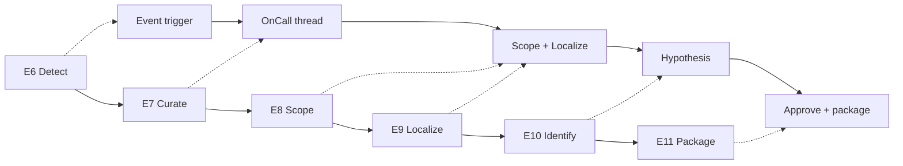
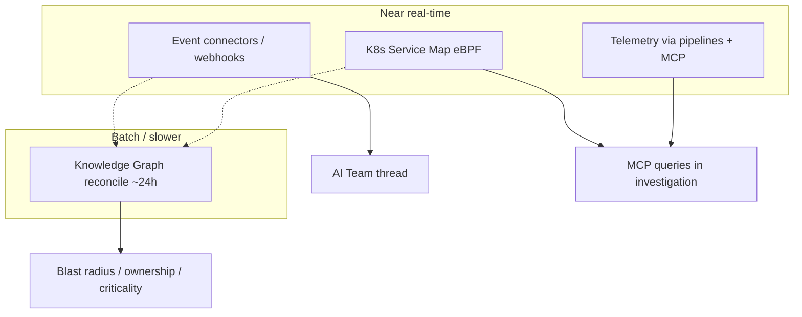
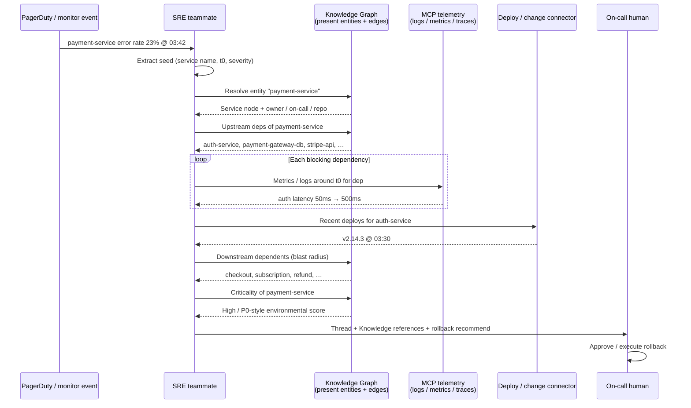
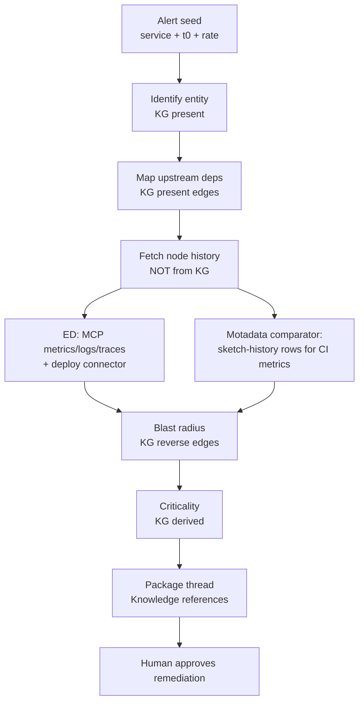

# ObserveOps E6–E11 ↔ Edge Delta AI Team lifecycle

**Purpose:** Map Motadata / ObserveOps case stages (**Detect → Curate → Scope → Localize → Identify → Package**) onto Edge Delta’s documented **AI Team investigation lifecycle**, and record where the fit is strong vs partial — including **alert-storm / thread creation**, **Knowledge Graph freshness**, **event / signal field shapes**, **how teammates use the Knowledge Graph**, and a **worked checkout-failure scenario** from Edge Delta AI.

**Status:** Verification note from Edge Delta AI Team product answers + prior research in this repo. Comparator only — not a decision to replace the Motadata build path.

**Related reading:**

| Document | Role |
|----------|------|
| [`docs/anomaly-detection.md`](docs/anomaly-detection.md) | How Edge Delta detects (baselines, monitors, edge vs platform) |
| [`pillar-ab-implementation/pillar-b/references/ED-MD-New.md`](pillar-ab-implementation/pillar-b/references/ED-MD-New.md) | Broader Edge Delta ↔ Motadata concept map |
| [`docs/observeops/OBSERVEOPS_PIPELINE_HLD.md`](docs/observeops/OBSERVEOPS_PIPELINE_HLD.md) | Canonical E1–E11 definitions |
| [Knowledge Graph](https://docs.edgedelta.com/knowledge-graph/) | Official freshness / reconcile statements |
| [Interpret Data Items](https://docs.edgedelta.com/data-item/) · [Data Item Examples](https://docs.edgedelta.com/data-item-examples/) | `_type`, event/signal shapes |
| [Parse Severity](https://docs.edgedelta.com/parse-severity-processor/) | Canonical `severity_text` levels |

---

## Contents

1. [Quick map](#1-quick-map)
2. [What each side means](#2-what-each-side-means)
3. [Stage-by-stage fit](#3-stage-by-stage-fit)
4. [Edge Delta lifecycle (their terms)](#4-edge-delta-lifecycle-their-terms)
5. [What the comparison confirms](#5-what-the-comparison-confirms)
6. [Gaps and caution flags](#6-gaps-and-caution-flags)
7. [E7 deep dive — one thread per event](#7-e7-deep-dive--one-thread-per-event)
8. [Knowledge Graph freshness (24-hour reconcile)](#8-knowledge-graph-freshness-24-hour-reconcile)
9. [Events, signals, and `_type` values](#9-events-signals-and-_type-values)
10. [Knowledge Graph I/O for AI teammates](#10-knowledge-graph-io-for-ai-teammates)
11. [Worked example — checkout failure](#11-worked-example--checkout-failure)
12. [Prompts used with Edge Delta AI](#12-prompts-used-with-edge-delta-ai)

---

## 1. Quick map

```text
ObserveOps / Motadata          Edge Delta AI Team (product language)
─────────────────────          ─────────────────────────────────────
E6 Detect               →      Event trigger (monitor / connector)
E7 Curate               →      Thread + OnCall orchestration     ← loosest fit
E8 Scope                →      Scoping (Knowledge Graph + MCP)
E9 Localize             →      Localization (KG neighborhood + MCP)
E10 Identify            →      Root-cause hypothesis (+ Sandbox)
E11 Package             →      Proposed actions → approval → packaged outputs
```



---

## 2. What each side means

### ObserveOps stages (this repo)

| Stage | Job in one line |
|-------|-----------------|
| **E6 Detect** | Something is wrong — raw alerts / anomalies fire |
| **E7 Curate** | Storm of related Detect signals → **one honest seed** `(CI, signal, t0)`; quality / GT handling |
| **E8 Scope** | Time window, severity, in-scope services / environment |
| **E9 Localize** | Suspect configuration item (or service) + neighborhood on the CI graph |
| **E10 Identify** | Failure class / root-cause hypothesis with evidence |
| **E11 Package** | Human-ready verdict / handoff (card, ticket, incident update) |

### Edge Delta AI Team stages (product answer)

| Stage | Job in one line |
|-------|-----------------|
| **Event trigger** | Monitor or event connector fires → AI Event destination → OnCall AI opens a thread |
| **Orchestration** | OnCall routes to SRE / Security / other teammates (can run in parallel) |
| **Scoping & localization** | Knowledge Graph (deps, blast radius, criticality) + MCP telemetry queries |
| **Hypothesis** | Correlate logs, metrics, traces, patterns, events, code/infra connectors; optional Sandbox |
| **Approval gate** | Guardrails trust ladder; write actions may wait for human approval |
| **Packaging** | Thread summary, Jira/Linear, PagerDuty note, Slack/Teams |

---

## 3. Stage-by-stage fit

| Your stage | What you mean | Edge Delta equivalent | Fit |
|------------|---------------|----------------------|-----|
| **E6 Detect** | Something is wrong | Monitor (Pattern Anomaly, Metric Threshold, Composite, …) or connector payload → ingestion → AI Event destination → OnCall thread + priority badge | **Strong** |
| **E7 Curate** | Storm → one honest seed | Thread creation + OnCall routing; parallel teammates on one thread | **Partial** — default is **one thread per event**; not a formal `(CI, signal, t0)` seed. See [§7](#7-e7-deep-dive--one-thread-per-event) |
| **E8 Scope** | Time window, severity, in-scope set | Priority badge; KG criticality; MCP time-bounded queries; `service.name` / env facets | **Strong** (happens inside teammate work; not a named “Scope” product stage) |
| **E9 Localize** | Suspect CI + neighborhood | KG: suspect service, dependencies, blast radius; MCP: logs, metrics, events, K8s service map | **Strong** (service / KG entity, not Motadata `ci_id`); KG may lag — see [§8](#8-knowledge-graph-freshness-24-hour-reconcile) |
| **E10 Identify** | Failure class / root-cause hypothesis | Cross-signal correlation + optional Sandbox → cited timeline + hypothesis | **Strong** |
| **E11 Package** | Human-ready verdict / handoff | Thread summary; Jira/Linear; PagerDuty note; Slack; approval history | **Strong** |

---

## 4. Edge Delta lifecycle (their terms)

Condensed from the Edge Delta AI Team answer used for this verification.

### 4.1 Sequence

1. **Event trigger** — Pattern Anomaly / Metric Threshold / Composite monitor, or connector (PagerDuty, GitHub, AWS, …) → ingestion pipeline → AI Event destination → OnCall AI creates a channel thread and may assign priority (e.g. P0/P1/P2).  
2. **Orchestration** — OnCall evaluates context and routes to specialized teammates (SRE, Security Engineer, Code Analyzer, Work Tracker, …); multiple teammates may run in parallel.  
3. **Scoping & localization** — Knowledge Graph for topology context; Edge Delta MCP for logs, patterns, metrics, anomaly events, service map; teammates cite **Knowledge references** in the thread.  
4. **Root-cause hypothesis** — Correlate logs, metrics, traces, events, code changes, infra state; Sandbox may run scripts when payloads are large; timeline with citations.  
5. **Proposed actions & approval** — Mitigations, tickets, notifications, draft PRs; Guardrails (described as L0–L4) gate writes; thread may show “Waiting for approval”.  
6. **Packaging** — Thread summary (symptoms, impact, root cause, actions, next steps) plus ticket / incident update / chat outputs; scores, token usage, approval history may appear on the thread.

### 4.2 Agent vs backend

| Component | Where | Role |
|-----------|-------|------|
| Edge Delta agent | Customer infra | Collect / process / stream telemetry (not AI reasoning) |
| Edge Delta backend | Edge Delta cloud | AI inference, Knowledge Graph, Sandbox, telemetry query store, event-connector ingestion |
| Streaming connectors | Agent / pipeline path | Continuous telemetry into the platform |
| Event connectors | Backend (MCP-style) | External events in; tools for teammates to act back |
| Edge Delta MCP Connector | AI Team ↔ backend | Query logs, metrics, traces, patterns, events, pipelines |

**Key point from the product answer:** all teammate reasoning runs in the **backend**. Agents are collectors and processors.

### 4.3 What needs human approval (default posture)

| Usually allowed without approval | Typically needs approval |
|----------------------------------|---------------------------|
| Read-only queries (telemetry, dashboards, Knowledge Graph, list issues/PRs) | Writes: create/update tickets, merge PRs, deploy pipelines, restart services, IAM changes |
| | Tools set to **Ask Permission** in connector settings |
| | Infra changes expected in channels (visibility), not only DMs |

Humans review in Activity / Guardrails approval queue / thread badge → approve, modify, or reject.

---

## 5. What the comparison confirms

Aligned with this repo’s Edge Delta research notes:

- Agents do **not** reason; AI runs on the **backend**.
- **Knowledge Graph** supplies topology / blast radius / ownership context; **MCP** supplies telemetry search.
- **Two ingress paths:** monitors (and related signals) **and** event connectors.
- **Human gate** on write actions (Guardrails); outputs land as thread / ticket / incident / chat.

---

## 6. Gaps and caution flags

| Flag | Why it matters for Motadata |
|------|-----------------------------|
| **E7 is the weakest match** | Default is **one thread per event**, not Curate’s “storm → one seed”. Correlation is mostly **inside** threads or via **Composite Monitors**. See [§7](#7-e7-deep-dive--one-thread-per-event). |
| **No `ci_id` / CMDB seed** | Localization is `service` + Knowledge Graph entities, not Motadata configuration-item identity. |
| **KG freshness** | Full re-reconcile is **daily**; brand-new entities may lack KG blast radius / ownership until then. Telemetry and K8s service map can still work. See [§8](#8-knowledge-graph-freshness-24-hour-reconcile). |
| **`_type` ≠ Motadata signal_class** | Edge Delta `_type` is the OTEL-shaped **data item kind** (`log` / `metric` / `event` / `signal` / …). See [§9](#9-events-signals-and-_type-values). |
| **KG access is implicit** | No public MCP tools for blast radius / neighbors; teammates use a built-in capability. See [§10](#10-knowledge-graph-io-for-ai-teammates). |
| **Sandbox / L0–L4 / example narrative** | Useful product story; spot-check against current docs before locking an ADR. |
| **Connector split** | Streaming (telemetry) vs event (AI triggers/tools) should stay distinct in comparator docs. |

---

## 7. E7 deep dive — one thread per event

**Question asked:** When several related monitors fire within minutes, does AI Team open one thread or many? Is there pre-creation dedupe?

**Product answer (condensed):** Edge Delta prioritizes **immediate thread-per-event** over wait-and-correlate grouping.

### 7.1 Thread creation

| Claim from product answer | Implication for E7 |
|---------------------------|--------------------|
| OnCall AI creates a **thread for each event** that passes pipeline filters | No Motadata-style “one honest seed” at ingest |
| Channel chosen by AI classification + rules (connector metadata / content) | Routing ≠ correlation |
| **No** documented pre-creation deduplication across related monitors | Storm of three monitors → **three threads** by default |

**Example**

```text
9:00  Pattern Anomaly on payment-service     → Thread 1
9:01  Metric Threshold on checkout-service   → Thread 2
9:02  Composite health monitor               → Thread 3   (unless designed to replace 1+2)
```

### 7.2 Where correlation *does* happen

| Mechanism | When | Effect |
|-----------|------|--------|
| **Inside the thread** | After creation | Teammates query cross-service logs/metrics; KG blast radius; cite related threads; Sandbox over a window |
| **Composite Monitors** | Pre-notification | AND/OR across child monitors → **one** composite alert → **one** thread when the composite fires |
| **Human merge** | Manual | Reference other threads; ask OnCall to consolidate findings; resolve duplicates by hand |
| **Silencing** | Connector events | Low-priority **external** connector events may be stored without full investigation. Product answer: **monitor-triggered alerts are never silenced** |

### 7.3 Composite Monitors as a partial Curate substitute

Composite monitors correlate **signals before alert**, not threads after the fact.

| Situation | Without composite | With composite |
|-----------|-------------------|----------------|
| Two related thresholds fire together | Two threads | Often **one** composite thread with combined context |
| Sub-monitors fire far apart | Separate threads | Depends on AND vs OR and whether both are “triggered” together |

Useful for Motadata comparison: Composite Monitors ≈ **pre-seed correlation of known couples**, not a general Detect-storm curator.

### 7.4 Design trade-off (as framed by Edge Delta AI)

| Approach | Pros | Cons |
|----------|------|------|
| **Thread-per-event (current)** | Fast open; clear audit per trigger; parallel teammates | Alert fatigue; duplicate work; more tokens |
| **Smart grouping (hypothetical)** | One investigation; less noise | Wait window; wrong merges; more state |

**Not described as available:** time-window auto-group, topology auto-merge of threads, LLM thread dedupe, retroactive merge.

### 7.5 Practical mitigations (from product answer)

1. **Composite Monitors** for known related conditions.  
2. **Same channel** for related services so humans see threads together.  
3. **Knowledge Graph / K8s service map** inside each investigation for cross-service context.  
4. **Pipeline filters** on the AI ingestion path to drop noise (e.g. `*-dev-*`) — fewer threads, still no auto-correlate.  
5. **Activity review** — manually point OnCall at related threads.

### 7.6 Motadata takeaway (E7)

| Motadata Curate | Edge Delta default |
|-----------------|--------------------|
| Many Detect alerts → **one seed** before diagnose | Many events → **many threads**; correlate later or design composites up front |
| Explicit seed contract `(CI, signal, t0)` | Thread + priority + channel; no CI seed object |

If Motadata requires storm→seed, that is a **product differentiator**, not something to assume Edge Delta AI Team already does.

---

## 8. Knowledge Graph freshness (24-hour reconcile)

**Concern:** If reconciliation is every **24 hours**, do new entities/relationships miss RCA until the next cycle? What storage/tech does that imply?

### 8.1 Documented vs inferred

| Statement | Status |
|-----------|--------|
| After you **connect a connector**, mapping starts in ~**3 minutes** | **Documented** ([Knowledge Graph](https://docs.edgedelta.com/knowledge-graph/)) |
| Graph **re-reconciles every 24 hours** | **Documented** |
| Stale facts removed on reconcile (not fixed TTL) | **Documented** |
| Most KG inputs are non-streaming event connectors; K8s service map is the streaming exception into the graph | **Documented** |
| Brand-new entity under an **already connected** connector appears only after next 24h pass | **Ambiguous** in public docs — Edge Delta AI treats this as a real gap; confirm with vendor |
| Physical store is S3+ETL / ClickHouse / Neo4j / … | **Not documented** — technology tables in AI answers are **speculation** |

### 8.2 Real-time vs batch paths (RCA fabric)



| Path | Freshness | Still usable for RCA? |
|------|-----------|------------------------|
| Event connectors | Seconds (webhooks) | Yes — trigger + tool calls |
| MCP telemetry | Continuous after ingest | Yes — logs / metrics / traces / patterns |
| K8s Service Map | Continuous traffic topology | Yes — live who-talks-to-whom; can feed KG |
| Knowledge Graph (most connectors) | ~3 min on connect; **daily** re-reconcile | **Partial** — may lack new nodes/edges for automated blast radius / ownership |

**Important:** RCA is **not only** the Knowledge Graph. Teammates can still investigate with MCP + connectors + (on K8s) service map. What may lag is **automated KG context** for facts not yet reconciled.

### 8.3 Example gap scenario (from Edge Delta AI)

```text
09:00  Deploy payment-processor-v2
09:15  PagerDuty: checkout-service 500s
09:16  OnCall + SRE investigate

Available immediately (typical):
  • Logs / metrics / K8s events via MCP
  • Live service-map edges (K8s / eBPF), if enabled
  • GitHub / PagerDuty connector tools (event-driven)

May be missing until reconcile (if mid-cycle discovery is batch-only):
  • KG service node for payment-processor-v2
  • KG blast radius / criticality including that node
  • New repo ↔ service or team ownership edges
```

Workarounds called out in the product answer: query telemetry by `service.name`; lean on live K8s map; use connector tools; pre-register entities in PagerDuty/Jira before deploy; manually state ownership/deps in the thread.

### 8.4 Volume / technology (design discussion — not ED docs)

| Estate | 24h KG cycle | Stance |
|--------|--------------|--------|
| &lt; ~1k entities, low churn | Often acceptable | Batch-friendly |
| Moderate churn / frequent deploys | Blind spots for KG-first localize | Hybrid freshness SLA; don’t rely on KG alone |
| High churn microservices | 24h too slow for KG-first | Event-driven graph or on-demand reconcile |

Hypothetical stores (Neo4j write-through, Neptune, DynamoDB+views, ClickHouse batch, Redis hot layer) are **architecture options for Motadata**, not confirmed Edge Delta internals. Prefer [Trust Center](https://trust.edgedelta.com/) DFD / Security Whitepaper for physical stores.

### 8.5 Motadata takeaway (E9 Localize)

| Decision | Implication |
|----------|-------------|
| Copy ED’s daily graph reconcile | Accept localize lag for new CIs unless another path is live |
| Motadata needs near-real-time neighborhood | Design explicit freshness (streaming edges, deploy hooks, on-demand rebuild) — do **not** inherit 24h by accident |

### 8.6 Questions still worth asking Edge Delta

```text
1) After a connector is already connected, when does a newly created entity
   (e.g. new PagerDuty service or GitHub repo) appear in the Knowledge Graph —
   within minutes, or only after the next 24-hour reconciliation?

2) Can reconciliation be triggered on-demand (e.g. post-deploy)?

3) How often does the Kubernetes Service Map update relative to Knowledge Graph
   reconciliation, and how quickly do those edges appear in the graph?

4) Do any webhook events write through to the Knowledge Graph immediately,
   or only into AI Team tools/threads until the next reconcile?
```

---

## 9. Events, signals, and `_type` values

**Question asked:** How does an event look (fields)? How is severity determined? What values can “signal type” take?

**Clarify vocabulary first**

| Phrase people say | What Edge Delta usually means |
|-------------------|-------------------------------|
| “Signal type” | Often the data-item field **`_type`** (`log`, `metric`, `event`, `signal`, …) — **not** Motadata `signal_class` |
| **Event** | Data item with `_type: "event"` (platform monitors, K8s inputs, connectors, …) |
| **Signal** | Separate data item `_type: "signal"` from **Threshold nodes** on **edge / Gateway pipelines** |
| **Alert** | Monitor **state** / notification language — not always a distinct `_type` |
| **`resource`** | OTEL-style **source tag map** on a data item — **not** a Knowledge Graph entity (see [§9.1](#91-core-fields-otel-shaped-data-items)) |

### 9.1 Core fields (OTEL-shaped data items)

From [Interpret Edge Delta Data Items](https://docs.edgedelta.com/data-item/) and [Data Item Examples](https://docs.edgedelta.com/data-item-examples/):

| Field | Role |
|-------|------|
| `_type` | **Data-item kind** for pipeline routing: `log`, `metric`, `event`, `signal`, … (see [§9.4](#94-_type-values-pipeline-routing)). This is **not** Motadata `signal_class` and **not** the same as `event_type`. |
| `timestamp` | Event time (docs: uint64 nanoseconds since Unix epoch on agent items; ingestion APIs may also accept RFC3339 strings) |
| `body` | Human-readable message / payload body |
| `severity_text` | Severity / level description (e.g. `ALERT`, `Warning`) |
| `resource` | Map of **source attributes / tags** (who / where: `service.name`, host, K8s pod, `ed.tag`, …). Answers “where did this telemetry come from?” |
| `attributes` | Item-specific metadata (monitor query, K8s reason, counts, …) |

**`resource` is not a Knowledge Graph entity.** In Edge Delta / OpenTelemetry, `resource` is a field map on the payload. A Knowledge Graph **entity** is a graph node (service, datastore, repository, …) used for ownership, dependencies, blast radius, and criticality. Investigation often **reads** a value from `resource` — especially `resource["service.name"]` — and **resolves** that string into a KG entity. The map itself is not the entity object.

```text
event or signal JSON
  └─ resource["service.name"] = "loggen"   ← tag on the data item
              │
              ▼  (resolution during investigation)
         KG entity: Service "loggen"       ← graph node + edges + citations
```

### 9.2 `event_domain` vs `event_type` vs `item.type` (these are three different jobs)

Do **not** treat these as synonyms. On event items they answer three separate questions:

| Field (as stored on the item) | Question it answers | Typical values | Search / CQL note |
|-------------------------------|---------------------|----------------|-------------------|
| **`event_domain`** | **Which product area** produced this event? | `"Monitor Alerts"`, `"K8s"` | CQL often uses `event.domain:"Monitor Alerts"` |
| **`event_type`** (top-level) | **What kind of event** inside that domain? | Monitors: `"metric_threshold"`, `"pattern_anomaly"`, `"log_threshold"`. K8s examples: reason-like values such as `"StorageReady"` | CQL often uses `event.type:"metric_threshold"` |
| **`attributes["item.type"]`** | Optional **tag** that this attributes blob is an event-shaped payload | Usually `"event"` on K8s event examples | **Not** used to classify monitor kind; ignore when routing RCA logic |

**Naming collision to watch (Kubernetes path only):**

| Location | Example value | Meaning |
|----------|---------------|---------|
| Top-level `event_type` | `"StorageReady"` | Edge Delta’s event kind for this item (aligned with K8s **reason**) |
| `attributes["event.reason"]` | `"StorageReady"` | Original Kubernetes **reason** |
| `attributes["event.type"]` | `"Warning"` | Original Kubernetes **type** (Normal / Warning) — **not** the same as top-level `event_type` |

**Ingestion API** examples sometimes send dotted keys (`event.domain`, `event.type`) in the request body; stored monitor/K8s examples in docs often show underscore top-level keys (`event_domain`, `event_type`). Same ideas — different wire spellings. Prefer Live Capture / `discover_schema` for your org’s actual keys.

#### Production-shaped example A — Metric Threshold monitor fired

Source: [Data Item Examples → Monitor Event](https://docs.edgedelta.com/data-item-examples/). Service `loggen` breached `error-logs-per-minute > 55`.

```json
{
  "timestamp": 1749076918758,
  "event_domain": "Monitor Alerts",
  "event_type": "metric_threshold",
  "severity_text": "ALERT",
  "body": "Legacy Integration for ed.tag:slacker,service.name:loggen",
  "resource": {
    "ed.monitor.id": "2y2B1q3XZrvz0rOZuLLxVaneU4T",
    "event.name": "Legacy Integration",
    "service.name": "loggen"
  },
  "attributes": {
    "ed.monitor.evaluated.value": "58.40",
    "ed.monitor.group.name": "ed.tag:slacker,service.name:loggen",
    "ed.monitor.notification.message": "**error-logs-per-minute** for **ed.tag:slacker,service.name:loggen** **>** **55** **avg** within the last **5m0s** …",
    "ed.monitor.query": "sum:error-logs-per-minute{*} by {service.name,ed.tag}.rollup(60)",
    "ed.monitor.type": "metric_threshold",
    "event.id": "2y3xCiyH6LLBI3c8MUziduzneim"
  }
}
```

How to read it:

| Field | Value here | Plain meaning |
|-------|------------|---------------|
| `event_domain` | `Monitor Alerts` | Came from an Edge Delta **monitor**, not from the Kubernetes API |
| `event_type` | `metric_threshold` | This monitor kind is a **metric threshold** breach (not pattern anomaly, not K8s) |
| `item.type` | *(absent)* | Not needed on this path |
| Seed for KG / RCA | `resource["service.name"]` = `loggen` | Structured service id; metric value in `attributes["ed.monitor.evaluated.value"]` = `58.40` |

#### Production-shaped example B — Kubernetes cluster event

Source: same docs page, Kubernetes Event Item (EKS node monitoring agent reporting I/O delay).

```json
{
  "timestamp": 1749079970000,
  "event_domain": "K8s",
  "event_type": "StorageReady",
  "severity_text": "Warning",
  "body": "IODelays: Process (kworker/u8:1-xfs-cil/nvme0n1p1) (PID 1757759) incurred 10.5 seconds of I/O delay",
  "resource": {
    "ed.source.type": "k8s_event_input",
    "ed.tag": "k8s-onboarding-demo",
    "host.name": "ip-10-0-1-112.us-west-2.compute.internal",
    "k8s.node.name": "ip-10-0-1-204.us-west-2.compute.internal",
    "service.name": ""
  },
  "attributes": {
    "event.count": "10",
    "event.reason": "StorageReady",
    "event.source.component": "eks-node-monitoring-agent",
    "event.type": "Warning",
    "item.type": "event"
  }
}
```

How to read it:

| Field | Value here | Plain meaning |
|-------|------------|---------------|
| `event_domain` | `K8s` | Came from **Kubernetes events**, not from a metric monitor |
| `event_type` (top-level) | `StorageReady` | ED’s kind for this item ≈ K8s **reason** |
| `attributes["event.type"]` | `Warning` | K8s Normal/Warning — **different field** |
| `attributes["item.type"]` | `event` | Marks attributes as event-shaped; **does not** replace `_type` or `event_domain` |
| Seed for KG / RCA | Often **empty** `service.name` | Use node / host / namespace from `resource`, or correlate via MCP — do not invent a service from `event_type` |

#### One-line rule

```text
event_domain  = which factory built it   (Monitor Alerts | K8s | …)
event_type    = which product SKU it is  (metric_threshold | pattern_anomaly | StorageReady | …)
item.type     = optional attribute tag   (usually "event" on K8s items — ignore for classification)
_type         = data-item pipe kind      (event | signal | log | …)  ← separate axis entirely
```

### 9.3 Where `event` vs `signal` JSON is used (edge vs platform)

Same “something breached a rule” idea can surface as two different JSON shapes, produced in different places:

| Shape | Produced by | Where it runs | Typical consumers |
|-------|-------------|---------------|-------------------|
| **Monitor `event`** (`event_domain: "Monitor Alerts"`, `event_type` like `metric_threshold` / `pattern_anomaly`) | **Platform (SaaS) monitors** | Edge Delta cloud evaluates metrics / patterns | Event search, notifications, AI Team / OnCall trigger from monitor fires |
| **`signal`** (`_type: "signal"` + nested `signal` object) | **Pipeline Threshold node** | **Node agent or Gateway** pipeline config | Trigger destinations (Slack, webhook, …) for edge-local threshold rules |
| **Other `event`s** (e.g. `event_domain: "K8s"`) | Kubernetes / connector **inputs** | Collected at the **edge**, stored/searched as events | Event search, correlation — **not** the Threshold `signal` schema |

```text
Platform path:   telemetry in SaaS → Monitor evaluates → EVENT json  → AI Team / notifications
Pipeline path:   metrics on Node/Gateway → Threshold node → SIGNAL json → Slack / webhook / …
K8s path:        k8s_event_input on agent → EVENT json (domain K8s) → event search / correlation
```

**Rule of thumb (detectors):**

- **`signal`** ≈ threshold evaluation on the **edge / Gateway** pipeline  
- **Monitor `event`** ≈ threshold / anomaly evaluation on the **platform (SaaS)**  
- **`event` as a data-item kind** is broader than “SaaS only” — Kubernetes and connector events are still `_type`-style **events**, not `signal`

**Pipeline threshold signal** example (`_type: "signal"` — no `event_domain` / `event_type`):

```json
{
  "_type": "signal",
  "timestamp": 1749030386195,
  "resource": { "service.name": "loggen", "ed.source.type": "kubernetes_input" },
  "attributes": {},
  "signal": {
    "title": "Threshold -threshold-checker triggered",
    "description": "error-logs-per-minute hit threshold … value 55.00",
    "signal_id": "111022",
    "name": "error-logs-per-minute",
    "value": 55,
    "threshold_condition": "value > 5"
  }
}
```

**Ingestion API sketch** (dotted keys on the wire; same concepts as `event_domain` / `event_type` for custom/platform ingest):

```json
{
  "body": "This is a mock K8s event.",
  "timestamp": "2026-09-16T10:00:00Z",
  "event.type": "Mock",
  "event.domain": "K8s",
  "severity_text": "Normal",
  "attributes": { "event.count": "1" }
}
```

### 9.4 `_type` values (pipeline routing)

Product / docs answers list these data-item kinds (confirm against current [Data Item](https://docs.edgedelta.com/data-item/) pages if an ADR depends on an exotic type):

| `_type` | Meaning |
|---------|---------|
| `log` | Log records |
| `metric` | Metrics |
| `trace` | Traces / spans |
| `event` | Events (monitors, K8s, connectors, …) |
| `signal` | Threshold-node outputs (edge alerts) |
| `cluster_pattern_and_sample` | Pattern payloads (legacy / pattern path) |
| `health` | Agent / component health |
| `custom` | Non-standard schemas (when used) |

These values drive **processor / destination routing**, not Motadata Collect `signal_class`.

### 9.5 How severity is determined

| Source | How `severity_text` (or related) is set |
|--------|----------------------------------------|
| **Monitor events** | From monitor configuration / trigger state (product answer examples use values like `"ALERT"` when thresholds breach; treat exact strings as source-specific) |
| **Kubernetes events** | From the K8s event itself (e.g. Normal / Warning; Error where present) |
| **Custom / enriched** | OTTL or processors can set severity-related attributes or `severity_text` |
| **Parse Severity processor** | Maps a parsed field onto **canonical** Edge Delta levels: `trace`, `debug`, `info`, `warn`, `error`, `fatal` ([Parse Severity](https://docs.edgedelta.com/parse-severity-processor/)) |

**Motadata note:** Do not assume one global enum equals Motadata severity. Monitor `"ALERT"` and Parse Severity `"fatal"` / `"error"` are different conventions until you normalize in a processor.

### 9.6 What an event can give you (structured vs narrative)

Events are **OTEL-shaped JSON data items** (`_type: "event"` or related `_type: "signal"`). What you can rely on depends on the source:

| Kind of fact | Where it lives | Reliable as a field? |
|--------------|----------------|----------------------|
| **When** it happened | `timestamp` (nanoseconds / epoch; APIs may accept RFC3339) | Yes — always present on data items |
| **How bad** | `severity_text` (monitor / K8s / Parse Severity) | Yes — when the source sets it |
| **What factory / SKU** | `event_domain` + top-level `event_type` (see [§9.2](#92-event_domain-vs-event_type-vs-itemtype-these-are-three-different-jobs)) | Yes — on monitor / K8s-style events |
| **Human message** | `body` (and often notification message attrs) | Yes as text; **not** pre-parsed into `service_name` / `error_rate` |
| **Service / host identity** | `resource["service.name"]`, K8s / host attrs | **Sometimes** — present when the monitor query or source tags include them; empty on some K8s examples |
| **Threshold number** | On `_type: "signal"`: `signal.value`, `signal.name`, `threshold_condition`; on monitor events: attrs like `ed.monitor.evaluated.value` | Yes when that source path is used |
| **Monitor query / links** | Attributes such as monitor query, explorer URL, priority (source-specific) | Often yes on monitor events — exact key names vary |

**PagerDuty-style title in §11** (`"Payment Service Error Rate Spiked to 23%"` at 3:42 AM):

| Derived meaning | Clear to a human / LLM? | Structured field on the event? |
|-----------------|-------------------------|--------------------------------|
| Service ≈ payment-service | Yes — from title / body text | **Only if** also present as `resource.service.name` (or similar); otherwise the teammate **extracts** it from text |
| Error rate ≈ 23% spike | Yes — from title / body text | **Only if** a monitor/signal attribute carries the value (Threshold `signal.value` or `ed.monitor.evaluated.value` style); otherwise narrative parse |
| Incident time ≈ 3:42 AM | Yes — wall-clock story | Prefer **`timestamp`** on the data item; “3:42 AM” is presentation |

So: those three facts are the **right seed for investigation**, but they are not automatically three named fields like `service_name` / `Error_rate` / `Incident_Time`. Structured Edge Delta events give you `timestamp` + `body` + `severity_text` + `resource` / `attributes` (and for signals, `signal.*`). Free-text titles still need **entity / metric extraction** before the Knowledge Graph lookup.

### 9.7 Motadata takeaway (E6 Detect ingress)

| Motadata idea | Edge Delta analogue |
|---------------|---------------------|
| Typed Collect classes | `_type` + `event_domain` / `event_type` (+ resource attrs) — three axes, not one |
| Severity on the seed | `severity_text` from monitor / K8s / Parse Severity — normalize explicitly if you need one scale |
| Detect “signal” | Often a **monitor event** (SaaS) or a pipeline **`signal`** (edge/Gateway) — two different `_type`s / producers |
| CI / entity on the seed | Prefer `resource["service.name"]` (or NLP on `body`) → **resolve** to a Knowledge Graph entity; do not treat `resource` as the entity |
| Seed fields from alert text | Prefer structured `resource` / `signal.*` / `ed.monitor.*`; fall back to NLP on `body` |

---

## 10. Knowledge Graph I/O for AI teammates

**Question asked:** For KG capabilities (suspect service, dependencies, blast radius, criticality) — what does the teammate **input**, and what does the graph **return** / how is it prepared?

### 10.1 How “querying” the Knowledge Graph works

There is **no customer-facing Cypher / graph-QL / MCP “query_kg” tool** in the public catalog. During an investigation the teammate uses the graph as a **built-in capability**:

1. **Seed** — resolve a string to an entity (`payment-service` from alert text, `service.name` from logs/metrics, PagerDuty-linked service, user question).
2. **Internal lookups** — ask the graph for that entity’s metadata, upstream dependencies, downstream dependents (blast radius), and criticality.
3. **Cite** — write **Knowledge references** (entity, source, confidence, context trail) into the thread.
4. **Enrich with MCP** — separate tools (`get_log_search`, metrics, traces, …) pull telemetry for the **same names**; those are not KG queries.

| Aspect | Documented / product answer |
|--------|-----------------------------|
| How teammates call the graph | **Implicit / built-in** during investigation — **not** listed as separate MCP tools like `get_log_search` |
| How entities are found | From context already in the case: `service.name` in telemetry, monitor text, user question, PagerDuty-linked service, … |
| Manual Cypher / graph API for customers | **Not** in public MCP tool catalog |
| Citations | Thread **Knowledge references** + context trail; facts carry **source** + **confidence** |
| What you “query with” | An **entity identity** (service name / component), not a free-form graph language |
| What you get back | Entity node + edges (deps / dependents) + criticality + provenance — see [§10.2](#102-capability-io-table) and [§11](#11-worked-example--checkout-failure) |

```text
Event / alert / user text
        │
        ▼
  Extract / resolve entity name
  (structured resource.service.name  OR  NLP on body)
        │
        ▼
  Knowledge Graph (internal — not MCP)
        │
        ├── entity + metadata
        ├── upstream dependencies
        ├── downstream blast radius
        └── criticality
        │
        ▼
  Cited in thread → then MCP for logs/metrics/traces
```

### 10.2 Capability I/O table

| Capability | Teammate “input” (seed) | Graph output (conceptual) | How it is prepared (docs + product answer) |
|------------|-------------------------|---------------------------|--------------------------------------------|
| **Identify suspect service** | Service / component id from logs, metrics, alert, question, incident link | Entity node + metadata (type, owner/team when known) + source/confidence | Discovers services from connectors + K8s service map into KG |
| **Map dependencies (upstream)** | Target service entity | What it depends on (services, datastores, external APIs, …) | K8s: eBPF service map; other: connector-discovered links; reconcile cadence applies ([§8](#8-knowledge-graph-freshness-24-hour-reconcile)) |
| **Compute blast radius (downstream)** | Failing / degraded service | Downstream dependents, often ranked by proximity / dependence | Traversal from the entity along reverse dependency edges (exact ranking algorithm **not** fully specified in public docs) |
| **Assess criticality** | Service / entity | Criticality reflecting **environmental dependence**, not mere degree; Topology View sizes nodes by criticality | Docs: criticality ≠ “well connected only”; product answers describe dependency-impact style scoring — treat formulas as **inferred** until vendor confirms |

### 10.3 Short flow (product narrative)

```text
Alert / question → resolve entity → upstream deps → blast radius → criticality
→ cite Knowledge references → MCP for logs/metrics/traces → hypothesis / actions
```

See the full worked scenario in [§11](#11-worked-example--checkout-failure).

### 10.4 Motadata takeaway (E8–E9)

| Motadata | Edge Delta |
|----------|------------|
| Explicit graph query / API in the diagnose path | **Opaque** teammate capability + UI Topology View |
| Seed CI + neighborhood as a first-class object | Entity resolution from strings + KG neighbors; no public `ci_id` |
| You own the graph store and refresh SLA | Vendor-hosted KG; 24h reconcile; live K8s map helps topology |
| Metric / baseline **history** on the CI (sketch-history) | **Not** in KG — teammate uses MCP telemetry (+ connectors for deploys). See [§11.7](#117-present-knowledge-graph-vs-history-stores) |

---

## 11. Worked example — checkout failure

**Source:** Edge Delta AI narrative (illustrative). JSON payloads below are **teaching shapes**, not a published public API schema. Capabilities (entity lookup, dependencies, blast radius, criticality, Knowledge references) match [Knowledge Graph](https://docs.edgedelta.com/knowledge-graph/) docs; numeric scores and exact field names are product-story detail.

**Scenario:** E-commerce checkout failure at **3:42 AM**.  
PagerDuty: *"Payment Service Error Rate Spiked to 23%"*. SRE teammate in `#alerts` starts investigation.

**ObserveOps mapping (private):** E6 trigger → E8/E9 via KG steps → E10 hypothesis (auth latency) → E11 package + human approval on rollback.

**Interactive walkthrough:** open [ed-kg-checkout-investigation.canvas.tsx](/root/.cursor/projects/root-Harshil-PoCs-Unified-RCA/canvases/ed-kg-checkout-investigation.canvas.tsx) beside the chat for a step-by-step animation (entity → upstream → history → blast radius → criticality).

### 11.0 Detailed investigation sequence

Knowledge Graph steps are **present-tense topology**. Temporal behaviour (latency spike, error rate vs baseline, deploy time) is fetched from **other stores** — see [§11.7](#117-present-knowledge-graph-vs-history-stores).





### 11.1 Identify suspect service

**Input:** `"payment-service"` from alert text / `service.name:"payment-service"`.

**How this step works**

The teammate does **not** open a public graph query language. Entity resolution is a **built-in** investigation capability against Edge Delta’s Knowledge Graph (no `query_kg` MCP tool in the public catalog).

1. **Normalize the seed.** Prefer structured fields on the monitor/PagerDuty-linked event (`resource.service.name`, monitor group tags). If only a title exists (“Payment Service Error Rate…”), extract a candidate service id.
2. **Lookup the present graph node.** Ask the KG backend for an entity matching that name among services discovered from connectors and the Kubernetes service map.
3. **Hydrate metadata already joined on the node** — type, owner team, on-call, repository, environments — when connectors previously supplied them.
4. **Record provenance** (source + confidence + last_seen) for later Knowledge references.
5. **If the node is missing** (brand-new service mid reconcile cycle), continue with MCP + live K8s map by `service.name`; automated ownership / blast-radius enrichment may lag — see [§8](#8-knowledge-graph-freshness-24-hour-reconcile).

**Illustrative KG return:**

```json
{
  "entity": {
    "type": "Service",
    "name": "payment-service",
    "owner_team": "payments-team",
    "repository": "github.com/mycompany/payment-service",
    "on_call": "@sarah",
    "deployed_in": ["production", "us-east-1"]
  },
  "source": "Kubernetes service map (eBPF)",
  "confidence": "high",
  "last_seen": "2025-01-15T03:42:10Z"
}
```

**Teammate use:** Confirm entity exists; note owner / on-call; decide where to dig next.

### 11.2 Map dependencies (upstream)

**Input (conceptual):** What does `payment-service` depend on?

**How this step works**

This is a **present-tense edge walk**, not a live rediscovery of the whole estate inside the thread. Edges were already fused into the Knowledge Graph (and/or are visible on the live Kubernetes service map).

1. **Start at the resolved node** (`payment-service`).
2. **Traverse outbound dependency edges** — what this service calls, authenticates through, reads/writes, or notifies (synchronous vs async when labeled).
3. **Those edges were previously built from** Kubernetes eBPF service-map traffic, OTLP/trace-derived call relationships, cloud/HTTP connectors, and messaging subscriptions where configured.
4. **Prioritize blocking / synchronous neighbors** for the next telemetry checks; keep non-blocking (e.g. async fraud notify) visible but secondary.
5. **Optionally deepen one hop** (story: payment → auth → identity-db). Depth control is product-internal, not a documented customer parameter.
6. **Stop with a candidate neighborhood** — still no latency numbers; history comes in the next step.

**Illustrative KG return:**

```json
{
  "dependencies": [
    {
      "entity": "auth-service",
      "relationship": "authenticates_requests_via",
      "criticality": "blocking",
      "source": "trace analysis (OTLP connector)",
      "confidence": "high"
    },
    {
      "entity": "payment-gateway-db",
      "relationship": "reads_writes_data_to",
      "criticality": "blocking",
      "source": "Kubernetes service map",
      "confidence": "high"
    },
    {
      "entity": "stripe-api",
      "relationship": "external_api_call",
      "criticality": "blocking",
      "source": "AWS CloudWatch (HTTP call logs)",
      "confidence": "medium"
    },
    {
      "entity": "fraud-detection-service",
      "relationship": "async_notification",
      "criticality": "non-blocking",
      "source": "Kafka topic subscriptions",
      "confidence": "medium"
    }
  ],
  "dependency_chain": "payment-service → auth-service → identity-db",
  "dependency_depth": 2
}
```

**Teammate use:** Query each dependency via MCP. Narrative outcome: `auth-service` latency 50ms → 500ms; payment timeouts attributed to auth slowdown.

### 11.2b Fetch history for those nodes (not from the Knowledge Graph)

**Input:** Suspect + upstream entity names, and the alert window around **t0**.

**How this step works**

The Knowledge Graph told the teammate **where to look**. Time-series behaviour is fetched elsewhere — see [§11.7](#117-present-knowledge-graph-vs-history-stores).

1. **For each blocking dependency (and the suspect),** call MCP tools scoped by `service.name` and the t0 window: metrics (latency, error rate), logs (timeouts, 5xx), traces/spans when available.
2. **Compare recent behaviour to the prior baseline in that window** (story: auth ~50ms → ~500ms). Edge Delta does this from the telemetry store, not by time-traveling the KG.
3. **Pull change evidence** (GitHub / deploy connector) for the implicated service near t0 (story: auth-service v2.14.3 @ 03:30).
4. **Correlate topology + time:** payment timeouts waiting on auth + auth deploy → working root-cause hypothesis.
5. **Motadata comparator:** metric baseline history for a configuration item may come from **sketch-history** rows (Pillar A stores). That is **not** Edge Delta KG, and it is **not** topology edge history.

### 11.3 Compute blast radius (downstream)

**Input (conceptual):** What depends on `payment-service`?

**How this step works**

Blast radius is the **reverse** of upstream mapping: who will feel it if this node fails.

1. **From `payment-service`, walk inbound / “depends on me” edges** in the present Knowledge Graph (optionally reinforced by live K8s traffic neighbors).
2. **Assign distance:** direct callers = 1 (checkout, subscription, refund); transitive = 2+ (order-fulfillment via checkout).
3. **Enrich impact** when possible: customer-facing flag; traffic volume from **metrics MCP** (req/min) — those rates are not static KG schema fields.
4. **Aggregate scope** for the thread: count of services, estimated user impact (e.g. ~80% of checkout flows), severity language (P1/P0).
5. **Evidence bar:** public docs confirm blast-radius style localization; exact ranking weights (traffic × distance × criticality) are **not** fully published — treat numeric storytelling as illustrative.

**Illustrative KG return (abridged):**

```json
{
  "blast_radius": {
    "directly_affected": [
      {
        "entity": "checkout-service",
        "relationship": "calls_payment_api",
        "impact": "critical",
        "distance": 1,
        "traffic_volume": "15,000 req/min"
      },
      {
        "entity": "subscription-service",
        "relationship": "processes_renewals_via",
        "impact": "high",
        "distance": 1,
        "traffic_volume": "2,000 req/min"
      },
      {
        "entity": "refund-processor",
        "relationship": "initiates_refunds_via",
        "impact": "medium",
        "distance": 1,
        "traffic_volume": "500 req/min"
      }
    ],
    "indirectly_affected": [
      {
        "entity": "order-fulfillment",
        "relationship": "depends_on → checkout-service → payment-service",
        "impact": "high",
        "distance": 2
      },
      {
        "entity": "email-notification-service",
        "relationship": "depends_on → subscription-service → payment-service",
        "impact": "low",
        "distance": 2
      }
    ],
    "total_services_affected": 12,
    "estimated_user_impact": "~80% of checkout flows blocked",
    "customer_facing": true
  }
}
```

**Teammate use:** Raise priority (customer-facing checkout); estimate failed checkouts (e.g. 15,000 req/min × 23% ≈ 3,450/min in the story); call out downstream fulfillment impact.

### 11.4 Assess criticality

**Input (conceptual):** How critical is `payment-service`?

**How this step works**

Criticality answers: “If this node is impaired, how bad is it for the **environment**?” — not merely “how many edges does it have?”

1. **Derive from present graph + business context:** how many services depend on this node (direct + transitive), whether dependents are customer/revenue paths, and whether the dependency pattern is serial (checkout blocked) vs parallel (many callers can degrade independently).
2. **Docs stance:** criticality reflects **environmental dependence**; Topology View sizes nodes by criticality so UI and teammate narrative align.
3. **Emit a tier/score for packaging** (story: ~95 / P0). The exact scoring function is product-internal — cite numbers as narrative until vendor confirms.
4. **Drive escalation behaviour** (page on-call with high priority) rather than treating the alert as noisy monitoring.

**Illustrative KG return:**

```json
{
  "criticality_assessment": {
    "score": 95,
    "tier": "P0 - Business Critical",
    "reasoning": {
      "total_dependencies": 12,
      "customer_facing_services_affected": 3,
      "revenue_impact": "direct",
      "transitive_dependencies": 18,
      "percentage_of_environment": "22% of services depend on this"
    },
    "context": [
      "payment-service is a critical bottleneck - 22% of production services depend on it",
      "Unlike auth-service (many connections but parallel), payment-service is a serial dependency for checkout",
      "Failure causes cascade: payment → checkout → order-fulfillment → warehouse-integration"
    ]
  }
}
```

**Teammate use:** Treat as immediate escalation, not noise; page on-call with high priority.

### 11.5 Thread packaging (Knowledge references)

**How this step works**

1. **Merge** KG citations (entities, edge trail, source, confidence) with MCP/connector evidence (latency jump, timeout logs, deploy version).
2. **Write** root cause, blast radius, criticality, and a concrete recommended action in the investigation thread.
3. **Gate writes:** recommend rollback; do not execute deploy/restart/IAM changes without human approval (AI Team Guardrails pattern).
4. **Human closes the loop** (story: @sarah confirms auth DB pool exhaustion and rolls back).

Condensed channel outcome from the product story:

| Block | Content |
|-------|---------|
| **Root cause** | `auth-service` latency 10×; cascading timeouts in `payment-service` |
| **Impact** | ~3,450 failed checkouts/min; blast radius 12 services; ~80% checkout flows blocked |
| **Evidence (MCP / connectors)** | Timeout logs; `payment_api_p99_latency` jump; auth-service deploy v2.14.3 ~03:30 |
| **Recommendation** | Rollback auth-service to v2.14.2 (human decides) |
| **Knowledge references** | Entities + sources + confidence; context trail (payment → auth upstream → 12 downstream → criticality) |

**Human-in-the-loop:** On-call confirms (e.g. auth DB pool exhaustion) and executes rollback — teammate recommends; human acts.

### 11.6 Takeaways from this example

| Takeaway | Detail |
|----------|--------|
| No manual graph API | Graph use is **automatic** during investigation |
| Progressive context | Alert → entity → deps → **history from non-KG stores** → blast radius → criticality |
| Multi-source fusion | eBPF map, traces, GitHub deploy history, cloud/HTTP context |
| Transparent citations | Knowledge references show entities, sources, trail, confidence |
| Human gate | Analysis + recommend; human approves remediation |

**Freshness reminder:** This story assumes KG already knows `payment-service` / edges. A **brand-new** service may lack KG enrichment until reconcile — see [§8](#8-knowledge-graph-freshness-24-hour-reconcile). MCP + live K8s map can still carry the investigation.

### 11.7 Present Knowledge Graph vs history stores

**Yes — the Knowledge Graph is an at-the-moment view** of entities and relationships (with Edge Delta’s ~24h reconcile for most connectors; live K8s service map is the near-real-time topology exception). It does **not** store “what was this node’s latency yesterday” or “metric sketch rows over the last N days.”

| Question | Store that answers it | Edge Delta | Motadata ObserveOps (comparator) |
|----------|----------------------|------------|----------------------------------|
| Who is this service **now**? | Topology / entity graph | Knowledge Graph entity | Present configuration-item / map node |
| What does it depend on **now**? | Present edges | KG upstream (+ live K8s map) | Present topology edges |
| Who fails if it fails **now**? | Present reverse edges | KG blast radius | Reverse walk on present map |
| Was behaviour worse than baseline around **t0**? | **Time-series / sketches** | MCP metrics, logs, traces | **Sketch-history** rows for that configuration item (Pillar A E4 stores / E5 baselines) — **not** the topology graph |
| Did something **change** recently? | Change evidence | GitHub / change connectors | Deploy / change evidence (separate from sketch history) |

So for the checkout story:

1. **Identify / deps / blast radius / criticality** → Knowledge Graph (present).  
2. **Auth latency 50→500ms, error samples, deploy v2.14.3** → history / telemetry / change stores — **not** KG edge rows.  
3. On the Motadata build path, fetching **sketch-history** for the suspect configuration item (and its dependency CIs) is the right analogue for **metric baseline history**, not for reconstructing past topology. Topology history, if you need it, is a separate design choice (map snapshots) — do not overload sketch-history to mean “all node history.”

---

## 12. Prompts used with Edge Delta AI

Use **Edge Delta product terms only** in these prompts — do not mention E6–E11 or Motadata stage names when asking their assistant.

### 12.1 Lifecycle (E6–E11 overview)

```text
Using only Edge Delta terms: after a monitor or connector fires, how does AI Team
turn that into one investigation, scope it, localize the suspect service
(including Knowledge Graph if used), form a root-cause hypothesis from
logs/metrics/traces/patterns, and package a human-ready outcome (thread, ticket,
incident update)? Please list stages, components, and one concrete example.
Call out agent vs backend, and what needs human approval.
```

### 12.2 Thread storms (E7 Curate)

```text
When several Pattern Anomaly / Metric Threshold / Composite monitors fire within
a few minutes for related services, how does AI Team decide to open one
investigation thread versus many? Is there explicit alert deduplication or
correlation before OnCall AI creates the thread, or does grouping happen only
after routing inside the thread?
```

### 12.3 Knowledge Graph freshness (E9 context)

```text
The Knowledge Graph docs say discovery starts within about three minutes after
connecting a connector, and the graph re-reconciles every 24 hours. For an
already-connected connector, if a new service or relationship appears now, when
does it become available for AI Team blast radius / ownership / Knowledge
references — immediately, within minutes, or only after the next reconciliation?
How does that interact with the live Kubernetes Service Map?
```

### 12.4 Event fields, severity, and `_type`

```text
In Edge Delta data items, what are the core fields on an event? How is
severity_text set for monitor events vs Kubernetes events vs processors?
What are the valid values of _type (log, metric, event, signal, …)?
Please distinguish _type from event.domain / event.type, and show one
example event JSON and one example signal JSON from Threshold nodes.
```

### 12.5 Knowledge Graph I/O during investigation

```text
During an AI Team investigation, how does a teammate use the Knowledge Graph
to (1) identify a suspect service, (2) map upstream dependencies, (3) compute
blast radius, and (4) assess criticality? What is the input (e.g. service name
from telemetry), what is returned, and how is each result prepared? Are there
MCP tools for these operations, or is access built-in? How do Knowledge
references appear in the thread?
```

### 12.6 Worked scenario (checkout / payment)

```text
Walk through a concrete example: PagerDuty fires "Payment Service Error Rate
Spiked to 23%" at 3:42 AM. Show how the SRE teammate would use the Knowledge
Graph step by step to identify the suspect service, map upstream dependencies,
compute blast radius, and assess criticality — then how Knowledge references
would appear in the #alerts thread. Mark which details are product behavior
vs illustrative narrative.
```
