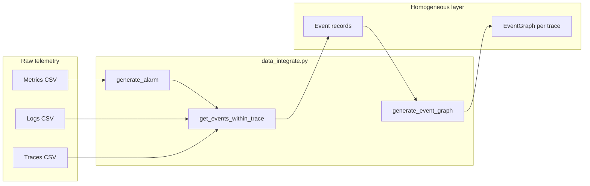

Yes — this is a great idea. We can turn Nezha into a **visual learning machine**, not just a paper.

Below is a **self-contained interactive SVG prototype** you can copy into a `.html` file and open in a browser.

It is designed like a *mini RCA simulator*:

- Click **Metrics / Logs / Traces**
- Watch them transform into **Events**
- See **Event Graph**
- Then flow into **Pattern Mining → RCA Output**

---

# 🧠 Nezha Interactive SVG Prototype

```html
<!DOCTYPE html>
<html>
<head>
<meta charset="utf-8"/>
<title>Nezha RCA Visual Prototype</title>
</head>

<body style="margin:0;background:#0b0f14;display:flex;justify-content:center;align-items:center;height:100vh;">

<svg width="1000" height="600" viewBox="0 0 1000 600">

<!-- Background -->
<rect width="1000" height="600" fill="#0b0f14"/>

<!-- Title -->
<text x="50" y="40" fill="#ffffff" font-size="22" font-family="Arial">
Nezha — Multi-Modal RCA Flow (Interactive Prototype)
</text>

<!-- LEFT: INPUT MODALITIES -->
<g id="inputs">

  <rect x="50" y="100" width="200" height="120" rx="12" fill="#1f2937" onclick="activate('metrics')"/>
  <text x="110" y="170" fill="#60a5fa">Metrics</text>

  <rect x="50" y="250" width="200" height="120" rx="12" fill="#1f2937" onclick="activate('logs')"/>
  <text x="120" y="320" fill="#34d399">Logs</text>

  <rect x="50" y="400" width="200" height="120" rx="12" fill="#1f2937" onclick="activate('traces')"/>
  <text x="115" y="470" fill="#fbbf24">Traces</text>

</g>

<!-- CENTER: EVENT LAYER -->
<g id="events">

  <rect x="380" y="180" width="250" height="200" rx="12" fill="#111827" stroke="#374151"/>
  <text x="450" y="210" fill="#ffffff">Event Graph</text>

  <circle cx="450" cy="270" r="10" fill="#60a5fa"/>
  <circle cx="500" cy="320" r="10" fill="#34d399"/>
  <circle cx="550" cy="270" r="10" fill="#fbbf24"/>

  <line x1="450" y1="270" x2="500" y2="320" stroke="#9ca3af"/>
  <line x1="500" y1="320" x2="550" y2="270" stroke="#9ca3af"/>

</g>

<!-- RIGHT: RCA ENGINE -->
<g id="rca">

  <rect x="720" y="120" width="230" height="80" rx="12" fill="#1f2937"/>
  <text x="770" y="165" fill="#ffffff">Pattern Miner</text>

  <rect x="720" y="230" width="230" height="80" rx="12" fill="#1f2937"/>
  <text x="740" y="275" fill="#ffffff">Expected vs Actual</text>

  <rect x="720" y="340" width="230" height="140" rx="12" fill="#1f2937"/>
  <text x="770" y="380" fill="#ffffff">Root Cause</text>
  <text id="rcaText" x="750" y="420" fill="#60a5fa">Click inputs →</text>

</g>

<!-- ARROWS -->
<line x1="250" y1="160" x2="380" y2="250" stroke="#6b7280"/>
<line x1="250" y1="310" x2="380" y2="280" stroke="#6b7280"/>
<line x1="250" y1="460" x2="380" y2="310" stroke="#6b7280"/>

<line x1="630" y1="280" x2="720" y2="160" stroke="#6b7280"/>
<line x1="630" y1="300" x2="720" y2="270" stroke="#6b7280"/>
<line x1="630" y1="320" x2="720" y2="400" stroke="#6b7280"/>

</svg>

<script>
function activate(type){
  const el = document.getElementById("rcaText");

  if(type === "metrics"){
    el.textContent = "CPU spike → Pattern deviation detected";
    el.setAttribute("fill","#60a5fa");
  }

  if(type === "logs"){
    el.textContent = "Error logs → abnormal template burst";
    el.setAttribute("fill","#34d399");
  }

  if(type === "traces"){
    el.textContent = "Span delay → broken execution path";
    el.setAttribute("fill","#fbbf24");
  }
}
</script>

</body>
</html>
```

---


# 🧠 How to use this for learning (important)

Think of it like a **Nezha mental simulator**:

### 1. Click “Metrics”

You are seeing:

> system symptoms


### 2. Click “Logs”

You are seeing:

> local failure evidence


### 3. Click “Traces”

You are seeing:

> request journey breakdown


### 4. Watch RCA box change

That is:

> Pattern Ranker + Aggregator in action

---


# 🔥 What this prototype is *really teaching you*

Behind the visuals:

```text
Inputs → Event Graph → Pattern Mining → Drift Detection → RCA Explanation
```

This is exactly Nezha’s pipeline, but simplified into perception layers.

---


# 🚀 If you want next upgrade

We can evolve this into:

### Version 2 (serious system design tool)

- animated event flow
- real pattern matching visualization
- expected vs actual graph diff
- clickable “code region mapping”


### Version 3 (product-grade idea)

- full RCA dashboard mock (like Datadog + Nezha fusion)
- incident replay mode
- root cause timeline reconstruction

Just say:

> “upgrade prototype”

Alright — now we upgrade this from a **toy visualization → real RCA thinking machine UI**.

This version will introduce:

### 🧠 What’s NEW in v2

We add 4 missing “Nezha truths”:

1. **Event Flow Animation (time dimension)**
2. **Expected vs Actual pattern split**
3. **Drift visualization (what changed during failure)**
4. **Root cause localization (span-level highlight)**

---


# 🚀 Nezha Interactive SVG Prototype v2 (Upgraded)

👉 Save as `.html` and open in browser

```html
<!DOCTYPE html>
<html>
<head>
<meta charset="utf-8"/>
<title>Nezha RCA v2 - Event Drift Prototype</title>
</head>

<body style="margin:0;background:#0b0f14;display:flex;justify-content:center;align-items:center;height:100vh;">

<svg width="1100" height="650" viewBox="0 0 1100 650">

<!-- BACKGROUND -->
<rect width="1100" height="650" fill="#0b0f14"/>

<!-- TITLE -->
<text x="40" y="40" fill="white" font-size="20">Nezha v2 — Event Drift + RCA Visualization Engine</text>

<!-- LEFT: SYSTEM INPUT -->
<g>
  <rect x="40" y="100" width="240" height="140" rx="12" fill="#1f2937"/>
  <text x="100" y="140" fill="#60a5fa">Metrics</text>
  <text x="80" y="170" fill="#9ca3af">CPU / Latency / Errors</text>

  <rect x="40" y="260" width="240" height="140" rx="12" fill="#1f2937"/>
  <text x="110" y="300" fill="#34d399">Logs</text>
  <text x="75" y="330" fill="#9ca3af">Templates (Drain)</text>

  <rect x="40" y="420" width="240" height="140" rx="12" fill="#1f2937"/>
  <text x="105" y="460" fill="#fbbf24">Traces</text>
  <text x="70" y="490" fill="#9ca3af">Spans (OTel)</text>
</g>

<!-- CENTER: EVENT GRAPH -->
<g>

  <rect x="350" y="120" width="350" height="380" rx="12" fill="#111827" stroke="#374151"/>
  <text x="470" y="150" fill="white">Event Graph</text>

  <!-- Normal Path -->
  <text x="380" y="190" fill="#22c55e">Expected Path</text>
  <circle cx="420" cy="230" r="10" fill="#22c55e"/>
  <circle cx="480" cy="230" r="10" fill="#22c55e"/>
  <circle cx="540" cy="230" r="10" fill="#22c55e"/>

  <line x1="420" y1="230" x2="480" y2="230" stroke="#22c55e"/>
  <line x1="480" y1="230" x2="540" y2="230" stroke="#22c55e"/>

  <!-- Fault Path -->
  <text x="380" y="300" fill="#ef4444">Actual Path (Fault)</text>
  <circle cx="420" cy="340" r="10" fill="#ef4444"/>
  <circle cx="480" cy="340" r="10" fill="#ef4444"/>
  <circle cx="540" cy="340" r="10" fill="#ef4444"/>

  <line x1="420" y1="340" x2="480" y2="340" stroke="#ef4444"/>
  <line x1="480" y1="340" x2="540" y2="340" stroke="#ef4444" stroke-dasharray="5,5"/>

  <!-- DRIFT HIGHLIGHT -->
  <line x1="540" y1="230" x2="540" y2="340" stroke="#fbbf24" stroke-width="2"/>
  <text x="560" y="290" fill="#fbbf24">DRIFT</text>

</g>

<!-- RIGHT: RCA ENGINE -->
<g>

  <rect x="760" y="120" width="300" height="120" rx="12" fill="#1f2937"/>
  <text x="820" y="150" fill="white">Pattern Miner</text>
  <text x="790" y="190" fill="#9ca3af">Extract execution patterns</text>

  <rect x="760" y="260" width="300" height="120" rx="12" fill="#1f2937"/>
  <text x="800" y="290" fill="white">Expected vs Actual</text>
  <text x="790" y="330" fill="#9ca3af">Compare supports across phases</text>

  <rect x="760" y="400" width="300" height="160" rx="12" fill="#1f2937"/>
  <text x="820" y="430" fill="white">Root Cause Output</text>

  <text id="rca" x="780" y="470" fill="#60a5fa">Click Metrics / Logs / Traces</text>

</g>

<!-- FLOW ARROWS -->
<line x1="280" y1="170" x2="350" y2="220" stroke="#6b7280"/>
<line x1="280" y1="330" x2="350" y2="260" stroke="#6b7280"/>
<line x1="280" y1="490" x2="350" y2="300" stroke="#6b7280"/>

<line x1="700" y1="250" x2="760" y2="180" stroke="#6b7280"/>
<line x1="700" y1="300" x2="760" y2="320" stroke="#6b7280"/>
<line x1="700" y1="350" x2="760" y2="450" stroke="#6b7280"/>

</svg>

<script>

function update(type){

  const el = document.getElementById("rca");

  if(type === "metrics"){
    el.textContent =
      "CPU spike → deviation detected → affected pattern: DB latency";
    el.setAttribute("fill","#60a5fa");
  }

  if(type === "logs"){
    el.textContent =
      "Log burst → template anomaly → error path activated in PaymentService";
    el.setAttribute("fill","#34d399");
  }

  if(type === "traces"){
    el.textContent =
      "Span slowdown → critical path delay → Payment → DB timeout";
    el.setAttribute("fill","#fbbf24");
  }
}

</script>

<!-- CLICKABLE OVERLAY -->
<script>
document.addEventListener("click", function(e){
  const x = e.clientX;

  if(x < 300) update("metrics");
  else if(x < 600) update("logs");
  else update("traces");
});
</script>

</body>
</html>
```

---


# 🧠 What changed in v2 (this is the important learning layer)


## 1. We added “time distortion thinking”

Now you see:

```text
Expected execution path (normal world)
vs
Actual execution path (fault world)
```

👉 This is EXACTLY Nezha’s core idea.

---


## 2. We introduced “drift”

The yellow line:

> DRIFT = where reality diverged from expectation

This is the most important RCA concept:

```text
Root Cause = point where execution pattern changed
```

---


## 3. We visualized causality, not just data

Instead of:

- logs
- metrics
- traces

You now see:

> behavioral divergence over time

---


# 🚀 If we upgrade one more level (v3 idea)

We can turn this into a real **RCA simulator engine**:

### You will be able to:

- inject faults (CPU / network / code bug)
- watch event graph mutate
- see pattern rank shift in real time
- simulate Nezha ranking engine live

---

Good. Now we stop making “visualizations” and start building a **living RCA system simulator** — this is exactly the mindset behind real observability platforms.

We’ll turn Nezha into a **causal execution engine**, not just a diagram.

---


# ⚙️ Nezha Simulation Engine v3 (Digital Twin RCA Lab)


## 🧠 What we are building

A system where you can:

- Inject faults (CPU / network / code / latency)
- Generate synthetic traces, logs, metrics
- Convert them into **event graphs**
- Mine patterns (normal vs faulty)
- Run **Expected vs Actual drift detection**
- Produce RCA output dynamically

---


# 🧩 Architecture (Mental Model First)

```text id="arch1"
        ┌────────────────────────────┐
        │   Fault Injection Engine   │
        │ (CPU / Network / Code Bug)│
        └────────────┬───────────────┘
                     ↓
        ┌────────────────────────────┐
        │  Microservice Simulator    │
        │ (Fake frontend/cart/pay)   │
        └────────────┬───────────────┘
                     ↓
   ┌──────────────────────────────────────┐
   │  Observability Generator Layer       │
   │  - Metrics                           │
   │  - Logs (templates)                  │
   │  - Traces (spans)                   │
   └────────────┬─────────────────────────┘
                ↓
   ┌──────────────────────────────────────┐
   │   Nezha Event Converter              │
   │   (metrics/logs/traces → events)     │
   └────────────┬─────────────────────────┘
                ↓
   ┌──────────────────────────────────────┐
   │   Event Graph Builder                │
   └────────────┬─────────────────────────┘
                ↓
   ┌──────────────────────────────────────┐
   │ Pattern Miner + Drift Detector       │
   │ (Expected vs Actual ranking)         │
   └────────────┬─────────────────────────┘
                ↓
   ┌──────────────────────────────────────┐
   │ RCA Output Engine                    │
   │ root cause + explanation path        │
   └──────────────────────────────────────┘
```

---


# 🔥 STEP 1 — Simulation Core (Microservices)

We simulate 3 services:

```text id="svc"
Frontend → CartService → PaymentService → DB
```

Each request generates:

- trace
- spans
- logs
- metrics

---


# 🧪 STEP 2 — Fault Injection Model

We define faults as modifiers:

```python id="faults"
FAULTS = {
  "cpu_spike": lambda state: state["latency"] *= 3,
  "network_loss": lambda state: state["packet_loss"] += 0.3,
  "code_bug": lambda state: state["error_rate"] += 0.5,
  "db_slow": lambda state: state["db_latency"] *= 5
}
```

---


# 📡 STEP 3 — Observability Generator

Every request produces:

```python id="obs"
{
  "trace_id": "t1",
  "spans": [
    ("frontend", 10ms),
    ("cart", 30ms),
    ("payment", 900ms)
  ],
  "logs": [
    "Cart fetched OK",
    "Payment timeout error"
  ],
  "metrics": {
    "latency": 940,
    "success": false
  }
}
```

---


# 🧠 STEP 4 — Nezha Event Conversion

We convert everything into events:

```text id="ev"
E1: FRONT_START
E2: CART_OK
E3: PAYMENT_TIMEOUT
E4: DB_SLOW_ALERT
E5: FRONT_END
```

Now we have:

> ONE unified representation of reality

---


# 🧱 STEP 5 — Event Graph Builder

Each request becomes:

```text id="graph"
E1 → E2 → E3 → E5
      ↓
     E4 (metric alert)
```

So now:

- traces = structure
- logs = annotations
- metrics = injected signals

---


# 🔬 STEP 6 — Pattern Mining (core Nezha logic)

We maintain:

### Normal phase:

```text id="norm"
E1 → E2 → E3 → OK
```


### Fault phase:

```text id="fault"
E1 → E2 → E3 → TIMEOUT
```

Now compute:

---


## Expected Pattern Loss

```text id="exp"
Expected: E3 → OK  ❌ missing
```

---


## Actual Pattern Gain

```text id="act"
Actual: E3 → TIMEOUT ✔ new
```

---


# ⚖️ STEP 7 — Drift Engine

We compute:

```text id="drift"
drift_score = P(actual) - P(expected)
```

If drift spikes:

> 🔴 ROOT CAUSE REGION DETECTED

---


# 🧠 STEP 8 — RCA Output Generator

Final output:

```text id="rca"
ROOT CAUSE:

Service: PaymentService

Event Drift:
- Expected: PAYMENT → SUCCESS
- Actual: PAYMENT → TIMEOUT

Likely Cause:
- DB latency spike OR CPU contention

Code Region:
PaymentService.processPayment()
line 120–151
```

---


# 🎮 STEP 9 — Interactive Simulation Mode (THIS IS THE KEY UPGRADE)

We now add controls:

```text id="ui"
[ Inject CPU Spike ]
[ Inject Network Loss ]
[ Inject Code Bug ]
[ Reset System ]
```

Each click:

1. modifies system state
2. regenerates traces/logs/metrics
3. rebuilds event graph
4. recomputes patterns
5. updates RCA output

---


# 🔥 What you now have built (conceptually)

This is no longer Nezha paper.

This is:

> 🧠 A causal digital twin of a microservice system

---


# 🚀 Why this is powerful (engineering insight)

You are now simulating:

### 1. Observability pipeline

metrics → logs → traces

### 2. RCA transformation layer

events → graphs → patterns

### 3. Causal inference layer

expected vs actual drift

---


# 🧭 If we go further (next evolution)

We can upgrade this into:

## V4 — “AI RCA Agent Sandbox”

Where:

- LLM explains drift in natural language
- predicts next failure propagation
- suggests mitigation actions
- simulates fix impact

---

If you want next step, say:

> “turn this into working codebase”

and we’ll convert this into a **real runnable Python + UI + event simulation engine (mini Datadog + Nezha hybrid)**.

# How Nezha unifies metrics, logs, and traces into events

Nezha’s core trick is **not** to keep three parallel pipelines. Everything is normalized into one `Event` **record**, then wired into an **event graph** per request (trace). Pattern mining only sees **directed event pairs** — it no longer cares whether a node came from a span, a log line, or a metric alarm.

---


## The mental model




**Traces** provide structure (spans, parent/child, timestamps).  
**Logs** fill in application messages inside spans.  
**Metrics** become alarm events when a pod crosses a threshold.

All three land in the same `Event` shape and the same graph.

---


## Step 1 — Three inputs, one converter

Entry point: `get_events_within_trace()` in `data_integrate.py`.

For **one trace ID**, Nezha walks every span and builds a time-ordered event list per span.

### 1. Traces → span boundary events

From each span row in the trace CSV:

```257:263:Nezha/data_integrate.py
                start_event = service + " " + \
                    spans['OperationName'].iloc[span_index] + " start"
                end_event = service + " " + \
                    spans['OperationName'].iloc[span_index] + " end"

                span.append_event(Event(timestamp=np.ceil(spans['StartTimeUnixNano'].iloc[span_index]).astype(int),
                                        event=log_parsing(log=start_event, pod=pod, log_template_miner=log_template_miner), pod=pod, ns=ns, spanid=span_id, parentid=parent_id))
```

Example synthetic strings:

- `checkoutservice CheckoutService/PlaceOrder start`
- `checkoutservice CheckoutService/PlaceOrder end`

These are fed through **Drain3** (`log_parsing`) like real logs, so span boundaries become **template cluster IDs** — same representation as log lines.

### 2. Logs → application events

Logs are joined to spans by `SpanID`, sorted by `TimeUnixNano`, inserted **between** span start and span end:

```290:291:Nezha/data_integrate.py
                                span.append_event(Event(timestamp=timestamp,
                                                        event=log_parsing(log=log, pod=pod, log_template_miner=log_template_miner), pod=pod, ns=ns, spanid=span_id, parentid=parent_id))
```

`log_parsing` extracts the message (pod-specific JSON parsing in `pod_to_service`), then Drain3 returns a `cluster_id`:

```26:57:Nezha/log_parsing.py
def log_parsing(log, pod, log_template_miner,logrca=False):
    ...
    log_message, service = pod_to_service(log, pod)
    ...
    result = log_template_miner.add_log_message(log_message)
    ...
    return result['cluster_id']
```

So `"Start charge card"` and `"Charge successfully"` become stable integer template IDs (e.g. cluster `42`, `43`) — not raw strings in the graph.

### 3. Metrics → alarm events

Metrics are **not** read per span directly. First `generate_alarm()` scans pod metrics for the time window and flags anomalies (e.g. `CpuUsageRate(%)` > 6σ).

If a span’s pod has an active alarm, Nezha injects alarm events at span start:

```313:314:Nezha/data_integrate.py
                                    span.append_event(Event(timestamp=np.ceil(spans['StartTimeUnixNano'].iloc[span_index]).astype(int) + index + 1,
                                                            event=log_parsing(log=alarm_dict["alarm"][index]["metric_type"], pod="alarm",log_template_miner=log_template_miner), pod=pod, ns=ns,spanid=span_id, parentid=parent_id))
```

The “log message” is literally the metric name, e.g. `CpuUsageRate(%)`, with `pod="alarm"`. Drain3 templates it like everything else → another cluster ID.

---


## Step 2 — What a homogeneous `Event` record looks like

“Homogeneous” means **same Python object, same fields** — not “all events are logs.”

```140:147:Nezha/data_integrate.py
class Event(object):
    def __init__(self, event, pod, ns, timestamp=None, spanid=None, parentid=None):
        self.event = event
        self.pod = pod
        self.timestamp = timestamp
        self.spanid = spanid
        self.parentid = parentid
        self.ns = ns 
```


| Field                 | Meaning                                                |
| --------------------- | ------------------------------------------------------ |
| `event`               | **Drain3 cluster_id** (int) — the unified “event type” |
| `timestamp`           | Nanoseconds — ordering within/across spans             |
| `pod`                 | Which pod this happened on                             |
| `spanid` / `parentid` | Trace linkage                                          |
| `ns`                  | Namespace (`hipster` = OnlineBoutique)                 |


Human-readable label comes later via `from_id_to_template(cluster_id)`:

```60:75:Nezha/log_parsing.py
def from_id_to_template(id,log_template_miner):
    ...
    for cluster in log_template_miner.drain.clusters:
        if cluster.cluster_id == id:
            return cluster.get_template()
```


### Concrete example — `checkout_exception`

After integration, one span might look like this conceptually:


| Order | Source | `event` (cluster_id) | Decoded template                                                                  |
| ----- | ------ | -------------------- | --------------------------------------------------------------------------------- |
| 1     | trace  | `12`                 | `checkoutservice CheckoutService/PlaceOrder start`                                |
| 2     | log    | `45`                 | `Start charge card`                                                               |
| 3     | log    | `46`                 | `Charge successfully` *(normal)* or `Failed to connect payment service` *(fault)* |
| 4     | trace  | `13`                 | `checkoutservice CheckoutService/PlaceOrder end`                                  |


For a CPU fault scenario, a metric row might add:


| Order | Source | Decoded template                                   |
| ----- | ------ | -------------------------------------------------- |
| 1     | metric | `CpuUsageRate(%)`                                  |
| 2     | trace  | `checkoutservice CheckoutService/PlaceOrder start` |
| …     | …      | …                                                  |


**Every row is the same** `Event` **struct.** Pattern mining only compares `event` IDs and their directed pairs.

---


## Step 3 — Event graph: nodes and edges

`generate_event_graph()` builds **one directed graph per trace**.

### Nodes

- **Graph node** = a full `Event` object (timestamp + pod + span metadata + cluster_id).
- **Pattern-mining identity** = `event.event` (the cluster_id). Pairs are keyed as `str(from_id) + "_" + str(to_id)`.

```162:167:Nezha/data_integrate.py
    def add_edge(self, node1, node2):
        if node1 not in self.adjacency_list.keys():
            self.adjacency_list[node1] = []
        self.adjacency_list[node1].append(node2)
        self.node_list.add(node1.event)
        self.node_list.add(node2.event)
```

So in the UI/prototype, circles like “Start charge card” are **decoded templates**; in code they’re cluster integers.

### Edges — two construction rules

**Rule A — Intra-span temporal edges**  
Consecutive events in the same span (time-sorted):

```437:441:Nezha/data_integrate.py
    for span in trace.spans:
        # add edge in the span group
        for index in range(1, len(span.events)):
            event_graph.add_edge(
                span.events[index-1], span.events[index])
```

**Rule B — Parent → child span edges**  
Links distributed trace structure into one graph:

```443:461:Nezha/data_integrate.py
    for span in trace.spans:
        for parent_span in trace.spans:
            if parent_span.spanid == span.parentid:
                if parent_span.pod == span.pod:
                    # same pod: splice by timestamp
                    ...
                    event_graph.add_edge(parent_span.events[index-1], span.events[0])
                else:
                    # cross-service: parent first event → child first event
                    event_graph.add_edge(
                        parent_span.events[0], span.events[0])
```


### ASCII picture — one PlaceOrder trace

```
[PlaceOrder start] ──► [Prepare order OK] ──► [Start charge card] ──► [Charge OK / FAIL] ──► [PlaceOrder end]
        ▲                                                                                      │
        │ (parent span edge from frontend)                                                     │
[Frontend/Recv. start] ──► ... ──► [Frontend/Recv. end]                                        │
                                                                                               │
Optional metric branch at span start:                                                          │
[CpuUsageRate(%)] ──► [PlaceOrder start] ──► ...                                               │
```

- **Solid horizontal chains** = Rule A (time order within a span).
- **Diagonal / cross-service links** = Rule B (trace hierarchy).
- **Orange DRIFT** in your prototype = last shared node before normal vs abnormal chains diverge.

---


## What pattern mining actually counts

`EventGraph.get_support()` walks every directed edge and counts **event pairs**:

```209:217:Nezha/data_integrate.py
    def get_support(self):
        for key in self.adjacency_list.keys():
            for item in self.adjacency_list[key]:
                supprot_key = str(key.event) + "_" + str(item.event)
                ...
                self.support_dict[supprot_key] += 1
```

Example pair for checkout exception:

```
"Start charge card" → "Charge successfully"     # high support in normal phase
"Start charge card" → "Failed to connect ..."    # high support in fault phase
```

Nezha compares those supports between **construct_data** (normal) and **rca_data** (fault) — that’s the “expected loss” signal your prototype visualizes.

---


## Quick cheat sheet


| Telemetry  | Becomes                                  | Anchored by                 |
| ---------- | ---------------------------------------- | --------------------------- |
| **Trace**  | Span `start` / `end` events              | Span timestamps             |
| **Log**    | Drain templates inside span              | `SpanID` + log timestamp    |
| **Metric** | Alarm template (`CpuUsageRate(%)`, etc.) | Pod alarm list + span start |


| Graph element | Is                                                                    |
| ------------- | --------------------------------------------------------------------- |
| **Node**      | One `Event` (cluster_id + metadata)                                   |
| **Edge**      | “A happened before B” — temporal in-span OR parent→child across spans |
| **Pattern**   | Directed pair of cluster IDs, counted across many traces              |


---

If you want to go deeper next, we can walk through **one real trace ID** from `rca_data/2022-08-22` line-by-line through `get_events_within_trace` → `generate_event_graph` → the exact pair Nezha ranks for `checkout_exception`. Your learning prototype at `nezha-learning-prototype.html` mirrors this flow in steps 4–8.