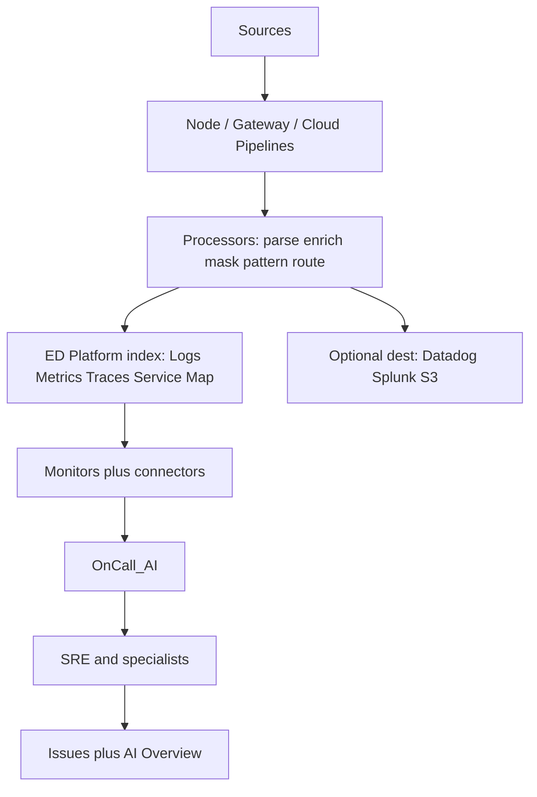
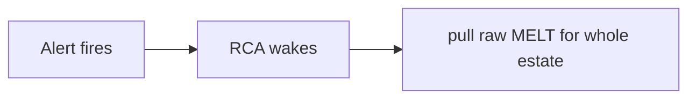
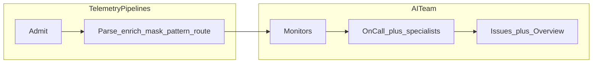
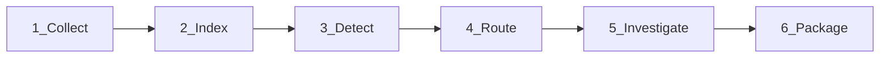
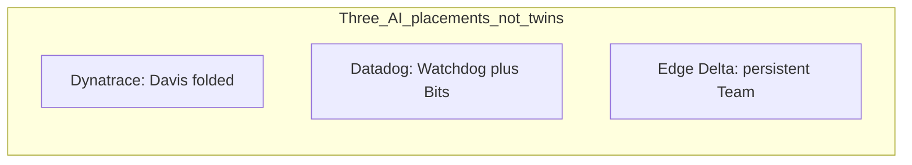

# Edge Delta production pipeline — native map & evidence

**Hub Thesis (curated):** [`edgedelta-production-pipeline.html`](./edgedelta-production-pipeline.html) is the reading path — one dual-layer map (Telemetry Pipelines ∥ AI Team), native stages once, one tenant snapshot. **02 Breakdown** is the IPO canvas ([`edgedelta-subsystem-mechanisms.html`](./edgedelta-subsystem-mechanisms.html)), not this file. Portal clicks: [`ed-portal-walkthrough.html`](./ed-portal-walkthrough.html). This markdown keeps full depth.

**Audience:** engineers who need Edge Delta clear **on Edge Delta’s own terms** before comparing Dynatrace or Datadog.  
**Status:** teaching / design reference — public product framing + **Observed (UI)** tenant snapshot.  
**Date:** 2026-08-14  

**Honesty labels**

| Label | Meaning |
|-------|---------|
| **Observed (UI)** | Seen in org `gmailcom_d4486595` on 2026-08-14 — see [`edgedelta-tenant-evidence-2026-08-14.md`](./edgedelta-tenant-evidence-2026-08-14.md) |
| **Public framing** | Edge Delta product docs / architecture pages |
| **Inferred** | Reasonable model; not an Edge Delta-internal spec |
| **Teaching** | Pedagogical name — not a measured SKU |

**Browser:** [`edgedelta-production-pipeline.html`](./edgedelta-production-pipeline.html) · [`:8765`](http://127.0.0.1:8765/edgedelta-production-pipeline.html)  
**Hub:** [`ed-ai-team-hub.html`](./ed-ai-team-hub.html)  
**Evidence:** [`edgedelta-tenant-evidence-2026-08-14.md`](./edgedelta-tenant-evidence-2026-08-14.md)  
**Separate unveils (not twins):** [`DYNATRACE_PRODUCTION_PIPELINE.md`](./DYNATRACE_PRODUCTION_PIPELINE.md) · [`DATADOG_PRODUCTION_PIPELINE.md`](./DATADOG_PRODUCTION_PIPELINE.md)  
**Out of scope here:** Lean vs Federated, L0/F1, CARE / Murphy / Nezha, `edgedelta-rca-lab`, Detect-category twins, flipping HLD D5.

---

## 0. Method

Finish an independent Edge Delta end-to-end reading (**pipelines → monitors → AI Team → Overview/Issues**) before deriving patterns against Dynatrace or Datadog. Do not force Smartscape∥Grail or Metrics∥APM∥Logs onto this product.

This pass is a **tenant snapshot**, analogous to Datadog 2026-08-03 (host-only, before `datadog-rca-lab`). There is **no** same-scenario checkout lab yet.

---

## 1. Mental model (one page)

Edge Delta is best understood as a **dual-layer** product:



The polished reading path is the HTML thesis ([`edgedelta-production-pipeline.html`](./edgedelta-production-pipeline.html) §1) — chip-and-panel diagram, same visual language as DT/DD.

**How to read that:** pipelines are the **data-hygiene / control** layer. The AI Team is a **persistent investigation layer** that consumes monitors, connector events, and (when present) platform telemetry. AI Overview is the operator landing page — not the whole pipeline.

It is **not**:



And it is **not** a Dynatrace dual-track or a Datadog three-rail twin.

| Path | Meaning |
|------|---------|
| Agent / Cloud Pipeline → **processors** | Collect and reshape **before egress** (**Public framing**; this tenant has no named pipeline in explorers — **Observed (UI)**) |
| Processors → **Platform** and/or **destinations** | Index for explorers; optionally fan-out (**Public framing**) |
| **Monitors** | Event threshold · pattern anomaly · metric threshold (**Observed (UI)** types) |
| **AI Team** | Specialized teammates (SRE, Software Engineer, Security Engineer, Work Tracker) + connectors (**Observed (UI)**) |
| **Issues / Overview** | Grouped findings + health score + action approval (**Public framing** lifecycle; this tenant: Issues **0**, Overview 100% Healthy — **Observed (UI)**) |

**Myths to drop**

1. Edge Delta is “just a cheaper Datadog.” Pipelines can sit **in front of** other destinations (**Public framing**). This tenant does **not** fan-out to Datadog (**Observed (UI)**: three connectors only — GitHub, Edge Delta MCP, Edge Delta Documentation).
2. AI Overview = Davis Problem list. Overview is a **team dashboard** (health, Issues, threads, live feed). Issue ≠ Problem ≠ Bits investigation ≠ Incident.
3. Pattern anomaly = Watchdog story = Davis Event. Same *layer* (Detect input), not the same object.
4. Empty Service Map means “no topology product.” This tenant has **no pipeline options** in the explorer filter — emptiness is missing write, not missing SKU (**Observed (UI)**).
5. Pipeline processors = our Vector ingest. Close **analog** for E1 hygiene; not a product twin and not a drop-in for [`INGESTION_PIPELINE_VECTOR.md`](./INGESTION_PIPELINE_VECTOR.md).

### 1.1 Dual-layer, not dual-track

**In one sentence:** Dynatrace and Datadog **centralize-then-analyze**; Edge Delta **shifts processing left**, then runs a **standing AI team** on monitors + that cleaned stream.



| Layer | Job |
|-------|-----|
| **Telemetry Pipelines** | Admit, parse, enrich, mask, pattern, route. Node / Gateway / Cloud / Coordinator (**Public framing** — [Architecture](https://docs.edgedelta.com/edge-delta-architecture/)) |
| **AI Team** | Continuous teammates. OnCall orchestrates specialists. Issues package recurring problems. Overview is the landing page (**Public framing** + **Observed (UI)** Overview/Teammates/Connectors) |

Join keys on this tenant were **not Observed**. **Public framing:** OpenTelemetry / OCSF standardize plus pipeline metadata tags (`edCustomTags`). Do not invent `entityId` or Unified Service Tags as ED’s primary key.

---

## 2. Native stages once

Teaching chain (ED vocabulary, not E1–E11):



| Native step | What it is | This tenant (**Observed UI**) |
|-------------|------------|-------------------------------|
| **1. Collect / process** | Pipeline agents (or agentless Cloud / Ingestion pipelines) | No pipeline names in Logs/Metrics/Traces/Service Map filters. `/pipelines` redirected to AI Overview. Primary nav has **no Pipelines item**. |
| **2. Index / explore** | Platform Logs · Metrics · Traces · Service Map | All empty or erroring. Default metric query exists: `ed.pipeline.node.read_bytes`. |
| **3. Detect** | Monitors (event / pattern / metric) | 5 monitors; only **Default Pipeline Liveness** is OK. Pattern Anomaly and GitHub event monitors: No Data. |
| **4. Route to Team** | AI Event destination, connectors, workflows | GitHub + ED MCP + ED Docs connected. Four default workflows (GitHub daily report, service anomaly, company-page summary, pipeline liveness). |
| **5. Investigate** | OnCall + specialists (SRE …) | Four teammate cards Observed. OnCall not a card. Performance “no score yet.” |
| **6. Package** | Issue + Overview health + action columns | Issues **0**. One Resolved Workflow thread in `#code-issues`. Health **100%**. |

**Doors vs stores:** Explorers (Logs ∥ Metrics ∥ Traces ∥ Service Map) are **not** fused Detect. Monitors are the Detect objects. AI Team is a downstream consumer — **Inferred** from docs + this tenant’s wiring (monitors/workflows → SRE teammate → email/channel).

---

## 3. Product I/O (teaching)

| Native object | Produced by | Consumed by | Honesty |
|---------------|-------------|-------------|---------|
| Processed telemetry | Pipeline processors | Platform explorers, 3rd-party dest, AI MCP | Public framing; **not Observed** as data in this org |
| Monitor alert | Monitors | Notifications, workflows, AI Team | Observed types; only liveness OK |
| Connector event | GitHub / PagerDuty / … | AI Event dest → teammates | GitHub Connected; CI/PR/Push monitors No Data |
| Investigation thread | OnCall / workflow / user prompt | Channels (`#alerts`, `#code-issues`, `#security-issues`) | One GitHub daily-report thread Resolved |
| Issue | AI Team when investigation concludes ≥ medium | Overview health score, action approval | **0** Issues Observed |
| Health score | Open Issues (critical −25, high −10, medium −4) | Overview gauge | **100%** with zero Issues — matches the published formula |

---

## 4. Stores (when they update)

**Public framing:** agents process locally; only reduced/enriched output leaves the environment; Platform indexes that output. Drain patterns are clustered **on the agent** (Log-to-Pattern), not after a backend full-text index.

**Observed (MCP, 17 Aug):** five query scopes on SaaS — `log` · `metric` · `trace` · `pattern` · `event`. Internal DB name unknown (not Grail, not Husky). Pattern clusters ≠ `event.type:pattern_anomaly` (that event type is still **0** while negative patterns are loud).

**Observed (UI, 14 Aug):** explorers had nothing to index. Global Data Settings had Logs/Metrics/Traces/Patterns/Heartbeats **Enabled** — preference ≠ data.

Default Metrics Explorer query (**Observed**):

```text
sum:ed.pipeline.node.read_bytes{*}.rollup(60)
```

Empty series. Pipeline liveness monitor OK implies *some* heartbeat exists (**Inferred**: control-plane health, not application MELT).

---

## 5. AI placement and catalogs

Two readings of “what AI does here,” in order: how the Team packages work (**5a**), then what catalogs they publish instead of Detect-class twins (**5b**). Together they feed HLD D5 (still Review) and the [hub one-story](./ed-ai-team-hub.html#one-story). They are not two names for the same list.

### 5a. AI Team / Overview / Issues (the URL we opened)

[AI Overview](https://docs.edgedelta.com/ai-overview-dashboard/) (**Public framing**) answers three questions: how healthy, which problems, what the Team is doing. **Observed (UI)** matched that layout:

- Health gauge + 7-day New / Re-Opened / Resolved / MTTR
- Incident timeline
- Active Issues (empty-state + START templates)
- Recent Threads
- Live Ops feed

**Issue lifecycle (Public framing, not Observed as a card):** when an investigation concludes a real problem ≥ medium, the Team matches it to an open Issue (occurrence++) or creates one. Close paths: AI-resolved, auto-close after inactivity, or human. Recurrence opens a **new** Issue linked to the previous (Re-Opened count).

**Action columns (Public framing):** You own these · AI actions — needs approval · AI has done so far. Human-in-the-loop for anything that touches infrastructure.

**Third AI placement (feeds HLD D5, does not flip it)**



| Vendor | AI geometry | Default vs optional |
|--------|-------------|---------------------|
| Dynatrace | Folded into **Davis** | Default Problem path |
| Datadog | Separable **Watchdog** (Detect) + **Bits** (package) | Optional surfaces on dense MTL |
| Edge Delta | Persistent **AI Team** + Issue/Overview | Autonomous investigation; **actions** need approval (**Public framing**). This tenant: Team provisioned, no Issues (**Observed UI**) |

Do not equate Issue with Problem, Bits investigation, or Incident.

### 5b. Supported scenarios (not Detect-class twins)

Edge Delta does **not** publish ERROR / SLOWDOWN / AVAILABILITY. They publish three **jobs**: **43 Packs** shape → **8 monitor types** notice → **10 use cases** investigate. Those are not Node / Gateway / Team. One-story + stage map: [`ed-ai-team-hub.html`](./ed-ai-team-hub.html)#one-story · [`ed-supported-scenarios.html`](./ed-supported-scenarios.html).

---

## 6. Tenant snapshot (walkthrough)

See [`edgedelta-tenant-evidence-2026-08-14.md`](./edgedelta-tenant-evidence-2026-08-14.md) for tables and screenshot names.

**One-line:** brand-new Free org, AI Team fully provisioned, telemetry fabric not writing, packaging quiet (Issues 0, one GitHub workflow thread).

That is a valid first Observed pass — the same honesty we used when Datadog’s first MCP snapshot was one host and zero Incidents.

---

## 7. Unfold onto ObserveOps E1–E11

Same abstract I/O as the HLD. ED column is **native**, not a twin. Labels mix Public framing with Observed emptiness.

| Block | Edge Delta anchor |
|-------|-------------------|
| **E1 Collect** | Node / Gateway / Cloud Pipelines admit logs, metrics, traces, events (**Public framing**). This tenant: no pipeline options in explorers (**Observed UI**). |
| **E2 Identity** | OTel / OCSF + pipeline metadata tags (**Public framing**). Not `entityId`, not Unified Service Tags. |
| **E3 Topology** | eBPF service maps at Node Pipeline (**Public framing**). Service Map UI present; request error + no pipeline options (**Observed UI**). |
| **E4 Stores** | Platform index of *already processed* telemetry; optional fan-out (**Public framing**). Logs 0 · traces 0 · metrics empty (**Observed UI**). |
| **E5 Maintain** | Coordinator, config pull, Packs, pipeline health monitors (**Public framing**). Default Pipeline Liveness **OK** (**Observed UI**). |
| **E6 Detect** | Pattern anomaly at agent + Platform monitors; AI Event dest / connectors (**Public framing**). Observed types: Event Threshold · Pattern Anomaly · Metric Threshold. |
| **E7 Curate** | Issue match (join open Issue or create) (**Public framing**). Observed: Issues **0**; Workflow thread is a different object. |
| **E8 Scope** | Issue adds services/envs; teammate pulls a pipeline window (**Public framing**). Not Observed (no Issue). |
| **E9 Localize** | SRE teammate investigation (timeline / impact) — not a Davis Smartscape walk (**Public framing** + SRE card copy Observed). |
| **E10 Identify** | Edge Delta MCP corroboration (logs/metrics/traces) with citations (**Public framing**). MCP connector **Connected**; no MELT to query (**Observed UI**). |
| **E11 Package** | Issue card + recommended actions + Overview health score (**Public framing**). Observed: Overview 100% Healthy, Issues 0, one Resolved thread. |

Detect-class matrix stays DT/DD-owned. Edge Delta does **not** publish a Davis `event.category` list. We will not invent one. Closest catalogs: **10** AI Team use cases · **8** monitor types · **43** Packs — [`EDGEDELTA_SUPPORTED_SCENARIOS.md`](./EDGEDELTA_SUPPORTED_SCENARIOS.md) · [HTML](./ed-supported-scenarios.html).

**Three-actor distribution (Node ∥ Gateway ∥ AI Team):** [`ed-supported-scenarios.html`](./ed-supported-scenarios.html)#three-actors — P1 on pipelines, E6 split, P3 on the Team.

---

## 8. Known unknowns

- Exact ranking / Issue-match function (black box).
- Whether OnCall is a hidden teammate, a router, or both.
- Why Usage Report showed 0 tokens while Plan showed 13 AI credits.
- Whether Pipeline Liveness OK implies a hidden default pipeline or only a control-plane heartbeat. **Update (MCP):** org has `AI-Connector-Telemetry-Pipeline` (`IngestionPipeline`, `purpose=edgedelta-ai`).
- How Service Map is built when a Node Pipeline *does* run (eBPF vs APM-derived).
- Getting Started says **seven** monitor types; Monitors section also documents Metric Anomaly. Union used here is 8.

---

## 9. Takeaway

**One sentence:** Edge Delta **shifts processing left** (shape at the edge), then runs a **persistent AI Team** whose operator landing page is AI Overview — Issues and action approval — not a Davis Problem and not optional Bits. Dynatrace and Datadog **centralize-then-analyze**.

**For ObserveOps:** this is a third teaching geometry for HLD **D5** (still Review): AI as a standing team with human-in-the-loop actions, sitting on an E1-like hygiene layer. It is also a reminder that a Detect/Package surface can be loud (teammates, monitors, workflows) while E4 stores are empty.

**Next:** geometry / AI / E1–E11 compare is on [`comparable-pipeline-dt-dd.html`](./comparable-pipeline-dt-dd.html) §0 (lab clocks stay DT vs DD). A same-scenario checkout lab for Edge Delta is still **not this pass**.
