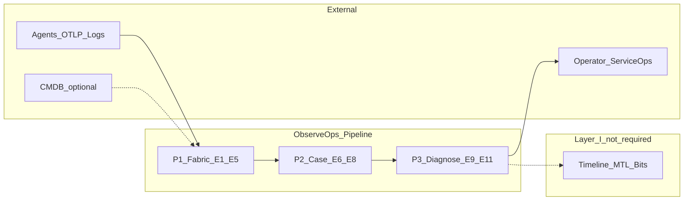
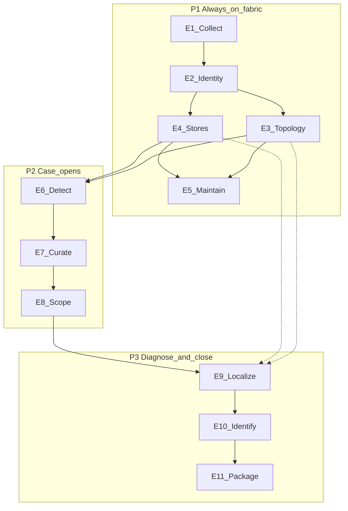

# ObserveOps pipeline — High-Level Design (HLD)

**Status:** Review  
**Version:** v0.2  
**Owners:** ObserveOps RCA engineering  
**Scope (in):** 3-phase / 11-stage engineering pipeline (E1–E11), Detect-class plug-ins, inter-stage contracts  
**Scope (out):** Layer I productization, remediation execution, collector-specific implementation details  
**Normative:** Stage responsibilities, I/O contracts, ADR defaults, HLD-to-LLD gates  
**Informative:** Vendor maps, lab references, teaching hubs (L0 launchpads: [`dt-davis-category-hub.html`](./dt-davis-category-hub.html) · [`dd-detect-category-hub.html`](./dd-detect-category-hub.html))

**Browser:** [`observeops-pipeline-hld.html`](./observeops-pipeline-hld.html) · `:8765/observeops-pipeline-hld.html`

---

## 1. Problem and destination

From continuous telemetry on a service chain, the pipeline must reliably surface: what broke (fault class), where it broke (leaf entity/service/operation), and what evidence to open next, without re-collecting the estate on every alert. This HLD defines our subsystem contracts; DT/DD unveil material is reference context, not architecture authority.

## 2. Architecture principles

Derived from [`lean-pipeline/docs/ARCHITECTURE.md`](../lean-pipeline/docs/ARCHITECTURE.md):

- Reproducibility is mandatory for evaluation paths.
- Verifiability is mandatory (tier/evidence trail must be inspectable).
- Causal validity is claimed only after scoped checks succeed.
- Earliest anomaly is not automatically root cause.
- Layer I artifacts are optional explainers; Layer E must stand alone.

## 3. System context (C4 level 1)

Ingress is E1 Collect. Egress is E11 Package to operator verdict card and optional incident handoff. CMDB remains optional enrichment; discovery-first default remains valid.

## 4. Layer model (do not collapse)

| Layer | Runs | Required for product RCA? | Contract |
|-------|------|----------------------------|----------|
| **E Engineering** | Continuous (P1) + per-case (P2/P3) | Yes | Must localize a leaf without MTL/Bits |
| **I Interpret** | Per run or optional UI | No | Timeline/MTL/Bits retell evidence, not replace E-stages |

Layer I artifacts:

- Timeline
- MTL workbook
- Bits review

## 5. Three-phase and 11-stage overview

| Phase | Stage count | Stage IDs | Alias |
|------|-------------|-----------|-------|
| **P1 Always-on fabric** | 5 | E1-E5 | Clock A fabric / F |
| **P2 Case opens** | 3 | E6-E8 | Triage / T |
| **P3 Diagnose and close** | 3 | E9-E11 | Clock B / D |

## 6. Stage catalog (formal contracts)

The same template applies to every stage:

- Purpose
- Trigger
- Inputs
- Outputs
- Preconditions
- Postconditions
- Failure if missing
- Degradation behavior
- NFR sketch
- Reference implementation
- Lab proof

### E1 Collect (P1)
- Purpose: ingest edge telemetry payloads from agents/OTLP/log streams.
- Trigger: continuous.
- Inputs: external telemetry envelopes.
- Outputs: `TelemetryEnvelope`.
- Preconditions: source auth/config available.
- Postconditions: incoming events are accepted into ingestion path.
- Failure if missing: no data enters pipeline.
- Degradation: partial source loss still allows scoped RCA on remaining sources.
- NFR sketch: sustained ingest throughput, backpressure safety.
- Reference implementation: lean ingest bundle path; federated demo ingest stubs.
- Lab proof: both ERROR and SLOWDOWN runs depend on successful ingest.

### E2 Identity (P1)
- Purpose: stamp join keys so records are correlation-ready.
- Trigger: continuous per record.
- Inputs: `TelemetryEnvelope`.
- Outputs: `IdentifiedRecord` (`ci_ref`, service/env/version tags, timestamps).
- Preconditions: identity strategy configured.
- Postconditions: each record is joinable with topology and stores.
- Failure if missing: cross-modal joins collapse.
- Degradation: unresolved records move to unattributed queue.
- NFR sketch: low-latency enrichment, deterministic keying.
- Reference implementation: unified tags/entity mapping in lab pipelines.
- Lab proof: DD/DT joins require identity before detect/localize.

### E3 Topology (P1)
- Purpose: maintain walkable dependency graph for neighborhood reasoning.
- Trigger: continuous updates + periodic refresh.
- Inputs: `IdentifiedRecord`, discovery relations, optional CMDB enrich.
- Outputs: `GraphSnapshot`.
- Preconditions: identity keys must exist.
- Postconditions: queryable neighbors, directionality, depth.
- Failure if missing: localize cannot reason over propagation.
- Degradation: stale graph increases ambiguity and misranking risk.
- NFR sketch: freshness window and bounded staleness.
- Reference implementation: lean graph walk; federated KG analog.
- Lab proof: ERROR cascades and SLOWDOWN path depth require topology.

### E4 Stores (P1)
- Purpose: persist queryable evidence over time under shared identity.
- Trigger: continuous writes.
- Inputs: `IdentifiedRecord`.
- Outputs: modality-specific query surfaces and history.
- Preconditions: storage backends available.
- Postconditions: time-sliced evidence retrievable by CI and tags.
- Failure if missing: detect and identify have no historical evidence.
- Degradation: missing modality produces thin evidence bundles.
- NFR sketch: retention and query latency budgets.
- Reference implementation: lean datasets and store abstractions; federated stores.
- Lab proof: MTL-like queries and identify evidence depend on E4.

### E5 Maintain (P1)
- Purpose: keep estate fresh (retention, indexing, discovery freshness, deploy feed).
- Trigger: scheduled/continuous maintenance.
- Inputs: store/index metadata, discovery updates, change feeds.
- Outputs: freshness baseline and maintain state.
- Preconditions: E3 and E4 operating.
- Postconditions: pipeline remains detect-ready.
- Failure if missing: data drift/staleness silently degrades RCA quality.
- Degradation: larger correlation windows needed, confidence drops.
- NFR sketch: index freshness and lifecycle correctness.
- Reference implementation: explicit in our HLD even when vendor stages differ.
- Lab proof: not always visible in single run, but prerequisite for reliability.

### E6 Detect (P2)
- Purpose: emit fault signals for a configured Detect class.
- Trigger: per observation window or rule evaluation.
- Inputs: `GraphSnapshot`, store queries.
- Outputs: `Signal`.
- Preconditions: identity + stores + topology queryable.
- Postconditions: candidate fault signals exist, but no root cause claim.
- Failure if missing: no case opens automatically.
- Degradation: partial detection can be operator-seeded at scope/localize.
- NFR sketch: detection latency and false-positive control.
- Reference implementation: rule/anomaly doors in both study lenses.
- Lab proof: ERROR has direct doors; SLOWDOWN may require alternate door.

### E7 Curate (P2)
- Purpose: collapse correlated signals into one case seed.
- Trigger: on detect signal arrival.
- Inputs: `Signal`, `GraphSnapshot`.
- Outputs: `CaseSeed`.
- Preconditions: at least one signal and merge policy available.
- Postconditions: one seed with merge rationale is emitted.
- Failure if missing: signal storm leaks directly to operators.
- Degradation: multiple seeds possible only under explicit policy override.
- NFR sketch: bounded merge latency and deterministic grouping.
- Reference implementation: required in our default policy (D3).
- Lab proof: DD multi-hot-service fog demonstrates need.

### E8 Scope (P2)
- Purpose: lock investigation working set (time + candidates + env/version).
- Trigger: on curated seed.
- Inputs: `CaseSeed`, topology/store context.
- Outputs: `WorkingSet`.
- Preconditions: seed must exist.
- Postconditions: bounded diagnosis domain established.
- Failure if missing: diagnose runs globally, noisy and expensive.
- Degradation: loose scopes increase ranking ambiguity.
- NFR sketch: scope build latency and candidate cap.
- Reference implementation: Tailor equivalent in 5+3+3 lens.
- Lab proof: both ERROR and SLOWDOWN rely on narrowed windows.

### E9 Localize (P3)
- Purpose: choose leaf claim based on Detect class semantics.
- Trigger: per scoped case.
- Inputs: `WorkingSet`, `GraphSnapshot`, store evidence.
- Outputs: `LeafClaim`.
- Preconditions: scoped candidate set available.
- Postconditions: one top leaf hypothesis returned.
- Failure if missing: no actionable root-cause target.
- Degradation: can return ranked candidates with lower confidence.
- NFR sketch: deterministic ranking under fixed scope.
- Reference implementation: lean path walk; federated hop-to-hop narrowing.
- Lab proof: deepest error leaf for ERROR; self-time leaf for SLOWDOWN.

### E10 Identify (P3)
- Purpose: corroborate/rank leaf with multimodal evidence.
- Trigger: on leaf claim.
- Inputs: `LeafClaim`, `WorkingSet`, store queries.
- Outputs: `EvidenceBundle`.
- Preconditions: leaf claim exists and evidence stores reachable.
- Postconditions: evidence pointers and confidence rationale available.
- Failure if missing: verdict exists but cannot be trusted/explained.
- Degradation: single-modality bundle allowed with explicit incompleteness note.
- NFR sketch: evidence lookup latency and reproducibility.
- Reference implementation: lean tier/signature checks; federated fusion evidence.
- Lab proof: KeyError stack/log/trace and SLOWDOWN self-time/CPU pointers.

### E11 Package (P3)
- Purpose: render operator-facing verdict handoff.
- Trigger: on evidence bundle completion.
- Inputs: `EvidenceBundle`.
- Outputs: `VerdictCard` and optional incident payload/narrative.
- Preconditions: leaf and evidence must be present.
- Postconditions: case is operationally consumable.
- Failure if missing: RCA output remains engineering-only and unclosed.
- Degradation: thin card allowed only when evidence completeness is flagged.
- NFR sketch: handoff latency and schema stability.
- Reference implementation: Problem-like card; optional Bits-style narrative.
- Lab proof: package behavior differs by vendor but remains required in our policy.

## 7. Information contracts and worked flows

Directional object catalog:

- `TelemetryEnvelope` (E1 -> E2)
- `IdentifiedRecord` (E2 -> E3,E4)
- `GraphSnapshot` (E3 -> E6,E7,E9)
- `Signal` (E6 -> E7)
- `CaseSeed` (E7 -> E8)
- `WorkingSet` (E8 -> E9)
- `LeafClaim` (E9 -> E10)
- `EvidenceBundle` (E10 -> E11)
- `VerdictCard` (E11 -> Operator/Incident)

Worked handoff examples:

| Class | Simplified handoff path |
|-------|--------------------------|
| ERROR | E1 envelope -> E2 identified service/route -> E6 error signal -> E7 curated seed -> E8 scoped call chain -> E9 deepest error leaf -> E10 stack/log/trace evidence -> E11 verdict |
| SLOWDOWN | E1 envelope -> E2 identified op/version -> E6 latency signal (or alternate seed) -> E7 curated seed -> E8 scoped interval -> E9 longest self-time leaf -> E10 span self-time + CPU corroboration -> E11 verdict |

## 8. Detect-class plug-in matrix

| Detect class | E6 feature focus | E9 leaf rule | E10 evidence emphasis |
|--------------|------------------|--------------|------------------------|
| **ERROR** | error rate, status:error | deepest error leaf | stack, logs, error spans |
| **SLOWDOWN** | duration, p95, saturation cues | longest self-time leaf | self-time spans, CPU/service latency |

Curate, Scope, and Package remain unchanged across classes.

## 9. Cross-cutting concerns

- Single identity thread: E2 keys must map to E3 nodes and E4 query keys.
- Parallel modalities: metrics, traces, logs can remain separate query planes with shared identity.
- Volatility gradient: P1 high churn, P2 episodic grouping, P3 locked working sets.
- Layer boundary: Layer I can consume outputs, never gate E-stage progression.

## 10. Implementation map (internal engineering)

| Stage band | Lean (primary ObserveOps eval engine) | Federated (optional path) | Future ingest path |
|------------|----------------------------------------|----------------------------|--------------------|
| E1-E5 | `lean-pipeline/core_engine/observeops/ingest/` and data bundle flow | `federated-pipeline/poc/` stores and adapters | [`INGESTION_PIPELINE_VECTOR.md`](./INGESTION_PIPELINE_VECTOR.md) |
| E6-E8 | detect/rules + case seed logic in lean orchestrator | Panorama-triggered entry + orchestrator narrowing | same signal model target |
| E9-E11 | `lean-pipeline/core_engine/observeops/engine.py` tiered escalation | Murphy -> Nezha -> fused verdict | pluggable if contracts preserved |
| Visual reference | [`eleven-subsystem-mechanisms.html`](./eleven-subsystem-mechanisms.html) | same mechanisms page | same stage contracts |

Lean and federated differ in diagnosis mechanics but both map to the same P3 stage contracts.

## 11. ADRs and open decisions

| Decision | Default in HLD | Sign-off status |
|----------|----------------|-----------------|
| D1 Topology model | Hybrid: derived edges first, typed IDs when cheap | Review |
| D2 Store geometry | Separate product queries, shared identity | Review |
| D3 Curate strength | Required: must emit one seed by default | Must be Signed |
| D4 Package policy | Required verdict card for close; narrative optional | Must be Signed |
| D5 AI placement | Optional door in Detect and optional narrator in Package | Review |

Sign-off criterion: D3 and D4 cannot remain TBD unless explicitly waived in review notes.

## 12. Failure modes and degradation

- E6 sparse/empty signals: P2 may stall; classify as detect coverage gap, not localize defect.
- E7 skipped: multi-service signal fog reaches operator with no primary seed.
- E3 stale graph: localize may choose wrong neighborhood/leaf.
- E4 modality loss: identify produces thin bundle and package must flag incompleteness.
- E5 lag: freshness decay causes delayed or inconsistent detection.

## 13. NFR baseline ownership

HLD ownership allocation (targets quantified in FR/AC and LLD):

- P1 (E1-E5): ingest throughput, retention, indexing/discovery freshness.
- P2 (E6-E8): correlation latency, deterministic grouping.
- P3 (E9-E11): diagnosis latency, reproducibility, evidence completeness.

## 14. Traceability appendix (light)

| Stage band | Closest FR/AC mapping |
|------------|------------------------|
| E1-E2 | FR-A (ingest/normalize), FR-B (entity resolution) |
| E3-E5 | FR-C (topology/time), FR-I/J (operability/freshness) |
| E6-E8 | FR-D (correlation and dedupe) |
| E9-E10 | FR-E/F (root cause + evidence) |
| E11 | FR-G/H (incident output and operator handoff) |

Primary FR/AC reference: [`multi-telemetry-rca-functional-and-acceptance-criteria.md`](./multi-telemetry-rca-functional-and-acceptance-criteria.md).

## 15. LLD backlog and HLD-to-LLD gate

LLD backlog:

1. `LLD-E1-Collect`
2. `LLD-E2-Identity`
3. `LLD-E3-Topology`
4. `LLD-E4-Stores`
5. `LLD-E5-Maintain`
6. `LLD-E6-Detect`
7. `LLD-E7-Curate`
8. `LLD-E8-Scope`
9. `LLD-E9-Localize`
10. `LLD-E10-Identify`
11. `LLD-E11-Package`

Gate for each LLD:

- references stage ID and purpose from this HLD,
- defines concrete schema/API for each I/O object it owns,
- includes one acceptance test path from ObserveOps corpus/lab replay.

Layer I docs are not `LLD-E*` unless investigation notebook is productized later.

## 16. References and annexes

- Canonical compare: [`COMPARABLE_PIPELINE_DT_DD.md`](./COMPARABLE_PIPELINE_DT_DD.md)
- Federated vs 5+3+3 gap analysis: [`FEDERATED_VS_DT_PIPELINE_GAPS.md`](./FEDERATED_VS_DT_PIPELINE_GAPS.md)
- Mechanisms visual: [`eleven-subsystem-mechanisms.html`](./eleven-subsystem-mechanisms.html)
- Glossary aliases: [`urca-glossary.html`](./urca-glossary.html)
- HTML companion: [`observeops-pipeline-hld.html`](./observeops-pipeline-hld.html)

---

## Doc hub contract (navigation)

Global site bar (`doc-nav.js`) remains the single site menu:

`Docs index` · `Our HLD` · `DT hub` · `DD hub` · `DT vs DD` · `Obs 1.0/2.0/3.0` · `Fed vs DT` · `Motadata FR/AC` · `PoC console`
