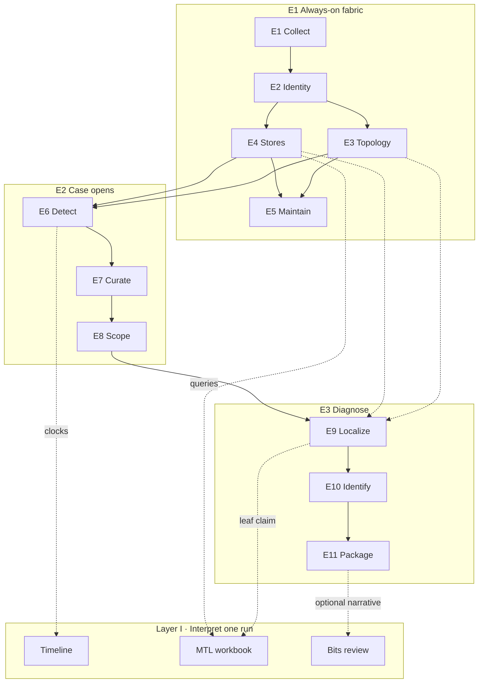

# ObserveOps pipeline — High-Level Design (HLD)

**Status:** Draft HLD — building blocks + interactions + information flow.  
**Next:** LLD per engineering block (one doc each).  
**Derived from:** Dynatrace + Datadog lab unveil (`COMPARABLE_PIPELINE_DT_DD.md`), not a twin of either vendor.

**Browser:** [`observeops-pipeline-hld.html`](./observeops-pipeline-hld.html) · `:8765/observeops-pipeline-hld.html`

---

## 0. Destination (same as both vendors)

From continuous telemetry on a service chain, surface:

1. **What broke** (fault class — error-rate, latency, …)
2. **Where** (leaf entity / service / operation)
3. **What to look at** (evidence pointers an operator can open)

We do **not** need to re-collect the estate from scratch on every alert.

Vendors disagree on **geometry** and **who does the last mile**. This HLD defines **our** required subsystems and the contract between them.

---

## 1. Two layers (do not collapse)

| Layer | Name | What it is | What it is not |
|-------|------|------------|----------------|
| **E** | **Engineering (behind the scenes)** | Always-on fabric + case pipeline subsystems that write, detect, scope, localize, and optionally package | Not a per-run teaching workbook |
| **I** | **Interpret (operator / lab run)** | How a human (or Bits-like agent) *reads* one Observed window across rails | Not a required storage or Detect engine |

### Layer I artifacts (separated from engineering sticky)

These stay as **run interpretation** peers — useful, not BTS building blocks:

| Artifact | Job |
|----------|-----|
| **Timeline** | Clocked Observed narrative (break / load / heal / Detect surfaces) for one category |
| **MTL workbook** | Copy-paste Metrics ∥ Traces ∥ Logs queries + Observed counts for one run |
| **Bits review** | Optional packaging / hypothesis-tree walk for one investigation |

**Contract:** Engineering must be able to name a leaf **without** MTL docs or Bits. MTL/Bits *explain* or *package*; they do not *replace* Collect → Detect → Localize.

Vendor unveil hubs (DT Dual-track, DD Three-rail/Breakdown) remain **annexes** for studying others — not our subsystem list.

---

## 2. Engineering building blocks (required)

Each block has: **inputs**, **outputs**, **consumers**, **failure if missing**.

### Phase E1 — Always-on fabric

| ID | Block | Responsibility | Primary output |
|----|-------|----------------|----------------|
| **E1** | **Collect** | Edge intake from apps/hosts/containers (agents, OTLP, logs, stats) | Raw or near-raw telemetry payloads |
| **E2** | **Identity** | Stamp join keys on every record (`service` / `env` / `version` / host — and/or stable entity id) | Join-ready records |
| **E3** | **Topology** | Maintain call-path / dependency structure (typed graph **or** derived-from-traces — LLD decision) | Walkable neighbors + edge evidence |
| **E4** | **Stores** | Persist always-on evidence (metrics timeseries and/or event lake; product explorers may stay separate) | Queryable history under Identity |
| **E5** | **Maintain** | Retention, indexing, discovery freshness, version/deploy change feed | Fresh enough fabric for Detect |

### Phase E2 — Case opens

| ID | Block | Responsibility | Primary output |
|----|-------|----------------|----------------|
| **E6** | **Detect** | Emit fault **signals** (threshold and/or anomaly) for a Detect class (error-rate, latency, …) | Signal objects (events / alerts / stories) — **not** yet a ranked root |
| **E7** | **Curate** | Merge related signals into **one case seed** (time + topology neighborhood) | Case seed (primary symptom + scope hints) |
| **E8** | **Scope** | Lock env/version/time window + candidate neighborhood for diagnosis | Investigation window + candidate set |

### Phase E3 — Diagnose & close

| ID | Block | Responsibility | Primary output |
|----|-------|----------------|----------------|
| **E9** | **Localize** | Pick the **leaf** on the call path (deepest error **or** longest self-time — by Detect class) | Leaf claim (entity + operation + fault class) |
| **E10** | **Identify** | Rank / corroborate leaf with multimodal evidence under Scope | Ranked evidence bundle |
| **E11** | **Package** | Emit operator-facing verdict (Problem-like card and/or optional agent narrative + optional Incident) | Packaged case (may be thin if policy = optional) |

### Non-blocks (explicit)

| Name | Why excluded from E* |
|------|----------------------|
| **MTL workbook** | Teaching/operator query cookbook for one run → Layer I |
| **Bits** | Optional agentic packaging UI/path → implementation choice under **E11**, not a separate fabric stage |
| **Incident declare** | Ops workflow; may wrap E11 output; not Collect/Detect |
| **Three-rail animation / Dual-track animation** | Pedagogy of vendor geometry → unveil annex |

---

## 3. Interactions & information flow

### Information contracts (HLD-level)

| Edge | Payload (conceptual) |
|------|----------------------|
| Collect → Identity | Untagged or partial records |
| Identity → Stores / Topology | Records + join keys; peer hints for edges |
| Stores → Detect | Series / events queryable by Identity + time |
| Topology → Detect / Curate / Localize | Neighbors, call direction, depth |
| Detect → Curate | One or many signals (same fault often lights multiple services) |
| Curate → Scope | Single seed + merge rationale |
| Scope → Localize | Window + candidates |
| Localize → Identify | Leaf hypothesis |
| Identify → Package | Leaf + corroborating MTL pointers |
| Package → humans / Incident | Verdict card; Layer I Bits may *re-tell* the same verdict |

### Parallelism (∥)

- **Stores** may be multi-rail (metrics ∥ traces ∥ logs) with **one Identity join** — inspired by Datadog product rails / Husky honesty, not forced “one Grail.”
- **Detect** may have multiple doors (threshold ∥ anomaly) — inspired by Monitors ∥ Watchdog; Curate must still produce **one seed** or explicitly leave multi-seed (LLD policy).
- Fabric (E1) runs **continuously**; E2–E3 run **per case**.

---

## 4. Detect-class plug-in (same blocks, different leaf rule)

| Detect class | Detect watches | Localize rule (E9) | Lab proof |
|--------------|----------------|--------------------|-----------|
| **ERROR** | error rate / status:error | Deepest **error** leaf (500 over 502 cascade) | DT P-26084 · DD e3 KeyError |
| **SLOWDOWN** | duration / p95 | Longest **self-time** leaf (HTTP 200 ok) | DT P-260820 · DD e3 ledger-scan |

Curate/Scope/Package stay; only Detect features + Localize ranking change.

---

## 5. Open decisions (resolve in LLD / ADRs)

| # | Decision | DT-like | DD-like | HLD default (proposal) |
|---|----------|---------|---------|------------------------|
| D1 | Topology write | Typed entity graph | APM-derived map | **Hybrid:** derived edges first; typed ids when bind is cheap |
| D2 | Store geometry | One multimodal lake | Separate explorers + dual backend | **Separate product queries, shared Identity**; backend LLD |
| D3 | Curate strength | Davis merges to one Problem | Weak auto-merge | **Required Curate** — otherwise we inherit DD’s multi-hot-service fog |
| D4 | Package policy | Default Problem | Optional Bits + Incident often 0 | **Package required for product close**; Bits-style narrative optional on top |
| D5 | AI placement | Folded in Davis | Separable Watchdog + Bits | **Detect AI optional door**; **Package AI optional narrator**; neither replaces Localize |

---

## 6. Map from vendor study (honesty)

| Our block | Dynatrace | Datadog |
|-----------|-----------|---------|
| E1 Collect | OneAgent / OTLP | Agent + ddtrace |
| E2 Identity | `entityId` | Unified Service Tags |
| E3 Topology | Smartscape | Service Map (derived) |
| E4 Stores | Grail | Metrics timeseries ∥ Husky events |
| E5 Maintain | Smartscape freshness + Grail lifecycle (**named stage**) | **No DD Maintain stage** — continuous Write (03) + retention/indexing |
| E6 Detect | Detectors → Events | Monitors ∥ Watchdog (SLOWDOWN may be empty) |
| E7 Curate | Davis merge | Gap in lab (multi-error services) |
| E9 Localize | `rootCauseEntity` when ranked | Flamegraph / Bits self-time (operator seed if Detect empty) |
| E11 Package | Problem (default) | Bits optional · Incident often 0 |
| Layer I MTL/Bits | Dual-track teaching + Problem UI | MTL workbook + Bits sticky |

Full narrative: [`COMPARABLE_PIPELINE_DT_DD.md`](./COMPARABLE_PIPELINE_DT_DD.md).

---

## 7. LLD backlog (after HLD sign-off)

One LLD per engineering block (interface schemas, storage, APIs, failure modes, lab acceptance):

1. `LLD-E1-Collect`
2. `LLD-E2-Identity`
3. `LLD-E3-Topology` (+ D1)
4. `LLD-E4-Stores` (+ D2)
5. `LLD-E5-Maintain`
6. `LLD-E6-Detect` (ERROR + SLOWDOWN plug-ins)
7. `LLD-E7-Curate` (+ D3)
8. `LLD-E8-Scope`
9. `LLD-E9-Localize` (error leaf vs self-time leaf)
10. `LLD-E10-Identify`
11. `LLD-E11-Package` (+ D4, D5)

Layer I docs stay under vendor/lab hubs; they are **not** LLD-E\* work items unless we productize an “investigation notebook” feature.

---

## 8. Doc hub contract (navigation)

**Global Site bar** (`doc-nav.js` — one sticky menu on every hosted HTML page):

`Docs index` · **`Our HLD`** · `DT hub` · `DD hub` · `DT vs DD` · `Obs 1.0 / 2.0 / 3.0` · `Fed vs DT` · `Motadata FR/AC` · `PoC console`

Do **not** add a second horizontal site menu on individual pages.

| Audience path | Use |
|---------------|-----|
| **Our pipeline** | Site → Our HLD → LLD-E\* |
| **Vendor unveil** | Site → DT hub / DD hub (engineering tabs) |
| **Interpret one run** | DD sticky **Interpret:** Timeline clocks · MTL · Bits (Layer I) |
| **Compare** | Site → DT vs DD after unveil |

Datadog category sticky: **Engineering** = Hub → Thesis → Breakdown → Three-rail → Timeline; **Interpret** = MTL workbook · Bits.
