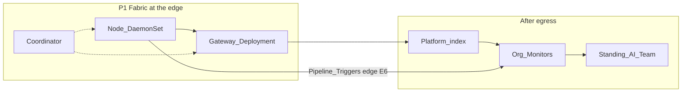

# Edge Delta lab setup — execute the AI Team use cases

**Hub:** [`ed-ai-team-hub.html`](./ed-ai-team-hub.html) · **HTML:** [`ed-lab-setup.html`](./ed-lab-setup.html)  
**Catalogs:** [`EDGEDELTA_SUPPORTED_SCENARIOS.md`](./EDGEDELTA_SUPPORTED_SCENARIOS.md)  
**Manifests:** [`labs/edgedelta/`](../labs/edgedelta/)  
**Date:** 2026-08-17  
**Org:** `gmailcom_d4486595` (`6da947fe-77af-421e-8a9c-dda8ead0b393`)

This is an **Edge Delta tenant lab**, not an ObserveOps HLD rewrite. Do not flip [`OBSERVEOPS_PIPELINE_HLD.md`](../OBSERVEOPS_PIPELINE_HLD.md) D5. Do not invent ERROR/SLOWDOWN twins.

Stack (do not collapse): **Packs shape → Monitors notice → Use cases investigate.**

---

## Honesty labels

| Label | Meaning |
|-------|---------|
| **Observed (MCP)** | Pulled from this org on 2026-08-17 via Edge Delta MCP |
| **Observed (UI)** | Seen in the app on 2026-08-14 — [`edgedelta-tenant-evidence-2026-08-14.md`](./edgedelta-tenant-evidence-2026-08-14.md) |
| **Public framing** | Edge Delta product docs |
| **Inferred** | Teaching model; not an Edge Delta-internal spec |
| **Blocked** | UC2 AWS · UC3 Elastic · UC5 CircleCI · UC7 PagerDuty (connectors not in this org) |

---

## Status (2026-08-17)

| Check | Result |
|-------|--------|
| Pipelines **Observed (MCP)** | **2:** Edge `kubernetes` (`5f43e54d-…`) + `AI-Connector-Telemetry-Pipeline` (GitHub IngestionPipeline) |
| WSL k3d | Ingested UC1/6/8 then agent **removed**. MCP still shows `k3d-ed-lab-server-0`. [`edgedelta-k3d-fabric-2026-08-17.md`](./edgedelta-k3d-fabric-2026-08-17.md) |
| RTX k3s `pro6000-server` | **Pro ingest OK**. Node + Coordinator Running. Gateway **not** installed (no Gateway pipeline ID; Pipelines nav hidden). |
| Use case 9 | **Observed (UI):** Daily GitHub report. [`edgedelta-uc9-github-2026-08-17.md`](./edgedelta-uc9-github-2026-08-17.md) |
| Use cases 1, 6, 8 | RTX MCP: negative patterns + K8s BackOff + Pod Crash Monitor ALERT. **OnCall Investigating** in `#alerts` (`P3 K8s Pod CrashLoopBackOff Alert`). Pattern Anomaly events still **0**. Issues **0**. |
| Use case 4 | Postgres + nginx on RTX. eBPF traces indexed (`checkout-api-db` → `checkout-db`). Gateway/OTLP still not installed. |
| Use case 10 | Native ED MCP queried RTX K8s events + patterns (same org schema). No third-party MCP contrast. |
| Use cases 2, 3, 5, 7 | **Appendix only** — [§ Later connectors](#later-connectors-use-cases-2-3-5-7) |

**2026-08-17 evening:** Pro upgrade unblocked RTX uploads. Combined analysis: [`edgedelta-lab-run-2026-08-17.md`](./edgedelta-lab-run-2026-08-17.md).

---

## 1. The 11 stages do not reverse

You are **half right** if you guessed “same 3-phase pipeline, only the direction changes.” The **contracts stay E1→E11**. What changes is **processing locus**, not stage order.

```text
Same order (ObserveOps HLD and ED teaching map):
  P1 Fabric   E1 Collect → E2 Identity → E3 Topology → E4 Stores → E5 Maintain
  P2 Triage   E6 Detect  → E7 Curate  → E8 Scope
  P3 Diagnose E9 Localize → E10 Identify → E11 Package
```

**Centralize-then-analyze (DT/DD):** ship telemetry, then think in the platform.

**Shift processing left (ED):** Node/Gateway **shape, reduce, optionally Detect** before egress. After egress sits the **platform** (index + org monitors); the **AI Team sits on that platform**. Same E1→E11 order. Catalogs (43/8/10) are jobs, not those SKUs — [`ed-ai-team-hub.html`](./ed-ai-team-hub.html)#one-story.



E6 is the **only** stage with three doors (Node trigger · Gateway trigger · org Monitor). The Team **consumes** the signal; it does not compute the threshold.

Full actor table: [`EDGEDELTA_SUPPORTED_SCENARIOS.md`](./EDGEDELTA_SUPPORTED_SCENARIOS.md) §6.

---

## 2. What this tenant already has

**Observed (UI) 2026-08-14 + Observed (MCP) 2026-08-17:**

- AI Team + teammate cards + GitHub + Edge Delta MCP + Documentation
- Hidden `AI-Connector-Telemetry-Pipeline` (GitHub HTTP → `ed_ai_event_output`)
- 5 monitors (UI): 3× GitHub Event Threshold (No Data), Pattern Anomaly (No Data), Pipeline Liveness (OK)
- **No Node/Gateway app fleet.** Explorers empty. Packs none.

**Executable without a cluster: use case 9 only** (GitHub workflow / `@edge-delta`), and only when GitHub actually sends events. Pattern Anomaly cannot fire without application logs.

Free-plan clock (UI 2026-08-14: ends 2026-08-28) and AI credits limit how many investigations we burn.

---

## 3. Shared fabric (unlocks 1, 4, 6, 8, 10)

One Kubernetes install, not ten.

| Piece | Role | HLD analog | Required? |
|-------|------|------------|-----------|
| **Kubernetes connector** (AI Team → Streaming) | Bundles logs, metrics, traces, service map, events onto one pipeline. Manage here, not in Pipeline Builder (editing can break the connector link). **Public framing** | E1 admission | **Yes** |
| **Node Pipeline** (DaemonSet) | Parse / mask / pattern / extract-metric on the node | E1–E2 primary, edge E6 | **Yes** |
| **Coordinator** (singleton) | Heartbeats, grouping, live capture | E5 | **Recommended** |
| **Gateway** (Deployment) | Dedup, service-level metrics, trace tail sampling, OTLP | E3 assist, cluster E6 | **Yes for traces / UC4**; Node-only is enough for log Pattern Anomaly + UC8 events |
| **Destination = Edge Delta Platform** | So MCP can query | E4 persist | **Yes** |
| **Sample workload** | Something that logs | Evidence for E6–E10 | **Yes** — empty cluster = Issues still 0 |
| **Packs** (optional) | Nginx, Postgres slow query | E2 shape, not Detect | After sources exist |
| **Pattern Anomaly monitor** | Already exists; needs log patterns | E6 org door | Wire to an AI channel once data flows |

Linux-only Node (no Gateway/Coordinator) is a degraded lab: UC1/UC8-lite possible; UC4 traces weaker.

### Cluster location does not change the recipes

Local machine vs another VM **does not change** use cases 1, 4, 6, 8, or 10. AI Team, Pattern Anomaly, and MCP run in Edge Delta SaaS. Agents process on the node, then send **outbound HTTPS** (`api.edgedelta.com:443`, plus archive endpoints).

A Linux VM is **ops quality**, not a different recipe: always-on Detect windows, real kernel for service map/traces, predictable RAM. A single VM is still **one** Kubernetes node. Two-node scheduling (richer UC8) needs two VMs.

**Do not use:** Windows Server as the node, Docker Desktop Kubernetes, or WSL nested inside the Linux VM.

### Linux VM sizes (this lab)

Vendor agent floor is 0.2 CPU / 256 MB — **that is not the VM size**. Helm defaults allow up to 2 CPU / 2 GiB **per agent**.

| | Small lab (UC1 + UC8-lite) | Preferred (Node + Coordinator + Gateway + nginx/API/Postgres) |
|--|----------------------------|---------------------------------------------------------------|
| CPU | 2 | **4** |
| RAM | 4 GB | **8 GB** |
| Disk | 20 GB | **40 GB** |
| OS | Ubuntu 22.04 or 24.04 LTS, 64-bit Intel/AMD | same |

Kafka for UC6: **12–16 GB**, or skip Kafka and use [`fake-ingest.yaml`](../labs/edgedelta/fake-ingest.yaml) on the 8 GB box.

If the cluster is on AWS instead: `t3.large` (2 vCPU / 8 GiB) or `t3.xlarge` (4 vCPU / 16 GiB). EKS is optional.

### Admin request (plain language)

We need one Linux virtual machine for a short observability lab. The monitoring software runs on this VM, then sends data out over HTTPS. We do not need the VM to accept incoming traffic from the internet.

**Please provision (preferred):**

- **1 VM:** 4 CPUs, 8 GB RAM, 40 GB disk
- **OS:** Ubuntu 22.04 or 24.04 LTS, 64-bit Intel/AMD (not ARM unless we agree first)
- **Always on:** do not put this VM to sleep or auto-shut down
- **Internet out:** HTTPS (port 443) allowed to:
  - `api.edgedelta.com`
  - Amazon S3 in `us-west-2` (`*.s3.us-west-2.amazonaws.com`)
  - `coordinator-grpc-*.aws.edgedelta.com`
- **Internet in:** none required for the monitoring vendor
- **From my laptop only (optional):** allow me to reach the VM on port **6443** (cluster admin) and **22** (SSH)
- **Clock:** keep time in sync (NTP)

**If 8 GB is not available, the floor that still works for a small lab is:** 2 CPUs, 4 GB RAM, 20 GB disk. Same OS, network, and “always on” rules.

**Please do not give us:** a Windows Server VM, Docker Desktop Kubernetes on a Windows host, or Linux-on-Windows (WSL) nested inside this VM. Those setups sleep with the laptop, share memory with Windows, and break parts of the monitoring agent.

**Later, only if we ask:**

- Message-queue demo (Kafka): raise RAM to **12–16 GB** on the same VM, or we skip Kafka.
- Two-machine scheduling demo: **two** VMs at 2 CPUs / 4 GB each — not one larger VM.

We will install Kubernetes (k3s) and a vendor agent ourselves after the VM is up. Admin does not need to install that software.

---

## 4. Use case matrix

| UC | Name | Extra on top of Node/Gateway + ED MCP | When |
|----|------|----------------------------------------|------|
| **9** | GitHub development workflow | Already connected | **Now** (sanity that Team works) |
| **1** | Anomaly-triggered investigation | App logs → Pattern Anomaly leaves No Data; OnCall → SRE + Code Analyzer | **First observability execute after Fabric** |
| **8** | Kubernetes troubleshooting | Same K8s connector. GitHub for “did a deploy do this?” | Same fabric as 1 |
| **4** | Database performance | nginx + backend + Postgres. Packs optional. OTLP → Gateway for traces | After 1/8 have Issues |
| **6** | Ingest failure | Fake ingest API (preferred on 8 GB) or Kafka | After 4, or skip Kafka |
| **10** | Data locality | Not a new vendor. Write-up: native ED MCP vs third-party MCP | After 1 has a real Issue |
| **2** | Security degradation | AWS connector + Security Engineer | Later — appendix |
| **3** | Cross-platform telemetry | Elastic MCP (not Amazon OpenSearch) | Later — appendix |
| **5** | CI/CD failure | CircleCI PAT + webhook | Later — appendix |
| **7** | PagerDuty automation | PagerDuty OAuth + Generic Webhooks v3 | Later — appendix |

---

## 5. Execution sequence

1. **This document** (locus + BOM + appendix).
2. **Gate:** Linux VM + kubeconfig. Confirm Free-plan limits in Admin before Helm.
3. **Install** via AI Team **Kubernetes connector** (UI). Follow [`labs/edgedelta/INSTALL.md`](../labs/edgedelta/INSTALL.md). Add Coordinator + Gateway on Kubernetes. Confirm explorers show logs; Pipeline Liveness stays OK; Pattern Anomaly leaves **No Data**.
4. **Demo app:** `kubectl apply -f labs/edgedelta/noisy-logger.yaml`.
5. **This session: execute UC9 only** (GitHub). UC1 / UC8 / UC4 / UC6 wait until you say the cluster is ready.
6. **Do not connect** AWS / Elastic / CircleCI / PagerDuty this pass.

---

## 6. Use case 10 — data locality write-up

**Honesty:** Public framing + Inferred until a live Issue exists. UC10 is not a new connector. It is why telemetry should **route through Edge Delta** so teammates query a native schema (discover, CQL, cross-signal) instead of a third-party MCP with a foreign index.

| | Native Edge Delta MCP | Third-party MCP (e.g. Elastic) |
|--|------------------------|--------------------------------|
| **Where data was shaped** | Node/Gateway **before** egress (shift left) | Often raw or differently parsed in another lake |
| **What teammates get** | `discover_schema`, CQL, logs ∥ metrics ∥ traces ∥ patterns on one org | Whatever that product exposes (UC3: ES|QL on Kibana) |
| **Pipeline control** | Same MCP can reason about pipelines | Foreign store; no ED pipeline nodes |
| **This tenant 2026-08-17** | MCP **Connected**; log search **0** — nothing to discover yet | Elastic **not** connected |

**Execute (after Fabric + UC1):** pick one Issue. Investigate it **only** with Edge Delta MCP. Then, if UC3 is later connected, investigate the **same window** with Elastic MCP. Write what native schema/correlation could do that the foreign lake could not (and the reverse: Elastic retention vs ED). Optional PagerDuty is a trigger, not the locality thesis.

**Do not** fan-out to Datadog/Splunk this pass unless we need a real third-party MCP contrast.

---

## 7. Later connectors (use cases 2, 3, 5, 7)

**Honesty:** UC2 is the only one that *is* AWS. UC3 is Elastic (Elastic Cloud on AWS is OK). UC5 and UC7 are SaaS; they do not run on the VM. Do **not** paste keys into git.

All four still need the UC1 fabric, or SRE has no telemetry to correlate.

### UC2 — Security-related degradation

OnCall → SRE (ED MCP) + **Security Engineer (AWS CLI)** + Code Analyzer (GitHub).

| Item | Spec |
|------|------|
| AWS | One account; connector region like `us-west-2` |
| CloudTrail | Management-events trail. `lookup-events` works without S3 |
| Inventory | At least one IAM user/role and one S3 bucket or EC2 instance |
| Connector | Access Key, Secret, Region. Assign to **Security Engineer**. Mutates: Ask Permission |
| Already have | GitHub, Edge Delta MCP |

Lab IAM (read-only — no Create/Put/Attach/Delete): `sts:GetCallerIdentity`; `cloudtrail:DescribeTrails`, `GetTrailStatus`, `LookupEvents`; `iam:GetUser/Role/Policy`, `ListUsers/Roles`, attached-policy list, credential report, `ListAccessKeys`; `s3:ListAllMyBuckets` + bucket ACL/policy/public-access-block; `ec2:DescribeInstances`, `DescribeSecurityGroups`, `DescribeVpcs`.

Optional richer path: CloudTrail → S3 → SQS → S3 streaming connector + CloudTrail pack. Not required to execute UC2. Not required: GuardDuty, Security Hub, Cost Explorer.

### UC3 — Cross-platform telemetry

SRE queries **ED MCP (metrics/traces)** and **Elastic MCP (logs via ES|QL)**. Same services must emit to **both** stores.

| Item | Spec |
|------|------|
| Product | Elastic Cloud or self-managed Elastic **8.11+**. Example: `https://….kb.us-east-1.aws.found.io` |
| Size | 1 zone, 1–2 GB RAM, 8 GB disk |
| Network | Public HTTPS Kibana (VPC-only will fail) |
| Auth | API key with read/query on lab indices |
| Grant | **SRE** |

**Not a substitute:** Amazon OpenSearch Service.

### UC5 — CI/CD pipeline failure

| Item | Spec |
|------|------|
| CircleCI | One followed project with `.circleci/config.yml` and a failing job |
| Token | Personal API token (read projects/workflows/pipelines) |
| Webhook | Required for autonomous execute |
| GitHub | Same repo (already connected) |
| Lock | `run_pipeline`, `rerun_workflow`, `run_rollback_pipeline` → Ask Permission |
| AWS | **None** |

GitHub Actions is use case **9**, not 5.

### UC7 — PagerDuty incident response

| Item | Spec |
|------|------|
| Role | Global Admin or Account Owner (OAuth) |
| Objects | One Service, one Escalation policy, a test incident |
| Webhook | Generic Webhooks **v3**; header `Authorization: Bearer <token>`; scope that Service; incident lifecycle events |
| Guardrails | Reads Allow; `create_incident` / `update_incident` Ask Permission |
| Also required | ED MCP + GitHub |
| AWS | **None** |

---

## 8. Out of scope this pass

- ObserveOps Vector / edge-Detect implementation
- Changing HLD stage order or D5 Review → Signed
- Same-scenario DT vs DD lab tables
- Fan-out destinations (Datadog/Splunk)
- Installing Kubernetes on this WSL box
