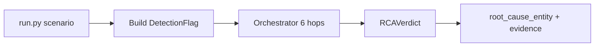
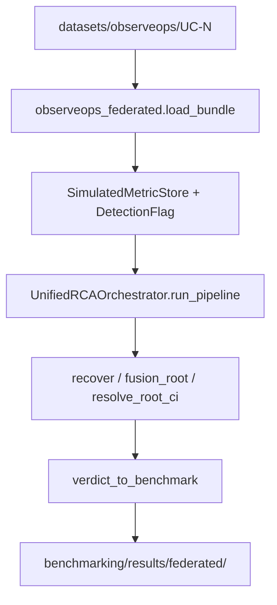

# Federated RCA — Architecture, Components & Workflow

**Status:** Optional ObserveOps track. For ObserveOps UC-1..UC-5, **lean is primary** ([ADR-001](../../docs/ADR-001-lean-primary-engine.md)).  
**Role of this tree:** Federated PoC, same-corpus bakeoff comparator, and optional microservice / code-path / gray-failure hybrid.  
**Not:** ObserveOps’ shipping primary engine (that is [`lean-pipeline/`](../../lean-pipeline/docs/ARCHITECTURE.md)).

This document describes what the federated pipeline **actually implements** today (demos + ObserveOps bakeoff adapter), plus how that relates to the aspirational dual-tier design. Deeper hop contracts: [`ORCHESTRATOR.md`](./ORCHESTRATOR.md). Storage vision: [`STORAGE_TIERS.md`](./STORAGE_TIERS.md). Limits and deferred work: [`LIMITATIONS_AND_FUTURE.md`](./LIMITATIONS_AND_FUTURE.md).

---

## 1. Design intent

Federated synthesizes three independently published systems behind a coordination layer:

| Step | Algorithm | Question |
|------|-----------|----------|
| 1 | **Panorama** | Who is unhealthy (gray failure / observer evidence)? |
| 2 | **Murphy** | Which upstream entity best explains the symptom (MRF / Gibbs)? |
| 3 | **Nezha** | Which execution-path / event patterns shifted inside that entity? |

The **orchestrator** (`UnifiedRCAOrchestrator`) is the glue: trigger routing, schema translation, narrowing, and fusion. None of the three papers defines that contract.

| Quality | Federated ObserveOps profile (bakeoff) |
|---------|--------------------------------------|
| Accuracy | **5/5** on UC-1..UC-5 (tied with lean) |
| Reproducibility | **~40%** bit-stable (N=20) — Gibbs / synthetic-store variance |
| Verifiability | Fusion path + hop logs; harder than lean tier trail |
| Causal Validity | Murphy partial — strongest of the three papers, costly if global |

**ObserveOps conclusion:** Murphy’s CV edge did **not** buy extra top-1 accuracy on classic infra; lean wins cost–benefit as primary. Keep federated when microservice gray-failure + code-path depth is explicitly in scope.

---

## 2. System architecture

```
┌──────────────────────────────────────────────────────────────────┐
|  Surfaces                                                         |
|  Demo CLI: run.py (crawler / hipster / ingest)                    |
|  Bakeoff: benchmarking/.../run_federated.py + observeops adapter  |
|  Learning UI: index.html on :8770 (NOT an RCA API)                |
└───────────────────────────────┬──────────────────────────────────┘
                                |
                                v
┌──────────────────────────────────────────────────────────────────┐
|  UnifiedRCAOrchestrator  (poc/orchestrator.py)                    |
|  Hop1 DetectionFlag → Hop2 MurphyRequest → Hop3 Murphy            |
|  → Hop4 NezhaRequest → Hop5 Nezha → Hop6 fuse_verdict             |
└───────┬─────────────────┬─────────────────┬──────────────────────┘
        |                 |                 |
        v                 v                 v
┌───────────────┐ ┌───────────────┐ ┌─────────────────────────────┐
| Panorama      | | Murphy        | | Nezha                       |
| adapters +    | | murphy/ +     | | adapters + pattern_ranker   |
| majority port | | SimulatedStore| | optional Redis pc: scorer   |
└───────────────┘ └───────────────┘ └─────────────────────────────┘
        |                 |
        v                 v
┌──────────────────────────────────────────────────────────────────┐
|  PoC stores: in-memory structural (LOS/metrics/edges)             |
|              optional Dragonfly/Redis speed tier (tg:/pc:)        |
|  Production vision: Vortex/DashMap + Dragonfly fleet (deferred)   |
└──────────────────────────────────────────────────────────────────┘
```

### Package layout

| Path | Role |
|------|------|
| [`../poc/`](../poc/) | Orchestrator, adapters, ingest stub, demo scenarios, Phase 0 harness |
| [`../murphy/`](../murphy/) | Murphy MRF / Gibbs reference |
| [`../panorama/`](../panorama/) | Panorama Go reference + learning UI |
| [`../Nezha/`](../Nezha/) | Nezha reference + learning UI |
| [`../run.py`](../run.py) | Demo CLI |
| [`../deploy/`](../deploy/) | Learning-prototype systemd (:8770) — not ObserveOps RCA API |
| [`../index.html`](../index.html) | Learning prototypes hub |
| Bakeoff adapter | [`../../benchmarking/benchmark/adapters/observeops_federated.py`](../../benchmarking/benchmark/adapters/observeops_federated.py) |

---

## 3. Components

### 3.1 Orchestrator (`poc/orchestrator.py`)

**`UnifiedRCAOrchestrator.run_pipeline(flag, incident_time)`** — six hops.

| Hop | Action |
|-----|--------|
| 1 | Accept `DetectionFlag` (Panorama or simulated) |
| 2 | `flag_to_murphy_request` — schema translate |
| 3 | `MurphyAdapter.diagnose` → posterior over entities |
| 4 | `murphy_to_nezha_request` — narrow if `max(posterior) ≥ θ_murphy` |
| 5 | `NezhaAdapter.diagnose` — ranked pattern pairs |
| 6 | `fuse_verdict` — weighted fusion → `RCAVerdict` |

**Defaults (`OrchestratorConfig`):** `theta_pano=0.5`, `theta_murphy=0.3`, fusion weights `(0.2, 0.4, 0.4)`. Bakeoff uses `gibbs_iterations=4`.

Hop payload schemas: [`ORCHESTRATOR.md`](./ORCHESTRATOR.md).

### 3.2 Panorama adapters

| Module | Role |
|--------|------|
| `poc/adapters/panorama.py` | `detect_from_reports`, `detect_simulated` |
| `poc/adapters/panorama_majority.py` | Python InferPano majority port |

ObserveOps bakeoff builds a **simulated** detection flag from `symptom_seed` (not live multi-observer LOS on the corpus).

### 3.3 Murphy (`murphy/` + `poc/adapters/murphy.py`)

- **`Murphy.diagnose(symptom, ...)`** — counterfactual-style MRF + Gibbs sampling.  
- Strongest Causal Validity profile of the three papers; weakest Reproducibility (seed / sampling).  
- ObserveOps path seeds `SimulatedMetricStore` from the UC bundle (propagation rules, noisy-neighbor, cross-layer injections).

### 3.4 Nezha adapters

| Module | Role |
|--------|------|
| `poc/adapters/nezha.py` | `rank_patterns` (`S_C/(S_C+S_P)`), dataset / simulated diagnose |
| `poc/adapters/nezha_speed.py` | Score from Redis `pc:` keys |

Natural strength: microservice code-path / pair mining (hipster demo). On ObserveOps classic-infra bakeoff, **root CI is driven mainly by Murphy fusion / heuristics**; Nezha is underused for classic ObserveOps root selection.

### 3.5 Ingest & stores (PoC)

| Module | Role |
|--------|------|
| `poc/ingest.py` — `IngestNormalizer` | Dual-stream write stub (speed + structural) |
| `poc/stores/speed.py` | Dragonfly/Redis `tg:` / `pc:` writer |
| `poc/stores/structural.py` | In-memory LOS + metrics + edges |

Rust/NATS production normalizer and Vortex structural fleet are **aspirational** (Phase C / E) — see [`STORAGE_TIERS.md`](./STORAGE_TIERS.md), [`CAPACITY.md`](./CAPACITY.md).

### 3.6 Demo scenarios (`poc/scenarios/`)

| Scenario | Intent |
|----------|--------|
| `crawler` | Murphy Figure-1 style crawler incident |
| `hipster` | Online Boutique — expect `checkoutservice` |
| `ingest` | Dual-stream write-path exercise |

### 3.7 ObserveOps bakeoff adapter

**Path:** `benchmarking/benchmark/adapters/observeops_federated.py` (+ `run_federated.py`).

1. Load frozen UC bundle from `datasets/observeops/`.  
2. Build `SimulatedMetricStore` (seeded) with corpus-aware propagation.  
3. Build simulated `DetectionFlag` from symptom seed.  
4. Run `UnifiedRCAOrchestrator`.  
5. Post-pipeline ObserveOps fusion: recover Murphy posterior if empty; prefer upstream among high-posterior candidates; **`resolve_root_ci`** may fall back to lean-shared helpers (`shared_upstream`, `upstream_healthy`) when posterior is weak.  
6. Emit bakeoff verdict: `engine`, `root_ci`, `signature`, `contributor_cis`, `evidence`, `observations`, …

Contrast with lean: lean walks the typed CI graph + ObserveOps rules + CARE/tiers natively (`lean-pipeline/core_engine/observeops/engine.py`). Federated re-hosts the same corpus into Murphy’s metric world.

---

## 4. End-to-end workflows

### 4.1 Microservice demo (hipster / crawler)



Expected hipster: `root_cause_entity: checkoutservice`.

### 4.2 ObserveOps bakeoff



```bash
# From repo root
python3 benchmarking/benchmark/run_federated.py --all --run-id bakeoff-001
./benchmarking/benchmark/run_bakeoff.sh
```

### 4.3 Learning UI (not production RCA)

```bash
cd federated-pipeline && python3 -m http.server 8770
# → http://127.0.0.1:8770/  (index.html → algorithm prototypes)
```

systemd: `deploy/systemd/unified-rca-learning-prototype.service` serves static HTTP only. ObserveOps packaged API is lean on `:8780`.

---

## 5. Operations

```bash
cd federated-pipeline
pip install -r requirements.txt -r murphy/requirements.txt

PYTHONPATH=..:. python run.py --scenario hipster --verbose
PYTHONPATH=..:. python run.py --scenario hipster --with-speed-tier --verbose
PYTHONPATH=..:. python -m pytest tests/ -v

# Phase 0 capacity probe (Dragonfly/Redis)
PYTHONPATH=..:. python -m poc.benchmarks.phase0_dragonfly \
  --port 6380 --workers 4 --pipeline-size 128 --seconds 20
```

Tests: `tests/test_pipeline.py` (crawler/hipster E2E); `tests/test_ingest.py` (skips unless Redis `:6379`).

---

## 6. Related documents

| Document | Role |
|----------|------|
| [`LIMITATIONS_AND_FUTURE.md`](./LIMITATIONS_AND_FUTURE.md) | Honest limits + Phase C/E deferrals |
| [`ORCHESTRATOR.md`](./ORCHESTRATOR.md) | Hop contracts, fusion, open decisions |
| [`STORAGE_TIERS.md`](./STORAGE_TIERS.md) | Speed vs structural tier design |
| [`CAPACITY.md`](./CAPACITY.md) | PoC EPS measurements + 1B vision |
| [`REQUIREMENTS.md`](./REQUIREMENTS.md) | Federated PoC goals / status |
| [`ARCHITECTURE_RATIONALE.md`](./ARCHITECTURE_RATIONALE.md) | Novelty claim / paper gaps |
| [`../../docs/POC_BRIEFING.md`](../../docs/POC_BRIEFING.md) | ObserveOps end-to-end briefing |
| [`../../lean-pipeline/docs/ARCHITECTURE.md`](../../lean-pipeline/docs/ARCHITECTURE.md) | Primary ObserveOps engine |

---

*Federated-pipeline technical architecture. evaluation-aligned (2026-07-13): lean primary; federated optional hybrid.*
