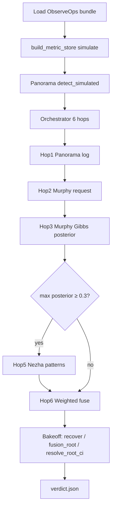

# Federated Pipeline — Sub-step Guide for Visual Simulation (UC-1)

**Purpose:** Explain every Federated diagnosis sub-step clearly enough that you can build a **frame-by-frame visual simulation** for the **same scenario as Lean** (UC-1), without running that simulation here.

**Sibling doc (Lean):** [`../../lean-pipeline/docs/TIERED_ESCALATION_VISUAL_GUIDE.md`](../../lean-pipeline/docs/TIERED_ESCALATION_VISUAL_GUIDE.md)  
**Code sources:** [`benchmarking/benchmark/run_federated.py`](../../benchmarking/benchmark/run_federated.py) · [`adapters/observeops_federated.py`](../../benchmarking/benchmark/adapters/observeops_federated.py) · [`poc/orchestrator.py`](../poc/orchestrator.py)  
**Related:** [ARCHITECTURE.md](./ARCHITECTURE.md) · [ORCHESTRATOR.md](./ORCHESTRATOR.md)

---

## 0. Correct mental model (vs Lean)

Federated is **not** a Tier‑1 → Tier‑2 → Tier‑3 escalator.

| Lean | Federated |
|------|-----------|
| Best-first walk + temporal + CARE + scoped causal | **Panorama → Murphy → Nezha → fusion** |
| Evidentiary tiers **1 / 2 / 3** | Bakeoff `evidentiary_tier` is only **1 = fusion OK** vs **2 = fallback** — **not** Lean CARE tiers |
| Tier‑3 = lean `verify_care_root` | Causal analogue = **Murphy counterfactual posterior** (Gibbs / MRF) |
| Bit-stable by design | Gibbs uses **global `np.random`** → can multi-hash across runs on some UCs |

**Policy contrast:** Lean *rations* causal validity (Tier‑3 only after CARE). Federated *runs* Murphy-style causal inference as a **core hop**, then fuses.

```
Lean:     Search/rules ──Δt?──► CARE ──verify?──► Tier 3 claim
Federated: Detect ──► Murphy posterior ──θ=0.3?──► Nezha ──► Fuse ──► resolve_root_ci
```

---

## 1. Same scenario inputs (UC-1 stage)

Identical cast as the Lean guide — so visuals can be **side-by-side**.

| Asset | Path | Role |
|-------|------|------|
| Topology | `datasets/observeops/UC-1/topology.json` | CIs + relations → Murphy entity graph |
| Anomalies | `…/anomalies.json` | Crossed signals → synthetic metric drivers |
| Symptom seed | `…/symptom_seed.json` | Panorama detection tip |
| GT (eval only) | `…/ground_truth.json` | `root_ci=esxi-host-01`, `signature=cpu_contention` |

**Seed:** `orders-api` / `request.p95_latency_ms` @ `2026-07-10T10:00:25Z`

| Time | CI | Signal | Value / thr |
|------|-----|--------|-------------|
| 10:00:05 | `esxi-host-01` | cpu.usage, cpu.ready | 92/85, 12/5 |
| 10:00:12 | `vm-app-01`, `vm-db-01` | cpu.ready | 11/5, 10/5 |
| 10:00:18 | `guest-os-vm-app-01` | load.avg | 8/4 |
| 10:00:25 | `orders-api` | request.p95_latency_ms | 1450/1000 |

**Causal chain (effect → cause):**  
`orders-api` → `guest-os-vm-app-01` → `vm-app-01` → `esxi-host-01`

**9 entities in store:** switch, esxi, datastore, 3 VMs (incl. neighbor), 2 guests, orders-api.

---

## 2. End-to-end flow (one page)



**Simulation tip:** Split into **(A) corpus → simulated telemetry**, **(B) 6 orchestrator hops**, **(C) bakeoff resolver**. Lean’s animation chapters were search frames; Federated’s are **pipeline hops**.

---

## 3. Sub-step A — Bundle → SimulatedMetricStore

**Module:** `benchmarking/benchmark/adapters/observeops_federated.py` · `build_metric_store`  
**Store:** `murphy/adapters/simulated_store.py` · **seed = 42**

### What it is

Federated does **not** walk crossed anomalies like Lean’s search. It builds a **synthetic metric history** so Murphy can run counterfactual queries.

### Steps to animate

1. **Map nodes → Murphy entities** (`TYPE_MAP`):  
   Service→`microservice`, GuestOS→`container`, VM→`vm`, Hypervisor→`host`, Datastore→`datastore`, NetworkPort→`nic`.
2. **Wire metadata** from topology: directed edges, `host_id` / `vm_id` / …, neighbor lists (via Lean `upstream_map`).
3. **Seat anomaly series** for each `(ci, signal)` with baselines; inject drivers at earliest crossed times.
4. **Propagation rules** (examples that fire on UC-1):  
   - `cpu.usage` → `cpu.ready` (`hosted_by`)  
   - `cpu.ready` → `load.avg`  
   - `load.avg` → `request.p95_latency_ms` (`runs_on`)
5. **`store.simulate(incident_time, lookback_days=7, interval_minutes=30)`** then overlay corpus values and re-propagate at symptom time.

### Visual frames

1. Empty “lab” → topology appears.  
2. Each CI sprouts time-series strips.  
3. Fault inject at 10:00:05 on esxi → ripple down the chain to orders-api at 10:00:25.  
4. Caption: “Murphy will query *this simulated world*, not Lean’s anomaly walk.”

### Constants

| Constant | Value |
|----------|-------|
| `MURPHY_SEED` | `42` (store simulation) |
| Lookback | 7 days @ 30 min intervals (adapter path) |

---

## 4. Sub-step B — Panorama detection (Hop 1)

**Module:** `poc/adapters/panorama.py` · `detect_simulated`

### What it is

Creates a **DetectionFlag** from the symptom seed (ObserveOps is simulated — not live majority-vote observers).

### UC-1 output

| Field | Value |
|-------|--------|
| entity | `orders-api` |
| metric | `request.p95_latency_ms` |
| status | `UNHEALTHY` |
| evidence_score | `0.85` |
| observer_count | `5` |
| incident_id | **new UUID every run** |

### Visual frames

1. App node alarms.  
2. Flag card pins to `orders-api`.  
3. Note: UUID changes each run (affects hop-log identity, **not** typical `verdict.json` root).

### Hop logging

Orchestrator records hop‑1 as `panorama` with input/output content hashes + latency.

---

## 5. Sub-step C — Orchestrator → Murphy request (Hop 2)

**Module:** `poc/orchestrator.py` · `flag_to_murphy_request`

### What it packages

```
MurphyRequest:
  symptom_entity = orders-api
  symptom_metric = request.p95_latency_ms
  lookback ≈ 168h
  gibbs_iterations = 4   # adapter/orchestrator setting
```

### Visual

Flag morphs into a “Murphy ticket” with lookback window highlight on the time-series strips.

---

## 6. Sub-step D — Murphy causal posterior (Hop 3) — the heavy step

**Modules:** `poc/adapters/murphy.py` · `murphy/murphy.py` · `murphy/mrf.py` · `murphy/graph.py`

### What it is

**Paper-backed causal-ish ranking:** relationship graph → prune candidates → per-entity ridge models → **counterfactual Gibbs sampling** (`n_samples=2000`) → significance → anomaly scores → **normalized posterior** `{entity_id → mass}`.

This is Federated’s analogue to Lean’s “causal claim,” but it is a **probability over entities**, not Lean Tier‑3 topology checks.

### Inputs / outputs

| In | Out |
|----|-----|
| Simulated store + MurphyRequest | `MurphyResult.posterior` distribution |
| | Top entity + masses in `RCAVerdict.evidence["murphy"]` |

### Visual frames (spend most of the film here)

1. Pruned candidate set glowing on topology.  
2. Particle / sample rain = Gibbs iterations (suggest “2000 samples × 4 iters” as a meter).  
3. Bar chart builds: posterior mass per CI — **esxi should dominate on UC-1**.  
4. Callout mass ≈ **0.573** on `esxi-host-01` (matched bakeoff).  
5. Caption: “Counterfactual: if this CI were healthy, would symptom abate?” (Murphy intent).

### Reproducibility footnote (for a side panel)

| Stable | Unstable |
|--------|----------|
| Metric store `seed=42` | `EntityModel.sample` uses **unseeded** `np.random.normal` |
| UC-1 matched runs often one verdict hash | UC-2/3/5 can flip roots → multi-hash (~40% overall on UC bakeoff) |

---

## 7. Sub-step E — Nezha gate + patterns (Hops 4–5)

**Module:** `poc/adapters/nezha.py`  
**Gate:** `OrchestratorConfig.theta_murphy = 0.3` (same numeric family as bakeoff threshold)

### Hop 4 — Decide whether Nezha runs

```
if max(murphy_posterior) ≥ 0.3:
    build NezhaRequest for top Murphy entity
else:
    skip Nezha
```

UC-1: posterior ~0.57 → **Nezha runs**.

### Hop 5 — What Nezha does on ObserveOps

Simulated pattern ranking (`S_C / (S_C+S_P)` style). On classic infra packs, this is mostly **cosmetic** — it **does not** choose ObserveOps `root_ci`.

### Visual frames

1. Traffic light at θ=0.3 (green on UC-1).  
2. Pattern chips appear on esxi/app (optional).  
3. Caption: “Nezha informs fusion confidence; bakeoff root still from Murphy+resolver.”

---

## 8. Sub-step F — Weighted fusion (Hop 6)

**Module:** `poc/orchestrator.py` · `fuse_verdict`

### Defaults

| Weight | Source |
|--------|--------|
| 0.2 | Panorama evidence |
| 0.4 | Murphy posterior |
| 0.4 | Nezha score |

```
confidence ≈ 0.2·pano + 0.4·murphy + 0.4·nezha
```

Produces an in-memory `RCAVerdict` with evidence blobs for all three.

### Visual

Three meters blend into one confidence dial; root still provisional until bakeoff resolver.

---

## 9. Sub-step G — Bakeoff root resolver (post-pipeline)

**Module:** `observeops_federated.py` — this is what **`verdict.json` actually stores** for ObserveOps scoring.

### G1 — `recover_murphy_causal_posterior` (if needed)

If Gibbs distribution empty / significance rejected everyone: rebuild scores from graph + anomaly signals, L1-normalize. Optional keep symptom if direct fault.

### G2 — `fusion_root_from_posterior`

```
rank entities by posterior descending
keep those with score ≥ top_score × 0.2
prefer the most UPSTREAM among survivors   # Lean upstream_map direction
write as rca.root_cause_entity
```

**UC-1 visual:** Bars above 0.2×top → among them, walk upstream — **esxi wins over VMs/app**.

### G3 — `resolve_root_ci(…, theta_murphy=0.3)`

**Constant:** `MURPHY_POSTERIOR_THRESHOLD = 0.3`

```
max_posterior = max(distribution) or scalar posterior

if max_posterior ≥ 0.3:
    root = fused Murphy root
    if earliest crossed CI is upstream of that root:
        override to earliest   # fallback_fired=True, reason earliest_onset_upstream
    elif vm-neighbor + shared_upstream hits:
        remap to shared host/datastore
    else:
        keep fused root        # fallback_fired=False  ← UC-1 bakeoff
else:
    heuristic_root_ci: earliest → shared_upstream → upstream_healthy.gate
    fallback_fired=True, reason murphy_posterior<0.3
```

### Bakeoff “tier” (do not confuse with Lean)

```python
evidentiary_tier = 2 if fallback_fired else 1
```

| Field | UC-1 bakeoff (`run-bakeoff-phase-b-002`) |
|-------|------------------------------------------|
| `root_ci` | `esxi-host-01` |
| `murphy_posterior` | `0.573` |
| `fallback_fired` | `false` |
| `evidentiary_tier` | `1` (= fusion accepted) |
| `observations` | `6` (hop count) |
| GT match | **PASS** |

### Visual frames

1. Posterior bars → upstream magnet pulls crown to esxi.  
2. θ=0.3 gate: PASS.  
3. Earliest-onset check: esxi *is* earliest — no override fight.  
4. Verdict card: root + posterior + `fallback_fired=false`.

---

## 10. Recommended simulation chapter list (UC-1)

Mirror Lean’s scene numbering so a dual-player cut can intercut.

| # | Scene title | Sub-steps | Viewer should leave knowing… |
|---|-------------|-----------|------------------------------|
| 0 | Freeze the incident | Same pack as Lean | Shared corpus |
| 1 | Build the lab | Metric store + propagation | Federated needs a simulated world |
| 2 | Raise the flag | Panorama | Symptom = orders-api |
| 3 | Ask Murphy | Request packaging | Lookback + Gibbs budget |
| 4 | Sample the cause | Gibbs / posterior bars | esxi mass ≈ 0.57 |
| 5 | Nezha optional | θ gate + patterns | Soft scoring, not root picker |
| 6 | Fuse confidence | Weighted blend | Still provisional |
| 7 | Resolve for bakeoff | fusion_root + resolve_root_ci | How `verdict.json` is born |
| 8 | Verdict card | root, posterior, fallback, hop count | Compare to Lean Tier‑3 card |
| 9 | Repro aside | seed vs np.random | Why Fed ≠ 100% on all UCs |

---

## 11. Data contract for a visual tool

```json
{
  "uc_id": "UC-1",
  "engine": "federated",
  "seed_ci": "orders-api",
  "seed_signal": "request.p95_latency_ms",
  "entities": [{"id": "esxi-host-01", "murphy_type": "host"}],
  "topology_edges": [{"from": "orders-api", "to": "guest-os-vm-app-01"}],
  "detection_flag": {
    "entity": "orders-api",
    "metric": "request.p95_latency_ms",
    "evidence_score": 0.85
  },
  "murphy": {
    "n_samples": 2000,
    "gibbs_iterations": 4,
    "posterior": {"esxi-host-01": 0.573, "vm-app-01": 0.12},
    "top_entity": "esxi-host-01"
  },
  "nezha_ran": true,
  "theta_murphy": 0.3,
  "fusion_confidence": 0.0,
  "resolve": {
    "root_ci": "esxi-host-01",
    "fallback_fired": false,
    "fallback_reason": null,
    "evidentiary_tier_bakeoff": 1,
    "murphy_posterior": 0.573
  },
  "observations": 6,
  "hops": [
    {"hop": 1, "component": "panorama"},
    {"hop": 3, "component": "murphy"},
    {"hop": 5, "component": "nezha"},
    {"hop": 6, "component": "orchestrator"}
  ]
}
```

Fill from `run_federated` in-memory `RCAVerdict` + `verdict.json`. Hop logs currently store **hashes/latency**, not full posterior — persist distribution in your sim exporter if you need per-CI bars.

---

## 12. Side-by-side UC-1: Lean vs Federated (for dual viz)

| Axis | Lean | Federated |
|------|------|-----------|
| Opening move | Best-first from seed | Simulate store + Panorama flag |
| Mid-game | Temporal Δt → CARE | Murphy Gibbs posterior |
| Causal claim | Tier **3** `verify_care_root` | Posterior **0.573** (≥ 0.3) |
| Root | `esxi-host-01` | `esxi-host-01` |
| Ambiguity handling | CARE severity + shared_upstream | fusion_root upstream preference + earliest override |
| Bakeoff tier field | `3` | `1` (meaning fusion OK — **different scale**) |
| `fallback_fired` | `true` (CARE path) | `false` |
| Repro N=20 (UC-1) | 100% | 100% on UC-1; engine overall ~40% |
| Observations | Crossed anomaly count / walk metrics | Orchestrator hop count (6) |

**Shared punchline for the closing slide:** Both get **`esxi-host-01`** on UC-1; they **disagree on how certainty is argued** (scoped checklist vs posterior mass).

---

## 13. One-line cheat sheet

| Sub-step | One line |
|----------|----------|
| **Metric store** | Turn UC pack into simulated time series (seed 42). |
| **Panorama** | Raise DetectionFlag on symptom seed. |
| **Murphy** | Gibbs/MRF → entity posterior (the causal-ish heart). |
| **θ gate** | Posterior ≥ 0.3 → invite Nezha. |
| **Nezha** | Pattern scores; soft input to fusion on ObserveOps. |
| **Fuse** | Weighted Pano/Murphy/Nezha confidence. |
| **Resolve** | Upstream among top posterior; θ fallback to heuristics. |
| **Not Lean tiers** | Bakeoff tier 1/2 ≠ CARE Tier 1/2/3. |

---

## 14. Pointers in code

| Concern | Path |
|---------|------|
| Bakeoff runner | `benchmarking/benchmark/run_federated.py` |
| Store / fusion / resolve | `benchmarking/benchmark/adapters/observeops_federated.py` |
| 6-hop orchestrator | `federated-pipeline/poc/orchestrator.py` |
| Panorama | `federated-pipeline/poc/adapters/panorama.py` |
| Murphy adapter | `federated-pipeline/poc/adapters/murphy.py` |
| Murphy core / MRF | `federated-pipeline/murphy/murphy.py`, `mrf.py` |
| Nezha | `federated-pipeline/poc/adapters/nezha.py` |
| UC-1 pack | `datasets/observeops/UC-1/` |
| Example verdict | `benchmarking/results/federated/UC-1/run-bakeoff-phase-b-002/verdict.json` |
| Lean sibling | `lean-pipeline/docs/TIERED_ESCALATION_VISUAL_GUIDE.md` |
