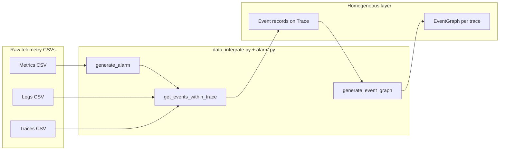
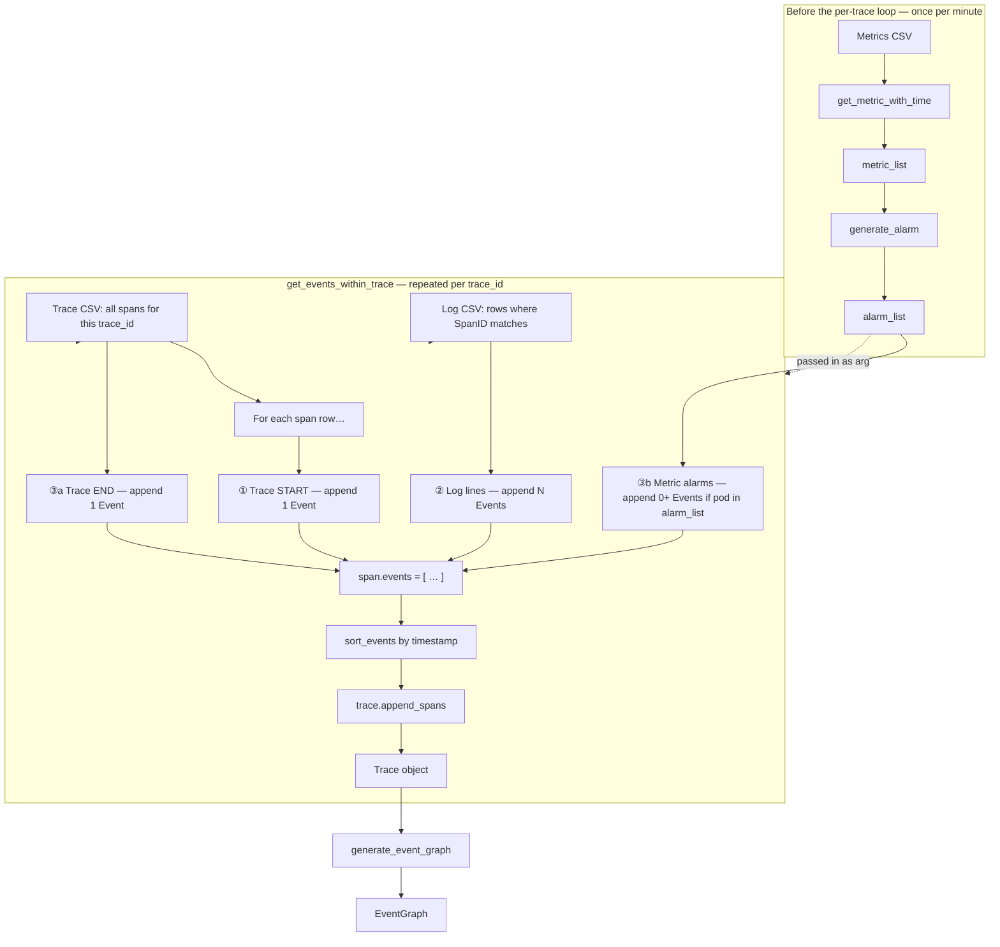

# Nezha: How Metrics, Logs, and Traces Unify Into Events

> **Unified RCA — Tier 3 (Code-Level RCA)**
> Nezha's core trick is **not** to keep three parallel pipelines. Everything is normalized into one **`Event` record**, then wired into an **event graph** per request (trace). Pattern mining only sees **directed event pairs** — it no longer cares whether a node came from a span, a log line, or a metric alarm.

| | |
|:---|:---|
| **Document** | Nezha learning dissection |
| **Tier** | 3 — Code-level RCA (event-pair drift) |
| **Code** | `Nezha/` · `data_integrate.py` · `pattern_ranker.py` |
| **Simulator** | [127.0.0.1:8770/#nezha](http://127.0.0.1:8770/#nezha) |
| **Related** | [Panorama (Tier 1)](Panorama_dissection.md) · [Murphy (Tier 2)](Murphy_dissection.md) |
| **Print (A4)** | `./federated-pipeline/scripts/build-dissection-pdf.sh Nezha-dissection.md` |

---

## Contents

1. [How to Read This Document](#how-to-read-this-document)
2. [The Big Picture (30-Second Version)](#the-big-picture-30-second-version)
3. [Core Design Insight: Why Homogenize?](#core-design-insight-why-homogenize)
4. [Input File Layout](#input-file-layout-whats-on-disk)
5. [Level 1 — Top-Level Pipeline (A → E → G)](#level-1--top-level-pipeline-a--e--g)
6. [Level 2 — Inside E: The Span Sandwich](#level-2--inside-e-the-span-sandwich)
7. [Pillars and Slices](#pillars-and-slices-intuitive-geometry)
8. [Inside get_events_within_trace()](#inside-get_events_within_trace--source-by-source)
9. [The Homogeneous Event Record](#the-homogeneous-event-record)
10. [Event Graph: Nodes and Edges](#event-graph-nodes-and-edges)
11. [What Pattern Mining Counts](#what-pattern-mining-counts)
12. [Design Tradeoffs: Why Pairs?](#design-tradeoffs-why-pairs)
13. [Cheat Sheet](#cheat-sheet)
14. [Where to Go Next](#where-to-go-next)

---

## How to Read This Document

Work through sections **in order**. Each section builds on the previous one.

> **input file layout → core design insight → pipeline map → span assembly → Event shape → graph rules → pattern mining → design tradeoffs**

For reference, jump to the [Cheat Sheet](#cheat-sheet).

### Where Nezha sits in Unified RCA

| Tier | Tool | Question |
|:----:|:-----|:---------|
| 1 | [Panorama](Panorama_dissection.md) | Who is unhealthy right now? |
| 2 | [Murphy](Murphy_dissection.md) | Which upstream entity caused this performance symptom? |
| 3 | **Nezha** (this doc) | Which code-path event patterns shifted? |

---

## The Big Picture (30-Second Version)

```
CSV files (metrics, logs, traces)
        ↓
  generate_alarm  →  alarm_list (which pods are hot right now)
        ↓
  get_events_within_trace  →  Trace { spans: [ Event, Event, … ] }
        ↓
  generate_event_graph  →  EventGraph (nodes + directed edges)
        ↓
  get_pattern_support  →  pattern dictionary (pair counts)
```

---

<div class="pagebreak"></div>
## Core Design Insight: Why Homogenize?

Before diving into the pipeline, it's worth understanding the *bet* Nezha makes — because it shapes every design decision downstream.

### Why merge three telemetry types into one `Event`?

Each telemetry type alone is incomplete for RCA:

- **Metrics** tell you *something is wrong* on a pod (CPU spike, memory pressure) but not *what* happened inside the request.
- **Logs** tell you *what happened* inside a service but have no causal link to other services.
- **Traces** give you the request path across services but no insight into internal service behavior.

**Nezha's answer**: homogenize all three into `Event` records on a shared timeline, so every signal — span boundaries, log lines, metric alarms — becomes a node in the same directed graph. Pattern mining then sees *one* unified story per request, not three fragmented ones.

### Why cluster IDs make this valid

The key move: every `Event`'s `.event` field is a **Drain3 cluster_id** (a stable integer). This applies equally to:

- Real log lines: `"Failed to connect payment service"` → cluster `47`
- Synthetic span-boundary strings: `"checkoutservice CheckoutService/PlaceOrder start"` → cluster `12`
- Metric alarm names: `"CpuUsageRate(%)"` → cluster `89`

All three go through the *same* `log_parsing()` → Drain3 call. In the final graph, the nodes are just integers. Pattern mining has no way to tell — and doesn't need to know — which telemetry type produced a given node.

> **Span-boundary strings clarified:** A trace span row carries metadata (`OperationName`, timestamps, `PodName`) but no message. Nezha *fabricates* a string:
>
> ```python
> start_event = service + " " + spans['OperationName'] + " start"
> # → "checkoutservice CheckoutService/PlaceOrder start"
> ```
>
> This synthetic string is then fed through `log_parsing()` exactly like a real log line, yielding a cluster ID. Span starts and ends become first-class events with no special treatment.

### Why temporal ordering is the right RCA signal

Think of each trace as a witness account at a crime scene. A single trace tells you the sequence of events for one request. Thousands of traces across a fault window tell you which sequences are *statistically anomalous* — *things that happened together during the fault that almost never happen together in normal operation.*

The causal chain ("A happened, then B happened, then failure") is more precise than a global snapshot ("these things were happening across the system at time T"). **Temporal ordering encodes cause-and-effect, not just co-occurrence**.

---

### How events are derived from the files

it's two sequential JOINs:

```
traceid.csv  →  JOIN trace.csv ON TraceID  →  get all spans for this request
                         ↓
                  JOIN log.csv ON SpanID   →  attach log lines to each span
```

First join gives you the span rows (*boundaries, pod names, timestamps*).

Second join pulls the log lines that belong to each span.

Then alarm events are a lookup — not a JOIN — because `alarm_list` is already an in-memory dict keyed by pod name, so it's O(1) per span: "*is this span's pod in the alarm dict?*"

---

One thing worth noting that differs from a standard RDBMS JOIN: the trace CSV contains **all spans across all trace IDs for that minute**. So the first join is actually a filter — scan the whole file, keep only rows where `TraceID` matches. In a database you'd have an index; here it's a pandas filter. At scale this is one of Nezha's cost centers — every trace ID re-scans the same file.

The log join works the same way: log.csv has all log lines for the minute across all pods and spans, filtered down by `SpanID`.

```py
So the access pattern is:
    for each trace_id in traceid.csv:
        spans = trace_df[trace_df['TraceID'] == trace_id]      # JOIN 1
        for each span in spans:
            logs = log_df[log_df['SpanID'] == span_id]         # JOIN 2
            alarms = alarm_dict.get(pod_name, [])              # LOOKUP
```

---

<div class="pagebreak"></div>
## Input File Layout (What's on Disk)

Nezha does **not** use "one CSV per modality per minute." Traces and logs are **minute-bucketed**; metrics are **per-pod time series** scanned for the target minute.

### Directory Tree (one date, e.g. `rca_data/2022-08-22/`)

```
rca_data/2022-08-22/
├── trace/
│   ├── 05_01_trace.csv          ← all spans in the 05:01 minute
│   ├── 05_02_trace.csv
│   └── …
├── traceid/
│   ├── 05_01_traceid.csv        ← one TraceID per line (no header)
│   ├── 05_02_traceid.csv
│   └── …
├── log/
│   ├── 05_01_log.csv            ← all log lines in the 05:01 minute
│   ├── 05_03_log.csv            ← fault RCA may use a nearby minute
│   └── …
└── metric/
    ├── checkoutservice-578fcf4766-9csqn_metric.csv   ← one file per pod
    ├── frontend-579b9bff58-t2dbm_metric.csv
    ├── cartservice-579f59597d-wc2lz_metric.csv
    └── …                         (many rows per file — ~1/minute)
```

The same layout exists under **`construct_data/`** (fault-free baseline) and **`rca_data/`** (fault window).

### Files Loaded for One RCA Query Minute

For `get_pattern("2022-08-22 05:01", …)` in `pattern_ranker.py`:

| #   | File            | Path pattern                                       | Role                                                                                                                          |
| --- | --------------- | -------------------------------------------------- | ----------------------------------------------------------------------------------------------------------------------------- |
| 1   | **Trace spans** | `{data_path}/{date}/trace/{HH}_{mm}_trace.csv`     | All spans in that minute: `TraceID`, `SpanID`, `ParentID`, `PodName`, `OperationName`, `StartTimeUnixNano`, `EndTimeUnixNano` |
| 2   | **Trace IDs**   | `{data_path}/{date}/traceid/{HH}_{mm}_traceid.csv` | Which requests to process — one `TraceID` per line                                                                            |
| 3   | **Logs**        | `{data_path}/{date}/log/{HH}_{mm}_log.csv`         | Log lines keyed by `SpanID`, with `TimeUnixNano` and JSON `Log` body                                                          |
| 4   | **Metrics**     | `{data_path}/{date}/metric/*_metric.csv`           | **Not** one file per minute — `get_metric_with_time()` scans every pod file and picks the row matching the query timestamp    |

```python
# pattern_ranker.py lines 28-40
trace_file = data_path + "/" + date + "/trace/" + str(hour) + "_" + str(min) + "_trace.csv"
trace_id_file = data_path + "/" + date + "/traceid/" + str(hour) + "_" + str(min) + "_traceid.csv"
log_file = data_path + "/" + date + "/log/" + str(hour) + "_" + str(min) + "_log.csv"

metric_list = get_metric_with_time(detete_time, data_path)
alarm_list = generate_alarm(metric_list, ns)
event_graphs = data_integrate(trace_file, trace_id_file, log_file, alarm_list, ns, log_template_miner)
```

### Sample Column Shapes

**`05_01_trace.csv`**:

```
TraceID, SpanID, ParentID, PodName, OperationName, StartTimeUnixNano, EndTimeUnixNano, Duration
```

**`05_01_traceid.csv`** — plain list, no header:

```
000b7a6e3e2507644c6fb503d48e40f4
00f6d6c57d587ee1d9bbfb15a726a637
…
```

**`05_03_log.csv`**:

```
Timestamp, TimeUnixNano, Node, PodName, Container, TraceID, SpanID, Log
```

**`checkoutservice-…_metric.csv`** — time series per pod:

```
Time, TimeStamp, PodName, CpuUsageRate(%), MemoryUsageRate(%), …
```

`get_metric_with_time()` also derives **`NetworkP90(ms)`** from the minute's trace CSV for each pod (`alarm.py`).

### How Files Map to A → E → G

```
Per query minute "2022-08-22 05:01":

  trace/05_01_trace.csv  ──────┐
  traceid/05_01_traceid.csv  ──┼──►  E  (once per TraceID in traceid file)
  log/05_01_log.csv      ─────┤
                               │
  metric/*.csv ──► filter row ──►  A  ──►  alarm_list ──►  E

  E (per trace) ──►  Trace { spans, events }
  G (per trace) ──►  EventGraph
```

| Modality    | On-disk shape                       | Pipeline step                            |
| ----------- | ----------------------------------- | ---------------------------------------- |
| **Traces**  | 2 CSVs/minute (`trace` + `traceid`) | Direct input to **E**                    |
| **Logs**    | 1 CSV/minute                        | Direct input to **E** (join on `SpanID`) |
| **Metrics** | N CSVs/day (per pod)                | **A** first → `alarm_list` → **E**       |

### Two Dataset Phases

| Phase               | Directory         | Used for                                          |
| ------------------- | ----------------- | ------------------------------------------------- |
| **Normal baseline** | `construct_data/` | Building expected pattern dictionary (fault-free) |
| **Fault window**    | `rca_data/`       | Abnormal patterns during/after fault injection    |

Nezha compares pattern supports from both phases (`construct_data` vs `rca_data`) when ranking root causes. The signal is not "this pair appears often" — it's "this pair appears *far more* during the fault than in normal operation."

---

<div class="pagebreak"></div>
## Level 1 — Top-Level Pipeline (A → E → G)

Three **functions**, not three telemetry types.



### What Each Step Takes In and Hands Off

| Step  | Function                                     | Input                                                         | Output                                                                                           | Fed to                           |
| ----- | -------------------------------------------- | ------------------------------------------------------------- | ------------------------------------------------------------------------------------------------ | -------------------------------- |
| **A** | `generate_alarm`                             | `metric_list` — per-pod metric values for one minute          | `alarm_list` — e.g. `[{pod: "checkoutservice-…", alarm: [{metric_type: "CpuUsageRate(%)", …}]}]` | Parameter into **E**             |
| **E** | `get_events_within_trace` (× many trace IDs) | Trace CSV, log CSV, one `trace_id`, `alarm_list`, Drain miner | One **`Trace`** object: `{ traceid, spans: [ Span, … ] }`                                        | **G** (once per trace)           |
| **G** | `generate_event_graph`                       | Completed **`Trace`**                                         | One **`EventGraph`** (adjacency list)                                                            | `get_pattern_support()` → ranker |

**Execution frequency:** A runs **once per time window**. E runs **once per trace ID**. G runs **once per trace** returned by E.

**Silent spans are inert, not harmful.** A span with no log lines and no metric alarm produces a single pillar edge: `start → end`. This pair appears with roughly equal support in both `construct_data` and `rca_data`, so its anomaly score ≈ 0 and it doesn't rank. The two-phase comparison noise-cancels structurally-present-but-informationally-empty edges automatically — no explicit filtering needed. This also means Nezha is robust to uneven instrumentation: a heavily-logged service and a nearly-silent one can coexist in the same trace without the silent spans polluting the ranking.

**A / E / G mnemonic:** **A**larms (from metrics) → **E**vents (homogeneous records on a `Trace`) → **G**raph (`EventGraph`).

Metrics do **not** skip E — `alarm_list` is an input to E, where matching pods get alarm `Event`s appended to spans. So E draws from **all three** sources: trace rows (span start/end), log rows (application messages), and `alarm_list` (metric-derived flags).

---

<div class="pagebreak"></div>
## Level 2 — Inside E: The Span Sandwich

Traces, logs, and metrics are **not** three sub-pipelines inside E. They are **three sequential append passes** on the same in-memory `span.events` list.



### The Sandwich Pattern (One Span)

```
① append START     (from trace row — StartTimeUnixNano)
② loop LOGS        (from log CSV — each TimeUnixNano)
③ append END       (from trace row — EndTimeUnixNano, may be pushed later)
④ append ALARMS    (from alarm_list — optional, then re-sorted)
⑤ sort_events()
```

Visually:

```
[PlaceOrder start]   ← trace boundary (synthetic string → cluster_id)
[Prepare order OK]   ← real log
[Start charge card]  ← real log
[Charge fail]        ← real log
[PlaceOrder end]     ← trace boundary (synthetic string → cluster_id)
[CpuUsageRate(%)]    ← metric alarm (if pod was hot) — sorted into position
```

`end_event` is **defined** next to `start_event` but **appended only after** the log loop, so late log timestamps can push the end boundary forward:

```python
# data_integrate.py lines 283-300
if timestamp - end_timestamp > 0:
    end_timestamp = timestamp + 1
...
span.append_event(Event(timestamp=end_timestamp, event=log_parsing(...)))
```

### Sub-Step I/O Table

| Sub-step          | Reads from                                | After this step `span.events` looks like     |
| ----------------- | ----------------------------------------- | -------------------------------------------- |
| **① Trace START** | One trace CSV row                         | `[ start ]`                                  |
| **② Logs**        | Log CSV filtered by `SpanID`              | `[ start, log₁, log₂, … ]`                   |
| **③a Trace END**  | Same trace row (`EndTimeUnixNano`)        | `[ start, logs…, end ]`                      |
| **③b Alarms**     | `alarm_list` from step A (not from logs!) | `[ …, end, maybe alarms ]` → then **sorted** |

**Key rule:** Logs do not feed metrics. Metrics are pre-scored into `alarm_list` before E runs. E only looks up whether this span's pod has an alarm.

### Worked Example — One checkoutservice Span (`checkout_exception`)

**Inputs (three sources, same request):**

| Source       | Data                                                                        |
| ------------ | --------------------------------------------------------------------------- |
| Trace row    | `SpanID=abc`, `OperationName=PlaceOrder`, start/end timestamps              |
| Log rows     | `SpanID=abc` → `"Start charge card"`, `"Failed to connect payment service"` |
| `alarm_list` | `[]` (exception faults often have no metric alarm)                          |

**`span.events` growing inside E:**

```
After ① START:
  [ Event(T₀, cluster_12) ]            # PlaceOrder start

After ② LOGS:
  [ Event(T₀, 12), Event(T₁, 45), Event(T₂, 47) ]
  #  start          Start charge card   Failed to connect…

After ③ END:
  [ …, Event(T₃, 13) ]                 # PlaceOrder end

After sort → appended to Trace with frontend, payment spans, etc.
```

**Output of E:** `Trace { spans: [ frontend_span, checkout_span, payment_span, … ] }`

**Input to G:** that `Trace` → **Output:** `EventGraph` with edges `12→45→47→13` plus cross-span parent→child links.

---

<div class="pagebreak"></div>
## Pillars and Slices (Intuitive Geometry)

Think of one request as a horizontal row across services. Each span is a vertical column of time-ordered events.

> **Key mental model:** Logs are the *interior* of each vertical pillar. Traces provide the *horizontal slice* that links pillars across services via TraceID + parent/child linkage. Nezha adds **synthetic boundary caps** (start/end strings → cluster IDs) to the top and bottom of every pillar — so the graph is never log-only, and every span contributes at least two nodes even if it emitted zero log lines.

```
Time ──────────────────────────────────────────────►

frontend span          checkoutservice span       paymentservice span
     │                         │                          │
     │  [Recv start]           │  [PlaceOrder start]      │  [Charge start]
     │       │                 │       │                  │       │
     │  [log: page served]     │  [Prepare order OK]      │  [Charge OK]
     │       │                 │       │                  │       │
     │  [Recv end]             │  [Start charge card]     │       │
     │                         │       │                  │       │
     │                         │  [Charge fail]           │       │
     │                         │  [PlaceOrder end]        │  [Charge end]
     ▼                         ▼                          ▼
   (pillar)                  (pillar)                   (pillar)
```

| Metaphor             | Meaning in Nezha                                                               |
| -------------------- | ------------------------------------------------------------------------------ |
| **Vertical pillar**  | One span's `events[]` — start, logs, end, optional alarm — sorted by timestamp |
| **Horizontal slice** | One `TraceID` linking pillars via `parentid` / `spanid`                        |

Each pillar is **not** logs-only. Trace CSV supplies the top and bottom caps:

```
span start   (trace — synthetic string)
log events   (logs — real messages)
span end     (trace — synthetic string)
alarm        (metrics — optional, sorted into position)
```

`generate_event_graph()` flattens pillars + slice into one DAG: consecutive edges within a pillar (Rule A), parent→child edges across pillars (Rule B).

---

<div class="pagebreak"></div>
## Inside `get_events_within_trace()` — Source by Source

### ① Traces → Span Boundary Events

Span rows have no message. Nezha fabricates one:

```python
# data_integrate.py lines 257-263
start_event = service + " " + spans['OperationName'].iloc[span_index] + " start"
end_event   = service + " " + spans['OperationName'].iloc[span_index] + " end"
# → "checkoutservice CheckoutService/PlaceOrder start"
# → "checkoutservice CheckoutService/PlaceOrder end"

span.append_event(Event(
    timestamp=np.ceil(spans['StartTimeUnixNano'].iloc[span_index]).astype(int),
    event=log_parsing(log=start_event, pod=pod, log_template_miner=log_template_miner),
    ...))
```

These synthetic strings pass through `log_parsing()` identically to real logs, yielding cluster IDs.

### ② Logs → Application Events

Logs join spans by `SpanID`, sorted by `TimeUnixNano`, inserted between start and end:

```python
# data_integrate.py lines 290-291
span.append_event(Event(
    timestamp=timestamp,
    event=log_parsing(log=log, pod=pod, log_template_miner=log_template_miner),
    ...))
```

`log_parsing` extracts the message, then Drain3 returns a **`cluster_id`**:

```python
# log_parsing.py lines 26-57
def log_parsing(log, pod, log_template_miner, logrca=False):
    log_message, service = pod_to_service(log, pod)
    result = log_template_miner.add_log_message(log_message)
    return result['cluster_id']
```

`"Start charge card"` → stable integer template ID (e.g. `45`) — not raw text in the graph.

### ③ Metrics → Alarm Events

Metrics are **not** read inside the log loop. `generate_alarm()` already produced `alarm_list` for the minute. If `span.pod` matches, alarm events are injected at timestamp ≈ span start:

```python
# data_integrate.py lines 313-314
span.append_event(Event(
    timestamp=np.ceil(spans['StartTimeUnixNano'].iloc[span_index]).astype(int) + index + 1,
    event=log_parsing(log=alarm_dict["alarm"][index]["metric_type"], pod="alarm", ...),
    ...))
```

The "log message" is the metric name, e.g. `CpuUsageRate(%)`, with `pod="alarm"`. Same `Event` shape as everything else.

---

<div class="pagebreak"></div>
## The Homogeneous `Event` Record

"Homogeneous" means **same Python object, same fields** — not "all events are logs."

```python
# data_integrate.py lines 140-147
class Event(object):
    def __init__(self, event, pod, ns, timestamp=None, spanid=None, parentid=None):
        self.event = event        # Drain3 cluster_id (int) — the unified "event type"
        self.pod = pod            # which pod this happened on
        self.timestamp = timestamp  # nanoseconds — ordering within/across spans
        self.spanid = spanid      # trace linkage
        self.parentid = parentid  # trace linkage
        self.ns = ns              # namespace
```

| Field                 | Meaning                                                |
| --------------------- | ------------------------------------------------------ |
| `event`               | **Drain3 cluster_id** (int) — the unified "event type" |
| `timestamp`           | Nanoseconds — ordering within/across spans             |
| `pod`                 | Which pod this happened on                             |
| `spanid` / `parentid` | Trace linkage                                          |
| `ns`                  | Namespace (`hipster` = OnlineBoutique)                 |

To decode for humans: `from_id_to_template(cluster_id)` → e.g. `"Start charge card"`.

### After Integration — One Span (`checkout_exception`)

| Order | Source | Decoded template                                   |
| ----- | ------ | -------------------------------------------------- |
| 1     | trace  | `checkoutservice CheckoutService/PlaceOrder start` |
| 2     | log    | `Start charge card`                                |
| 3     | log    | `Failed to connect payment service` *(fault)*      |
| 4     | trace  | `checkoutservice CheckoutService/PlaceOrder end`   |

CPU fault may prepend `CpuUsageRate(%)` before span start (after `sort_events`).

---

<div class="pagebreak"></div>
## Event Graph: Nodes and Edges

`generate_event_graph()` builds **one directed graph per trace**.

### Nodes

- **Graph node** = full `Event` object (metadata + cluster_id).
- **Pattern identity** = `event.event` (the int). Pairs keyed as `str(from_id) + "_" + str(to_id)`.

```python
# data_integrate.py lines 162-167
def add_edge(self, node1, node2):
    if node1 not in self.adjacency_list.keys():
        self.adjacency_list[node1] = []
    self.adjacency_list[node1].append(node2)
    self.node_list.add(node1.event)
    self.node_list.add(node2.event)
```

### Edges — Two Rules

**Rule A — Intra-span (down the pillar):** consecutive events in time order.

```python
# data_integrate.py lines 437-441
for span in trace.spans:
    for index in range(1, len(span.events)):
        event_graph.add_edge(span.events[index-1], span.events[index])
```

**Rule B — Cross-span (horizontal slice):** parent span → child span.

```python
# data_integrate.py lines 443-461
for span in trace.spans:
    for parent_span in trace.spans:
        if parent_span.spanid == span.parentid:
            if parent_span.pod == span.pod:
                event_graph.add_edge(parent_span.events[index-1], span.events[0])
            else:
                event_graph.add_edge(parent_span.events[0], span.events[0])
```

Visually:

```
[Frontend/Recv. start] ──► … ──► [Frontend/Recv. end]
        │
        │ Rule B: parent → child (cross-span)
        ▼
[PlaceOrder start] ──► [Prepare OK] ──► [Start charge card] ──► [Charge fail] ──► [PlaceOrder end]
                                                                      ▲
                                            Rule A: consecutive       │
                                            events within span ───────┘
```

**Rule A encodes causality within a service** ("this log entry preceded this outcome"). **Rule B encodes call propagation across services** ("frontend calling checkout caused this checkout event").

---

<div class="pagebreak"></div>
## What Pattern Mining Counts

`EventGraph.get_support()` walks every directed edge:

```python
# data_integrate.py lines 209-217
def get_support(self):
    for key in self.adjacency_list.keys():
        for item in self.adjacency_list[key]:
            support_key = str(key.event) + "_" + str(item.event)
            ...
            self.support_dict[support_key] += 1
```

Example — `checkout_exception`:

```
"Start charge card" → "Charge successfully"    # high support in construct_data (normal)
"Start charge card" → "Failed to connect …"    # high support in rca_data (fault)
```

Nezha compares supports between `construct_data` and `rca_data` → expected-loss ranking.

---

<div class="pagebreak"></div>
## Design Tradeoffs: Why Pairs?

This is the most important conceptual question to hold when reading Nezha's output.

### The granularity spectrum

| Granularity        | Problem                                                                                                                                                                                       |
| ------------------ | --------------------------------------------------------------------------------------------------------------------------------------------------------------------------------------------- |
| **Single events**  | Too coarse. `"Failed to connect"` appears in every trace during a fault, regardless of which service caused it. No discrimination.                                                            |
| **Directed pairs** | Sweet spot — directional signal with enough repetition to accumulate support.                                                                                                                 |
| **Full paths**     | Too specific. A 6-hop path `12→45→47→13→89→23` rarely repeats identically across thousands of traces due to variation in log content, span ordering, and service topology. Support collapses. |

### Why the construct_data comparison compensates for pair simplicity

A pair with **high support in rca_data but near-zero support in construct_data** is already decisive — you don't need a longer chain to be confident the fault introduced it. The anomaly score from the two-phase comparison does much of the discriminating work that chain length would otherwise provide.

### Where pairs fall short

If two different faults produce the same anomalous pair (e.g., both a CPU spike and a memory leak on checkoutservice produce `CpuUsageRate(%) → PlaceOrder start`), the pair alone can't distinguish them. A longer chain would resolve this.

**Nezha's answer:** the full event path is preserved in the `EventGraph` and is reconstructable for human inspection. Pairs are used for *ranking* because counting triples or quads compounds the sparsity problem exponentially. When you inspect the simulation output, ask: does the top-ranked pair point at the root cause, or at the symptom closest to it?

### The practical implication for RCA

Nezha's pair-based ranking is a strong *first filter*, not a complete answer. A decisive pair score narrows the field to one or two candidate pods. Human inspection of the full event chain in that pod's spans confirms or refutes.

---

<div class="pagebreak"></div>
## Cheat Sheet

### Two Levels of "Steps"

| You see…                          | It means…                                           |
| --------------------------------- | --------------------------------------------------- |
| **A → E → G**                     | Three **functions** in the repo                     |
| **① Traces / ② Logs / ③ Metrics** | Three **append passes** on the same `Span` inside E |
| "Step 2 in old numbering"         | The `Event` **data shape** (not a pipeline stage)   |
| "Step 3 in old numbering"         | `generate_event_graph` (step G)                     |

### Telemetry → Graph

| Telemetry  | Becomes                                                      | Anchored by                   |
| ---------- | ------------------------------------------------------------ | ----------------------------- |
| **Trace**  | Span `start` / `end` events (synthetic strings → cluster_id) | Span timestamps               |
| **Log**    | Drain3 templates in span                                     | `SpanID` + log timestamp      |
| **Metric** | Alarm template (`CpuUsageRate(%)`, etc.)                     | `alarm_list` + span pod match |

| Graph element     | Is                                                                         |
| ----------------- | -------------------------------------------------------------------------- |
| **Node**          | One `Event` (cluster_id + metadata)                                        |
| **Edge (Rule A)** | "A before B" — consecutive events within a span (causality within service) |
| **Edge (Rule B)** | Parent span → child span first event (call propagation across services)    |
| **Pattern**       | Directed pair of cluster IDs, counted across traces                        |

### The Anomaly Signal

```
pair_score = support_in_rca_data - support_in_construct_data

High score = this pair is new or dramatically amplified during the fault
           = likely causal, not coincidental
```

---

<div class="pagebreak"></div>
## Where to Go Next

- **Simulation:** [http://127.0.0.1:8770/#nezha](http://127.0.0.1:8770/#nezha) — walkthrough steps mirror **E → G** (events on trace, then event graph).
- **Related:** [Panorama_dissection.md](Panorama_dissection.md) (Tier 1) · [Murphy_dissection.md](Murphy_dissection.md) (Tier 2).
- **Deeper dive:** pick one trace ID from `rca_data/2022-08-22` and walk `get_events_within_trace` → `generate_event_graph` → ranked pair for `checkout_exception`.
- **Extension:** what breaks if Drain3 cluster IDs are not stable across runs?
