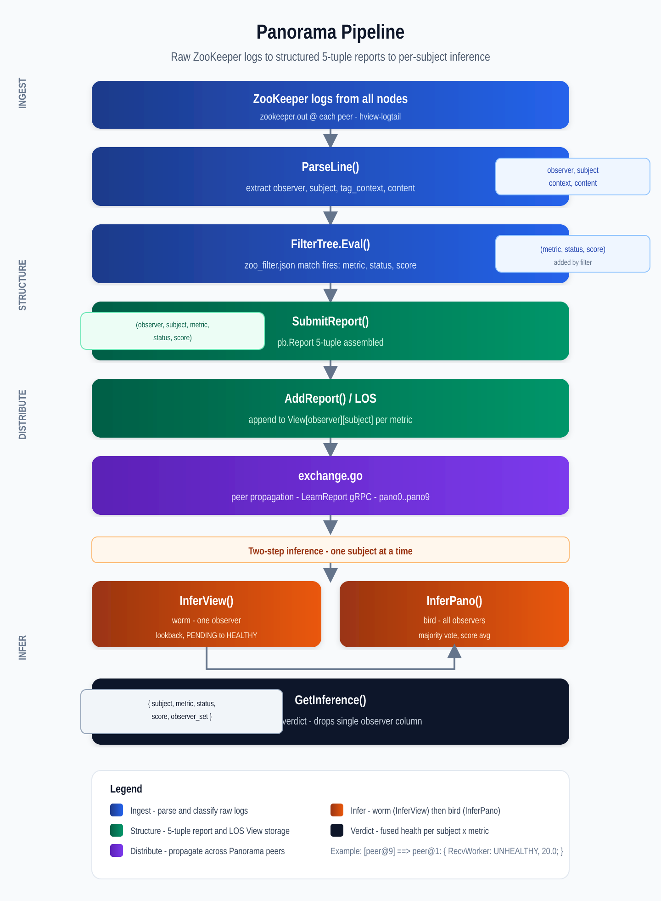

# Panorama: Distributed Fault Inference via Local Views

> **Unified RCA — Tier 1 (Symptom Detection)**
> Panorama's core trick is **not** to compare against a historical baseline. It collects each node's local observation of its neighbors, normalizes them into structured views, and reconciles disagreements via weighted majority. The signal is *convergence of independent observers*, not *deviation from normal*.


|                |                                                                                                   |
| -------------- | ------------------------------------------------------------------------------------------------- |
| **Document**   | Panorama learning dissection                                                                      |
| **Tier**       | 1 — Symptom detection (observer consensus)                                                        |
| **Code**       | `panorama/` · `filter.go` · `decision/majority.go`                                                |
| **Simulator**  | [127.0.0.1:8770/#panorama](http://127.0.0.1:8770/#panorama) |
| **Related**    | [Murphy (Tier 2)](Murphy_dissection.md) · [Nezha (Tier 3)](Nezha-dissection.md) |
| **Print (A4)** | `./federated-pipeline/scripts/build-dissection-pdf.sh Panorama_dissection.md` |


---


## Contents

1. [How to Read This Document](#how-to-read-this-document)
2. [The Big Picture (30-Second Version)](#the-big-picture-30-second-version)
3. [Core Design Insight: Why Not a Baseline?](#core-design-insight-why-not-a-baseline)
4. [The Report Tuple](#the-report-tuple-what-the-simplified-triplet-was-missing)
5. [LOS Storage](#los-storage-the-write-side-buffer)
6. [Two-Step Inference](#two-step-inference-inferview-then-inferpano)
7. [InferView vs InferPano (Worm / Bird)](#inferview-vs-inferpano-worm-view-and-bird-view)
8. [The Normalization Problem](#the-normalization-problem-why-raw-logs-are-incomparable)
9. [The Filter Tree](#the-filter-tree-zoo_filterjson--filtergo) — population, AND chains, validation
10. [Local Views](#local-views)
11. [Majority Reconciliation](#majority-reconciliation-decisionmajoritygo)
12. [Why It's Called Panorama](#why-its-called-panorama)
13. [Nezha vs Panorama](#nezha-vs-panorama-side-by-side)
14. [Key Files](#key-files)
15. [Cheat Sheet](#cheat-sheet)
16. [Where to Go Next](#where-to-go-next)

---


## How to Read This Document

Work through sections **in order** the first time.

> **core distinction → pipeline overview → worm/bird inference → normalization → filter tree → report tuple → local views → LOS storage → two-step inference → majority reconciliation → Nezha vs Panorama**

For reference, jump to the [Cheat Sheet](#cheat-sheet).

### Where Panorama sits in Unified RCA

| Tier | Tool | Question |
|:----:|:-----|:---------|
| 1 | **Panorama** (this doc) | Who is unhealthy right now? |
| 2 | [Murphy](Murphy_dissection.md) | Which upstream entity caused this performance symptom? |
| 3 | [Nezha](Nezha-dissection.md) | Which code-path event patterns shifted? |

---


## The Big Picture (30-Second Version)

<figure>
  
  <figcaption><strong>Figure 1 — Panorama pipeline.</strong> Each row in <strong>Observation Details</strong> is the same <strong>5-tuple</strong> <code>(observer, subject, metric, status, score)</code>. <code>GetInference()</code> returns a per-subject verdict with <code>observer_set</code> instead of a single observer. <a href="../assets/panorama-pipeline.svg">SVG (vector)</a></figcaption>
</figure>

| Phase | Step | Output |
|:------|:-----|:-------|
| **Ingest** | `ParseLine()` | `observer`, `subject`, `tag_context`, `content` |
| **Ingest** | `FilterTree.Eval()` | `metric`, `status`, `score` (from match) |
| **Structure** | `SubmitReport()` → `AddReport()` / LOS | Report stored in `View[observer][subject]` |
| **Distribute** | `exchange.go` | Reports propagated to pano0…pano9 |
| **Infer** | `InferView()` → `InferPano()` | Worm then bird — one subject at a time |
| **Verdict** | `GetInference()` | `{ subject, metric, status, score, observer_set }` |

---


## Core Design Insight: Why Not a Baseline?


### The Nezha approach and its limits

Nezha compares fault-window patterns against a fault-free baseline (`construct_data`). The signal is deviation: pairs that appear in `rca_data` but not in `construct_data`. This works well but has two constraints:

- You need enough fault-free data first — no warm-up, no signal.
- A singleton service with no peers can still leave traces and logs for Nezha to mine.


### Panorama's different bet

Panorama asks: **do independent observers agree right now?** If 4 out of 5 ZooKeeper followers independently log "leader unreachable" within the same time window — no historical baseline needed — that convergence *is* the signal.

> **The family member metaphor:** Rather than looking up a patient's medical records (centralized logs/traces/metrics as in Nezha), Panorama asks the closest family members — the nodes in direct contact with the affected node — to report what they observed. Each node's logs are a local observation of its neighbors' health, not just a record of its own internal behavior.

This makes Panorama:

- **Baseline-free** — catches a fault the first time it ever happens.
- **Observer-dependent** — needs multiple nodes watching the same subject. Can't work on a singleton service with no peers.
- **Scale-friendly** — gets *stronger* as you add more servers (more observers per subject). Nezha's scan cost grows with server count; Panorama's inference confidence grows.

---


## The Report Tuple: What the Simplified Triplet Was Missing

Our initial mental model used a 3-field triplet: `(observer, subject, state)`. The real report produced by Panorama is a **5-tuple**:

```
(observer,  subject,  metric/context,  status,  score)
```


### The two extra fields

**Metric / Context** — scopes the status to a specific component dimension. Extracted as `tag_context` during `ParseLine()`. Examples: `SyncThread`, `LearnerHandler`, `WorkerSender`, `cpu`. A single subject can carry multiple metrics with independent statuses simultaneously:

```
subject=peer@9:
  SyncThread    → UNHEALTHY, score=20
  LearnerHandler → DEAD,      score=0
```

These are separate reports, not overwrites. Metric is the key that namespaces health state per component.

**Score** — numeric severity/confidence (0–100). Averages across observers in `InferPano` when status alone doesn't discriminate. A low score on `UNHEALTHY` is weaker signal than a high score on `UNHEALTHY`.

### Status vocabulary (richer than ALIVE/DEAD/UNCERTAIN)


| Status            | Meaning                                                         |
| ----------------- | --------------------------------------------------------------- |
| `HEALTHY`         | Explicitly observed as fine                                     |
| `UNHEALTHY`       | Degraded but not down                                           |
| `MAYBE_UNHEALTHY` | Weak signal, low confidence                                     |
| `DEAD`            | Confirmed down                                                  |
| `PENDING`         | Transient — absorbed by later `HEALTHY` in `InferView` lookback |


`PENDING` is a first-class state that gets resolved rather than surfaced. If a `PENDING(50)` is followed by a `HEALTHY(90)` in the lookback window, `InferView` resolves it to `HEALTHY(90)` — the pending concern was short-lived.

### Match

A **Match** is the filter tree rule that fires on a log line. One match produces one `(context, status, score)` triple. No match = line silently dropped, never enters LOS. Match is the gate between raw text and structured report.

---


## LOS Storage: The Write-Side Buffer

**LOS = Local Observation Store** (`store/raw.go` → `AddReport()`).

After `SubmitReport()` assembles the 5-tuple, it lands in LOS — the persistence layer between filter output and inference. LOS organizes reports into:

- **View** — all reports from **one observer** about **one subject**, organized per metric. This is what `InferView()` reads.
- **Panorama (data model)** — all views for **one subject** across **all observers**. This is what `InferPano()` reads.

```
LOS write side:  Report → AddReport() → View (per observer+subject+metric)
LOS read side:   InferView() reads View → InferPano() reads Panorama model
```

The Panorama data model (lowercase) is distinct from the Panorama system (uppercase). The model is just the aggregated collection of views for a subject — the input to the majority vote.

---


## Two-Step Inference: InferView then InferPano

The majority vote in `InferPano` does **not** operate on raw reports. It operates on **already-smoothed per-observer summaries** produced by `InferView`. This two-step design separates noise reduction from consensus.

### Step 1 — InferView (`decision/majority.go`)

Per observer, per subject, per metric:

- Looks backward over recent observations (`VIEW_METRIC_HISTORY_SIZE = 2`)
- Averages scores for same-status entries in the lookback window
- Resolves `PENDING → HEALTHY` transitions (if newer HEALTHY exists in window)
- Stops lookback when status changes (doesn't average across status boundaries)

Output: one smoothed `(status, score)` summary per observer per metric.

### Step 2 — InferPano (`decision/majority.go`)

Across all observers for one subject, per metric:

- Status chosen by **majority** over observer summaries
- Tie-break: pick **higher-severity** status enum (DEAD > UNHEALTHY > MAYBE_UNHEALTHY > HEALTHY)
- Score: **average** across observer summaries for the winning status

Output: final `(subject, metric, status, score, observer_set)` verdict.

---


## InferView vs InferPano: Worm View and Bird View

Yes — **worm view vs bird view** is the right mental model, with one important nuance: **both steps are scoped to one subject at a time**. Panorama does not fuse all entities in the cluster in one shot; it builds one panorama per subject, then infers that subject's health.


|                 | **InferView** (worm)                                 | **InferPano** (bird)                                      |
| --------------- | ---------------------------------------------------- | --------------------------------------------------------- |
| **Metaphor**    | One observer's timeline along one subject            | All observers fused for that subject                      |
| **Input**       | One `View` = one observer's stream about one subject | One `Panorama` = all views about that subject             |
| **Question**    | "What does **FE_2** think about **TS_3**'s `cpu`?"   | "What do **all observers** think about **TS_3**'s `cpu`?" |
| **Granularity** | per **observer × subject × metric**                  | per **subject × metric** (across observers)               |
| **Code**        | `decision/majority.go` → `InferView()`               | `decision/majority.go` → `InferPano()`                    |


```text
Subject = TS_3   (who we are judging)

  FE_1's worm (InferView)  ──┐
  FE_2's worm (InferView)  ──┼──►  Bird view (InferPano) for TS_3
  FE_4's worm (InferView)  ──┘
```


### The three names in every report

Every Panorama report is built from three identifiers plus status/score:

```text
(observer, subject, metric, status, score)
```


| Field        | Meaning                           | Question it answers      |
| ------------ | --------------------------------- | ------------------------ |
| **Subject**  | Entity being judged               | "Whose health?"          |
| **Observer** | Node that reported                | "Who saw it?"            |
| **Metric**   | Health dimension / failure aspect | "Unhealthy in what way?" |


A report is always **observer → subject**: "I think *they* are …" on metric *X*.

### Subject examples


| Subject  | In the system                              |
| -------- | ------------------------------------------ |
| `peer@9` | ZooKeeper peer 9 (ensemble member)         |
| `peer@1` | ZooKeeper peer 1 (often a remote peer)     |
| `TS_3`   | Backend service (train-ticket style tests) |
| `FE_2`   | Frontend monitor node (in unit tests)      |


In `worker_sender`: observer is `peer@2`, but **subject is** `peer@1` — peer@2 reports that peer@1 looks unhealthy (channel open failure).

### Observer examples


| Observer               | Role                                                          |
| ---------------------- | ------------------------------------------------------------- |
| `peer@9`               | This ZK node's `hview` instance (tails local `zookeeper.out`) |
| `peer@2`               | Another peer's `hview`                                        |
| `FE_1`, `FE_2`, `FE_4` | Frontend monitors in `store/inference_test.go` → `TestInfer`  |


The same subject can have **many observers**; each contributes one `View` in that subject's panorama.

### Metric examples

**Metric** comes from filter `Context` in `conf/zoo_filter.json`, or from manual `metric:status:score` in `hview-client`.


| Metric                  | Typical trigger                                 |
| ----------------------- | ----------------------------------------------- |
| `SyncThread`            | Log: `Too busy to snap, skipping`               |
| `RecvWorker`            | `tag_context == RecvWorker`                     |
| `SendWorker`            | `tag_context == SendWorker`                     |
| `LearnerHandler`        | Shutdown / GOODBYE / exception logs             |
| `WorkerSender`          | `Cannot open channel to …`                      |
| `cpu`, `mem`, `network` | Manual or synthetic reports (`TestInfer`)       |
| `remote_dispatch`       | `TestInferPending` — pending→healthy resolution |


One subject can carry **multiple metrics at once** — each is a separate report, not an overwrite:

```text
subject = peer@9:
  SyncThread      → UNHEALTHY, 20
  LearnerHandler  → DEAD,       0
```

---


### Worked example 1 — InferView only (`pending_resolve`)

- **subject:** `TS_3`
- **observer:** `FE_2`
- **metric:** `remote_dispatch`

FE_2's view timeline:

```text
t1: remote_dispatch = PENDING,  50
t2: remote_dispatch = HEALTHY,  90
```

`InferView` walks backward (max 2 per metric), merges `PENDING` into later `HEALTHY`:

```text
InferView(FE_2 → TS_3):  remote_dispatch = HEALTHY, 90
```

That is **one worm** — only FE_2's smoothed opinion about TS_3. No other observers involved yet.

---


### Worked example 2 — InferView then InferPano (`majority_cpu`)

- **subject:** `TS_3`
- **metric:** `cpu`
- **observers:** FE_1, FE_2, FE_4 (mixed reports in simulator)

After each observer's stream is smoothed by `InferView`:


| Observer | InferView summary for `cpu`           |
| -------- | ------------------------------------- |
| FE_1     | UNHEALTHY, 60                         |
| FE_2     | HEALTHY, 70                           |
| FE_4     | (mixed raw stream → per-view summary) |


`InferPano` on panorama for **subject TS_3**:

1. Count status votes across observers for metric `cpu`
2. Majority wins; tie → **higher severity** enum (DEAD > UNHEALTHY > … > HEALTHY)
3. Score = **average** of per-observer summary scores

```text
InferPano(TS_3):  cpu = UNHEALTHY, score ≈ 40
```

That is the **bird view** — collective verdict for one subject on one metric.

---


### Worked example 3 — Same observer, many subjects (`quorum_cascade`)

`peer@9` emits several reports in one fault window. Each **subject** gets its own panorama:


| Report | observer | subject | metric     |
| ------ | -------- | ------- | ---------- |
| 1      | peer@9   | peer@1  | RecvWorker |
| 2      | peer@9   | peer@4  | RecvWorker |
| 3      | peer@9   | peer@3  | SendWorker |
| 4      | peer@9   | peer@9  | SyncThread |


For **subject = peer@9** (simulator focus):

- Panorama contains view(s) about `peer@9`
- `InferView(peer@9 → peer@9)`: SyncThread UNHEALTHY, 20
- `InferPano(peer@9)`: SyncThread UNHEALTHY, 20

For **subject = peer@1** (different panorama):

- `InferView(peer@9 → peer@1)`: RecvWorker UNHEALTHY, 20
- `InferPano(peer@1)`: RecvWorker UNHEALTHY, 20

Same observer, different subjects and metrics — **one inference run per subject**.

---


### Quick reference


| Term          | One line                                          |
| ------------- | ------------------------------------------------- |
| **Subject**   | Who we are diagnosing                             |
| **Observer**  | Who reported the observation                      |
| **Metric**    | Which component/signal (SyncThread, cpu, …)       |
| **InferView** | Fuse **one observer's** timeline for one subject  |
| **InferPano** | Fuse **all observers'** summaries for one subject |


---


## The Normalization Problem: Why Raw Logs Are Incomparable

Two followers observing the same leader failure might log:

```
follower-1: "WARN  QuorumCnxManager - Connection timeout to /10.0.0.1:2888"
follower-2: "ERROR LeaderHandler - Lost connection to leader epoch 47"
```

Same underlying fact — leader unreachable — expressed in completely different strings. You cannot majority-vote on raw strings. Before comparison is possible, both lines must produce the same structured output:

```
(observer=follower-1, subject=leader, state=DEAD)
(observer=follower-2, subject=leader, state=DEAD)
```

This transformation is the **filter tree's job**.

---


## The Filter Tree (`zoo_filter.json` + `filter.go`)


### Why a tree, not a flat list of regex rules

A flat rule can match a string. It cannot match a string *in context*. Consider:

```
"Connection lost to /10.0.0.1:2888"
```

Before classifying this as `state=DEAD`, you need to know: is `/10.0.0.1` the *leader* or a *peer follower*? The same connection loss means something completely different depending on the subject's role in the quorum.

A tree provides **topology awareness**:

```
parent node  →  "who is this log line about, and what role do they play?"
child node   →  "given that role, what state does this observation imply?"
```

The parent establishes role/context; the child fires *conditional* on that context. A flat list treats all connection losses identically. A tree discriminates: leader-loss → `DEAD` escalation; peer-loss → `UNCERTAIN` or lower severity.

> **Analogy to Nezha pairs:** Just as Nezha uses directed pairs (A → B) rather than single events to encode cause-and-effect, Panorama uses tree-structured rules rather than flat patterns to encode topology-and-state. Both designs are solving the same underlying problem: single-unit matching loses the relationship that gives the signal meaning.


### Output of a match (5-tuple gate)

When **all** clauses in a chain pass, the classifier produces `(metric/context, subject, status, score)`. Together with `ParseLine`'s observer and subject defaults, that becomes the full report:

```
(observer, subject, metric, status, score)
```

When **no** chain fully matches, `FieldFilterTree.Eval` returns `ok=false` and `ParseLine` returns `nil` — the line is **silently dropped** and never enters LOS. There is no partial report and no degraded confidence.

---

### How the FilterTree is populated in production

The tree is **not learned at runtime**. It is **authored, versioned, and loaded as configuration**.

| Who | What they do |
|:----|:-------------|
| **SRE / ZK domain experts** | Study `zookeeper.out` under real faults (partition, leader loss, snap skip, learner death) |
| **Rule authors** | Add or edit chains in `conf/zoo_filter.json`: field predicates + classifier |
| **Deploy** | Ship updated JSON with Panorama / `hview-logtail`; restart or roll out per peer |

**Loading path** (`plugin/zookeeper.go`):

- Flag: `--filter conf/zoo_filter.json` (default)
- `ValidateFlags()` → `LoadConfig()` parses JSON
- `NewFieldFilterTree()` compiles operators/regexes and validates status/score strings at **startup**
- `hview-logtail` passes the same file when tailing logs (see `panorama/README.md`)

**Division of labour:**

```
ParseLine()     →  topology: tag_context, tag_subject, content, ensemble/IP maps
FilterTree.Eval →  classification: metric, status, score, optional subject override
```

The tree only classifies fields ParseLine already extracted. If ensemble mapping is wrong, rules can match on the wrong subject even when regexes are correct.

**Bypass:** `hview-client report subject metric:status:score` submits a 5-tuple **without** the filter tree — useful for drills and gap-filling, not a substitute for validating rules at scale.

---

### Chain evaluation: every clause must pass (AND)

Each JSON `Chain` is split at build time (`NewFieldFilterTree` in `filter.go`):

| Part | Source | Role |
|:-----|:-------|:-----|
| **Head** | `Chain[0]` | Branch entry — must pass or the whole branch is skipped |
| **Body** | `Chain[1…]` | Additional filters — **all** must pass for that body to match |
| **Classifier** | sibling of `Chain` | Runs only after a body fully matches |

`Eval` logic (simplified):

```text
for each branch:
    if head fails → try next branch
    for each body under this head:
        if ALL body filters pass → return classifier (MATCH)
    if head passed but no body completed → NO MATCH (not partial)
return NO MATCH
```

**Mental model:** a `Chain` is a **conjunctive rule** (logical AND). Partial match = **no report**, unless another **complete** chain elsewhere in the tree matches.

**Single-clause rules** (e.g. `tag_context == RecvWorker`) have an empty body chain — once the head passes, the rule fires immediately.

**Multiple bodies, same head** (e.g. several `LearnerHandler-` content patterns): head matches once, then bodies are tried **in JSON order** — **first body where every filter passes wins**. If the head matches but no body completes, the line is dropped.

> **Open design question (resolved in code):** overlapping rules are ordered by **authoring order**, not automatic highest-severity merge. Put more specific / higher-severity bodies before general ones under the same head.

---

### Worked example — `WorkerSender` (two-clause AND)

From `conf/zoo_filter.json`:

```json
"Chain": [
  { "Field": "tag_context", "Operator": "~", "Pattern": "WorkerSender\\[myid=\\d+\\]" },
  { "Field": "content", "Operator": "~",
    "Pattern": "Cannot open channel to (?P<rid>\\d+) at election address .*/(?P<host>[^:]+):(?P<port>\\d+)",
    "CaptureResult": true }
],
"Classifier": {
  "Context": "WorkerSender",
  "Subject": "<content_host>",
  "Status": "maybe_unhealthy",
  "Score": "40"
}
```

| What matches in production | Result |
|:---------------------------|:-------|
| **Both** `tag_context` (WorkerSender thread) **and** `content` (channel error text) | Match → report: metric `WorkerSender`, subject from captured `host`, `MAYBE_UNHEALTHY`, score 40 |
| **Only** `tag_context` — WorkerSender thread, different message | Head passes, content filter fails → **dropped** |
| **Only** `content` — channel error text, wrong `tag_context` (e.g. RecvWorker) | Head fails on this branch → other branch may match, else **dropped** |

`"Subject": "<content_host>"` uses the regex capture from **content**. If content does not match, there is no capture and the rule never fires — not “subject unknown.”

After failed `Eval`, `ParseLine` may log `ignore communication related log` to stderr when `tag_subject != myid`; the line still does not enter LOS.

---

### Worked example — `LearnerHandler-` (one head, many bodies)

Several chains share `tag_context == LearnerHandler-` as the head but require **different** `content` patterns:

| Body matches | Classifier outcome (example) |
|:-------------|:-----------------------------|
| `Unexpected exception causing shutdown…` | `LearnerHandler`, DEAD / low score |
| `Synchronizing with Follower…` / `NEWLEADER-ACK…` | `LearnerHandler`, HEALTHY / high score |

Flow: head matches → try body 1 (all its filters) → if fail, try body 2 → first **full** body wins. Same AND rule applies **within** each body.

---

### Validating rules in production

**What this codebase validates today:**

| Stage | Check |
|:------|:------|
| Startup | JSON parses; regex/operators compile; invalid status/score strings fail `NewFieldFilterTree` |
| Unit test | `types/filter_test.go` — one golden case (WorkerSender channel + capture) |
| Runtime | stderr on parse failures, ignored comm logs, empty subject |

There is **no** full regression suite over every rule in `zoo_filter.json` in this repo. Operational validation is expected.

**Recommended production validation:**

1. **Golden log replay** — labeled `zookeeper.out` snippets; assert expected 5-tuple per line via `ParseLine` + `Eval`.
2. **Rule review checklist** — unique failure signature? correct `Subject` for remote peers? consistent scores? benign lines non-matching?
3. **`hview-client` cross-check** — manual `report` as expected output while tuning a rule, then encode into JSON.
4. **Quorum drill** — inject fault; confirm multiple observers emit **comparable** reports; run `dump inference`.
5. **Version control** — treat `zoo_filter.json` like firewall policy: PR review, canary one peer's logtail before fleet rollout.
6. **Coverage monitoring** — track share of WARN/ERROR lines that match vs are dropped; alert on new `tag_context` patterns after ZK upgrades.

---

### Why the filter tree is the crucial decision maker

```text
Raw log line
    → FilterTree match?  ──No──→  Dropped forever (no LOS, no inference)
    → Yes → 5-tuple Report → View → Panorama → InferView / InferPano
```

Panorama's baseline-free signal is **agreement among structured reports**. If the filter tree is wrong:

- Wrong **subject** → panorama and inference target the wrong peer.
- Wrong **status/score** → majority vote is confidently wrong.
- **No rule** → fault is invisible no matter how many observers exist.

`InferView` / `InferPano` only reconcile what the filter already committed to. **Tuning the tree is the highest-leverage operational task** for Panorama on ZooKeeper.

---


## Local Views

> **Note:** Examples below use simplified `ALIVE` / `DEAD` / `UNCERTAIN` labels for intuition. Production ZooKeeper reports use `HEALTHY`, `UNHEALTHY`, `MAYBE_UNHEALTHY`, `DEAD`, and `PENDING` from `zoo_filter.json`.

After the filter tree processes all log lines for a time window, you have a collection of structured reports. Grouped by observer, these form **local views**:

```
observer  →  { subject  →  state }
```


### Concrete ZooKeeper example (1 leader + 3 followers)

```
follower-1's local view:  { leader → DEAD,  follower-2 → ALIVE, follower-3 → ALIVE     }
follower-2's local view:  { leader → DEAD,  follower-1 → ALIVE, follower-3 → UNCERTAIN  }
follower-3's local view:  { leader → ALIVE, follower-1 → ALIVE, follower-2 → ALIVE      }
```

Each row is one node's filter-tree output — what that node's logs say about every peer it interacts with. These are now structurally comparable: same fields, same state vocabulary, across all observers.

### UNCERTAIN is a first-class state

`UNCERTAIN` is not a fallback or an error. It means: "I observed something about this subject, but my signal is ambiguous." It is useful information for operators — it points where to look next rather than forcing a wrong binary verdict. A subject with many `UNCERTAIN` votes across observers is itself a signal worth investigating.

---


## Majority Reconciliation (`decision/majority.go`)

With local views in hand, majority reconciliation combines them into a single **panorama verdict** per subject.

Naive majority: count votes, pick the winner.

```
leader:  DEAD × 2,  ALIVE × 1  →  verdict: DEAD
```

But naive majority breaks when some observers are themselves compromised. If follower-3's `ALIVE` vote for the leader comes from a node that is itself partially isolated, counting it equally with confident `DEAD` votes produces a wrong or uncertain verdict.

### Recursive observer assessment

Panorama solves this using the **same local view infrastructure** to assess observer credibility. It checks: what do *other* observers say about this observer?

```
follower-3 votes:  leader → ALIVE

Check other observers' views of follower-3:
  follower-1's view of follower-3:  ALIVE
  follower-2's view of follower-3:  UNCERTAIN

→ follower-3 is partially suspect → its vote is down-weighted
```

The recursion is elegant: no separate credit-scoring system, no historical accuracy table. Observer credibility is derived *live* from the same filter tree + local view pipeline. The mechanism is self-referential — local views assess both subjects *and* observers.

### Final panorama verdict

```
subject     →  weighted majority verdict
leader      →  DEAD       (2 × confident DEAD vs 1 × down-weighted ALIVE)
follower-3  →  UNCERTAIN  (one observer flagged it; warrants further inspection)
```

---


## Why It's Called Panorama

A panoramic photo is assembled from many overlapping narrow-angle images. Each partial image is valid within its frame; combining them — with awareness of overlap and occlusion — produces one wide composite picture.

Panorama the system works identically:

```
many narrow local views  →  one wide composite inference
     (per-observer)              (system-wide verdict)
```

Each node sees only its immediate neighbors clearly. Panorama stitches these partial pictures into a system-wide health assessment, handling disagreements (occlusion) through weighted majority.

---


## Nezha vs Panorama: Side-by-Side


| Dimension                        | Nezha                                         | Panorama                                          |
| -------------------------------- | --------------------------------------------- | ------------------------------------------------- |
| **Signal**                       | Pair support drift (normal vs fault baseline) | Convergence of independent observer votes         |
| **Requires baseline?**           | Yes — `construct_data` fault-free window      | No — inference is real-time                       |
| **Catches first-time faults?**   | Only after baseline is established            | Yes, immediately                                  |
| **Works on singleton services?** | Yes — traces/logs exist regardless            | No — needs multiple observers of same subject     |
| **Scales with more servers**     | Cost grows (more CSVs to scan)                | Confidence grows (more observers per subject)     |
| **Core data structure**          | Directed event pair (cluster_id → cluster_id) | Report / view 5-tuple `(observer, subject, metric, status, score)` |
| **Normalization**                | Drain3 cluster_id (all telemetry → int)       | Filter tree (`zoo_filter.json` → structured report)                |
| **Combining signal**             | Pattern support count across traces           | Weighted majority across observer local views     |
| **Observer credibility**         | Not applicable (centralized)                  | Assessed recursively via same local view pipeline |


---


## Key Files


| File                            | Role                                                                     |
| ------------------------------- | ------------------------------------------------------------------------ |
| `panorama/conf/zoo_filter.json` | Filter tree — log patterns → `(metric, status, score)` + subject rules |
| `panorama/types/filter.go`      | `FieldFilterTree` build and `Eval` (AND chains)                          |
| `panorama/decision/majority.go` | Weighted majority reconciliation                                         |
| `panorama/plugin/zookeeper.go`  | ZooKeeper-specific log parsing and node role identification              |


---


## Cheat Sheet


### The Pipeline

```
raw log line
  → ParseLine + filter tree (zoo_filter.json; all chain clauses must match)
  → report 5-tuple: (observer, subject, metric, status, score)
  → View[observer][subject] → Panorama per subject
  → InferView (worm) → InferPano (bird) → GetInference verdict
```


### Key Concepts


| Concept                   | Meaning                                                                                                        |
| ------------------------- | -------------------------------------------------------------------------------------------------------------- |
| **Observer**              | Node whose logs are being read                                                                                 |
| **Subject / Target**      | Node being assessed (potentially faulty)                                                                       |
| **Metric / Context**      | Component dimension scoping the status (e.g. SyncThread, cpu) — `tag_context` from ParseLine                   |
| **Status**                | Health state: HEALTHY / UNHEALTHY / MAYBE_UNHEALTHY / DEAD / PENDING                                           |
| **Score**                 | Numeric severity 0–100; averaged across observers in InferPano                                                 |
| **Match**                 | Filter tree rule that fires — gate between raw log and structured report                                       |
| **Filter chain**          | Conjunctive (AND): head + all body clauses must pass; partial match = dropped                                 |
| **Filter population**     | Hand-authored `zoo_filter.json`; loaded at startup; not ML-learned                                            |
| **No match**              | Line dropped; optional stderr; never enters LOS                                                               |
| **Rule validation**       | Startup compile + sparse unit tests; production relies on golden log replay and quorum drills                   |
| **Report**                | Full 5-tuple: (observer, subject, metric, status, score)                                                       |
| **LOS storage**           | Local Observation Store — persistence layer between filter output and inference                                |
| **View**                  | All reports from one observer about one subject, per metric                                                    |
| **Panorama (data model)** | All views for one subject across all observers — input to InferPano                                            |
| **InferView**             | Per-observer smoothing (worm): lookback, score averaging, PENDING resolution — one observer × subject × metric |
| **InferPano**             | Cross-observer majority (bird): tie-break + score averaging → final verdict — all observers × subject × metric |
| **PENDING**               | Transient state absorbed by later HEALTHY in InferView lookback window                                         |
| **Recursive assessment**  | Observer credibility derived from other observers' local views of that observer                                |


### The Anomaly Signal

```
Nezha:    pair_score = support_in_rca_data - support_in_construct_data
Panorama: verdict = weighted_majority({ observer → state for subject X })
          weight(observer) ∝ how many other observers see it as ALIVE
```

---


## Where to Go Next

- **Simulation:** [http://127.0.0.1:8770/#panorama](http://127.0.0.1:8770/#panorama) — walk scenarios: Quorum cascade (SyncThread trace) → SyncThread → LearnerHandler DEAD → WorkerSender → Pending resolution → Multi-observer majority.
- **Related:** [Murphy_dissection.md](Murphy_dissection.md) (Tier 2 — infra performance RCA) · [Nezha-dissection.md](Nezha-dissection.md) (Tier 3 — code-level pair mining).
- **Code bridge:** map each simulator walkthrough step to `plugin/zookeeper.go`, `types/filter.go`, or `decision/majority.go`.
- **Extension:** add `filter_replay_test.go` with labeled log lines and expected 5-tuples per `zoo_filter.json` rule.

