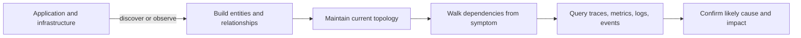
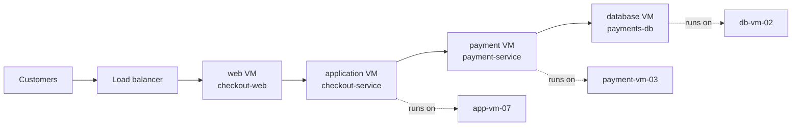
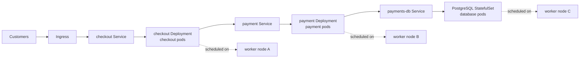

# Knowledge graph lifecycle comparison: Dynatrace, Datadog, Edge Delta

**Audience:** operators and engineers new to the three platforms.
**Purpose:** one place to understand how each platform builds, updates, queries, and walks service relationships using the same two production-shaped examples.
**Evidence date:** 2026-10-16. The scenarios below are shared reference scenarios; prior lab observations are called out separately and are not represented as a completed three-vendor production bakeoff.

## At a glance

Think of the “graph” as a live map of **things** (services, hosts, pods) and **relationships** (calls, runs-on, routes-to). The map helps answer “what depends on what?” Telemetry answers “what happened, when, and how badly?” The two are connected, but they are not necessarily one database or one query language.



| Vendor | What the operator sees | How relationships are mainly learned | How evidence is joined |
|---|---|---|---|
| **Dynatrace** | Smartscape entity topology | OneAgent/discovery plus observed service calls and infrastructure relationships | Stable Dynatrace entity identity connects topology to Grail telemetry |
| **Datadog** | APM Service Map / service catalog | APM traces reveal service dependencies; service tags identify telemetry | Tags such as `service`, `env`, `version`, and trace context |
| **Edge Delta** | Service Map and separate telemetry explorers | Public product framing describes Node Pipeline eBPF observations; traces expose service/peer context | OpenTelemetry attributes and pipeline metadata; verify the exact tenant identity fields |

**Important:** these are three ways to support dependency reasoning, not three equivalent general-purpose knowledge graph databases. A map edge is evidence of a relationship, not proof that the edge caused an incident.

## Two shared production examples

Both examples use the same logical application and service names on all platforms. The topology is a common reference shape, not a claim that identical data has already been sent to all three vendor tenants.

### Example A: checkout on virtual machines



**Incident to investigate:** checkout latency rises after a payment-service configuration rollout. The new connection-pool setting creates more concurrent database connections than `payments-db` allows. Customers see slow or failed checkouts.

**Walk:** start with the checkout latency symptom; follow `checkout-service → payment-service → payments-db`; check whether payment calls are slow; then verify database connection saturation and the rollout time. The host relationships answer where the affected processes run, but the call path is what localizes this symptom.

### Example B: checkout on Kubernetes



**Incident to investigate:** a payment Deployment rollout applies the same oversized connection-pool setting. Payment pods report database connection errors; checkout returns elevated errors. The Kubernetes view adds ownership and placement relationships (Service → pods → nodes) to the application call path.

**Walk:** start at the checkout error; follow `checkout → payment → payments-db`; inspect the payment pods and their owning Deployment; compare the rollout time and pod logs with database connection metrics. A pod restart or node health issue is a separate branch to test, not an assumed cause.

## Lifecycle comparison

| Lifecycle stage | Dynatrace | Datadog | Edge Delta |
|---|---|---|---|
| **Build** | OneAgent and discovery identify entities; observed calls and infrastructure cues create relationships. Smartscape represents typed entities and relationships. | Agent/instrumentation emits APM spans. Service identity and observed calls populate service/dependency views. | Node Pipelines collect and process telemetry; public documentation describes eBPF-based traces and service maps. OTLP/gateway paths may be needed for other sources. |
| **Maintain** | New observations update the live entity/topology view; telemetry history is stored separately. Classic Smartscape docs describe inactive connections as dashed after 2 hours and removed after more than 72 hours. Confirm which Smartscape experience is in use. | The service map is based on APM-observed dependencies and a selected time context. The exact retention/aging interval is not established in this comparison; measure it in the tenant. | Pipeline configuration and agent health control continued collection. Exact Service Map refresh and edge-aging behavior is not established here; verify with a running/stopped workload. |
| **Query** | Use Smartscape for topology; use Grail/DQL for evidence such as spans, logs, metrics, and events. These are complementary reads. | Use Service Map for dependency context; use Trace Explorer and Metrics/Logs queries with shared service/environment tags for evidence. | Use Service Map for topology where populated; query separate `trace`, `metric`, `log`, `pattern`, or `event` scopes for evidence. The scopes are not graph traversal commands. |
| **Walk** | Select a service/entity and expand related services or infrastructure. Follow the call path, then use its entity identity to query supporting evidence. | Follow service dependencies in APM Service Map, then open traces to inspect caller/child spans. Use tags to compare metrics and logs for the same service and environment. | Follow visible service relationships in Service Map. If it is empty, first verify eBPF/pipeline health and incoming trace data; use service/peer attributes to corroborate the relationship. Do not infer a successful UI walk from spans alone. |

```mermaid
flowchart TB
	subgraph DT[Dynatrace]
		D1[OneAgent and discovery] --> D2[Smartscape entities and edges]
		D1 --> D3[Grail telemetry with entity identity]
		D2 --> D4[Smartscape walk]
		D4 --> D3
	end
	subgraph DD[Datadog]
		A1[Agent and APM instrumentation] --> A2[Traces and service tags]
		A2 --> A3[APM Service Map]
		A2 --> A4[Trace, metric, and log queries]
		A3 --> A4
	end
	subgraph ED[Edge Delta]
		E1[Node or Gateway Pipeline] --> E2[eBPF or ingested telemetry]
		E2 --> E3[Service Map when supported and populated]
		E2 --> E4[Separate telemetry query scopes]
		E3 --> E4
	end
```



## How to run the same walk in each platform

Use one environment tag (`env=kg-vm-prodlike` or `env=kg-k8s-prodlike`), stable service names, and one captured 15-minute incident window. Generate at least five minutes of healthy traffic, apply the connection-pool change, sustain traffic long enough to capture the fault, then roll back and verify recovery. Never compare results from different time windows as if they were simultaneous.

| Operator action | Dynatrace | Datadog | Edge Delta |
|---|---|---|---|
| **Find the map** | Open Smartscape and choose the service/infrastructure view appropriate to the environment. | Open APM Services / Service Map and filter to the environment. | Open Service Map; first confirm the relevant Node Pipeline and eBPF path are enabled for the workload. |
| **Start the walk** | Select `checkout-service`; follow calls to `payment-service`, then `payments-db`. For Kubernetes, also inspect process/container and host relationships. | Follow the same service chain. Open a trace to verify parent/child span relationships; inspect Kubernetes/host context separately. | Follow the same path if rendered. Use the trace's service and peer attributes to check the edge; record whether that relationship is visible in the map itself. |
| **Query leaf evidence** | Grail/DQL: filter spans to the payment/database service and incident time; inspect duration, status, and entity identity. | Trace Explorer: filter by `env`, `service`, error status, and time. Correlate metrics/logs using the same service/environment tags. | Trace scope: filter by service/peer attributes and time. Query metrics/logs separately; capture the actual filter syntax exposed by the tenant. |
| **Prove the likely cause** | Correlate slow/erroring spans with database metrics/logs and the rollout event. | Correlate trace latency/errors with database metrics/logs and deployment tags/events. | Correlate available spans and logs/metrics with the rollout evidence. Do not assume Edge Delta automatically models deployment/config relationships as graph edges. |
| **Check maintenance** | Stop calls to one dependency, then note inactive/stale/removed behavior in the actual Smartscape experience. | Stop calls and revisit the map over time; record the selected time window and what changes. | Stop calls while keeping the pipeline healthy; record map visibility and trace-query results over time. |

### Query examples (illustrative)

These examples show the filter intent. Use the field names and syntax available in the tenant; do not paste a field name blindly across products.

**Dynatrace DQL evidence shape:**

```dql
fetch spans
| filter dt.entity.service == "<payment-service-entity-id>"
| fields timestamp, span.name, duration, http.response.status_code
```

The query retrieves evidence for an entity. The topology walk itself is performed in Smartscape or through the topology API, not by treating DQL as a graph traversal language.

**Datadog Trace Explorer filter shape:**

```text
env:kg-vm-prodlike service:payment-service
```

Narrow to error status and the incident time in the UI. Compare with `service:payments-db` or the database integration's service/resource name as available in the environment.

**Edge Delta query intent:**

```text
scope = trace
service.name = payment-service
time = incident window
```

This is filter intent, not a guaranteed Edge Delta query-language statement. Confirm exact UI/MCP syntax and available attributes in the tenant. For a dependency, inspect caller/peer attributes such as `net.peer.name` where present.

## Entity and relationship vocabulary

Use the same logical names in both environments so the walk is comparable. Infrastructure IDs will naturally differ.

| Logical thing | VM example | Kubernetes example | Relationship to inspect |
|---|---|---|---|
| Entry point | Load balancer / web VM | Ingress | Routes traffic to checkout |
| Checkout | `checkout-service` process on app VM | checkout Service and Deployment/pods | Calls payment |
| Payment | `payment-service` process on payment VM | payment Service and Deployment/pods | Calls the database |
| Database | `payments-db` process on database VM | `payments-db` Service and PostgreSQL StatefulSet/pods | Receives payment database calls |
| Runtime placement | Process → VM → host/zone | Pod → node → cluster/namespace | Containment/placement, distinct from service calls |
| Change evidence | VM config/deployment event | Deployment/ConfigMap rollout event | Time-correlate; not necessarily a graph edge |

Identity is the glue. Keep service names stable, use one environment/cluster naming convention, and attach host/container/pod identity where possible. A name mismatch can split one logical service into multiple apparent nodes; an incorrect alias can merge unrelated services.

## What to record

Capture one row per platform and scenario. Record **not available** rather than filling gaps with assumptions.

| Field | Record |
|---|---|
| Scenario / environment | VM or Kubernetes; environment, cluster, namespace, region |
| Graph entities | Names, IDs, entity types, and whether discovered or configured |
| Edges | Caller → callee and containment/placement relationships; source of each edge |
| Build delay | Time from first request or resource discovery to visible node/edge |
| Maintenance | What adds/updates/removes an edge; observed stale/age-out behavior and time window |
| Query | Exact filter/query, time range, and returned evidence type |
| Walk result | Can a new operator follow checkout → payment → database in the product UI? |
| Cause evidence | Span, metric, log, event/change record supporting or refuting the suspected cause |
| Gaps | Missing instrumentation, empty map, identity mismatch, unsupported field, or product limitation |

## Current evidence and limits

Repository lab evidence supports a controlled three-service checkout comparison for Dynatrace and Datadog. It records Dynatrace Smartscape/Grail and a Datadog APM-derived Service Map, with an inventory fault used in those lab runs. Edge Delta evidence includes eBPF trace data for a separate Kubernetes/PostgreSQL example, including service and peer attributes, but does **not** demonstrate the same checkout workload rendered and walked in its Service Map.

Therefore:

- The lifecycle descriptions above combine public product framing with recorded lab observations; they are not a new simultaneous production-tenant test.
- The VM and Kubernetes examples are shared reference scenarios to make vendor behavior comparable. They are not claims that these exact production stacks are already deployed in each vendor.
- Edge Delta's same-workload Service Map traversal and graph aging remain to be verified live. An indexed trace with a peer attribute is useful relationship evidence, but it is not proof that the visual map rendered or could be traversed.
- The 2-hour/72-hour stale-edge behavior applies to the cited Dynatrace Smartscape Classic documentation; verify the exact Smartscape version and view in use. Do not copy those timings to Datadog or Edge Delta.

## Takeaway

Dynatrace emphasizes a discovered entity topology joined to telemetry by entity identity. Datadog emphasizes service dependencies inferred from APM traces and tags that join product evidence. Edge Delta describes service maps built from edge observations and exposes separate telemetry query scopes; map behavior depends on a functioning pipeline and must be validated with live data.

For both VM and Kubernetes systems, the operator's job is the same: **start at the symptom, follow service calls to a leaf, expand to the relevant runtime entity, query time-aligned evidence, and verify the proposed cause against a change or resource signal.** The platforms differ in how much of that path they materialize for you.

## Product documentation

- [Dynatrace Smartscape Classic](https://docs.dynatrace.com/docs/platform/smartscape) and [Dynatrace Query Language](https://docs.dynatrace.com/docs/platform/grail/dynatrace-query-language)
- [Datadog Service Map](https://docs.datadoghq.com/tracing/services/service_map/)
- [Edge Delta architecture](https://docs.edgedelta.com/edge-delta-architecture/)