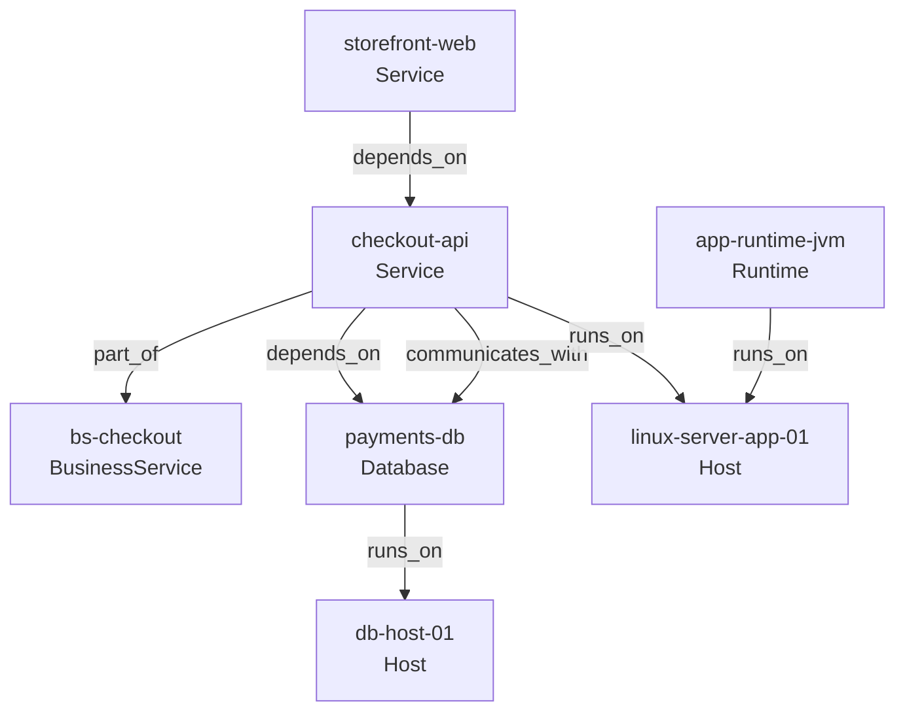
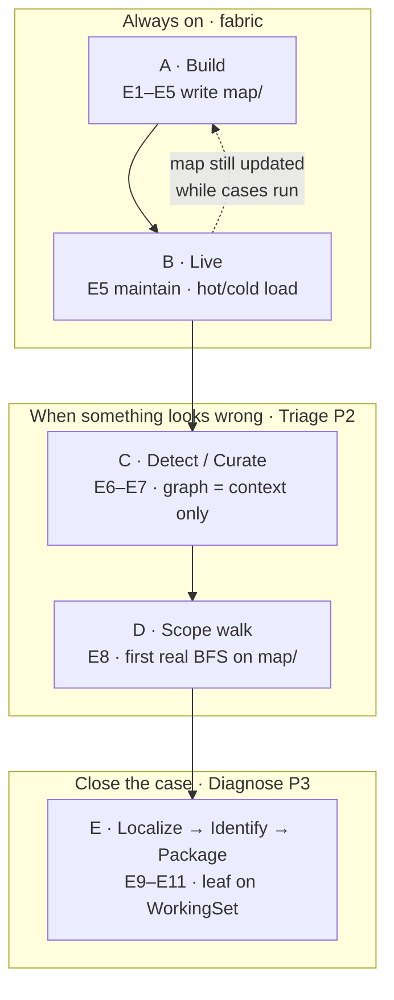
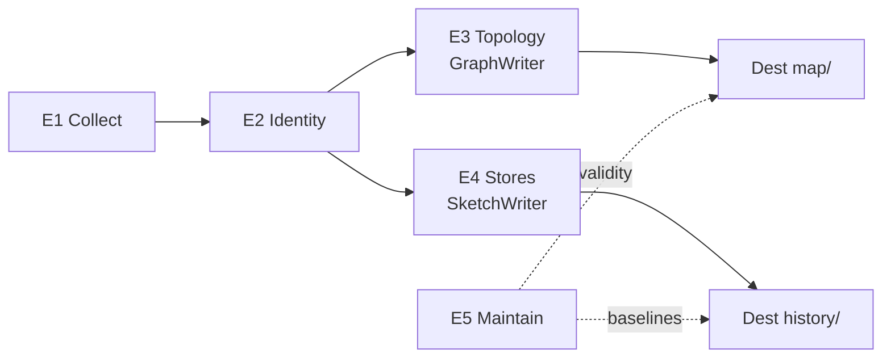
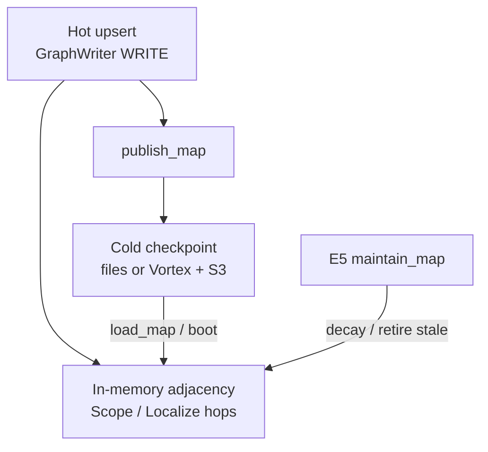
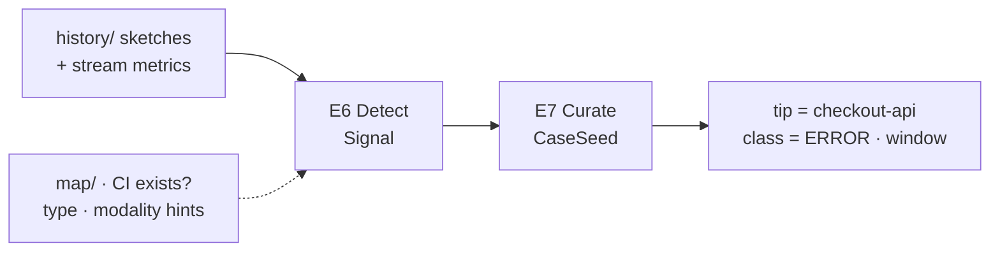
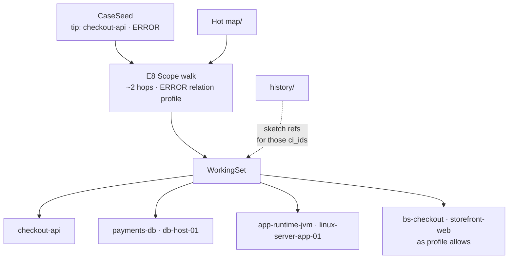
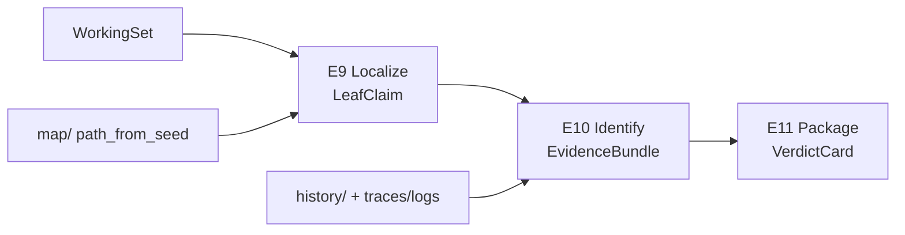
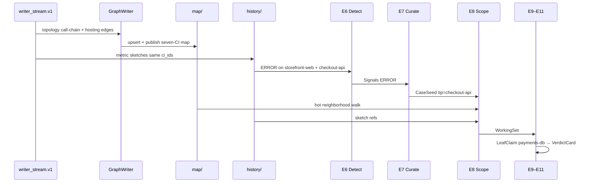

# Knowledge graph — lifecycle and use cases

**Audience:** Anyone who needs a cold-start picture of **where the Motadata knowledge graph participates** in ObserveOps — not a second full pipeline HLD.

**What “knowledge graph” means here:** the walkable estate under Dest room **`map/`** — configuration-item nodes and edges packaged as a **`GraphSnapshot`**. Pillar B (Topology / GraphWriter) owns writes. Pillar A sketches live in a **separate** room (**`history/`**). Diagnose **joins** the two by identity at read time; the rooms do **not** sync into each other.

**Normative depth:** [`GRAPH_QNA.md`](../../pillar-ab-implementation/contracts/GRAPH_QNA.md) · [`MAP_SCOPE_WALK_POLICY.md`](../../pillar-ab-implementation/contracts/MAP_SCOPE_WALK_POLICY.md) · [`MAP_HOT_COLD_LIFECYCLE.md`](../../pillar-ab-implementation/contracts/MAP_HOT_COLD_LIFECYCLE.md) · [`WRITER_REGULATOR.md`](../../pillar-ab-implementation/contracts/WRITER_REGULATOR.md) · [Our HLD](../observeops/observeops-pipeline-hld.html)

---

## Contents

1. [Running estate (same example everywhere)](#1-running-estate-same-example-everywhere)
2. [Lifecycle at a glance](#2-lifecycle-at-a-glance)
3. [Phase A — Build the map (fabric E1–E5)](#3-phase-a--build-the-map-fabric-e1e5)
4. [Phase B — Keep it live (maintain + hot / cold)](#4-phase-b--keep-it-live-maintain--hot--cold)
5. [Phase C — Case opens (Detect / Curate; graph is context)](#5-phase-c--case-opens-detect--curate-graph-is-context)
6. [Phase D — Walk the map (E8 Scope)](#6-phase-d--walk-the-map-e8-scope)
7. [Phase E — Diagnose on the walk (E9–E11)](#7-phase-e--diagnose-on-the-walk-e9e11)
8. [End-to-end story (one pass)](#8-end-to-end-story-one-pass)
9. [What the knowledge graph is not used for](#9-what-the-knowledge-graph-is-not-used-for)
10. [Related reading](#10-related-reading)

---

## 1. Running estate (same example everywhere)

Teaching estate aligned with the lab **customer checkout** sample map
([`pillar-b/poc/sample_estate/customer_checkout/`](../../pillar-ab-implementation/pillar-b/poc/sample_estate/customer_checkout/)
plus a short call-chain hop from the walk-test fixture). Identity has already bound these configuration items.

| Configuration item (`ci_id`) | Type | Role in the story |
|------------------------------|------|-------------------|
| `bs-checkout` | BusinessService | Business wrapper (checkout capability) |
| `storefront-web` | Service | Browser-facing storefront (often fires first in a storm) |
| `checkout-api` | Service | Checkout API (usual case tip after Curate) |
| `app-runtime-jvm` | Runtime | JVM process for the API |
| `linux-server-app-01` | Host | Host where the API / JVM run |
| `payments-db` | Database | Payments database dependency |
| `db-host-01` | Host | Host where the database runs |

Typical **map** edges (catalog names after normalize):

| From | Edge | To | Why it matters |
|------|------|----|----------------|
| `checkout-api` | `part_of` | `bs-checkout` | Business grouping |
| `storefront-web` | `depends_on` | `checkout-api` | Ingress call chain |
| `checkout-api` | `depends_on` | `payments-db` | Data dependency (ERROR deepest-leaf path) |
| `checkout-api` | `communicates_with` | `payments-db` | Runtime talk path (SLOWDOWN / correlate) |
| `checkout-api` | `runs_on` | `linux-server-app-01` | API hosting |
| `app-runtime-jvm` | `runs_on` | `linux-server-app-01` | Process hosting (same machine) |
| `payments-db` | `runs_on` | `db-host-01` | DB hosting (different machine) |



That picture **is** the knowledge graph the rest of the pipeline walks. Alerts, tickets, and metric samples are **not** vertices here; they hitch by `tenant` + `ci_id` (and time) as evidence. A three-node Service→Database→Host triangle is only a subset — Scope and Localize need the call chain, process tier, and split hosting to show why walks are bounded.

---

## 2. Lifecycle at a glance

The graph has one job that changes **mode** over time: first **write**, then **stay current**, then (when a case opens) **be walked**, then **support a leaf claim**. Detect watches telemetry and sketches — not a Scope-style walk of `map/`.



| Phase | Pipeline | Graph mode | One-line role |
|-------|----------|------------|---------------|
| **A · Build** | E1–E5 | **Write / soft maintain** | Keep a trusted, walkable estate in `map/` |
| **B · Live** | E5 + Dest | **Publish · load · decay** | Hot adjacency for walks; cold is checkpoint |
| **C · Case open** | E6–E7 | **Context only** | Signal / CaseSeed name a tip `ci_id`; no neighborhood walk yet |
| **D · Walk** | E8 Scope | **Bounded walk** | Tip → WorkingSet (paths + sketch refs) |
| **E · Diagnose** | E9–E11 | **Decide + explain** | LeafClaim on the walk; evidence from `history/` and other stores |

Interactive film of the same arc: [`edge-platform-detect-simulation.html`](./edge-platform-detect-simulation.html).

---

## 3. Phase A — Build the map (fabric E1–E5)

**Job:** Keep a trusted, walkable picture of the estate **before** (and while) incidents open.

### Stage touch map

| Stage | Name | Touches `map/`? | Simple explanation |
|-------|------|-----------------|--------------------|
| **E1** Collect | Admit telemetry | No write | Shapes bytes into a stream. Does not invent edges. |
| **E2** Identity | Bind `ci_id` | No write | Stamps `identity.status`. Writers only accept **resolved**. |
| **E3** Topology | GraphWriter | **Yes — write** | Admits topology claims → upsert nodes + edges → publish under `map/`. |
| **E4** Stores | SketchWriter | No (writes `history/`) | Parallel room: metric sketches for the same `ci_id`s. |
| **E5** Maintain | Validity / baselines | **Yes — soft** | Expires or downgrades stale edges; refreshes sketch baselines. Does **not** invent new dependency edges. |

After E2, Motadata fans out **in parallel**: Topology ∥ Stores. Same identity; two rooms.



### Motadata wire (source of truth)

Post-E2 stream is **`writer_stream.v1`**. GraphWriter admits when a **`topology`** block is present (presence predicate — no Collect `fact_kind` router). Lab fixtures may still send legacy `ingest.v1` + `fact_kind=topo_update` (dual-admit in the PoC).

### Example — building edges on this estate

1. Optional bootstrap (or prior WRITEs) already has the seven configuration items above as vertices.
2. A resolved stream line arrives for one claim, for example API hosting:

```json
{
  "schema_version": "writer_stream.v1",
  "identity": { "status": "resolved", "bind_source": "discovery" },
  "ci": { "ci_id": "checkout-api", "ci_type": "Service" },
  "topology": {
    "relation": "runsOn",
    "src_ci_id": "checkout-api",
    "dst_ci_id": "linux-server-app-01",
    "src_ci_type": "Service",
    "dst_ci_type": "Host"
  }
}
```

3. GraphWriter: admit → WRITE → upsert edge `RUNS_ON` with key `(checkout-api, RUNS_ON, linux-server-app-01)`.
4. Later lines (same tape pattern) add `storefront-web → depends_on → checkout-api`, `checkout-api → depends_on → payments-db`, `payments-db → runs_on → db-host-01`, JVM `runs_on`, `part_of`, `communicates_with`, and so on.
5. `publish_map` materializes Dest keys under `map/` (nodes, edges, snapshot) for the whole present estate.

| Stream line condition | GraphWriter |
|-----------------------|-------------|
| Only a metric / sketch block | **NOOP** (silent skip) — SketchWriter may still write `history/` |
| Identity not resolved | **DROP** — edge never enters production `map/` |

Teaching visuals: [`e1-e5-pipeline-architecture.html`](./e1-e5-pipeline-architecture.html) · [`graphwriter-io-walkthrough.html`](./graphwriter-io-walkthrough.html) · [`pillar-b-stream-graph-demo.html`](./pillar-b-stream-graph-demo.html)

---

## 4. Phase B — Keep it live (maintain + hot / cold)

**Job:** The map is a **present** estate, not a diary of every past topology. Cold storage is a **checkpoint** of that present map so walks can reload quickly.



| Use | Graph involvement |
|-----|-------------------|
| **Publish** | GraphWriter → Dest `map/` (Gate B: files today; Vortex + S3 when that profile is chosen) |
| **Cold** | Columnar / object checkpoint of the same rooms |
| **Hot** | In-memory adjacency for Scope / Localize hops |
| **Boot / recovery** | `load_map` (or equivalent) rebuilds hot from cold **before** interactive walks |

Temperature (hot vs cold) is **how** Dest stores bytes. It is **not** a second knowledge-graph model.

Detail: [`MAP_HOT_COLD_LIFECYCLE.md`](../../pillar-ab-implementation/contracts/MAP_HOT_COLD_LIFECYCLE.md) · [`vortex-s3-interaction.html`](./vortex-s3-interaction.html)

---

## 5. Phase C — Case opens (Detect / Curate; graph is context)

**Job:** Raise and package “something looks wrong” **without** walking the whole estate yet. This is the start of **Triage (P2: E6–E8)**. Official case territory opens here; the **walk** still waits for E8.

Detectors / monitors watch **telemetry and sketches for a bound `ci_id`**, not a BFS of `map/`.

| What they watch | Where it lives | ERROR example | SLOWDOWN example |
|-----------------|----------------|---------------|------------------|
| Live counters / window rates | Shaped stream (doors A/B) or platform series | `service.request.error_rate`, 5xx, span `status:error` rate | Live request duration / p95 of the short window |
| Compact percentiles vs season | `history/` sketches (door C) | Error-rate digest vs baseline | Sketch p95 for `http.server.request.duration` vs weekday-hour baseline |



| Stage | Graph involvement |
|-------|-------------------|
| **E6 Detect** | **Does not** store or read Detect classes (`ERROR` / `SLOWDOWN` / …) as map vertices. Detectors watch telemetry / sketches for a bound `ci_id`; the **Signal** carries `class` + `ci_id`. `map/` is only **context**: does this `ci_id` exist, what `ci_type` is it, and (when modeled) which **telemetry planes** are expected vs declared N/A — not “which Detect class fired.” Door C compares sketch vs baseline in **`history/`**. Does **not** build the WorkingSet. |
| **E7 Curate** | Collapses Signals into one **CaseSeed** (tip CI, class, window). Still **no** neighborhood walk. Class lives on the case object, still **off** the graph. |

Example storm: ERROR Signals fire on `storefront-web` and `checkout-api` (call-chain fog). Curate merges them into one CaseSeed with tip = `checkout-api` (most-upstream-symptomatic service on the shared path), class = ERROR, last 15 minutes. The full map (JVM, both hosts, `payments-db`, business service) already exists; nobody has walked it for this case yet.

---

## 6. Phase D — Walk the map (E8 Scope)

**Job:** When a case opens, **do not diagnose the whole estate**. Walk a **small neighborhood** on the hot present map from the symptom tip, then attach sketch **refs** for those configuration items.

### Inputs and output

| Piece | Meaning |
|-------|---------|
| **CaseSeed** (from E7) | Tip CI + detect class + time window |
| **Present map** | Hot adjacency (loaded from cold or live upserts) — **not** one lake fetch per hop |
| **WorkingSet** (output) | Bounded `ci_ids`, edges, candidate paths, sketch refs, evidence budget |

Scope **does not** pick the root-cause leaf. That is **E9 Localize**.



### Example — ERROR case on checkout

1. Detect / Curate already produced the CaseSeed tip = `checkout-api`, class = ERROR.
2. Scope walks **outward** from `checkout-api` (default **2 hops**, confidence-bearing edges), using the ERROR relation profile (`depends_on`, `communicates_with`, `uses`, plus hosting like `runs_on` / `part_of` as needed).
3. Reachable set (illustrative, within hop budget): `checkout-api`, `payments-db`, `db-host-01`, `app-runtime-jvm`, `linux-server-app-01`, `bs-checkout`, and optionally `storefront-web` if inbound / `part_of` / correlate edges are in profile.
4. WorkingSet records paths such as:
   - tip → `depends_on` → `payments-db` → `runs_on` → `db-host-01`
   - tip → `runs_on` → `linux-server-app-01` (and JVM co-tenant on the same host)
   - tip → `part_of` → `bs-checkout`
5. For each of those `ci_id`s, Scope attaches **sketch refs** from `history/` in the case window (digest / baseline pointers — not a full trace open yet).
6. Hop / candidate **caps** still apply (ERROR profile in policy) — the walk must not silently dump the whole estate.

**SLOWDOWN** uses the same neighborhood idea; policy may add a short **inbound** hop (for example from `storefront-web` on `depends_on` / `communicates_with`) when the seed is mid-tier and ingress latency matters.

Policy: [`MAP_SCOPE_WALK_POLICY.md`](../../pillar-ab-implementation/contracts/MAP_SCOPE_WALK_POLICY.md) · rooms: [`map-history-storage-blocks.html`](./map-history-storage-blocks.html)

---

## 7. Phase E — Diagnose on the walk (E9–E11)

**Job:** Inside the WorkingSet, **name the leaf**, **corroborate** with evidence, **hand off** a verdict. The knowledge graph supplies **who is connected**; sketches and other stores supply **what looked wrong**.



### E9 Localize — pick the leaf on the graph

- **Input:** WorkingSet (+ ability to re-read neighbors).
- **Output:** **LeafClaim** — top hypothesis configuration item + `path_from_seed` on the map.

**ERROR example:** Paths reach the API host tier (`linux-server-app-01` / `app-runtime-jvm`) **and** the database tier (`payments-db` / `db-host-01`). Localize ranks toward the **deepest actionable fault leaf** for the class — e.g. claim `payments-db` with path  
`checkout-api → depends_on → payments-db`  
when error evidence concentrates on the database (not the app host, and not stopping at `storefront-web`).

**SLOWDOWN example:** Same neighborhood; ranking may prefer a **self-time / saturation** leaf — often `checkout-api`, `app-runtime-jvm`, or `linux-server-app-01` on the hot path — rather than “deepest error” into `payments-db`.

### E10 Identify — corroborate (graph + history + modalities)

- Re-reads sketches for the claim CI (and budgeted path neighbors).
- May follow an **exemplar** on a sketch row into a trace product (`trace_id` / `span_id`) — that is **not** another graph edge; it is evidence hitching the same `ci_id`.
- Emits **EvidenceBundle** (pointers + confidence rationale).

### E11 Package — operator handoff

- Turns EvidenceBundle into a **VerdictCard** (and optional ticket payload) that still names the leaf CI from the map so ServiceOps can join later on `tenant` + `ci_id`.

**One line:** Fabric **writes** the map; Scope **walks** it; Diagnose **decides on** it and **explains** with history — never by dumping the whole lake.

---

## 8. End-to-end story (one pass)



1. **Build / live:** Stream (and optional bootstrap) admits the seven-CI checkout estate — call chain, JVM, split hosts, `depends_on` / `runs_on` / `part_of` / `communicates_with` → `map/` updated. Sketches for those CIs accumulate in `history/`.
2. **Detect / Curate:** ERROR fog on `storefront-web` and `checkout-api` → one CaseSeed tip = `checkout-api`, class = ERROR.
3. **Scope:** Walk out ~two hops → WorkingSet covering API, JVM, app host, `payments-db`, `db-host-01`, business service (+ ingress as profile allows) with paths and sketch refs.
4. **Localize:** LeafClaim = `payments-db` (deepest error on the dependency path), not the app host and not the storefront tip alone.
5. **Identify / Package:** Sketch + logs/traces for that CI corroborate; VerdictCard names `payments-db` for the operator.

---

## 9. What the knowledge graph is not used for

| Anti-pattern | Why |
|--------------|-----|
| Alert / Incident / ticket as map vertices | Those are case / evidence objects; durable CIs stay on the map |
| Continuous sync from `history/` into `map/` | Rooms stay independent; join at WorkingSet |
| Opening S3 and scanning raw for every hop | Scope walks **hot** adjacency after load |
| Letting Detect pick the root-cause leaf by walking alone | Leaf pick is Localize; Detect emits Signals |
| Treating Collect `fact_kind` as Motadata writer source of truth | Writers use **`writer_stream.v1`** presence blocks |
| Calling Detectors “graph watchers” | They watch **telemetry and sketches** for a `ci_id`; `map/` is context until E8 |

---

## 10. Related reading

| Want | Open |
|------|------|
| Fabric portal index | [`README.md`](./README.md) |
| Lab estate fixtures (this map) | [`customer_checkout/`](../../pillar-ab-implementation/pillar-b/poc/sample_estate/customer_checkout/) |
| Contract Q&A | [`GRAPH_QNA.md`](../../pillar-ab-implementation/contracts/GRAPH_QNA.md) |
| Scope walk knobs + detect-class profiles | [`MAP_SCOPE_WALK_POLICY.md`](../../pillar-ab-implementation/contracts/MAP_SCOPE_WALK_POLICY.md) |
| Hot / cold mutate · publish · load | [`MAP_HOT_COLD_LIFECYCLE.md`](../../pillar-ab-implementation/contracts/MAP_HOT_COLD_LIFECYCLE.md) |
| Writer admit source of truth | [`WRITER_REGULATOR.md`](../../pillar-ab-implementation/contracts/WRITER_REGULATOR.md) |
| Pipeline stage contracts | [`OBSERVEOPS_PIPELINE_HLD.md`](../observeops/OBSERVEOPS_PIPELINE_HLD.md) §8 |
| Interactive film (ingest → case) | [`edge-platform-detect-simulation.html`](./edge-platform-detect-simulation.html) |
| ERROR + SLOWDOWN E1–E11 narration | [`../observeops/E1_E11_ERROR_SLOWDOWN_NARRATIVE.md`](../observeops/E1_E11_ERROR_SLOWDOWN_NARRATIVE.md) |
| PoC GraphWriter timeline | [`pillar-b-stream-graph-demo.html`](./pillar-b-stream-graph-demo.html) |
