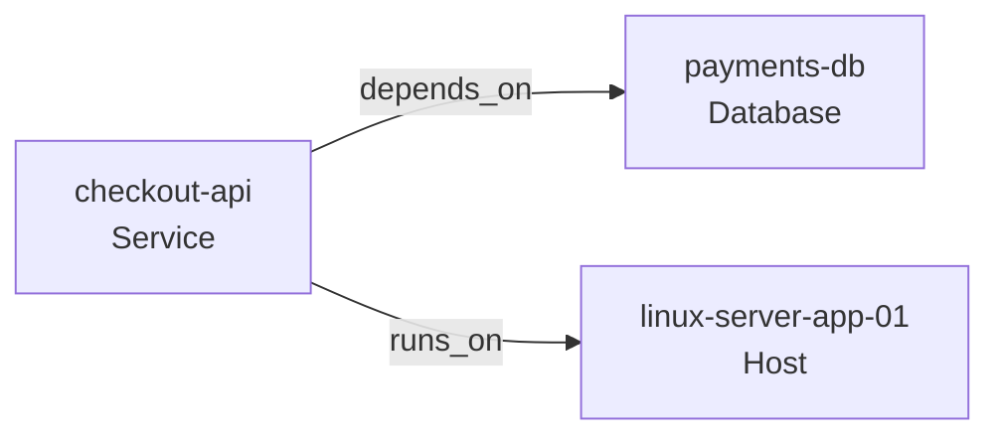
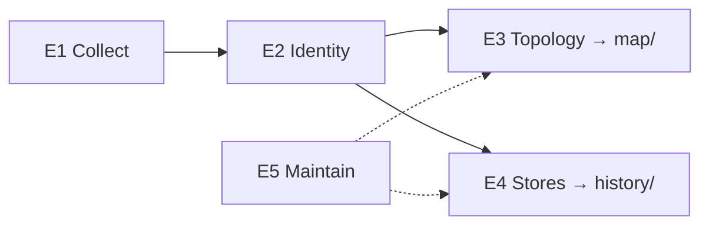
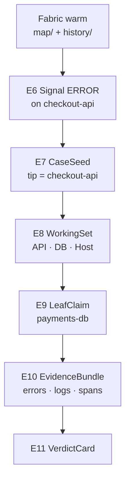
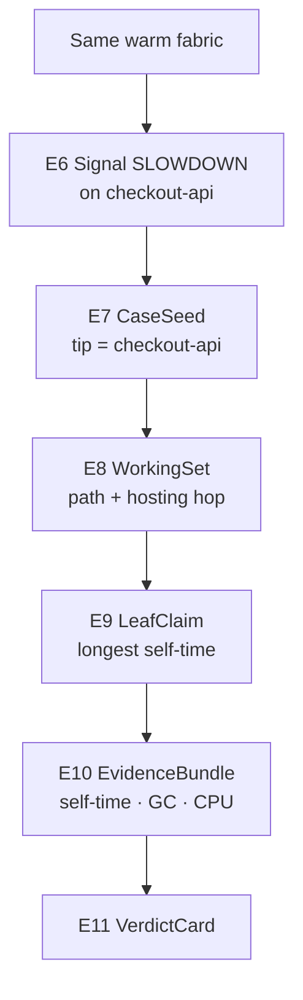
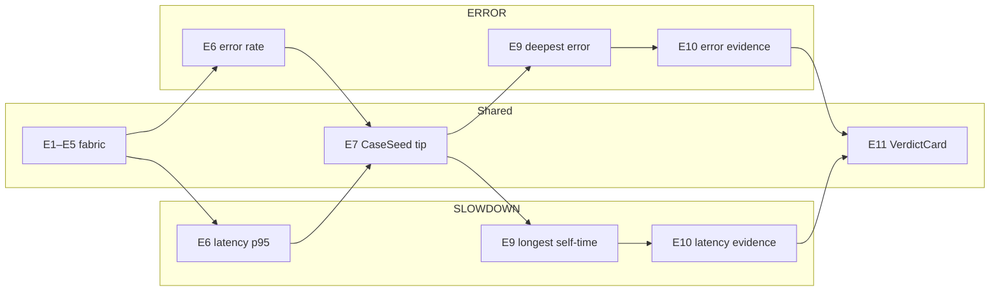

# ERROR and SLOWDOWN — E1 to E11 in plain language

**Audience:** Cold readers who want **one page** that walks Motadata ObserveOps from always-on fabric through triage and diagnose for the two starter Detect classes: **ERROR** and **SLOWDOWN**.

**What this is:** Teaching narration on the locked checkout-style estate. Threshold numbers are illustrative; cut values live in LLD-E6 / tenant KPI catalogs.

**What this is not:** A replacement for interactive [Fusion](./observeops-fusion-guide.html) (click every stage’s I/O) or the full eight-use-case tables in [`OBSERVEOPS_HLD_OPERATIONAL_GRAPH.md`](./OBSERVEOPS_HLD_OPERATIONAL_GRAPH.md) §5.

**Normative parents:** [Pipeline HLD](./OBSERVEOPS_PIPELINE_HLD.md) · [Our HLD hub](./observeops-pipeline-hld.html) · [GRAPH_QNA](../GRAPH_QNA.md)

---

## Contents

1. [Shared estate](#1-shared-estate)
2. [Shared fabric (E1–E5) — before any case](#2-shared-fabric-e1e5--before-any-case)
3. [Scenario A — ERROR](#3-scenario-a--error)
4. [Scenario B — SLOWDOWN](#4-scenario-b--slowdown)
5. [What differs between the two](#5-what-differs-between-the-two)
6. [Where to go next](#6-where-to-go-next)

---

## 1. Shared estate

Both stories use the same small checkout stack. Identity has already bound stable configuration-item ids (`ci_id`).

| Configuration item | Type | Role |
|--------------------|------|------|
| `checkout-api` | Service | Customer-facing API (usual symptom tip) |
| `payments-db` | Database | Dependency of the API |
| `linux-server-app-01` | Host | Machine where the API process runs |

That picture lives under Dest room **`map/`** (knowledge graph). Metric percentile sketches for the same `ci_id`s live under **`history/`**. Alerts and tickets are **not** vertices on the map; they point at a `ci_id`.

---

## 2. Shared fabric (E1–E5) — before any case

Fabric is **always on**. It does the same job whether the eventual case is ERROR or SLOWDOWN.

| Stage | Plain job | In our story |
|-------|-----------|--------------|
| **E1 Collect** | Admit shaped telemetry | Bytes from agents / apps become a stream. No graph inventing. |
| **E2 Identity** | Bind `tenant` + `ci_id` | A line about checkout is stamped `checkout-api` (resolved). Unresolved lines do not enter production writers. |
| **E3 Topology** | Write the knowledge graph | GraphWriter upserts nodes and edges (`depends_on`, `runs_on`, …) into `map/`. |
| **E4 Stores** | Write sketches / evidence | SketchWriter accumulates percentiles for the same CIs into `history/`. |
| **E5 Maintain** | Keep fabric honest | Soft-expire stale edges; refresh seasonal sketch baselines. Does not invent new dependency edges. |

**After this section:** the estate is walkable on `map/`, and door-C Detect can compare sketch digests to baselines in `history/`. No incident is open yet.

Interactive film of fabric → capture: [`edge-platform-detect-simulation.html`](../fabric/edge-platform-detect-simulation.html). Graph-focused lifecycle: [`KNOWLEDGE_GRAPH_USE_CASES.md`](../fabric/KNOWLEDGE_GRAPH_USE_CASES.md).

---

## 3. Scenario A — ERROR

**Customer symptom:** Checkout returns failures (elevated 5xx / exceptions).  
**Detect class:** `ERROR`.  
**Teaching leaf:** `payments-db` (deepest place still showing the fault on the dependency path).

### E6 Detect — raise a Signal (not a root cause)

Monitors watch **telemetry and sketches for `checkout-api`**, not a walk of the whole map.

- Live or windowed series such as `service.request.error_rate`, HTTP 5xx, or span `status:error` rate.
- Or door C: sketch digest for that metric vs seasonal baseline on `history/`.

**Out:** `Signal{class: ERROR, ci_id: checkout-api, window, magnitude}`.  
The map only answers “this is a Service we care about”; it is not the series being thresholded.

### E7 Curate — one case from a storm

Nearby hop may also fire ERROR (for example a caller or runtime). Curate merges adjacent ERROR signals into **one** `CaseSeed`.

**Out:** tip = `checkout-api`, class = ERROR, investigation window (for example last 15 minutes), plus a short merge rationale.  
Still **no** full neighborhood WorkingSet.

### E8 Scope — first real map walk

Scope loads hot adjacency from `map/` and walks a **bounded** neighborhood from the tip (ERROR relation profile: dependency and hosting edges such as `depends_on`, `communicates_with`, `runs_on`).

**Out:** `WorkingSet` roughly `{checkout-api, payments-db, linux-server-app-01}` with paths and **sketch refs** from `history/` for those ids.  
Scope does **not** pick the leaf.

### E9 Localize — deepest error leaf

Inside the WorkingSet, Localize applies the ERROR plug-in: descend while error evidence persists; stop at the **last** CI still showing the fault.

**Out:** `LeafClaim` = `payments-db` with path  
`checkout-api → depends_on → payments-db`  
(when evidence concentrates on the database rather than the host).

### E10 Identify — corroborate (Verify lives here)

Re-read sketches, logs, and traces for the claim (and budgeted neighbors). Match a fault signature (for example connection pool exhaustion / too many connections).

**Out:** `EvidenceBundle` — pointers + confidence rationale. No-false-blame: do not blame infrastructure when only the app is sick.

### E11 Package — hand off

**Out:** `VerdictCard` naming `payments-db`, the path from seed, evidence summary, and confidence. Operator / ticket join stays on `tenant` + `ci_id`.

**One sentence:** Errors on the API open a case at the API tip; the graph walk and error evidence push the leaf to the database dependency.

Deeper interactive diagnose on this estate: [Our HLD → Diagnose](./observeops-pipeline-hld.html#diagnose).

---

## 4. Scenario B — SLOWDOWN

**Customer symptom:** Checkout is slow (p95 latency up); requests may still succeed.  
**Detect class:** `SLOWDOWN`.  
**Teaching leaf:** often `checkout-api` or `linux-server-app-01` when that tier owns the **self-time / saturation**, not “deepest error.”

### E6 Detect — raise a Signal

Watches latency-shaped series for `checkout-api`, for example:

- `http.server.request.duration` or `service.latency.p95` over a window  
- Door C: sketch **p95 vs seasonal baseline** on `history/`

**Out:** `Signal{class: SLOWDOWN, ci_id: checkout-api, window, p95 delta}`.

### E7 Curate — one case along the latency path

Multiple SLOWDOWN signals along a call path collapse to one `CaseSeed`. Edge **criticality** can break ties when two tips compete.

**Out:** tip = `checkout-api`, class = SLOWDOWN, window.

### E8 Scope — latency path plus hosting

Same idea as ERROR, with the SLOWDOWN profile: walk the latency neighborhood, and typically allow a **hosting hop** (`runs_on`) because slowdown often originates a tier below the tip service.

**Out:** WorkingSet including `checkout-api`, dependency neighbors as policy allows, and `linux-server-app-01`, plus sketch refs.

### E9 Localize — longest self-time leaf

Plug-in differs from ERROR: rank by **self-time** (work done here), not by “deepest error.” Callers that are only waiting should lose to the CI that is actually busy or saturated.

**Example outcomes (teaching):**

- Leaf = `checkout-api` when the service’s own spans dominate self-time (for example heavy GC / locking in-process).  
- Leaf = `linux-server-app-01` when host CPU / saturation explains the wait after the hosting hop.

**Out:** `LeafClaim` + `path_from_seed` on the map.

### E10 Identify — corroborate latency evidence

Pull self-time distributions, GC pauses, DB transaction duration, CPU — whatever the leaf’s signature lists. Exemplars on sketch rows may hitch into a `trace_id` (evidence, not a new map edge).

**Out:** `EvidenceBundle`.

### E11 Package — hand off

**Out:** `VerdictCard` naming the self-time leaf, path, and evidence. Same packaging contract as ERROR; different leaf rule and evidence emphasis.

**One sentence:** Latency on the API opens a case at the API tip; the walk adds hosting context; the leaf is where self-time or saturation lives, not automatically the deepest database.

---

## 5. What differs between the two

Fabric (E1–E5) is shared. Differences start at Detect and peak at Localize / Identify.

| Topic | ERROR | SLOWDOWN |
|-------|-------|----------|
| What Detect watches | Error rate / 5xx / error spans | Latency p95 (live or sketch vs baseline) |
| Signal class | `ERROR` | `SLOWDOWN` |
| Scope emphasis | Call-chain / dependency closure | Latency path **+** hosting hop |
| E9 leaf rule | **Deepest error** leaf | **Longest self-time** leaf |
| E10 evidence emphasis | Stacks, error logs, error spans | Self-time, GC, CPU, slow queries |
| Teaching leaf on checkout estate | Often `payments-db` | Often service or host on the hot path |

Detectors do **not** mainly watch the knowledge graph. They watch series for a bound `ci_id`. The graph is **context** until E8 Scope walks it, then **structure** for leaf path and blast.

---

## 6. Where to go next

| Want | Open |
|------|------|
| Click every stage’s inputs/outputs | [Fusion](./observeops-fusion-guide.html) — pick ERROR or SLOWDOWN |
| Written per-stage IN/OUT for all eight use cases | [`OBSERVEOPS_HLD_OPERATIONAL_GRAPH.md`](./OBSERVEOPS_HLD_OPERATIONAL_GRAPH.md) §5 |
| Interactive checkout diagnose (ERROR depth) | [Our HLD → Diagnose](./observeops-pipeline-hld.html#diagnose) |
| When the graph is built vs walked | [`KNOWLEDGE_GRAPH_USE_CASES.md`](../fabric/KNOWLEDGE_GRAPH_USE_CASES.md) |
| Use-case catalog (short definitions) | [`OBSERVEOPS_USE_CASES.md`](./OBSERVEOPS_USE_CASES.md) |
| Glossary of Detect / Normalize / Identify | [`urca-glossary.html`](./urca-glossary.html) |
