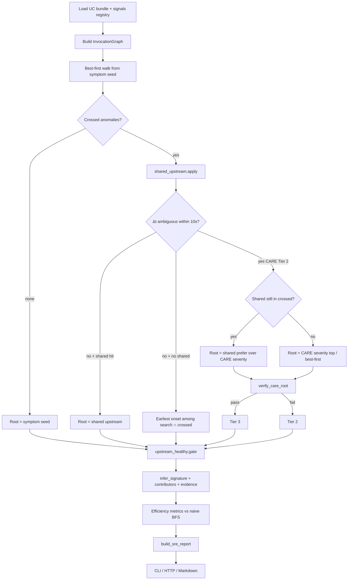

# Lean ObserveOps RCA — Architecture, Components & Workflow

**Status:** Primary ObserveOps **evaluation** engine ([ADR-001](../../docs/ADR-001-lean-primary-engine.md)); not a finalized product commitment.  
**Scope:** Classic infrastructure typed CI graph (Network → Host → VM → Guest OS → App + Datastore).  
**Corpus:** [`datasets/observeops/`](../../datasets/observeops/) from [`rca-use-cases-only.md`](../../docs/rca-use-cases-only.md).

This document describes what the lean pipeline **actually implements**. Product requirements and four-axis framing live in the shared [Lean PRD](../../docs/Lean_RCA_PRD.md); plain-language narrative in the [Simple Guide](../../docs/Lean_RCA_Simple_Guide.md). Limitations and roadmap items: [`LIMITATIONS_AND_FUTURE.md`](./LIMITATIONS_AND_FUTURE.md). **Frame-by-frame sub-step guide for visual simulation:** [`TIERED_ESCALATION_VISUAL_GUIDE.md`](./TIERED_ESCALATION_VISUAL_GUIDE.md).

---

## 1. Design intent

Lean answers ObserveOps classic-infra tickets with one coherent algorithm family:

1. Walk a **typed inventory graph** upstream from the symptomatic CI.  
2. Use **anomaly onset** and **information-gain scoring** to prioritize checks.  
3. Apply **ObserveOps rules** (shared-upstream, signatures, contributors, upstream-healthy).  
4. Escalate to **CARE** only when onsets clump inside a Δt window.  
5. Claim **Causal Validity** only after a **scoped** Tier-3 check.

**Not** the design: equating “earliest abnormal CI” with root cause, fleet-wide counterfactual sampling, or LLM reasoning in the deduction path.

| Quality | ObserveOps stance |
|---------|-----------------|
| Reproducibility | Mandatory (bit-stable) |
| Verifiability | Mandatory (tier + evidence trail) |
| Accuracy | Mandatory to measure vs corpus GT (threshold-gated) |
| Causal Validity | Recommended — claim only on Tier 3 |

---

## 2. System architecture

```
┌─────────────────────────────────────────────────────────────────┐
|                     lean_rca (public surface)                    |
|  CLI: diagnose | serve     HTTP :8780     SRE report enricher   |
└───────────────────────────────┬─────────────────────────────────┘
                                |
                                v
┌─────────────────────────────────────────────────────────────────┐
|              observeops/engine.py  (diagnose orchestrator)       |
|  load bundle → search → ObserveOps rules → tiers → signature       |
└───────┬─────────────────┬─────────────────┬─────────────────────┘
        |                 |                 |
        v                 v                 v
┌───────────────┐ ┌───────────────┐ ┌─────────────────────────────┐
| ingest/       | | lean/ core    | | rules/ + registry            |
| bundle.py     | | graph,search, | | shared_upstream              |
| topology+     | | info_gain,    | | datastore_contributor        |
| anomalies+    | | temporal,     | | upstream_healthy             |
| events+seed   | | care,causal,  | | signals.yaml                 |
|               | | signature     | |                              |
└───────────────┘ └───────────────┘ └─────────────────────────────┘
        |
        v
┌─────────────────────────────────────────────────────────────────┐
|  datasets/observeops/UC-*   (frozen bundles; OBSERVEOPS_CORPUS) |
└─────────────────────────────────────────────────────────────────┘
```

### Package layout

| Path | Role |
|------|------|
| [`../core_engine/lean/`](../core_engine/lean/) | Graph walk, scoring, temporal, CARE, causal, signature |
| [`../core_engine/observeops/`](../core_engine/observeops/) | ObserveOps orchestration, ingest, rules, signal registry |
| [`../core_engine/schema/`](../core_engine/schema/) | Typed topology JSON Schema |
| [`../lean_rca/`](../lean_rca/) | CLI, HTTP API, SRE report (`causal_chain`, blast radius, remediation) |
| [`../deploy/`](../deploy/) | systemd unit `lean-rca.service` |
| [`../scripts/serve-rca.sh`](../scripts/serve-rca.sh) | Local/prod-style serve helper |

---

## 3. Components

### 3.1 Invocation / inventory graph (`lean/invocation_graph.py`)

- **`InvocationGraph.from_topology(topology)`** — builds the walkable graph from corpus `topology.json`.  
- Edges are oriented **effect → cause** (`from` → `to`): search walks **upstream** toward shared infrastructure.  
- **`upstream_of(ci)`** / **`collect_upstream(start)`** — immediate neighbors and full upstream closure (BFS discovery order).

**ObserveOps node types** (schema): `NetworkPort`, `HypervisorHost`, `Datastore`, `VirtualMachine`, `GuestOS`, `Service`.  
**Relations:** `uplink_to`, `hosted_by`, `stored_on`, `runs_on`.

This is an **inventory / interaction graph**, not a causal graph. Edges assert configuration/runtime relatedness, not proven causation.

### 3.2 Best-first search (`lean/search.py`) + info-gain (`lean/info_gain.py`)

- **`best_first_walk(graph, start, score_fn)`** — expands the upstream frontier by highest score (not strict FIFO BFS).  
- **`naive_bfs_expansions(...)`** — FIFO baseline for efficiency ratio reporting.  
- **`score_candidate(ci, crossed, onset_times, decisive_signals)`** — prefers CIs with crossed anomalies, earlier onset, decisive signal hits, and higher severity ratios. Uncrossed CIs score extremely low so they stay behind observed nodes.

Cap: `max_expansions=50` (PoC).

### 3.3 Temporal ordering (`lean/temporal.py`)

- Per-CI earliest onset from crossed anomalies.  
- **`delta_t_ambiguous(..., window_seconds=10.0)`** — CARE trigger when ≥2 candidate onsets fall within **10 seconds**.

Temporal precedence is a **necessary clue**, not a sufficient verdict. Independent early noise (UC-3b switch) must not win solely by timestamp.

### 3.4 CARE fallback (`lean/care.py`)

When Δt ambiguity fires:

- PoC CARE ranks crossed candidates by **severity sum** (`value/threshold`), not full PRD spectrum scoring + PageRank.  
- Engine then **prefers ObserveOps shared-upstream** over raw CARE severity when a shared CI is in the crossed set (UC-3b).

### 3.5 Scoped causal verification (`lean/causal.py`)

**`verify_care_root(graph, seed_ci, root_ci, crossed)`** runs only on the CARE path. Checks (logged):

1. Root has an anomaly onset.  
2. Root is topology-upstream of the symptom seed.  
3. Root onset precedes connected downstream anomalous CIs.

Pass → **Tier 3**. Fail → remain Tier 2. This is intentionally lightweight (not Murphy Gibbs / PC-FCI).

### 3.6 Signature inference (`lean/signature.py`)

**`infer_signature(crossed)`** — deterministic first-match on crossed metrics (no GT leak):

| Signature | Typical ObserveOps UC |
|-----------|---------------------|
| `cpu_contention` | UC-1 |
| `link_failure` | UC-2 |
| `storage_contention` | UC-3 / UC-3b |
| `os_resource_exhaustion` | UC-4 |
| `app_resource_exhaustion` | UC-5 |
| `unknown` | fallback |

### 3.7 Ingest (`observeops/ingest/bundle.py`)

Loads a frozen UC directory:

| File | Required | Role |
|------|----------|------|
| `topology.json` | yes | Typed CI graph |
| `anomalies.json` | yes | Metric threshold crossings |
| `symptom_seed.json` | yes | Starting CI |
| `ground_truth.json` | yes (eval) | Bakeoff labels |
| `events.json` | required on UC-2/UC-4/UC-3b | Structured SNMP/syslog-style evidence |

**`evidence_from_bundle`** merges onset-sorted anomalies and events into the evidence trail (`source: anomaly|event`).

### 3.8 Signal registry (`observeops/registry.py` + `signals.yaml`)

Maps CI prefixes (`esxi-`, `switch-`, `datastore-`, `vm-`, `guest-os-`, `orders-`) to decisive signals and rule bindings used by shared-upstream / contributor / upstream-healthy.

### 3.9 ObserveOps rules (`observeops/rules/`)

| Rule | Module | Behavior |
|------|--------|----------|
| Shared upstream | `shared_upstream.py` | Multiple VMs with same pain class → host (CPU) or datastore (storage) |
| Contributor | `datastore_contributor.py` | Noisy-neighbor VM(s) for storage contention |
| Upstream healthy | `upstream_healthy.py` | If infra not crossed (app-only), keep root at app seed (UC-5 anti-FP) |

### 3.10 Public API (`lean_rca/`)

| Surface | Entry | Behavior |
|---------|-------|----------|
| CLI | `python -m lean_rca diagnose <UC>` | JSON or human Markdown report |
| HTTP | `python -m lean_rca serve` | `GET /health`, `GET /v1/diagnose/{uc_id}`, `POST /v1/diagnose` with `{"uc_id"}` |
| Report | `report.py` | Adds `causal_chain`, `blast_radius`, `remediation` |
| Deploy | `deploy/systemd/lean-rca.service` | Binds `:8780` via `serve-rca.sh` |

Corpus path: `OBSERVEOPS_CORPUS` env, else [`repo_paths.OBSERVEOPS_CORPUS`](../../repo_paths.py).

**Note:** `POST` with an inline `bundle` body returns **501** (not implemented). Diagnosis is corpus-id based in this packaging.

---

## 4. End-to-end workflow

Entry point: **`diagnose(uc_id, corpus_dir)`** in [`observeops/engine.py`](../core_engine/observeops/engine.py).



### Root-selection policy (critical)

1. **No crossed anomalies** → symptom seed.  
2. **Clear shared-upstream** (not Δt-ambiguous) → shared CI.  
3. **Δt-ambiguous (CARE)** → prefer shared-upstream if present; else CARE severity; run scoped causal → Tier 2 or 3.  
4. **Otherwise** → earliest onset among best-first candidates that crossed.  
5. **Always** → `upstream_healthy.gate` (UC-5).

This is how lean rejects “Batch VM I/O started first ⇒ Batch is root” and “switch blipped earlier ⇒ switch is root” (UC-3 / UC-3b).

### Verdict fields

Core engine fields before/with SRE enrichment:

| Field | Meaning |
|-------|---------|
| `root_ci` | Selected root configuration item |
| `signature` | Fault class label |
| `contributor_cis` | e.g. noisy neighbor (may be empty) |
| `evidence` | Ordered anomalies + events |
| `evidentiary_tier` | 1 / 2 / 3 |
| `fallback_fired` | CARE path active |
| `causal_verified` / `causal_log` | Tier-3 check result |
| `obs_to_convergence` / `naive_bfs_expansions` / `efficiency_ratio` | Search cost |
| `causal_chain` | Shortest root→symptom path |
| `blast_radius` | Downstream dependents of root |
| `remediation` | Signature-keyed operator hints |

### Per-UC sketch

| UC | Typical path | Tier (bakeoff) |
|----|--------------|----------------|
| UC-1 Host CPU | Shared upstream → ESXi; CARE often → Tier 3 | 3 |
| UC-2 Link | Clear network signals + events | 1 |
| UC-3 Storage | Shared datastore + contributor | 3 |
| UC-3b Storage + early switch | CARE fires; **shared wins** over switch | 3 |
| UC-4 Guest OS | OS exhaustion + events | 1 |
| UC-5 App only | Upstream-healthy gate keeps app | 1 |

---

## 5. Evidentiary tiers

| Tier | Code condition | Causal Validity claim? |
|------|----------------|------------------------|
| **1** | Main path; no CARE | **No** — temporal + topology + ObserveOps rules |
| **2** | CARE fired; causal check failed or not claimed | **No** — stronger correlational ranking |
| **3** | CARE fired **and** `verify_care_root` passed | **Yes** — scoped, lightweight |

Reporting must not collapse these into one unqualified “proven root cause.”

---

## 6. Operations

```bash
# From repo root
PYTHONPATH=lean-pipeline:. .venv/bin/python -m lean_rca diagnose UC-1 --format report
PYTHONPATH=lean-pipeline:. .venv/bin/python -m lean_rca serve --host 127.0.0.1 --port 8780
./lean-pipeline/scripts/serve-rca.sh

# Tests
PYTHONPATH=lean-pipeline:. .venv/bin/python -m pytest lean-pipeline/core_engine/tests/observeops/ -v

# Bakeoff (lean side)
.venv/bin/python benchmarking/benchmark/run_lean.py --all
```

Dependency: **PyYAML** (signal registry).

Deploy notes: [`../deploy/README.md`](../deploy/README.md).

---

## 7. Related documents

| Document | Role |
|----------|------|
| [`LIMITATIONS_AND_FUTURE.md`](./LIMITATIONS_AND_FUTURE.md) | Honest limits + deferred work |
| [`../core_engine/observeops/README.md`](../core_engine/observeops/README.md) | Engine-local quick reference |
| [`../../docs/Lean_RCA_PRD.md`](../../docs/Lean_RCA_PRD.md) | Product requirements |
| [`../../docs/POC_BRIEFING.md`](../../docs/POC_BRIEFING.md) | End-to-end ObserveOps briefing |
| [`../../docs/ROADMAP.md`](../../docs/ROADMAP.md) | Phases A/B/D done; B5/C*/E* optional |
| [`../../benchmarking/results/comparison/DECISION.md`](../../benchmarking/results/comparison/DECISION.md) | Bakeoff decision memo |

---

*Lean-pipeline technical architecture. Corrected to ObserveOps shipping state (2026-07-13).*
