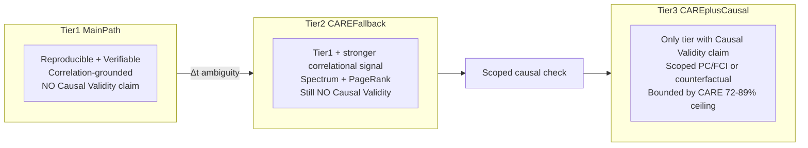
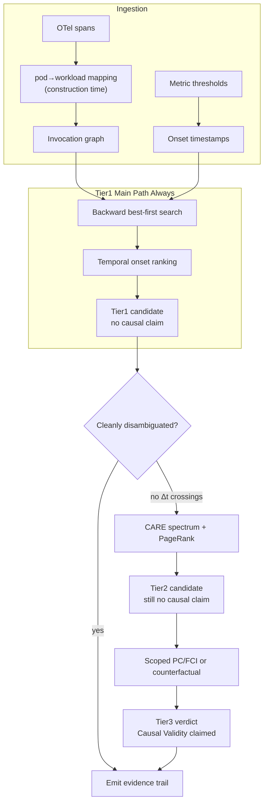
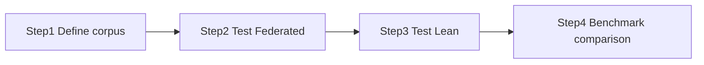
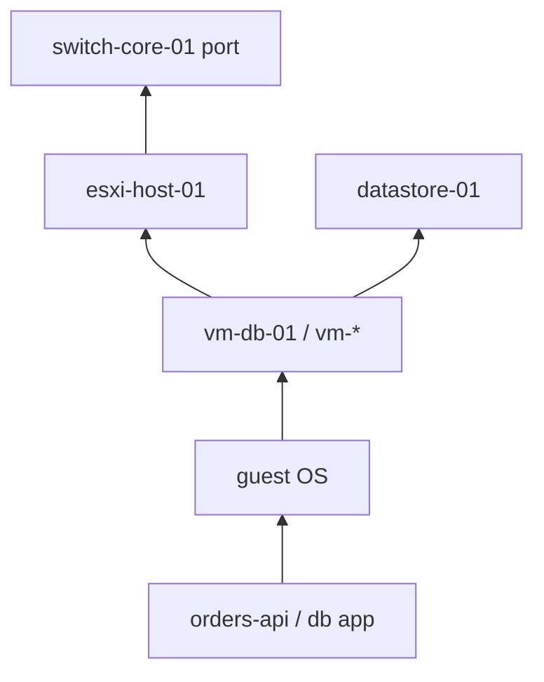

# Lean RCA PRD — Thorough Insights (v17)

> **Historical.** Motadata ObserveOps (Corpus B) is complete and **lean is primary** — see [`docs/ROADMAP.md`](../../docs/ROADMAP.md), [`docs/README.md`](../../docs/README.md), [`docs/ADR-001-lean-primary-engine.md`](../../docs/ADR-001-lean-primary-engine.md). Paths like `harness/`, `corpus/`, `PoC/`, and root `Lean_RCA_PRD.pdf` below are obsolete; use `datasets/observeops/`, `federated-pipeline/`, `lean-pipeline/`, and `docs/Lean_RCA_PRD.pdf`.
>
> **Roadblock note:** Body text below often echoes the PRD’s “targets 1a/2/3” framing and may omit **Roadblock 4**. For the live Motadata corpus, Mandatories are **1b** + **4** (shared GT bakeoff) — see [`docs/README.md`](../../docs/README.md).

## Document Status (Critical Change)

[`docs/Lean_RCA_PRD.pdf`](../../docs/Lean_RCA_PRD.pdf) (originally marked **PROPOSAL — Pending Team Review**):

- At the time of writing: nothing described had been built; federated was still the default design
- **Superseded for Motadata classic infra:** lean is the adopted primary engine (ADR-001); Corpus A (DeathStarBench) remains deferred/optional

**Plan impact (original):** treat architecture claims as hypotheses. **Outcome:** Motadata adopted lean as primary ([ADR-001](../../docs/ADR-001-lean-primary-engine.md)); federated remains optional for microservice/code-path work.

---

## What Changed Since the 12-Page Revision

### 1. Four-Axis Reliability Framework (replaces "deterministic" umbrella)

The PRD decomposes reliability into **four independent axes**:

| Axis | Meaning |
|------|---------|
| **Reproducibility** | Same input → same output |
| **Verifiability** | Human can inspect why a result was produced |
| **Accuracy** | Empirically correct against ground truth |
| **Causal Validity** | Reflects actual causation, not correlation or temporal precedence |

A system can be fully reproducible and still be unverifiable, inaccurate, or merely correlational. Every prior "deterministic" claim is restated against these axes.

### 2. Graph Terminology Table (Section 2)

| Term | Granularity | Edge Meaning | Used Here? |
|------|-------------|--------------|------------|
| Event graph | Finest (spans, log lines) | Event ordering within one trace | No (Nezha's mechanism, superseded) |
| **Invocation graph** | Service-to-service | A called B — interaction only | **Yes — what BFS walks** |
| Dependency graph | Ambiguous umbrella | Runtime or build-time | Avoided in favor of "invocation graph" |
| Causal graph | Formal SCM | Parent change produces child change | Only approximated for CARE-triggered subset (§2.6) |

### 3. BFS + Info-Gain = Best-First Search (not plain BFS)

Once Section 2.2 is active, traversal is **best-first over the BFS frontier** (highest expected information gain first), not strict FIFO BFS. Sections 2.1 + 2.2 together are **search strategies over a non-causal graph** — they make search efficient, they do not make the graph causal.

### 4. Three Evidentiary Tiers (expanded from two)



**Phase 6 must label every result by tier.** Blending Tier 1 and Tier 2/3 overstates main-path rigor.

### 5. CARE Does Not Close the Causation Gap (Section 2.6 expanded)

Explicit correlation-to-causation chain:
1. Invocation edge = interaction substrate (not causal)
2. Temporal ordering = necessary but not sufficient (common-cause confound illustrated: degraded network switch)
3. CARE spectrum + PageRank = stronger **correlation**, refined by topology — still not causal

CARE scores well on Reproducibility, Verifiability, and Accuracy (72–89%) but **not Causal Validity**. Scoped causal check exists specifically to supply Causal Validity where claimed.

### 6. New Future-Work Sections

- **§2.8 Continuous Causal Learning:** background causal-structure learner off per-incident critical path; cheap lookup at incident time
- **§2.9 Classic Infrastructure Topology:** typed nodes (Service / Host-VM / NetworkDevice), dual ingestion (traces + SNMP/syslog/NetFlow), partial Roadblock 1b reduction — **next major extension after PoC**, prioritized ahead of universal causal-graph refinement

### 7. New Appendix D

Four-axis comparison of Panorama, Murphy, Nezha with papers' own reported results. Key reading: no system is strong on all four axes; Murphy trades Reproducibility/Verifiability for strongest (partial) Causal Validity — this motivates §2.6's scoped causal check design.

### 8. Murphy BFS Nuance (Section 5)

Murphy uses BFS as **pre-filter before Gibbs sampling** — opposite of this proposal's BFS as **primary reasoning mechanism**. See Appendix D for full four-axis tradeoff.

### 9. Dynatrace Davis Clarification

Cited as **design philosophy precedent only** — closed proprietary SaaS, not a reusable component.

### 10. LLM Rejection Rationale Expanded

Rejected not because LLMs can't be reproducible (frozen model can be), but because reproducible LLM still fails **Verifiability** (no clean evidence chain) and **Accuracy** (hallucination risk).

---

## Realigned Architecture



**User refinement retained:** CARE is **not** on the main decision tree. Happy-path diagnoses never pay CARE or causal-check cost.

---

## Architecture Deep Dive (Updated)

### 2.1 Core: BFS + Temporal Ordering

- Walks **invocation graph** (not event graph, not causal graph)
- **Two-level mapping:** raw telemetry at pod granularity → workload identity at graph construction (avoids cosmetic relabeling that leaves pod-level fragmentation underneath)
- **Reproducibility claim only** — not Verifiability, Accuracy, or Causal Validity individually
- Concrete confound illustration: degraded network switch independently slows X and Y; temporal ranking alone misattributes
- **Ingestion scope:** trace parent/child linking only — not Nezha's full log+metric normalization pipeline

### 2.2 Information-Gain (Explicit Spec + Worked Example)

- Belief distribution over frontier candidates (initially uniform)
- Observable per node: `thresholdCrossed` (bool) + `crossingTimestamp`
- Expand highest expected Shannon entropy reduction first
- Worked example: Redis normal → eliminated; Kafka abnormal → ~80% belief collapse after 2 checks
- Phase 2 must validate observations-to-convergence vs naive BFS baseline

### 2.3 Conditional Fallback + Scoped Causal Verification

- **Trigger:** ≥2 candidates cross threshold within Δt (2× clock-skew bound)
- CARE when fired; scoped causal check **only when CARE fires**
- Main path output = leading candidate via temporal precedence + reachability, **not causally verified**

### 2.4 Entity Identity

Workload keying required for:
1. CARE spectrum signal accumulation (not Murphy-style history failure)
2. Mid-incident cause continuity across pod rotation

### 2.5 Infrastructure

Single in-memory invocation graph + rolling metrics window. **Not** Murphy's Vortex/Arrow CSR or DashMap property store repackaged.

### 2.6 Invocation vs Causal Graph

Universal causal discovery **rejected** (historical per-edge dependency, latency). Scoped check on CARE's narrowed candidate set only.

### 2.7 No Multi-Modal Fusion

Logs not fused. Acknowledged regression vs Nezha. Out of current PoC scope.

### 2.8 Continuous Causal Learning (Post-PoC)

Background learner, persistent store, update cadence. Extends Causal Validity beyond CARE-triggered subset without per-incident discovery cost.

### 2.9 Classic Infrastructure Topology (Post-PoC, High Priority)

- Typed nodes: Service / Host-VM / NetworkDevice with distinct identity strategies
- Dual ingestion: traces + SNMP/syslog/NetFlow/CMDB
- Partially reduces Roadblock 1b where data is already accessible — does not eliminate organizational silos

---

## PoC Scenarios (Unchanged Core, Updated Reporting)

| Scenario | Mechanism | Metric | Proof Type |
|----------|-----------|--------|------------|
| Cascading latency | BFS + temporal + info-gain; CARE on Δt | Top-1 accuracy; observations-to-convergence | Baseline Category A proof |
| Blind spot | BFS boundary flagging | Correct bounded-flag rate | Roadblock 1a proof |
| Pod churn | Workload vs pod keying | Accuracy delta | Roadblock 3 B→A |

**Phase 6 reporting requirements:**
- Scenario 1 split by evidentiary tier (Tier 1 / Tier 2 / Tier 3)
- Never blend tiers into one accuracy figure
- Infrastructure footprint vs federated back-of-envelope estimate (Phase 7 replaces with measured)

---

## Implementation Phases (Appendix B + Updates)

```mermaid
flowchart LR
  P0[Phase0 Harness] --> P1[Phase1 Core + Reproducibility]
  P1 --> P2[Phase2 InfoGain best-first]
  P2 --> P3[Phase3 CARE + scoped causal]
  P3 --> P4[Phase4 Identity + blind spot]
  P4 --> P4b[Phase4b Cyclic stress optional]
  P4b --> P5[Phase5 Reproducibility proof]
  P5 --> P6[Phase6 EVAL three-tier]
  P6 --> P7[Phase7 COMPARISON.md]
```



| Phase | Key Deliverable | Axis / Tier Focus |
|-------|-----------------|-------------------|
| 0 | `harness/` YAML per scenario | — |
| 1 | `core-engine/` CLI + 50-run reproducibility test | Reproducibility (Axis 1) |
| 2 | Convergence-count log vs naive BFS | Efficiency claim validation |
| 3 | Fallback log + causal-verification log | Tier 2 + Tier 3 |
| 4 | Pod vs workload keying delta; blind-spot flag rate | Roadblocks 1a, 3 |
| 4b | Cyclic topology findings note (optional) | Known limitation |
| 5 | 20× rerun bit-for-bit reproducibility % | Reproducibility |
| 6 | `EVAL.md` with tier-separated metrics | All four axes where applicable |
| 7 | `COMPARISON.md` vs federated on **same Motadata corpus** | Measured per UC, four-axis |

---

## ObserveOps Benchmark — 4-Step Workflow

**Source:** [rca-use-cases-only.md](/root/Harshil-PoCs/Unified-RCA/rca-use-cases-only.md)  
**Principle:** Same frozen input corpus for both architectures; only the engine differs.



| Step | Goal | Deliverable | Gate |
|------|------|-------------|------|
| **1 — Define corpus** | Freeze identical input bundles for UC-1..UC-5 | `harness/corpus/observeops/` + `COMPARISON_BENCHMARK.md` | All bundles validate against schema |
| **2 — Test federated** | Run Panorama→Murphy→Nezha on each bundle | `results/federated/UC-N/verdict.json` (+ logs) | 5/5 UCs produce verdict |
| **3 — Test lean** | Run lean engine (with §2.9 ObserveOps upgrade) on **same** bundles | `results/lean/UC-N/verdict.json` (+ tier logs) | 5/5 UCs pass smoke vs ground truth |
| **4 — Benchmark comparison** | Score both side-by-side | `COMPARISON.md` | Per-UC metrics + four-axis summary |

**Parallel track:** Corpus A (DeathStarBench/TrainTicket) remains the PRD algorithm PoC (Phases 0–6 / `EVAL.md`). It does **not** substitute for Step 1–4.

---

### Step 1 — Define corpus

**Output tree:**

```
harness/corpus/observeops/
  manifest.yaml              # corpus version, UC list, shared topology hash
  COMPARISON_BENCHMARK.md    # metric definitions, pass/fail per UC
  UC-1/ ... UC-5/
    topology.json
    metrics/
    anomalies.json
    symptom_seed.json
    ground_truth.json
    injection_manifest.yaml
```

**Shared topology** (all UCs):



**Ground truth per UC:**

| UC | Root CI | Signature | Pass | Fail |
|----|---------|-----------|------|------|
| UC-1 | `esxi-host-01` | `cpu_contention` | Blame host | Blame app/VM only |
| UC-2 | `switch-core-01:GigE0/2` | `link_failure` / `network_saturation` | Blame port | Blame app/server |
| UC-3 | `datastore-01` | `storage_contention` | Blame datastore (+ contributor VM) | Blame DB app only |
| UC-4 | `guest-os-vm-app-01` | `os_resource_exhaustion` | Blame guest OS | Blame app or infra below |
| UC-5 | `orders-api` | `app_resource_exhaustion` | Blame app; infra healthy | False-blame infra |

**Step 1 exit criteria:** schema validates; `ground_truth.json` frozen; `anomalies.json` matches use-case thresholds (table b).

---

### Step 2 — Test with Federated

**Engine:** [`federated-pipeline/poc/orchestrator.py`](../../federated-pipeline/poc/orchestrator.py) (Panorama → Murphy → Nezha) with Corpus B adapter.

**Per UC run:**
1. Load frozen bundle from `harness/corpus/observeops/UC-N/`
2. Map typed CIs + metrics into federated adapter inputs
3. Execute pipeline from `symptom_seed.json`
4. Write `results/federated/UC-N/run-XX/verdict.json` + evidence trail

**Capture per run:**
- `root_ci`, `signature`, `evidence[]`
- hops / observations count
- reproducibility across N=20 identical reruns

**Step 2 exit criteria:** verdict exists for all 5 UCs; no adapter crashes; logs complete.

---

### Step 3 — Test with Lean

**Prerequisite (§2.9 ObserveOps upgrade on same corpus reader):**

| Component | Path |
|-----------|------|
| Typed graph schema | `core-engine/schema/observeops_topology.json` |
| Signal registry | `core-engine/observeops_signals.yaml` |
| Bundle ingest | `core-engine/ingest/observeops_bundle.py` |
| Shared-upstream rule | `core-engine/rules/shared_upstream.py` |
| Datastore contributor | `core-engine/rules/datastore_contributor.py` |
| Upstream healthy gate | `core-engine/rules/upstream_healthy.py` |

**Per UC run (identical bundle paths as Step 2):**
1. Load **same** frozen bundle
2. Typed normalizer → invocation graph
3. Best-first BFS + temporal + info-gain
4. CARE + scoped causal check **only** if Δt ambiguity
5. Write `results/lean/UC-N/run-XX/verdict.json` + `evidentiary_tier` + `fallback_fired`

**Step 3 exit criteria:** top-1 matches `ground_truth.root_ci` on smoke; N=20 reproducibility logged; tier labels correct.

---

### Step 4 — Benchmark comparison

**Input:** `results/federated/` + `results/lean/` from Steps 2–3 on **same corpus version**.

**Score identically for both:**

| Metric | Definition |
|--------|------------|
| Top-1 root CI accuracy | vs `ground_truth.root_ci` |
| Signature match | vs `ground_truth.signature` (UC-1..UC-4) |
| False-infra-blame rate | UC-5 only |
| Observations / hops | efficiency |
| Reproducibility % | N=20 bit-identical |
| Verifiability | evidence cites decisive signals |
| Four-axis scores | Reproducibility, Verifiability, Accuracy, Causal Validity |

**Lean-only columns:** evidentiary tier (1/2/3), CARE fallback rate.

**Output:** `COMPARISON.md`

```markdown
# Federated vs Lean — ObserveOps Corpus

## Corpus version & manifest hash
## Step 2 federated summary (per UC)
## Step 3 lean summary (per UC)
## Side-by-side metrics table
## Four-axis comparison
## UC-5 false-infra-blame analysis
## Lean tier breakdown
## Gaps / adapter limitations
## Team review notes (not adoption decision)
```

**Step 4 exit criteria:** every number traces to a specific run directory; no blended tier metrics.

---

## Federated vs Lean — Reference Detail (Corpus B)

**Source of truth for benchmarks:** [rca-use-cases-only.md](/root/Harshil-PoCs/Unified-RCA/rca-use-cases-only.md)

This is the **product-relevant comparison corpus** — VMware/classic-infra stack (Network → ESXi → VM → Guest OS → App), not the PRD's K8s DeathStarBench/TrainTicket scenarios. Both architectures must consume **identical frozen input bundles** per use case; only the reasoning engine differs.

### Two corpora (do not conflate)

| Corpus | Purpose | Scenarios | Fair for lean today? |
|--------|---------|-----------|---------------------|
| **A — PRD synthetic** | Algorithm PoC (BFS, CARE, pod churn, blind spot) | DeathStarBench / TrainTicket | Yes (current PRD scope) |
| **B — Motadata ObserveOps** | Federated vs lean head-to-head | UC-1..UC-5 in `rca-use-cases-only.md` | After **Phase 7-pre** (§2.9 upgrade below) |

Phase 6 `EVAL.md` = Corpus A only. Steps 1–4 above = Corpus B comparison track.

### Shared topology (Corpus B)


All five UCs share this stack; they differ only in **where the fault is injected** and **which layer is ground-truth root cause**.

### Per-UC ground truth (benchmark contract)

| UC | Injected fault | **Ground-truth root CI** | **Ground-truth signature** | Symptom seed (what fires first) | **Pass =** | **Fail =** |
|----|----------------|--------------------------|----------------------------|----------------------------------|------------|------------|
| UC-1 | ESXi CPU contention | `esxi-host-01` | `cpu_contention` | `orders-api` p95 latency | Root = host; chain host→VMs→apps | Blame app or individual VM only |
| UC-2 | Switch uplink sat/link-down | `switch-core-01:GigE0/2` | `link_failure` / `network_saturation` | App timeouts / TCP errors | Root = switch port | Blame app or server |
| UC-3 | Datastore noisy neighbor | `datastore-01` (+ noisy-neighbor VM as contributor) | `storage_contention` | DB / app latency | Root = datastore, not DB app | Blame `vm-db-01` or DB as sole cause |
| UC-4 | OS fs full / OOM / runaway | `guest-os-vm-app-01` | `os_resource_exhaustion` | App down / 5xx | Root = guest OS on that VM | Blame app code; blame host/network when OS-local |
| UC-5 | JVM heap / pool exhaustion | `orders-api` | `app_resource_exhaustion` | App latency / errors | Root = app; **upstream infra verified healthy** | **False-blame** host, switch, or datastore |

UC-5 is the **anti-false-positive control**: both engines must resist pointing at infra when infra signals are normal.

### What "same input corpus" means (frozen bundle per UC)

Each UC run uses one versioned directory, e.g. `harness/corpus/observeops/UC-1/`:

```
UC-N/
  topology.json          # CIs + edges (invocation/dependency), frozen
  metrics/               # time-series per CI/signal at listed thresholds
  anomalies.json         # threshold crossings + timestamps per CI
  symptom_seed.json      # which CI triggered the investigation
  ground_truth.json      # root_ci, signature, contributor_cis (if any)
  injection_manifest.yaml # how fault was produced (reproducibility)
```

**Rule:** Federated and lean readers load the **same files**. No architecture-specific preprocessing that changes graph or timestamps between runs.

### Metrics scored identically for both architectures

| Metric | Definition | Applies to |
|--------|------------|------------|
| **Top-1 root CI accuracy** | Predicted root CI == `ground_truth.root_ci` | UC-1..UC-5 |
| **Signature match** | Predicted rule/signature == `ground_truth.signature` (or equivalent) | UC-1..UC-4 |
| **False-infra-blame rate** | Predicted root in {host, switch, datastore} when ground truth is app | **UC-5 only** |
| **Symptom suppression** | Downstream symptom CIs not emitted as root | All UCs |
| **Observations / hops** | Count of CI checks or graph expansions to verdict | Both |
| **Reproducibility** | Bit-identical output across N=20 reruns on same bundle | Both |
| **Verifiability** | Evidence trail cites signals listed in use-case table (b) | Both |
| **Evidentiary tier (lean only)** | Correct Tier 1 / 2 / 3 label; no Causal Validity claim on Tier 1/2 | Lean |
| **Fallback rate (lean only)** | % runs where CARE fired; must be logged, not hidden | Lean |

Score each UC on the **four-axis framework** where applicable:

- **Reproducibility** — same bundle → same verdict
- **Verifiability** — can auditor trace to `cpu.ready`, `linkDown`, GAVG, fs%, heap%, etc.?
- **Accuracy** — top-1 vs ground truth
- **Causal Validity** — only if engine explicitly claims it (lean Tier 3 only; federated Murphy partial)

### How each architecture runs on Corpus B

| Step | Federated (Panorama → Murphy → Nezha) | Lean (BFS + temporal + info-gain + conditional CARE) |
|------|----------------------------------------|------------------------------------------------------|
| Ingest | Adapt federated adapters to read `topology.json` + `metrics/` + `anomalies.json` | Step 3 typed bundle normalizer → invocation graph |
| Trigger | `symptom_seed.json` CI | Same |
| Reason | Panorama flags → Murphy MRF posterior → Nezha patterns → fused verdict | Backward best-first on invocation graph + temporal onset; CARE only if Δt ambiguity |
| Output | `verdict.json` with root CI + evidence | `verdict.json` with root CI + evidence + `evidentiary_tier` + `fallback_fired` |

**Step 2 engine:** [`federated-pipeline/poc/orchestrator.py`](../../federated-pipeline/poc/orchestrator.py) with Corpus B adapter.

### Lean §2.9 upgrade (required before Step 3)

Scoped §2.9 upgrade before Phase 7 — typed graph + signal-aware rules on frozen Corpus B bundles (no live SNMP/NetFlow for PoC).

**Core engine unchanged:** best-first BFS, temporal ranking, info-gain, conditional CARE, three tiers, no full log fusion.

**Additions:**

1. **Typed CIs:** `NetworkPort` → `HypervisorHost` → `VirtualMachine` → `GuestOS` → `Service`, plus `Datastore` edges
2. **Signal registry** (`core-engine/observeops_signals.yaml`) — decisive signals per UC from `rca-use-cases-only.md` table (b)
3. **Shared-upstream convergence** — deepest common upstream with decisive signal when multiple downstream CIs fire (UC-1..UC-3)
4. **UC-1:** `cpu.ready` >5% on ≥2 VMs under same host
5. **UC-2:** `linkDown` / port util >90% outranks downstream timeouts
6. **UC-3:** root `datastore-01` + `contributor_cis` for noisy-neighbor VM
7. **UC-4:** OOM/fs as structured alerts in `anomalies.json` (not Drain); stop at `GuestOS`
8. **UC-5:** upstream healthy gate — no infra blame when upstream signals clean

**Deliverables:**

| Path | Purpose |
|------|---------|
| `core-engine/schema/observeops_topology.json` | Typed graph schema |
| `core-engine/observeops_signals.yaml` | Per-UC threshold registry |
| `core-engine/ingest/observeops_bundle.py` | Bundle → typed graph |
| `core-engine/rules/shared_upstream.py` | UC-1..UC-3 convergence |
| `core-engine/rules/datastore_contributor.py` | UC-3 contributor |
| `core-engine/rules/upstream_healthy.py` | UC-5 anti-false-positive |
| `core-engine/tests/observeops/test_uc*.py` | Smoke tests vs ground truth |

**Phase order for comparison track:** Step 1 → Step 2 → Step 3 → Step 4 (strictly sequential).

**Out of scope:** live SNMP/NetFlow ingest, Nezha log fusion, universal causal graph.

---

## Appendix D Integration (New)

| System | Reproducibility | Verifiability | Accuracy | Causal Validity |
|--------|-----------------|---------------|----------|-----------------|
| Panorama | High | High | 15/15 gray failures <7s | Low (explicit) |
| Murphy | Low (Gibbs) | Medium | 1.35×–4.7× error reduction | Highest (partial) |
| Nezha | High | Highest | 89.77% top-1 | Low |

**Lean design intent:** inherit Panorama/Nezha Reproducibility+Verifiability+Accuracy on main path; reserve Murphy-style counterfactual reasoning for scoped Tier 3 check only.

---

## Relationship to Current Workspace (updated)

| PRD Component (plan name) | Actual location / status |
|---------------------------|--------------------------|
| `harness/corpus/observeops/` | → `datasets/observeops/` (**done**) |
| `core-engine/` | → `lean-pipeline/core_engine/` (**done**) |
| Info-gain best-first layer | **Done** (lean search + IG) |
| CARE conditional fallback | **Done** |
| Scoped causal verification | **Done** (Tier 3 on UC-1/UC-3) |
| Three-tier reporting | **Done** (verdicts + bakeoff) |
| `COMPARISON.md` | → `benchmarking/results/comparison/` (**done**) |
| Federated PoC (`PoC/`) | → `federated-pipeline/` (optional Motadata path; **not** primary) |

**Canonical status:** [`docs/ROADMAP.md`](../../docs/ROADMAP.md). Path aliases in this plan body (`harness/`, `PoC/`, `core-engine/`) are historical.

---

## Strengths of the v17 PRD

1. **Four-axis framework** — stops overloading "deterministic"
2. **Three-tier evidentiary reporting** — prevents overclaiming causation
3. **Graph terminology precision** — invocation ≠ causal ≠ event
4. **CARE limitation stated plainly** — correlation ≠ causation
5. **Murphy BFS distinction** — pre-filter vs primary reasoning
6. **Post-PoC roadmap** — §2.8 causal learning, §2.9 classic infra prioritized
7. **Appendix D** — evidence-backed tradeoff for scoped causal check

(Adoption for Motadata classic infra is now decided — lean primary.)

## Risks and Open Questions (historical; Motadata path resolved)

1. ~~**Proposal may not be adopted**~~ — **Resolved:** lean primary (ADR-001)
2. **Tier confusion in implementation** — still watch UI/report labeling
3. **Scoped causal check depth** — PoC Tier 3 is lightweight; fuller PC/FCI optional later
4. **Best-first vs "BFS" naming** — keep docs precise
5. **Cyclic topology** — optional honesty limit
6. **Corpus A** — DeathStarBench still deferred / optional
7. **No multimodal fusion** — lean may miss log-only signals vs Nezha
8. **Federated scope** — keep microservice track bounded if resumed
9. ~~**Step sequencing**~~ — Steps 1–4 complete (`bakeoff-phase-b-001`)

---

## Recommended Next Steps (ObserveOps comparison track)

**Done (Motadata critical path):** Steps 1–4 + Phases A/B/D — see [`docs/ROADMAP.md`](../../docs/ROADMAP.md).

**Optional later:** B5 continuous causal memory; Phase C federated ingest (microservice track); Phase E capacity; Corpus A algorithm PoC.

---

## Bottom Line

ObserveOps bakeoff is complete: one frozen corpus (`datasets/observeops/`), both engines scored, **lean primary** for Motadata classic infra. Prefer [`docs/README.md`](../../docs/README.md) and ADR-001 over the obsolete path names in the body of this historical plan.
