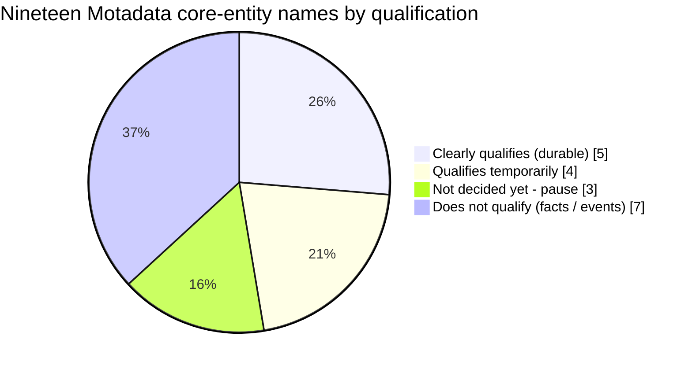

# Graph + sketch contract — discussion brief (locked leanings)

**Purpose:** One sit-down document that freezes (1) which Motadata names may become topology nodes, (2) the Pillar B configuration-item catalog and fifteen edge types, and (3) the Pillar A sketch row shape.  
**Status:** Discussion draft with **owner leanings locked** (not Signed until the room votes).  
**Date:** 2026-08-20  
**Q&A companion:** [`GRAPH_QNA.md`](./GRAPH_QNA.md) (E1–E5 always-on fabric).  
**Also:** condensed PDF [`Sketches_Merging_RawData_QnA.pdf`](../../docs/Sketches_Merging_RawData_QnA.pdf) — see GRAPH_QNA on merge / raw retention.

**Companion:** Full sample JSON for every qualified node type and all fifteen edges — [`GRAPH_NODE_EDGE_SAMPLES.md`](./GRAPH_NODE_EDGE_SAMPLES.md).
**Pillar A deep dive (inputs → process → artifacts):** [`PILLAR_A_PERCENTILES_DEEP_DIVE.md`](../../docs/PILLAR_A_PERCENTILES_DEEP_DIVE.md).

### Owner leanings (this session)

| Topic | Choice |
|-------|--------|
| **Graph** | Full operational-graph catalog: richer configuration-item types + **fifteen edge types** + full provenance. Accept longer freeze time. |
| **Vortex** | Logical schema first — JSON field tables now; protobuf later as encoding only (no Vortex `.proto`/API yet). **Hybrid store:** strict spine for join/walk keys; flexible attributes per entity or edge type (§6.1). |
| **Sketch row** | One row = T-Digest + explicit buckets + seasonal baseline under `(metric, entity, window, season_key)`. |

**Non-negotiables still locked:** configuration-item vertices only (Alert / Incident / ticket are **not** nodes); join within Dest tenant is ingest `ci_id` ≡ sketch `entity_id` ≡ map `entity_id`; D5 stays Review. Motadata-aligned storage: **no `tenant` on node/edge rows**; Snowflake `edge_id` / `evidence_event_id`; no stored `discovered_via`.

---

## 1) What this brief asks the room to lock

These are the decisions the sit-down is for. They are written in ordinary language so a cold reader can vote without decoding private labels.

| # | Decision to lock | What “yes” means |
|---|------------------|------------------|
| 1 | **Primary identity** | Within a Dest tenant, every topology node and every sketch row joins on the **same string**: ingest `ci_id` → map `entity_id` ≡ sketch `entity_id`. Tenant lives on the snapshot / Dest path, **not** on Motadata node/edge rows. |
| 2 | **Configuration-item type catalog** | Use the **richer type set** in §3 — Motadata storage uses lowercase (`service`, `host`, `db`, …); ingest may still say PascalCase. Keep types as a **versioned closed enum**. Non-CI Motadata names never become vertices. |
| 3 | **Node metadata** | Adopt Motadata columns in §3.4 (`entity_id`, `type`, `name`, `metadata` JSON string, `last_seen`, `version`, validity). |
| 4 | **Edge type catalog** | Lock **all fifteen** relations in §4.2; storage enum is Motadata SCREAMING_SNAKE (`DEPENDS_ON`, …); ingest still uses snake_case. |
| 5 | **Edge metadata and audit** | Motadata columns: Snowflake `edge_id` + `evidence_event_id`, `source_id` / `target_id`, `edge_type`, `valid_from` / `valid_to`. Upsert key is `(source_id, edge_type, target_id)`. **No** stored `discovered_via`. |
| 6 | **Exchange format** | Share **JSON examples** now; generate `.proto` / DDL only **after** Signed and when Vortex needs encoding. |
| 7 | **Sketch row shape** | One **`sketch.v1`** row holds T-Digest + buckets + seasonal baseline together (§5). |

**Trade-off to say out loud:** A rich configuration-item graph is right for disk/network/contention walks, but finishing LLD-E3 and the first Vortex tables takes longer than a four-edge MVP. Mitigation: the **schema** carries all fifteen relation names on day one; **writers** may emit only a subset until the sources exist (§4.5).

---

## 2) What counts as a configuration item

Motadata’s leadership PDF lists **nineteen** names as “core entities.” That list mixes things that keep existing in the estate with things that only happened at a moment in time. Before we freeze graph nodes, every name must pass the same test: is it a configuration item, does it have a stable identity, and would you open a long-lived ticket against it?

### 2.1 Working definition

A **configuration item** is a noun that keeps existing in the estate and can be given an identity **durable enough to still mean the same thing if you look it up again later**.

Ask three questions for every name:

1. **Where does this name map?** — Is it a real thing in the estate, or a moment in time (something fired, something changed)?
2. **Does it have a stable unique identity?** — Not only “unique while I am looking at it,” but unique in a way that still points at the *same* thing later.
3. **Does it stick around long enough that you would open a ticket against it?** — Long-lived ticket roots need durable configuration items.

**Rule of thumb**

- If it is a noun that keeps existing → candidate configuration item (then check identity).
- If it is something that happened at a point in time → fact or event — **never** a configuration item, and **never** a node on the topology map. Attach it as evidence to a configuration item instead.

### 2.2 Sharpening: uniqueness alone is not enough

Uniqueness at a single moment is **necessary but not sufficient**. That is why a process identifier fails the durable-identity test even though it looks unique when you glance at it: process identifiers get reused. A container or pod passes *more* than a process because its unique identifier is not recycled the same way — but only for as long as that instance is alive. So those are “graph nodes for a while,” not roots for long-term tickets.

That is also why Database, Deployment, and Network sit in “pause until you pick the identity”: they *could* receive a stable identity; the Motadata PDF never says what that identity is, so do not guess.

### 2.3 Four categories

| Category | Meaning | Ticket root? |
|----------|---------|--------------|
| **Clearly qualifies** | Persists; has (or can have) a durable identity | Yes |
| **Qualifies temporarily** | Real while alive; useful on the graph for that window | No — parent / scope is the durable thing |
| **Not decided yet** | Could be a configuration item, but the stable identity is unspecified | Pause — do not invent an identity |
| **Does not qualify** | Event or fact about a moment in time | Never — evidence only |

### 2.4 Nineteen Motadata names — pie and counts

Counts of the nineteen Motadata names: clearly qualifies **5** (26%) · temporarily **4** (21%) · not decided **3** (16%) · does not qualify **7** (37%).



| Category | Count | Share of 19 |
|----------|------:|------------:|
| Clearly qualifies (durable) | 5 | 26% |
| Qualifies temporarily | 4 | 21% |
| Not decided yet — pause | 3 | 16% |
| Does not qualify (facts / events) | 7 | 37% |

Source: Motadata Observability 3 Pillars PDF · core entities list. Queue is counted under “clearly qualifies” only as a **named** broker destination. Database is counted under “not decided” until you name the instance or cluster.

**What you may open a long-lived ticket against.** Ticket against a durable configuration item: Service, Host, Customer, BusinessService, a named Database instance or cluster, or a named Queue destination. Do not ticket a Pod unique identifier, a container identifier, a process identifier, an Alert, a Change, or a Trace. Those may appear on the walk for a window or as evidence; they are not the configuration item you anchor the ticket to.

### 2.5 Clearly qualifies

These persist and have durable identities. They are the usual roots for a long-lived ticket.

| Name | Stable identity? | Sticks around for a ticket? | Notes |
|------|------------------|-----------------------------|-------|
| Service | Yes — stable service / workload identity | Yes | Clear configuration item |
| Host | Yes — machine / hypervisor identity | Yes | Clear configuration item |
| Customer | Yes — tenant / account identity | Yes | Clear configuration item |
| BusinessService | Yes — named offering the customer cares about | Yes | Clear configuration item |
| Queue | Yes — only as a named broker destination (topic / queue name) | Yes, if named | Not “the network of queues” as a vague blob |

Database belongs here as well **once** you name the specific instance or cluster. Until then it stays in “not decided yet” below.

### 2.6 Qualifies temporarily

These exist for a while and can have an identity while they are alive. They are useful on the graph for that window. They are not permanent — a pod dies and a new one replaces it. Do not anchor a long-term ticket to them; point the ticket at the durable parent.

| Name | Stable identity? | Sticks around for a ticket? | Notes |
|------|------------------|-----------------------------|-------|
| Pod | Yes while alive — Kubernetes unique identifier for this replica; not recycled like a process identifier | No — dies when replaced | Graph node for that window; parent is the durable workload |
| Container | Yes while alive — container identifier, or pod unique identifier plus container name | No — not across restarts | Passes more of the identity test than Process; still not a ticket root |
| Process | No for durability — a process identifier is unique at a glance, then reused | No | Fails the “look it up later and mean the same thing” test harder than Pod or Container |
| Endpoint | Only if you bind a stable URL, port, or route identity | Only if that identity is durable | Not “whatever internet address appeared on this span” |

### 2.7 Not decided yet — pause, do not guess

These could be configuration items, but the Motadata PDF never says what the stable identity actually is. Until the identity scheme is chosen, pause.

| Name | Stable identity? | Sticks around for a ticket? | What you must decide |
|------|------------------|-----------------------------|----------------------|
| Database | Not yet — instance? cluster? schema? cloud resource name? | Only after you name the instance or cluster | Pick the scoped identity; then it moves to “clearly qualifies” |
| Deployment | Not yet — Kubernetes Deployment unique identifier ≠ release version ≠ runbook identity | Only after you say which object the node is | Those are three different things; name one |
| Network | Not yet — “Network” as a word is too coarse to be one identity | Only after you pick a concrete object | Switch, network interface, subnet, virtual network, or load balancer — pick one |

### 2.8 Does not qualify at all

These are events or facts about a moment in time. They should not be nodes on the topology map. They are evidence attached to a configuration item, not configuration items themselves.

| Name | Stable identity as a configuration item? | Sticks around for a ticket? | What it actually is |
|------|------------------------------------------|-----------------------------|---------------------|
| Change | No — fact with a time (change identity, git commit, deploy identity) | No — never the topology node | Something that happened; link it to a configuration item |
| Alert | No | No | A detect fire — a signal, not a configuration item |
| Incident | No | No | A case identity for the investigation, not estate topology |
| ITSMTicket | No | No — the ticket points at a configuration item; it is not one | Join later on the same configuration-item identity |
| Metric | No | No | Evidence type or sketch key — not a configuration item |
| LogPattern | No | No | Pattern catalog / corroboration — not a configuration item |
| Trace | No — a trace identity can be unique and still not be a configuration item | No | Evidence of a call path — not something you ticket as the estate object |

5 + 4 + 3 + 7 = 19. Topology freeze for Pillar B remains **configuration-item vertices only**.

---

## 3) Entities (nodes on the topology map)

### 3.1 What is an entity on this graph

An **entity** on the topology map is a **configuration item** with stable `entity_id` (within the Dest tenant) that may be localized or ticketed.  
It is **not** Alert, Incident, Signal, Verdict, or Change-as-configuration-item.

### 3.2 Primary ID

| Field | Rule |
|-------|------|
| Dest `tenant` | Namespace on snapshot envelope / path — **not** a Motadata node column |
| `entity_id` | Stable within tenant; same string as ingest `ci_id` / sketch `entity_id` after Identity bind |
| ingest `ci_id` | Remains on `ingest.v1`; GraphWriter maps it to `entity_id` at the boundary |

### 3.3 Configuration-item types (closed enum we version)

Align with Motadata lowercase storage names. Ingest may still use PascalCase (`Service` → `service`, `Database` → `db`, `Runtime` → `process`, `BusinessService` → `business_service`).

| Family | Example Motadata `type` | Why needed |
|--------|-------------------------|------------|
| Business / service | `business_service`, `service`, `customer` | Symptom seed, ERROR/SLOWDOWN, account scope |
| Runtime / middleware | `process`, named `queue` | Leaf depth on app stacks / messaging |
| Data | `db` (named instance/cluster) | DB leaves |
| Compute / OS | `host` | Contention / hosting walks |
| Container (optional) | `pod`, `container`, `k8s_deployment` | Ephemeral; use validity windows |
| Network | `network`, `endpoint` | Fabric / durable routes |
| Observation | (collector as `service` if modeled) | MONITORING_UNAVAILABLE |

**Still not graph entities:** `alert`, `incident`, `itsm_ticket`, `red_metric`, `log_pattern`, `trace`, `change`.

### 3.4 Node metadata

A `graph_node.v1` object is one **topology vertex**: a durable configuration item after Identity has bound it. It is not a log line, alert, or ticket.

How it is built, in order:

1. Collect admits telemetry (host name, agent id, Kubernetes UID, and so on).
2. Identity stamps a stable `ci_id` inside `tenant` on the ingest line. `identity.status` becomes `resolved`, or stays unresolved / synthesized off the snapshot.
3. Topology maps the line to Motadata columns and writes this JSON as a vertex on `GraphSnapshot`. Only **resolved** ingest lines are admitted; status is not copied onto the node.
4. Display fields (`name`, optional tags in `metadata`) come from inventory, not from the symptom.

Machine-required fields are listed in [`schemas/graph_node_v1.schema.json`](./schemas/graph_node_v1.schema.json).

**Always required (Motadata + schema)**

| Field | Example | Meaning |
|-------|---------|---------|
| `schema_version` | `graph_node.v1` | Which node contract this is. Constant. |
| `entity_id` | `linux-server-app-01` | Stable id within Dest tenant. Same string as sketch `entity_id`. |
| `type` | `host` | Motadata lowercase closed enum. |
| `name` | `app-01` | Human display name. Not the join key. |
| `metadata` | `"{\"env\":\"rca-lab\"}"` | JSON object as a **string**. |
| `last_seen` | `2026-08-20T03:30:00Z` | Refreshed on every upsert. |
| `version` | `1` | Monotonic integer per `entity_id`. |
| `valid_from` / `valid_to` | `null` / `null` | When this vertex was believed true. |

**Optional extras** live inside the `metadata` JSON string (aliases, scope_parent, monitored_via, …) or as schema `additionalProperties`. Do **not** invent a second primary key beside `entity_id`.

**What this JSON is not:** Alert, Incident, ticket, Metric, Trace, LogPattern, and Change-as-configuration-item do not get a `graph_node.v1`. Those hitch the walk as facts or evidence; they are not vertices.

**Writer rule:** GraphSnapshot vertices only from ingest lines with `identity.status = resolved`. Status is admit-time only.

**Hybrid, not one rigid row shape for every type:** Host, Pod, and Database share the Motadata spine above. Type-specific extras stay in `metadata`. The machine schema allows that on purpose (`additionalProperties: true`). Full hybrid rule for Vortex: §6.1.

### 3.5 Node JSON examples

One illustrative Host sample remains here for the sit-down one-pager. **Full sample JSON** lives in [`GRAPH_NODE_EDGE_SAMPLES.md`](./GRAPH_NODE_EDGE_SAMPLES.md).

```json
{
  "schema_version": "graph_node.v1",
  "entity_id": "linux-server-app-01",
  "type": "host",
  "name": "app-01",
  "metadata": "{\"aliases\":[\"app-01.lab.local\"],\"env\":\"rca-lab\"}",
  "last_seen": "2026-08-20T03:30:00Z",
  "valid_from": null,
  "valid_to": null,
  "version": 1
}
```

This Host is already bound: Dest tenant `default` + `entity_id` `linux-server-app-01` is the join key (same string as sketch `entity_id`). Type `host` tells Localize this is compute/OS. Null validity means we are not treating this host as a short-lived replica.

---

## 4) Edges (15 types)

### 4.1 What an edge is (and what it is not)

The topology map stores **how configuration items relate**. An **edge** names two CIs (`source_id` / `target_id`), a Motadata `edge_type` such as `RUNS_ON` or `DEPENDS_ON`, Snowflake `edge_id` / `evidence_event_id`, and `valid_from` / `valid_to`.

In practice every edge is:

- **Typed** — `edge_type` from the closed Motadata catalog in §4.2 (ingest snake_case maps at the writer).
- **Directed** — the arrow has a meaning (workload → host for `RUNS_ON`).
- **Auditable** — `evidence_event_id` points at the proving event; optional PoC `origin` helps E5 maintain.
- **Time-bounded** — `valid_from` / `valid_to` say when the fact was believed true.

**What does *not* belong on this topology edge catalog**

| Word you may hear elsewhere | What it actually is | Why it is not an E3 topology edge |
|-----------------------------|---------------------|-----------------------------------|
| `CORRELATED_WITH` (Curate) | “These alerts/signals belong together in a case” | Connects **signals / cases**, not two estate configuration items |
| `RESOLVED_BY` (Package) | “This verdict / ticket closed that case” | Packaging / case outcome — not estate topology |
| `AFFECTS` as stored blast radius | “If this breaks, these other things hurt” | Impact is **computed at investigation time**, not a durable map fact |

### 4.2 Full relation catalog (lock as enum)

| Ingest `relation` | Motadata `edge_type` | Plain meaning |
|-------------------|----------------------|---------------|
| `depends_on` | `DEPENDS_ON` | A needs B |
| `runs_on` | `RUNS_ON` | A executes on B |
| `mounts` | `MOUNTS` | A mounts B |
| `connects_to` | `CONNECTS_TO` | L2/L3 adjacency |
| `backs` | `BACKS` | A backs B |
| `uses` | `USES` | A uses B (often inferred) |
| `hosted_on` | `HOSTED_ON` | Guest/VM on hypervisor |
| `member_of` | `MEMBER_OF` | A in cluster/group |
| `part_of` | `PART_OF` | Child of parent |
| `routes_through` | `ROUTES_THROUGH` | Path via middlebox |
| `authenticates_via` | `AUTHENTICATES_VIA` | Auth dependency |
| `monitored_by` | `MONITORED_BY` | Observed by collector |
| `backed_up_by` | `BACKED_UP_BY` | Backup target |
| `clustered_with` | `CLUSTERED_WITH` | Peer same tier |
| `communicates_with` | `COMMUNICATES_WITH` | Calls / talks to |

### 4.3 Edge metadata

A `graph_edge.v1` object is one **typed, directed relationship** between two CI vertices.

How it is built:

1. Collect and Identity produce two bound CIs in the same Dest tenant.
2. Topology picks a catalog `relation`; GraphWriter maps snake_case → Motadata `edge_type`.
3. Both ends must already be CI vertices on the snapshot.
4. Allocate or reuse Snowflake `edge_id` via upsert key `(source_id, edge_type, target_id)`; stamp `evidence_event_id`.
5. Set `valid_from` / `valid_to` on the edge object.

Machine-required fields: [`schemas/graph_edge_v1.schema.json`](./schemas/graph_edge_v1.schema.json).

| Field | Example | Meaning |
|-------|---------|---------|
| `schema_version` | `graph_edge.v1` | Edge contract id |
| `edge_id` | `7146828800000001` | Snowflake UInt64; stable across upserts of the same logical edge |
| `source_id` | `app-runtime-jvm` | Source vertex `entity_id` |
| `target_id` | `linux-server-app-01` | Destination vertex `entity_id` |
| `edge_type` | `RUNS_ON` | Motadata SCREAMING_SNAKE enum (§4.2) |
| `evidence_event_id` | `7146828800000102` | Snowflake of the proving ingest/event row |
| `valid_from` / `valid_to` | timestamps or `null` | When this relationship was believed true |

**Upsert identity:** `(source_id, edge_type, target_id)` — not the snowflake. On refresh, reuse `edge_id` and update `valid_from` / `evidence_event_id`.

**Retired from storage:** nested `discovered_via` / `evidence_type` tiers. E5 maintain uses `valid_to`, PoC `origin` (`declared` vs `stream`), and node `last_seen` / `version`.

### 4.4 Provenance (admit-time / maintain helpers)

Ingest still carries `identity.bind_source`. GraphWriter may copy it to optional PoC `telemetry_source` and set `origin` to `declared` (bootstrap) or `stream` (topo stream). That is **not** Motadata table DDL — it only drives E5 soft/hard and stale-stream drop.

### 4.5 Edge JSON example

```json
{
  "schema_version": "graph_edge.v1",
  "edge_id": 7146828800000002,
  "source_id": "app-runtime-jvm",
  "target_id": "linux-server-app-01",
  "edge_type": "RUNS_ON",
  "valid_from": "2026-08-20T00:00:00Z",
  "valid_to": null,
  "evidence_event_id": 7146828800000102
}
```

Full fifteen-edge samples: [`GRAPH_NODE_EDGE_SAMPLES.md`](./GRAPH_NODE_EDGE_SAMPLES.md).

### 4.6 Writer subset

Schema carries all fifteen Motadata `edge_type` names on day one; wave-1 writers may emit only `RUNS_ON`, `HOSTED_ON`, `DEPENDS_ON`, `COMMUNICATES_WITH`, `PART_OF`. Other catalog relations are phased skip (map unchanged).

---

## 5) Sketch row (`sketch.v1`)

Sketches are Pillar A / Stores history: compact summaries of **metric samples for one configuration item over one time window**. They are not a second topology graph.

### 5.1 Logical key — what makes one row unique

Imagine raw samples arriving for “checkout-api latency.” We do not store every sample forever. We roll them into **one sketch row per unique combination** of:

`(tenant, entity_id, metric_id, window, season_key, window_start)`

| Part | Meaning | Why it is in the key | v1 suggestion |
|------|---------|----------------------|---------------|
| `tenant` | Customer / namespace | Sketches never cross tenants | e.g. `default` |
| `entity_id` | Same string as graph `ci_id` after Identity bind | Joins history to the map | Must be **resolved** |
| `metric_id` | Which named stream | Latency and CPU are different rows | e.g. `request.latency_ms`, `cpu.utilization_pct` |
| `window` | How long this summary covers | Same samples may feed both a 1-minute and a 5-minute row | Start with `1m` + `5m` (also allow `1h` / `1d` in the enum) |
| `season_key` | Calendar slot used for the **baseline** | Tuesday 09:00 traffic ≠ Sunday 02:00 | e.g. `Thu-09:00` (hour-of-week, tenant timezone) |
| `window_start` | When this particular slice began | Distinguishes successive 5-minute rows | RFC3339 start of the bucket |

**Concrete example:** Tenant `default`, entity `checkout-api`, metric `request.latency_ms`, window `5m`, season `Thu-09:00`, starting `2026-08-20T03:30:00Z` → exactly one `sketch.v1` row. The next five minutes is a **different** row (`window_start` advances). A parallel `1m` summary for the same minute is also a **different** row (`window` differs).

### 5.2 Body: three summaries in one row — related, not three products

Our freeze stores **one hybrid row** with three bodies. They are **logically independent to query** (you can read percentiles without reading buckets), but they are **not three separate products or three separate stores**.

| Piece | Job | How it relates to the others | JSON field on `sketch.v1` |
|-------|-----|------------------------------|---------------------------|
| **T-Digest** | Mergeable distribution → p50 / p95 / p99 without keeping every sample | Describes *this window’s* distribution | `tdigest` |
| **Explicit buckets** | Fixed bins + counts | Same samples, histogram view (cheap rules / charts) | `buckets` |
| **Seasonal baseline** | Expected p50 / p95 / p99 for this `season_key` | Usually built from *many past windows* for that calendar slot; used to judge whether this window’s percentiles look normal | `baseline` |

They share the **same samples and the same identity/time key**. Example: checkout p95 = 180 ms may be normal on Tuesday afternoon and abnormal at Sunday 02:00 — same digest number, different `season_key` baseline.

**Why all three:** percentiles merge cleanly across windows; buckets make histogram queries deterministic; seasonal baselines stop business cycles from looking like faults.

### 5.2.1 Why three bodies — and where exemplars fit (summary)

One window of samples (for example 23 latency points in five minutes) is summarized three ways in **one** `sketch.v1` row. They answer different questions; they are **not** interchangeable.

| Piece | One-line job | Built from |
|-------|--------------|------------|
| **T-Digest** | How bad was **this window**? (p50 / p95 / p99, mergeable) | **Same** raw samples this window |
| **Buckets** | Where did mass sit in **fixed bins** this window? (heatmap / rules) | **Same** raw samples this window |
| **Seasonal baseline** | Is that **normal for this calendar slot**? (expected p50 / p95 / p99) | **Many past** windows with the same `season_key` — not this slice alone |

**Example:** digest p95 = 400 ms **this** Thu-09:00 slice vs baseline expected p95 = 170 ms → Detect treats it as abnormal. Without baseline, busy Thursday mornings look like incidents every week.

**If you drop one or two:**

| Keep | Lose | Cost |
|------|------|------|
| Digest only | Buckets + baseline | No stable histogram; no season-aware Detect |
| Digest + baseline | Buckets | Detect still works; weaker heatmap / bin rules |
| Digest + buckets | Baseline | Shape of **this** window OK; business-cycle false alarms |
| All three (frozen) | — | One row, one join key for retrieval |

Digest and buckets share **the same samples**; baseline shares the **same entity + metric + season_key** family across history. You can **read** each body alone; they are not three separate products.

**Exemplars (optional, not a fourth `sketch.v1` body in v1):** Google Cloud / OpenTelemetry pattern — attach a **trace id** to a histogram bucket so an operator clicks a hot bin and opens one request path. **Different job:** metric aggregate → trace drill-down. Does **not** replace digest or baseline. Detect can fire on digest + baseline without exemplars; drill-down is slower. Visual walk-through: [`sketch-exemplars-visual.html`](../../docs/fabric/sketch-exemplars-visual.html).

#### How each piece looks in JSON

**1) T-Digest (`tdigest`)** — centroids approximate the distribution for this window. Lab may use readable JSON centroids; production may store opaque bytes under the same logical field.

```json
"tdigest": {
  "compression": 100,
  "encoding": "centroids_json",
  "centroids": [
    { "m": 92.1, "w": 14 },
    { "m": 145.3, "w": 9 }
  ]
}
```

From those centroids a reader can recover approximate p50 / p95 / p99 for *this* `window_start`. (`m` = centroid mean, `w` = weight / sample mass.)

**2) Explicit buckets (`buckets`)** — versioned bin edges and counts for the **same** samples. `bounds` has one more number than `counts` (edges around each bin).

```json
"buckets": {
  "bucket_schema_version": "latency_v1",
  "bounds": [0, 50, 100, 200, 500, 1000, 2000],
  "counts": [12, 19, 5, 1, 0, 0]
}
```

Reading: 12 samples in `[0, 50)`, 19 in `[50, 100)`, 5 in `[100, 200)`, 1 in `[200, 500)`, none above 500 for this window.

**3) Seasonal baseline (`baseline`)** — expected percentiles for this `season_key` (not invented from the current window alone). Compare current digest percentiles to these expectations.

```json
"baseline": {
  "baseline_version": "seasonal_v1",
  "expected_p50": 88.0,
  "expected_p95": 170.0,
  "expected_p99": 320.0
}
```

### 5.3 Sketches do **not** carry edges

A `sketch.v1` row is about **one configuration item + one metric + one time window**. It has `entity_id` (same string as graph `ci_id`). It does **not** have `src_ci_id`, `dst_ci_id`, or `relation`.

| Store | Holds | Does not hold |
|-------|--------|----------------|
| **Sketch (`sketch.v1`)** | Compact metric history for one entity | Topology edges, “who calls whom” |
| **Knowledge / topology graph** | Configuration-item nodes + typed edges + provenance | Percentile digests / bucket tables |

Join graph and sketches later by **`tenant` + `ci_id` / `entity_id`** (and time). Do not stuff the map into the sketch row.

### 5.4 Full `sketch.v1` example (key + all three bodies)

**Time-boundary rule:** `window_start` is mandatory (it is part of the uniqueness key). You need **exactly one of** `window` (the duration string, e.g. `"5m"`) or `window_end` (an RFC3339 timestamp) — not both. Since `window` is already in the row key, the example below uses `window` and omits `window_end`. A writer that does not carry a duration string may store `window_end` instead; a reader can always derive the missing one from the other two.

```json
{
  "schema_version": "sketch.v1",
  "tenant": "default",
  "entity_id": "checkout-api",
  "entity_type": "Service",
  "metric_id": "request.latency_ms",
  "window": "5m",
  "window_start": "2026-08-20T03:30:00Z",
  "season_key": "Thu-09:00",
  "sample_count": 23,
  "tdigest": {
    "compression": 100,
    "encoding": "centroids_json",
    "centroids": [{"m": 92.1, "w": 14}, {"m": 145.3, "w": 9}]
  },
  "buckets": {
    "bucket_schema_version": "latency_v1",
    "bounds": [0, 50, 100, 200, 500, 1000, 2000],
    "counts": [12, 19, 5, 1, 0, 0]
  },
  "baseline": {
    "baseline_version": "seasonal_v1",
    "expected_p50": 88.0,
    "expected_p95": 170.0,
    "expected_p99": 320.0
  }
}
```

**Lab note:** `centroids_json` is fine for review. Production Vortex may store digest as bytes (`encoding: "tdigest_bytes"`) with the same logical fields.

### 5.5 Still to freeze in the room for sketches

1. First **two metric_ids**  
2. First **bucket_schema_version** tables (latency + CPU)  
3. Confirm `season_key` = hour-of-week  
4. Confirm multi-window update (one sample feeds 1m and 5m)

---

## 6) Where the knowledge graph vs sketches are written

Two **orthogonal** axes. Do not collapse them into one picture.

| Axis | What it partitions | Example |
|------|--------------------|---------|
| **Rooms (content)** | What kind of fact | Room 2 = map (`graph_node.v1` / `graph_edge.v1`); Room 1 = history (`sketch.v1`). Same `tenant` + `ci_id` / `entity_id` namespace; **different** schemas and rows. |
| **Temperature (dest profile)** | How hot the same row is | For a Motadata-shaped dest: **Vortex** = hot analytical engine; **S3** = cold object cellar. Same rows age out of Vortex into S3. Lab may use a file dest with no Vortex at all. |

Visual: [`vortex-s3-interaction.html`](../../docs/vortex-s3-interaction.html).  
**Dedicated Q&A (all fabric clarifications):** [`GRAPH_QNA.md`](./GRAPH_QNA.md).

Think of the rooms as living in the same warehouse when the E4 destination is Vortex/S3 (or another allowed dest: file, existing Motadata store, …).

| What | Pipeline stage | Logical artifact | What lands on disk / in the index |
|------|----------------|------------------|-----------------------------------|
| **Knowledge / topology graph** | Topology write, versioned later | `graph_node.v1`, `graph_edge.v1` → `GraphSnapshot` | Configuration-item vertices + the fifteen edge types + provenance / validity |
| **Sketches / history** | Stores write, seasonal refresh later | `sketch.v1` rows | T-Digest + buckets + baseline per entity/metric/window/season |
| **Change facts** (later) | Version / change track | `change_fact.v1` | Facts linked to a configuration item by id and time — **not** graph vertices |

**Vortex / S3:** Motadata-shaped dest profile may host **both** rooms (map and history). That does **not** mean edges are fields inside `sketch.v1`. Edges are written on the **graph / `GraphSnapshot` path**. Sketches are written on the **sketch-store path**. Vortex is the query surface; S3 is not opened as a dump by diagnose.

**Who reads the lake:** The **retrieval** step builds a bounded `WorkingSet` by querying Vortex (which may federate cold S3 partitions). Deterministic Localize / Identify consume that `WorkingSet`. Motadata’s optional **Rust ReAct agent** (Pillar C / Layer I) is one more client of retrieval — not a synonym for “every caller,” and not allowed to open S3 or hop-scan Vortex raw. Operator path must work with that agent off.

**Where this lands on disk:** Vortex/S3 is **one** allowed E4 destination among others (lab file dest, existing Motadata store, …). This brief freezes **row shapes** (`graph_node.v1`, `graph_edge.v1`, `sketch.v1`), not “Vortex is the only lake forever.” Which physical product a tenant writes to is an E4 / Stores choice — tracked on the Motadata ↔ shift-left build-order pages as the destination-profile checkpoint, not as part of this graph contract.

**SaaS owns** the canonical topology snapshot; Gateway may assist discovery but does not become a second source of truth.

### 6.1 Hybrid schema — strict spine, flexible attributes (not schema-less)

Different configuration items and edges **will** carry different metadata. A Host does not need a Kubernetes UID; a Pod does. A `runs_on` edge from process inventory does not look identical to a `communicates_with` edge from spans. That is expected.

We do **not** choose either extreme:

| Extreme | Why it fails here |
|---------|-------------------|
| **Fully strict** — every node/edge must fill the exact same columns | Rejects real variety (Pod vs Host vs Database) or forces meaningless nulls everywhere. |
| **Fully schema-less** — no shared typed keys | Joins, walks, and Localize become slow and unsafe. `tenant` + `ci_id` / `entity_id` and closed `relation` must stay real, queryable fields. |

**What we lock instead — the hybrid model industry uses for entity graphs:**

1. **Spine (strict).** A short list of required, typed fields that every writer must set so the map joins and walks. For nodes: §3.4 required list. For edges: §4.3 required list (`relation` stays the fifteen-name closed enum). For sketches: the logical key in §5.1.
2. **Attributes (flexible).** Recommended and optional fields, `labels`, and other extras may differ by `ci_type` or by how the edge was discovered. The machine JSON Schemas already allow this (`additionalProperties: true` on node and edge).
3. **Promotion rule.** If Retrieval or Localize must **filter or walk** on a field often, promote it onto the spine (or into a versioned optional column) in a later schema version. If only one family needs it, leave it optional or in the property bag — do **not** invent a new free-text `relation` or `ci_type` to smuggle metadata.

**What this means for Vortex:** treat Vortex (when chosen as the E4 dest) as a **hybrid analytical store under this logical contract** — not “one rigid table for every entity,” and not “a document dump.” Physical encoding (dense common columns + sparse / map / nullable extras, or a separate property store beside walkable edges) can follow after Signed; we have not frozen a Motadata Vortex DDL yet. Feasibility of the *logical* hybrid model is already assumed: the JSON contracts are written that way on purpose.

**One line:** *Identity and relation types are rigid; decorations are not.*

---

## 7) Format for the sit-down

| Now | After Signed | When Vortex exists |
|-----|--------------|--------------------|
| This brief + JSON examples | Field tables in LLD for Topology / Stores | Generate `.proto` / DDL from Signed tables |

Logical messages:

```text
graph_node.v1
graph_edge.v1
sketch.v1
change_fact.v1   # later — fact, not configuration item
```

---

## 8) Knowledge graph vs event graph (manager FAQ)

**This brief freezes the configuration-item knowledge (topology) graph** — Motadata Pillar B → ObserveOps `GraphSnapshot`. An **event graph** is a different substrate and is **not** part of this freeze.

| Graph | Vertices / edges | Our place |
|-------|------------------|-----------|
| **Knowledge / topology** (this brief) | Configuration items + durable relations (`runs_on`, `depends_on`, …) | Topology / Pillar B |
| **Sketches / history** | Not a graph — compact metric stats | Stores / Pillar A |
| **Change facts** | “This configuration item changed at T” — fact, not a node | Later (`change_fact.v1`) |
| **Signals / case edges** | Alert as `Signal`; correlate / dedupe | Detect / Curate — not topology vertices |
| **Event / execution graph** | Things that happened in time (spans, log/metric events, deploy firings) | Later / Detect–Localize / optional Fed speed tier — **out of this A/B freeze** |

**Rule:** events **join** the knowledge graph by the same `tenant`+`ci_id` (and time windows). They do **not** become vertices on `GraphSnapshot`.

**One-liner for leadership:** *We store the estate map in Topology; events hang off it by identity and time. A dedicated event graph is optional and not in this freeze.*

### Vendor cousins (not 1:1 “event graph” products)

Closest jobs on Dynatrace / Datadog / Edge Delta — same *roles*, not Motadata naming:

| Vendor | Closest to **knowledge / topology** | Closest to **event / execution time structure** |
|--------|-------------------------------------|--------------------------------------------------|
| **Dynatrace** | **Smartscape** — typed entity graph (`entityId`) | **Grail** multimodal events; **PurePath / traces** as the call-path story Davis walks with Smartscape |
| **Datadog** | **Service Map** — mostly APM-derived view, not a peer write track like Smartscape | **APM traces / flamegraphs** (+ Husky behind traces+logs); Metrics ∥ APM ∥ Logs join by tags |
| **Edge Delta** | **eBPF Service Map** at Node (public framing; our tenant often empty) | Processed telemetry / **eBPF traces** in the platform index; pipelines shape streams before AI Team |

**Teaching caution:** nobody in that trio sells a clean twin labeled “knowledge graph + event graph.” Dynatrace’s cleanest split is **Smartscape ∥ Grail** (topology write vs evidence lake), not a third product called event graph. Do not equate Smartscape = Service Map = ED Service Map.

---

## 9) What you say in one minute

> We are building a **rich configuration-item knowledge graph**: typed catalog and fifteen edge types with provenance — configuration items only, no Alert vertices. That is the estate map. Sketches are **one history row each** with T-Digest, explicit buckets, and a seasonal baseline for the same entity and metric; sketches do **not** store edges. Graph and sketches are **two rooms** (different facts, one identity namespace); Vortex and S3 are **temperature tiers** for those rows when that dest is chosen — orthogonal axes. Storage is **hybrid**: a strict spine for join and walk keys, flexible attributes per type — not fully rigid and not schema-less. Diagnose reads through **retrieval → WorkingSet**; an optional Rust ReAct agent is one client of retrieval, not a raw lake browser. An **event / execution graph** is a different substrate and is out of this freeze. Vortex has no proto yet, so we freeze **JSON logical schemas** today and encode to protobuf when Vortex is ready. Writers can phase which edges they emit; the schema stays complete.

---

## 10) Open questions still for the room

1. Exact closed enum of `ci_type` for wave 1 (paste final list on the whiteboard).  
2. Are `tier` + `instance_scope` required on day one or wave 2?  
3. Timestamp format: RFC3339 strings vs unix millis in Signed contract?  
4. Who is sole GraphSnapshot writer?  
5. First two sketch metrics + bucket bounds?
6. **Raw buffer vs strict zero-raw:** which scenarios (late identity, forensics, ML, full hot-bin drill-down) stay in Motadata scope with a short raw buffer, and which are explicitly out?  

---

*Next after meeting: paste Signed enums into Topology / Stores LLDs and refresh merged scope.*
