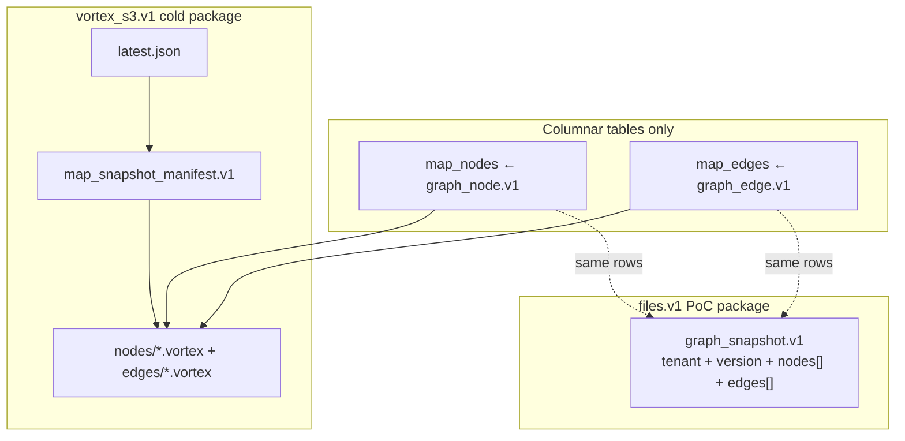
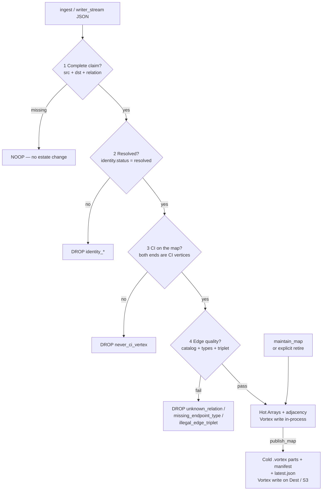
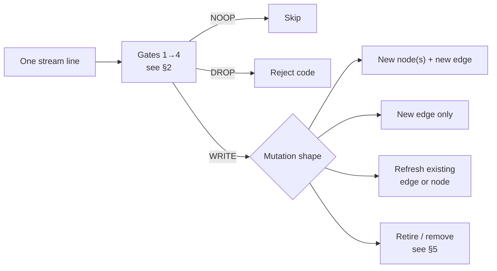
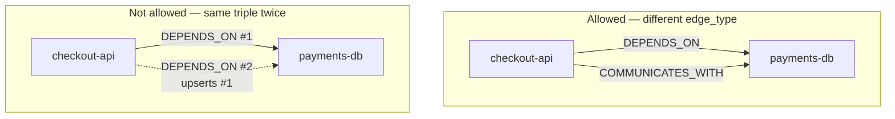
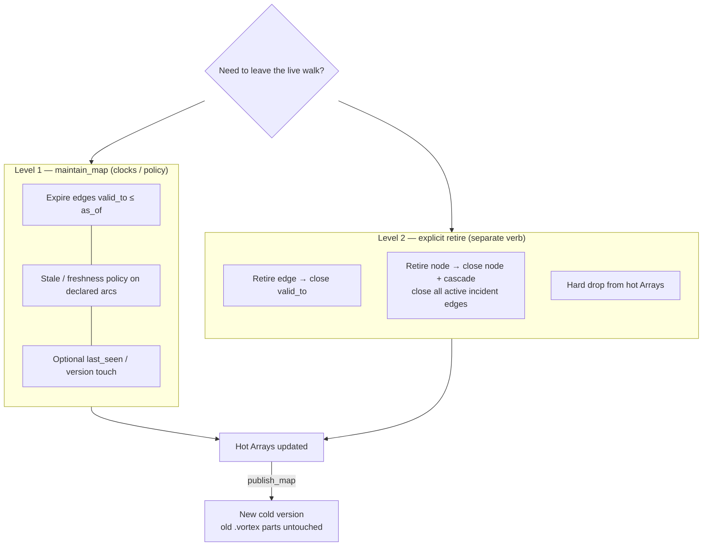

# Map hot / cold lifecycle — mutate, maintain, retire, publish, read

- **Status:** Locked teaching companion (2026-09-29).
- **Parent SoT:** [`MAP_WRITE_READ_RECORD.md`](./MAP_WRITE_READ_RECORD.md)
- **Columns:** [`MAP_VORTEX_COLUMNAR_SCHEMA.md`](./MAP_VORTEX_COLUMNAR_SCHEMA.md)
- **Admit input:** [`../E2_INPUT_FIXTURES.md`](../E2_INPUT_FIXTURES.md)
- **Triplet rules:** [`EDGE_TRIPLET_ALLOWLIST.md`](./EDGE_TRIPLET_ALLOWLIST.md)

**This page answers**

- What is (and is not) a columnar table
- Which **admit gates** run before any hot mutate (and where the full allowlist lives)
- What `upsert_topo` / `write_topo_stream` writes after **WRITE**
- How `publish_map` differs from hot upsert
- Which mutation shapes exist under WRITE
- Whether two edges can share the same endpoints
- The **two levels of removal** (`maintain_map` vs explicit retire)

---

## 1. What is columnar — and what is not

| Artifact | Role | Purpose (plain) | Columnar Vortex table? |
|----------|------|-----------------|-------------------------|
| `graph_node.v1` → **`map_nodes`** | Configuration-item vertices | One row per CI on the topology map (host, service, db, …). Hot upserts and cold `.vortex` parts both use this shape. | **Yes** |
| `graph_edge.v1` → **`map_edges`** | Typed relationships | One row per Motadata link between two CIs. Walks and neighbor lookups are built from these rows. | **Yes** |
| `graph_snapshot.v1` | Packaged envelope: `tenant` + `version` + `nodes[]` + `edges[]` | **PoC publish and read unit in one document** — the full topology map for that tenant at that publish (not a third table). Files profile writes/reads `graph_snapshot.json`. | **No** — PoC convenience JSON |
| `map_snapshot_manifest.v1` | Cold index of which `.vortex` parts belong to a version | **Motadata cold publish footer** — lists the node/edge part keys that make one immutable generation. Replaces the need for a giant JSON envelope on S3. | **No** — ObserveOps footer JSON |
| `latest.json` | Pointer `{ "version": "…" }` | Tiny “which generation is current?” bookmark. Readers follow this to the right manifest (or PoC snapshot), then load parts. | **No** |

Only **two** Motadata columnar tables exist (`map_nodes`, `map_edges`). Dest profile (`files.v1` vs `vortex_s3.v1`) changes encoding, not that fact.

**Present map, not history room.** Pillar B `map/` holds the **current** topology estate (what Localize walks). Cold `snapshots/<version>/` are immutable **checkpoints of that present map** for load/rebuild — not the ObserveOps `history/` room (sketches / change facts). Maintain refreshes validity on the live map; it does not append a long event diary of past estates into `map/`.

**How the non-table pieces relate**



- **Files PoC:** `graph_snapshot.v1` = one packaged **publisher** output and one packaged **reader** input for the complete topology at that version.
- **Vortex+S3:** the same “complete generation” idea is `latest.json` → `map_snapshot_manifest.v1` → `.vortex` parts — not a duplicated `graph_snapshot` table.

**Edge vs node flexible attrs — why the asymmetry**

- **Nodes** carry a **closed, versioned promoted-tag catalog** (`attr_catalog.v1`: `env`, `region`, `owner`, `namespace`) as real nullable Utf8 columns — not a JSON `metadata` bag. That lets Vortex zone-prune / filter on tags without parsing nested documents. Adding a new filterable tag is a catalog version bump, not unbounded per-key DDL.
- **Edges** have **no** tag columns. An edge is a typed topology claim — who links to whom under which Motadata `edge_type`. The closed fifteen-name catalog plus endpoints already carry the meaning; a free-form bag would invite dumping discovery provenance onto every arc.
- Edge **audit** stays fixed columns only: `evidence_event_id` (which ingest/event proved the claim) and `valid_from` / `valid_to` (**UInt64** epoch ms). `discovered_via` and similar are **not** stored on the edge row.
- **Clocks** on nodes (`last_seen`, validity) are also **UInt64** epoch ms for zone-map time prune.
- Walks project the spine (`entity_id` / `type`, or `source_id` / `target_id` / `edge_type`) and defer promoted tags and `evidence_event_id` until a UI or filter needs them. See [`MAP_VORTEX_COLUMNAR_SCHEMA.md`](./MAP_VORTEX_COLUMNAR_SCHEMA.md).

---

## 2. Two tempos: hot mutate vs cold persist

| Tempo | APIs (names) | What is written | Cold `.vortex` / S3? |
|-------|--------------|-----------------|----------------------|
| **Hot** | `write_topo_stream` / `upsert_topo`, `maintain_map`, explicit retire (when wired) | In-process node/edge **Arrays** (Vortex/Arrow) + **adjacency** for walks | **No** |
| **Cold** | `publish_map` | New immutable `nodes/*.vortex` + `edges/*.vortex` + `manifest.json` + `latest.json` | **Yes** |



**Admit gates (GraphWriter triage — before any hot mutate)**

| # | Gate | Pass → | Fail |
|---|------|--------|------|
| 1 | Complete topology claim (`src_ci_id`, `dst_ci_id`, `relation`) | Continue | **NOOP** |
| 2 | Subject identity resolved | Continue | **DROP** `identity_*` |
| 3 | Both endpoints may be map CI vertices (not Alert / Metric / ticket / …) | Continue | **DROP** `never_ci_vertex` |
| 4 | Relation in the fifteen-name catalog + Motadata types known + pair on allowlist | **WRITE** | **DROP** `unknown_relation` / `missing_endpoint_type` / `illegal_edge_triplet` |

Normative detail: [`EDGE_TRIPLET_ALLOWLIST.md`](./EDGE_TRIPLET_ALLOWLIST.md) §2; reject codes: [`IDENTIFIED_STREAM_REJECT.md`](./IDENTIFIED_STREAM_REJECT.md). Dest JSON Schema validation on flush is **publish hygiene**, not these admit gates.

- `upsert_topo` **does** update the Vortex **hot** store (columnar Arrays in memory) **only after WRITE**.
- It does **not** PUT a new cold `.vortex` object on every topo line.
- Cold objects are **checkpoints**: never patch an old part; next publish = new `version`.

- **PoC today:** hot = Python `GraphState`; cold = `graph_snapshot.json` + JSONL.
- **Motadata path:** hot Arrays; cold via Rust [`map-vortex/`](../pillar-b/map-vortex/).

---

## 3. Admit outcome vs estate mutation shape

**Admit** still ends in only three outcomes — **NOOP**, **WRITE**, or **DROP** — but those labels are the *result* of the four gates in §2, not a free-form decision. This section covers what happens **after WRITE**.



| Shape | What changes |
|-------|----------------|
| **New node(s) + new edge** | Insert endpoints (if missing) and insert edge; allocate `edge_id` / `evidence_event_id` |
| **New edge only** | Both ends already on the map; insert edge (may refresh endpoint `last_seen` / node `version`) |
| **Refresh existing edge or node** | Same upsert key → reuse `edge_id`, update evidence / validity / `last_seen` |
| **Retire / remove** | See §5 (two levels) — not the same as E5 clock maintain alone |

---

## 4. Multiple edges between the same pair of nodes?

- **Yes**, if `edge_type` differs.
- **No**, not two copies of the same typed arc.

Logical uniqueness (within tenant): `(source_id, edge_type, target_id)`. Direction is part of the key. Extra proof for the same typed arc does not create a parallel edge.



- **Allowed:** `DEPENDS_ON` **and** `COMMUNICATES_WITH` (two rows, two snowflake `edge_id`s).
- **Not allowed:** two `DEPENDS_ON` rows — the second stream line **upserts** the first (reuse `edge_id`, refresh `evidence_event_id` / validity).

---

## 5. Removal at two levels (do not overload `maintain_map`)



### Level 1 — Validity / freshness (`maintain_map`)

**Primary automatic path (E5-shaped).** Operates on clocks and policy for rows already on the map:

- Expire edges with `valid_to <= as_of`
- Drop or de-emphasize stale stream / declared arcs by age policy
- Soft / hard freshness marks on declared edges (may still publish)
- Optional node `last_seen` / `version` touch

This is **not** “operator deleted host X.” Prefer closing windows via **`valid_from` / `valid_to`** (and related marks).

### Level 2 — Explicit retire / remove (separate verb)

**Legitimate intentional close** (CMDB/admin / future writer-stream retire claim). Separate from `maintain_map`:

| Request | Hot effect | Cascade |
|---------|------------|---------|
| Retire **edge** | Set `valid_to = as_of` (preferred) or remove from live edge table | None |
| Retire **node** | Set node `valid_to` (or remove from live node table) | **Close every active incident edge** where `source_id` or `target_id` equals that `entity_id` |
| Hard drop from live map | Delete from hot Arrays so the next publish’s walk surface omits them | Same cascade for nodes |

Still never rewrite yesterday’s cold `.vortex`. Change hot → **`publish_map`** → new version. Older versions remain for time-travel / audit.

**Walk rule:** an edge is active only if both endpoints are active and (`valid_to` is null or `> as_of`).

**Wire status**

- Level 1 is implemented in PoC `maintain_map`.
- Level 2 (explicit retire presence block or Dest admin API) is a **locked product rule** to implement on the Rust hot store — do not fold it into E5 maintain.

---

## 6. Publish and read (cold round-trip)

```mermaid
sequenceDiagram
  participant Hot as Hot Arrays + adjacency
  participant Pub as publish_map
  participant S3 as Dest / S3
  participant Load as load_map
  participant Walk as neighbors / WorkingSet

  Note over Hot,S3: Publish (order: parts → manifest → latest)
  Hot->>Pub: Current map_nodes + map_edges
  Pub->>S3: Write nodes/part-*.vortex + edges/part-*.vortex
  Pub->>S3: Write manifest.json (map_snapshot_manifest.v1)
  Pub->>S3: Write latest.json
  Pub->>Hot: Invalidate version-keyed read memos

  Note over S3,Walk: Read (S3 only to rebuild; walks stay hot)
  Load->>S3: GET latest.json → version
  Load->>S3: GET manifest.json
  Load->>S3: Open listed .vortex (postscript → layout → project)
  Load->>Hot: Rebuild Arrays + adjacency
  Walk->>Hot: neighbors / paths (not S3 per hop)
```

### Publish (`publish_map`)

1. Build Arrow / Vortex tables for current hot `map_nodes` and `map_edges`.
2. Write new `nodes/part-*.vortex` and `edges/part-*.vortex` (segments + layout metadata + VTXF postscript — Vortex library owns file footers).
3. Write ObserveOps `manifest.json` (lists parts; `map_snapshot_manifest.v1`).
4. Write `latest.json`.
5. Invalidate version-keyed read memos.

Order matters: parts → manifest → latest. A version without a complete manifest is invisible.

### Read (`load_map` → walk)

1. Resolve version via `latest.json` (or explicit version).
2. Load `manifest.json`.
3. Open listed `.vortex` files: postscript → layout → project / prune → segments.
4. Rebuild hot Arrays + adjacency (project walk spine; defer promoted tags and `evidence_event_id` until needed).
5. `neighbors` / paths and WorkingSet use **hot** state — not S3 per hop.

PoC shortcut: prefer `Dest.get("map", "graph_snapshot.json")` as the packaged read unit.

---

## 7. Related docs

| Doc | Job |
|-----|-----|
| [`MAP_WRITE_READ_RECORD.md`](./MAP_WRITE_READ_RECORD.md) | Normative keys, Dest API, §6 Vortex+S3 footers |
| [`MAP_VORTEX_COLUMNAR_SCHEMA.md`](./MAP_VORTEX_COLUMNAR_SCHEMA.md) | Locked columns + dtypes |
| [`GATE_B_DEST_PROFILE.md`](./GATE_B_DEST_PROFILE.md) | `files.v1` vs `vortex_s3.v1` |
| [`GRAPH_QNA.md`](./GRAPH_QNA.md) G40–G44 | Short FAQ mirrors of this page |
| [`docs/fabric/vortex-s3-interaction.html`](../../docs/fabric/vortex-s3-interaction.html) | Rooms vs temperature visual |
