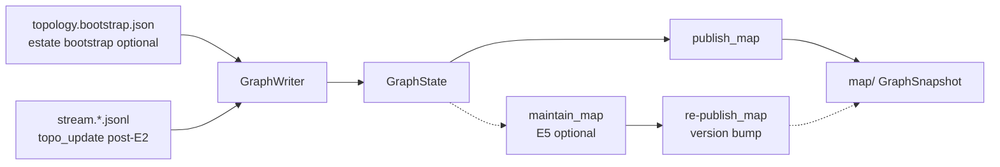
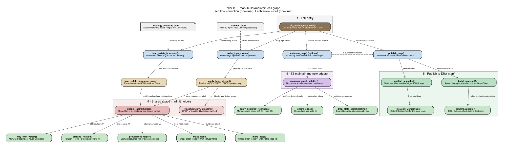
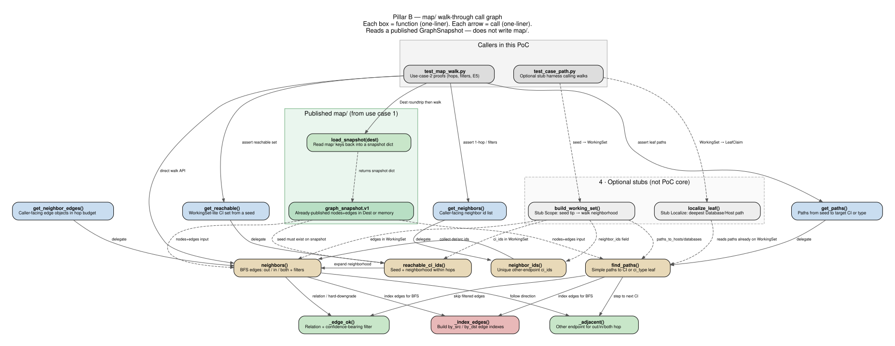
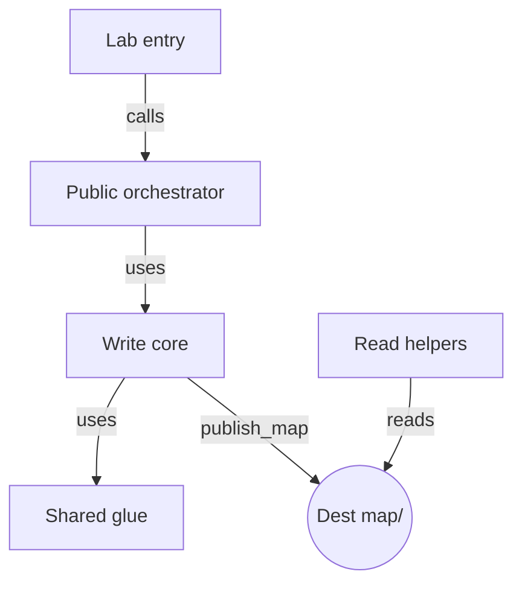
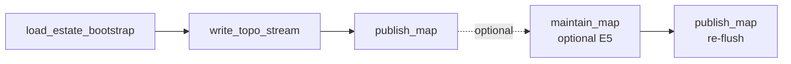

# Codebase go-through — Pillar B knowledge-graph PoC

**Doc job:** walk the **code and sample estate** for the two PoC use cases — **build/maintain** and **walk-through**.  
**Framing:** [Pillar B PoC hub](../../../docs/fabric/pillar-b-poc-hub.html). Eval → [`MAP_P1_FABRIC_EVAL.md`](./MAP_P1_FABRIC_EVAL.md). Package door → [`../README.md`](../README.md).

**What this PoC proves:** after Identity (assumed), Motadata can **build and keep** a `map/` knowledge graph from optional estate bootstrap + a `topo_update` stream, **maintain** edge validity, and **walk** the published snapshot — without owning Detect, sketches, or ServiceOps.

**Home package:** `pillar-ab-implementation/pillar-b/` · **Runnable lab:** `pillar-b/poc/`

```bash
cd pillar-ab-implementation/pillar-b/poc
make install && make test-all
make publish-map    # optional: write poc/out/<tenant>/map/
```

---

## 1. Runtime spine (follow this in code)



<figure class="doc-fig">
  
  <figcaption>Same spine as SVG (scales in the hub). Mermaid above is preferred when the preview renders. <a href="./runtime-spine.png">PNG</a> if you need a raster export.</figcaption>
</figure>

**Call graphs (one-liners on nodes and arrows)** — SVG embeds stay readable on `:8765`; full-size PNGs are optional downloads (they are ~4k px wide and look huge if opened raw).

<figure class="doc-fig">
  
  <figcaption>Use case 1 · Build + maintain — <a href="./pillar-b-callgraph.svg">SVG</a> · <a href="./pillar-b-callgraph.png">PNG</a> · <a href="./pillar-b-callgraph.dot">DOT</a></figcaption>
</figure>

<figure class="doc-fig">
  
  <figcaption>Use case 2 · Walk-through — <a href="./pillar-b-walk-callgraph.svg">SVG</a> · <a href="./pillar-b-walk-callgraph.png">PNG</a> · <a href="./pillar-b-walk-callgraph.dot">DOT</a></figcaption>
</figure>

Noisier auto dump (write path only, optional): [`pillar-b-callgraph-auto.png`](./pillar-b-callgraph-auto.png).

`GraphWriter` is a thin orchestrator: `load_estate_bootstrap` → `write_topo_stream` → `publish_map` → optional `maintain_map`. Lab CLI: [`../poc/graph/cli_publish_map.py`](../poc/graph/cli_publish_map.py) (`make publish-map`).

---

## 2. Package layout (what lives where)

```text
pillar-b/
├── README.md                 ← package front door (I/O + admit)
├── docs/                     ← PoC guides only (this page, MAP_P1, doc map)
├── archived-docs/            ← OPTIONAL product HTML (not PoC SoT)
└── poc/                      ← runnable code + sample estate + tests
    ├── ab_shared/            ← gate, dest, ingest, schema helpers
    ├── graph/                ← sole map writer path
    ├── sample_estate/customer_checkout/  ← teaching estate inputs (not live CMDB)
    └── out/                  ← FileDest after make publish-map
```

JSON schemas live only under slice [`../../contracts/schemas/`](../../contracts/schemas/) — `ab_shared.schema` loads that path.
Do not confuse with:

- **`pillar-a/`** — sketches into `history/` (E4). GraphWriter NOOPs those lines.
- **`integration/`** — optional read-join only, not an A∪B merge product.

---

## 3. Shared glue — `poc/ab_shared/`

These modules are **not** the Topology writer. They are small utilities the writer (and tests) depend on so Pillar B can behave like a post-Identity consumer without reimplementing Collect or the full Identity LUT.

Pillar B sample-estate inputs already look like post-Identity `ingest.v1`. Collect is Done elsewhere; this package **simulates** its output.

### `identity_gate.py` — who may become map work

Identity (E2) stamps `identity.status` on each line. GraphWriter must not invent a second policy. `ResolvedOnlyGate.admit(record)` returns accepted only when status is `resolved`. Unresolved or synthesized lines become **DROP** reasons on the reject tape — they never silently create nodes or edges.

This is the hard door into E3. Full `telemetry_key_index` LUT is Design (named in MAP_P1); the PoC only enforces the resolved-only gate.

### `ingest_source.py` — how lines enter the writer

Abstracts “a stream of dict records.” Lab uses `JsonlIngestSource` (files under `sample_estate/customer_checkout/`). Unit tests use `ListIngestSource` so cases can inject one-off NOOP/DROP lines without new sample-estate files.

### `dest.py` — where `map/` lands

Gate B style destination: `put("map", filename, bytes)` / `get(...)`.

- **`MemoryDest`** — tests (no disk).
- **`FileDest`** — `make publish-map` writes under `poc/out/<tenant>/map/`.

GraphWriter never opens paths itself; snapshot publish always goes through Dest.

### `schema.py` — shape checks before publish

Loads JSON Schema from slice `contracts/schemas/` and validates nodes, edges, and `graph_snapshot.v1` on flush. Failed validation is a hard fail in tests — the PoC does not ship half-shaped map files.

### `reject_codes.py` — stable DROP strings

Single catalog of reason codes (`identity_unresolved`, `identity_synthesized`, `never_ci_vertex`, `unknown_relation`, …). GraphWriter appends `(record, reason)` pairs; SAMPLE_IO Case B asserts on these strings. Do not invent ad-hoc reject text in builder code.

### `paths.py` — sample estate root

`SAMPLE_ESTATE` points at `poc/sample_estate/customer_checkout/` so tests and CLI share one path constant.

### `clock.py` — lab time helper

`FrozenClock` exists for shared patterns with Pillar A. E5 maintain in this PoC currently takes an explicit `as_of` timestamp string (lab clock) rather than injecting `FrozenClock` everywhere — see `maintain.py`.

---

## 4. Map writer core — `poc/graph/`

Call order on the happy path: **`graph_writer`** orchestrates → **`graph_builder`** mutates `GraphState` → **`snapshot`** validates and publishes → optional **`maintain`** then re-flush.

### `graph_writer.py` — public API

The only class most callers need. Methods mirror the spine:

1. `load_estate_bootstrap(...)` — optional estate starting map (not CaseSeed).
2. `write_topo_stream(source)` — upsert admitted topo lines into GraphState via `apply_topo_stream`.
3. `publish_map(dest, version=...)` — validate + publish `graph_snapshot.v1` to Dest.
4. `maintain_map(as_of, ...)` — E5 pass on existing edges; does not create edges.

Rejects are exposed as `writer.rejects` (list of `(record, reason)`).

### `graph_builder.py` — in-memory estate + admit triage

Owns `GraphState` (`nodes`, `edges`, `rejects`).

- **`load_estate_bootstrap_state`** — reads `topology.bootstrap.json`, qualifies CI types, emits declared edges with provenance `topology.bootstrap`.
- **`apply_topo_stream`** — the E3 heart: for each line, choose NOOP / WRITE / DROP / phased skip. (“Admit” = that per-line triage — [terminology](./MAP_P1_FABRIC_EVAL.md#terminology-do-not-blur).)
- **`_make_node` / `_make_edge`** — after admit, shape Motadata `graph_node.v1` / `graph_edge.v1` (`entity_id`, `type`, `metadata` JSON string, Snowflake `edge_id` / `evidence_event_id`, `source_id` / `target_id` / `edge_type`). Upsert edges by `(source_id, edge_type, target_id)`.

```python
# apply_topo_stream outline:
# fact_kind != topo_update → NOOP
# gate / never-CI / unknown relation → DROP
# classify_relation skip → phased map-NOOP
# classify_relation emit → WRITE via _make_node (endpoints) + _make_edge
```

Outcome table (NOOP / WRITE / DROP) lives in the [package README](../README.md#admit-actions-hub-language--code) — not duplicated here.

### `ci_qualify.py` — which vertex types may exist on the map

Configuration-item (CI) allow/deny. Alert, Change, Incident, tickets, and similar **never-CI** types return DROP (`never_ci_vertex`). Wave-1 service/host/runtime/database types may emit. Prevents case objects from becoming estate nodes.

### `edge_catalog.py` — relation names and wave-1 phasing

Fifteen Motadata relation names. `classify_relation` returns:

- **emit** — wave-1 WRITE (`runs_on`, `hosted_on`, `depends_on`, `communicates_with`, `part_of`).
- **skip** — in catalog but not wave-1 yet (e.g. `mounts`) → phased map-NOOP, usually not a DROP.
- **reject** — unknown name → DROP `unknown_relation`.

### `provenance.py` — how an edge claims it was discovered

Retired from the map write path. Motadata edges store Snowflake `evidence_event_id` instead of nested `discovered_via`. Module kept for unit tests of the old evidence_type heuristic and optional non-map audit. E5 maintain now keys off `origin` (`declared` vs `stream`), `valid_to`, and node `last_seen` / `version`.

### `snapshot.py` — publish contract for `map/`

`build_snapshot` validates every node/edge and the snapshot envelope. `publish_snapshot` writes Dest keys `graph_snapshot.json`, `nodes.jsonl`, `edges.jsonl`. `load_snapshot` is the read side for tests and neighbors. Normative key meanings: slice [`MAP_WRITE_READ_RECORD`](../../contracts/MAP_WRITE_READ_RECORD.md).

### `maintain.py` — E5 validity (no new edges)

Runs against existing `GraphState`:

- Drop edges past `valid_to`.
- Drop stale **corroborating** edges older than a max age.
- Mark **declared** edges soft-stale (7d) or hard-downgraded (30d) — Design-numeric product defaults; fixture `as_of` drives the clock.

Hard-downgraded edges stay on the published map but leave `confidence_bearing_edges`. Details: [`LLD-E5-Maintain`](../../../docs/observeops/LLD-E5-Maintain.md).

### `neighbors.py` / `read_api.py` — use case 2 (walk-through)

Outbound / inbound / both, hop budget, relation filters, reachable set, leaf paths, `confidence_bearing_only`. Proofs: `test_map_walk.py`. Chain fixture: `walk_chain.bootstrap.json`.

### `case_path/` — stub harness only (optional)

Drivers that **assume** Detect/Curate/Identify/Package and call walk APIs. Not the knowledge-graph mission — see [Pillar B PoC hub](../../../docs/fabric/pillar-b-poc-hub.html).

| Module | Stub role |
|--------|-----------|
| `signal.py` / `curate.py` | Fake storm → CaseSeed tip |
| `scope.py` / `localize.py` | Tip → neighborhood / leaf via walks |
| `identify.py` / `package.py` | Lab evidence + operator-shaped card |

Proofs: `test_case_path.py`, `test_identify_package.py` (optional relative to core PoC).

### `compare.py` — SAMPLE_IO spine equality

Compares expected vs actual on a **spine** of ids/types/relations so provenance display fields can grow without breaking Case A goldens.

### `cli_publish_map.py` — lab entrypoint

Wires bootstrap + resolved stream + `FileDest` (+ optional maintain). Invoked by `make publish-map`.

### Other files in `graph/` (secondary)

| File | When you need it |
|------|------------------|
| `change_fact.py` | Optional change-fact helper — **not** part of `publish_snapshot` |
| `compare.py` | Covered above (SAMPLE_IO) |

---

## 5. Sample estate — `poc/sample_estate/customer_checkout/`

| Artifact | Meaning |
|----------|---------|
| `topology.bootstrap.json` | Estate bootstrap (declared starting map) — **not** CaseSeed |
| `stream.resolved.jsonl` | Case A — five wave-1 `topo_update` WRITEs |
| `stream.reject.jsonl` | Case B — DROP mix + metric/event/trace/anomaly NOOPs |
| `cases/case_a_map_spine/` · `cases/case_b_rejects/` | Golden spines / reject expectations (PoC core) |
| `cases/stub_case_path/` · `cases/stub_diagnose_close/` | Optional Detect→Package harness fixtures (not map mission) |
| [`SAMPLE_IO.md`](../poc/sample_estate/customer_checkout/SAMPLE_IO.md) | Human expected-vs-actual for Case A/B |
| [`estate README`](../poc/sample_estate/customer_checkout/README.md) | Why this folder exists + file inventory |

---

## 6. Tests — what proves what

| Test file | Focus |
|-----------|--------|
| **`test_p1_map_fabric.py`** | Use case 1: E1 boundary, E2 gate, E3 triage, E4 orthogonality, E5 freshness |
| **`test_map_walk.py`** | Use case 2: hops, inbound, reachable set, leaf paths, E5 confidence filter |
| `test_case_path.py` · `test_identify_package.py` | Optional stubs (not core PoC) |
| `test_graph_writer.py` | Happy path flush, silent skip, reject tape |
| `test_sample_io.py` | Case A/B spine equality |
| `test_maintain.py` | Expire / corroborating / declared soft unit cases |
| `test_edge_catalog.py` · `test_ci_qualify.py` · `test_provenance.py` | Catalog / CI / evidence helpers |
| `ab_shared/tests/` | Gate, dest, schemas, clock |

Eval narrative for those proofs: [`MAP_P1_FABRIC_EVAL.md`](./MAP_P1_FABRIC_EVAL.md).

---

## 7. Pipeline stages → this tree

| Stage | In this codebase | Look at |
|-------|------------------|---------|
| **E1 Collect** | Not implemented; simulated by sample-estate spine | `test_e1_*` in `test_p1_map_fabric.py` |
| **E2 Identity** | Gate only (`ResolvedOnlyGate`); no LUT | `ab_shared/identity_gate.py` |
| **E3 Topology** | Sole map writer | `graph_writer` → `graph_builder` → `snapshot` |
| **E4 Stores** | Absent by design here; non-topo lines NOOP | `test_e4_mixed_tape_*` |
| **E5 Maintain** | Validity on existing edges | `maintain.py` + `maintain_map` |

**Estate bootstrap** (`load_estate_bootstrap`) ≠ **CaseSeed** (P2/E7). Bootstrap fills `GraphState` before the stream; CaseSeed never writes `map/` in this PoC.

---

## 8. Hands-on path (15–20 minutes)

1. [`MAP_P1_FABRIC_EVAL.md`](./MAP_P1_FABRIC_EVAL.md) — stage matrix once.  
2. Skim `topology.bootstrap.json` + first lines of `stream.resolved.jsonl`.  
3. Read `GraphWriter` then `apply_topo_stream` end-to-end.  
4. `make test-all` — if green, the contract holds.  
5. `make publish-map` — inspect `poc/out/default/map/graph_snapshot.json`.  
6. Skim `test_p1_map_fabric.py` section headers (E1→E5).  
7. Optional: [hub GraphWriter tab](http://127.0.0.1:8765/observeops-pipeline-hld.html#graphwriter).

---

## 9. Explicit non-goals

- No live ServiceOps ticket create  
- No eight product use-case packs (Detect classes as product scope)  
- No live discovery crawler / `telemetry_key_index` LUT  
- No SketchWriter inside Pillar B  
- Vortex/S3 encodings deferred — PoC Dest is `files.v1` only  

**Core PoC = build/maintain + walk.** `case_path/` stubs are optional harnesses only ([Pillar B PoC hub](../../../docs/fabric/pillar-b-poc-hub.html)).

---

## Clarifications

### Who calls the public `GraphWriter` API?

`GraphWriter` is **not** an HTTP service and not called by Detect/Diagnose in this PoC. Callers today:

| Caller | Role |
|--------|------|
| [`cli_publish_map.py`](../poc/graph/cli_publish_map.py) (`make publish-map`) | Lab operator entry — bootstrap → write_topo_stream → publish_map → optional maintain_map |
| Unit / P1 tests under `poc/graph/tests/` | Acceptance proofs |
| [`integration/join/`](../../integration/join/) (optional) | Read-join smoke that builds a map then joins sketches |

**Product intent (not implemented here):** a **Topology writer** after Identity would call the same sequence on a continuous `topo_update` stream (plus optional CMDB/estate bootstrap). Diagnose stages (E6–E11) **read** `map/` via snapshot/neighbors — they do not call `write_topo_stream` / `publish_map`.

Internal helpers (`apply_topo_stream`, `may_emit_vertex`, …) are for `GraphWriter` and tests — not a second public surface.

### Python files by purpose and scope

These scopes match the **Pillar B map PoC navigator** canvas layers. They are file roles, not Motadata pipeline stages.

**How they relate (call / dependency direction):**



**Spine** is the whole write story (not a separate package). **Production surfaces** encode Dest `map/` (plus the `ingest.v1` stream) — not a GraphWriter HTTP API.

**GraphWriter call sequence:**



**Cold-reader order** (same as the navigator):

1. **Spine** — one write story into `map/`  
2. **Public orchestrator** — only write API (`graph_writer.py`)  
3. **Lab entry** — `make publish-map` / CLI (PoC only)  
4. **Write core** — builder, catalog, qualify, snapshot, maintain  
5. **Shared glue** — `ab_shared` gate / Dest / ingest / schema  
6. **Read helpers** — neighbors / load snapshot after publish  
7. **Production surfaces** — Dest rooms + stream honesty (read last)

| Scope | Folder / file | Job | Who should import it |
|-------|---------------|-----|----------------------|
| **Public orchestrator** | `graph/graph_writer.py` | Sole write API for `map/` | CLI, Topology writer (future), tests |
| **Lab entry** | `graph/cli_publish_map.py` | Wire files → writer → Dest | Humans via `make publish-map` only |
| **Write core** | `graph_builder.py`, `ci_qualify.py`, `edge_catalog.py`, `provenance.py`, `snapshot.py` | Mutate/validate estate → publish | Only `graph_writer` (+ focused unit tests) |
| **Maintain (E5)** | `graph/maintain.py` | Validity on existing edges | `graph_writer.maintain_map` |
| **Read helpers** | `neighbors.py`, `read_api.py` | Walk a published snapshot | Tests; later Diagnose readers |
| **Test-only compare** | `compare.py` | Spine equality for SAMPLE_IO | Tests only |
| **Secondary** | `change_fact.py` | Optional change facts — not part of `publish_snapshot` | Ignore for P1 map path |
| **Shared utilities** | `ab_shared/*` | Gate, Dest, ingest sources, schemas, reject codes | Writer + tests (Pillar A–style shared patterns) |
| **Sample estate / paths** | `ab_shared/paths.py`, `sample_estate/` | Sample estate locations | CLI + tests |

Rough layering: **CLI/tests → `GraphWriter` → builder/catalog/qualify/provenance → snapshot/Dest**. Do not call builder from Diagnose.

### Method names → plain meaning

| Name you see | Plain meaning |
|--------------|---------------|
| `load_estate_bootstrap` | Load optional **starting estate** JSON into memory (not CaseSeed) |
| `write_topo_stream` | Admit-triage `topo_update` lines and **upsert into in-memory GraphState** (not Dest yet) |
| `publish_map` | **Validate** GraphState + **write** `graph_snapshot.v1` / nodes / edges to Dest `map/` |
| `maintain_map` | E5 pass: expire / stale-corroborating / declared soft·hard marks — **no new edges** |
| `rejects` | DROP tape: `(record, reason_code)` pairs from this run |
| `apply_topo_stream` | Per-line admit loop (NOOP / WRITE / DROP / phased skip) |
| `load_estate_bootstrap_state` | Bootstrap load returning a bare `GraphState` (builder-level) |
| `_make_node` / `_make_edge` | Shape Motadata `graph_node.v1` / `graph_edge.v1` after admit (bootstrap + stream); edge upsert by logical key |
| `classify_relation` | Relation name → emit / skip / reject |
| `may_emit_vertex` | CI type allowed on map? else DROP |
| `build_snapshot` / `publish_snapshot` | Assemble validated snapshot / write Dest keys |
| `admit` (on `ResolvedOnlyGate`) | Identity gate check only — not GraphWriter’s full NOOP/WRITE/DROP table |

Renames above are the current public verbs (`load_estate_bootstrap` / `write_topo_stream` / `publish_map` / `maintain_map`).

### Production surfaces (HTTP / RPC / Dest) — what other subsystems use

Honest freeze vs Design (Motadata SoT: [`GATE_B_DEST_PROFILE`](../../contracts/GATE_B_DEST_PROFILE.md) · [`MAP_WRITE_READ_RECORD`](../../contracts/MAP_WRITE_READ_RECORD.md) · pipeline HLD):

| Surface | Audience | Purpose | Status |
|---------|----------|---------|--------|
| **Ingest stream** (`ingest.v1` after E2) | Topology writer (internal) | Continuous `topo_update` lines into GraphWriter `write_topo_stream` | PoC simulates; product Topology writer = Design |
| **Estate bootstrap load** | Topology / CMDB sync job | Optional starting map (`load_estate_bootstrap`) before stream | PoC file; product CMDB pull = Design |
| **Dest write protocol** `put("map", key, bytes)` | GraphWriter only | Publish `graph_snapshot` / nodes / edges into the `map/` room | **Frozen logical contract**; PoC encoding `files.v1` |
| **Dest read protocol** `get("map", "graph_snapshot.json")` | E5 maintain, E8 Scope, Diagnose | Load packaged snapshot; walk neighbors | **Frozen logical contract** |
| **Vortex (hot) + S3 (cold)** | Same Dest adapters | Production temperature encodings of the **same** logical keys/fields | Design / later — not a second schema |
| **Public REST/gRPC “GraphWriter API”** | External product callers | — | **Not frozen.** Product does not expose GraphWriter as a third-party CRUD HTTP API in current HLD; other Motadata stages talk via **rooms + Dest** (and later UI over those reads) |

What Diagnose / Scope need is **read access to `map/`** (snapshot + neighbor walk), not write RPCs into GraphWriter. What Collect/Identity provide is the **stream**, not an HTTP call into Pillar B.

### Interactive code navigation (Cursor)

No Motadata-specific navigator is required:

1. Open `pillar-ab-implementation/pillar-b/poc` (or repo root) in Cursor.  
2. Enable **Python** + **Pylance**.  
3. On a symbol: **Go to Definition** (F12), **References** (Shift+F12), **Call Hierarchy** (command palette).  
4. Start at `graph_writer.py` → F12 into `apply_topo_stream` → References on `GraphWriter` for CLI + tests.  
5. In chat: `@graph_writer.py` or ask for the call chain from `publish_map`.  

Editor navigation + this go-through + the [Pillar B PoC hub](../../../docs/fabric/pillar-b-poc-hub.html) are the interactive maps for this PoC.
