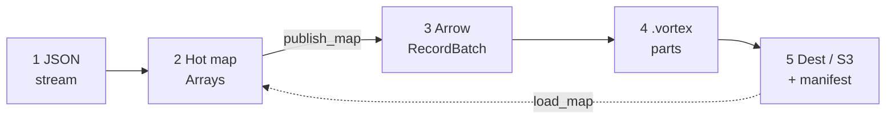
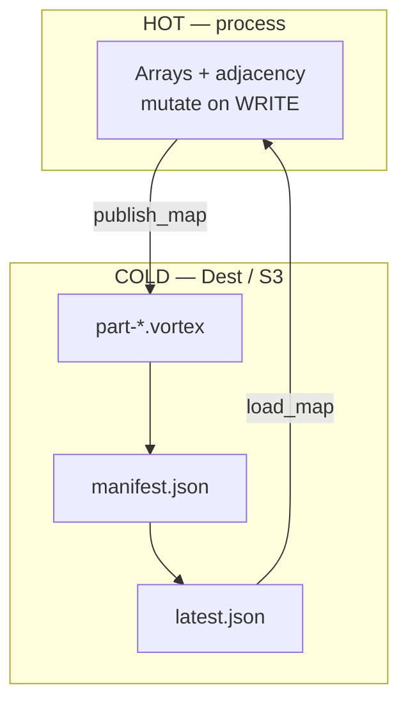

# JSON → Arrow → Vortex → S3 — map pipeline guide

- **Status:** Cold-reader teaching page for Motadata `vortex_s3.v1` (2026-09-30 flat lock).
- **Best visual:** open the fabric page first → [`map-arrow-vortex-pipeline.html`](../../../docs/fabric/map-arrow-vortex-pipeline.html) ([`:8765/map-arrow-vortex-pipeline.html`](http://127.0.0.1:8765/map-arrow-vortex-pipeline.html)).
- **Map scope:** Pillar B `map/` is **present** topology. Cold snapshot versions are checkpoints of that present map — not ObserveOps `history/` sketches.

**Companions:** [`MAP_VORTEX_S3_POC_PRIMER.md`](./MAP_VORTEX_S3_POC_PRIMER.md) · [`MAP_VORTEX_COLUMNAR_SCHEMA.md`](../../contracts/MAP_VORTEX_COLUMNAR_SCHEMA.md) · [`MAP_HOT_COLD_LIFECYCLE.md`](../../contracts/MAP_HOT_COLD_LIFECYCLE.md) · [`map-vortex/`](../map-vortex/)

---

## 1. Sixty-second story

```text
JSON stream  →  Hot map (in process)  →  Arrow RecordBatch  →  .vortex parts  →  Dest/S3
     │                │                        │                    │              │
  GraphWriter      upsert on WRITE          our tables.rs      SpiralDB crate   manifest + latest
  admit 1→4        no S3 per line           flat columns       VTXF footer      ObserveOps index
```

| Step | What | Where it lives |
|------|------|----------------|
| **1** | Topology claim (JSON) | `writer_stream.v1` / lab `topo_update` |
| **2** | Hot upsert | In-process map (walk surface) |
| **3** | Arrow table | Memory only (demo may also write `.arrow` twins) |
| **4** | Vortex parts | `nodes/part-*.vortex`, `edges/part-*.vortex` |
| **5** | Dest index | `manifest.json` then `latest.json` under the tenant |

SpiralDB does **not** parse Motadata JSON. We build Arrow; the Vortex library packs the file.



---

## 2. How hot and cold are kept

| | **Hot** | **Cold** |
|--|---------|----------|
| **Job** | Live present estate for `neighbors` / WorkingSet | Immutable checkpoint of that present estate |
| **Kept where** | GraphWriter / `HotMap` process memory | Dest objects (S3 or lab path) |
| **Mutate?** | Yes — admitted WRITE lines | **No** — never patch an old `.vortex` |
| **When written** | Every WRITE | Only on `publish_map` |
| **When read for walks** | Always (after upsert or after `load_map`) | Only during `load_map` to rebuild hot |

**Present map, not history.** New snapshot versions replace “what is current” via `latest.json`. That is load/rebuild hygiene — not a Pillar A `history/` sketch diary.



---

## 3. Flat rows (wire = Vortex)

Same shape on JSON Schema and Arrow/Vortex columns:

- Clocks: **epoch milliseconds** (`last_seen`, `valid_from`, `valid_to`)
- Tags: closed **`attr_catalog.v1`** — `env`, `region`, `owner`, `namespace`
- **No** nested `metadata` JSON bag
- CI ids stay Utf8 strings (`entity_id` / `source_id` / `target_id`)

Lock: [`MAP_VORTEX_COLUMNAR_SCHEMA.md`](../../contracts/MAP_VORTEX_COLUMNAR_SCHEMA.md).

---

## 4. Tiny example

```text
checkout-api (service) --RUNS_ON--> linux-server-app-01 (host)
```

After `publish_map` / demo:

```text
map/<tenant>/snapshots/<version>/
  nodes/part-00000.vortex
  edges/part-00000.vortex
  manifest.json
map/<tenant>/latest.json
```

Demo twin `.arrow` files are optional debug IPC — Motadata cold SoT is `.vortex`.

---

## 5. Why Arrow exists here

| | Arrow | Vortex |
|--|-------|--------|
| Role | In-memory columnar interchange | Compressed columnar **file** on object storage |
| Analogy | Spreadsheet open in RAM | Spreadsheet packed for the warehouse |
| Our call | `nodes_record_batch` / `RecordBatch::try_new` | `from_arrow_record_batch` → `write_options().write` |

**Arrow = interchange desk. Vortex = packing machine.**

---

## 6. API cheat-sheet (implementers)

### JSON / structs → Arrow

| Call | Crate | File |
|------|-------|------|
| `map_nodes_schema_plain()` / `map_edges_schema_plain()` | `map_vortex` | `schema.rs` |
| `nodes_record_batch` / `edges_record_batch` | `map_vortex` | `tables.rs` |
| `RecordBatch::try_new` | `arrow` | via `tables.rs` |

### Arrow → `.vortex`

| Call | Owner |
|------|--------|
| `write_vortex(batch, path)` | **us** `write.rs` |
| `session.arrow().from_arrow_record_batch(...)` | SpiralDB |
| `session.write_options().write(...)` | SpiralDB (layout + postscript) |
| `publish_map` → parts + manifest + latest | **us** |

### `.vortex` → Arrow (load)

| Call | Owner |
|------|--------|
| `load_map` / `read_vortex_part` | **us** `load.rs` |
| `open_options().open_buffer` → `scan` → `execute_arrow` | SpiralDB |

**Two footers:** VTXF postscript **inside** each `.vortex` (SpiralDB) vs ObserveOps `manifest` + `latest` **across** objects (us).

---

## 7. Hands-on verify

```bash
cd pillar-ab-implementation/pillar-b/map-vortex
cargo test
cargo run --bin map_vortex_demo -- --tenant-root /tmp/map-tenant --version lab-1 --verify-load
# layout should show env/region/owner/namespace + u64 clocks — not metadata Utf8
vx tree layout /tmp/map-tenant/snapshots/lab-1/nodes/part-00000.vortex
```

Python lab (flat wire + GraphWriter):

```bash
cd pillar-ab-implementation/pillar-b/poc
.venv/bin/python -m pytest graph/tests/unit/ -q
```

---

## 8. Doubts checklist

| Question | Answer |
|----------|--------|
| Is `.arrow` on disk required? | **No** — memory `RecordBatch` is required; `.arrow` file is a demo twin. |
| Does cold store history? | **No** — present-map checkpoints only. |
| Who invents the Vortex postscript? | SpiralDB `vortex` crate — not ObserveOps. |
| Can walks open S3 per hop? | **No** — `load_map` once, then walk hot. |

---

*Hub: [`/docs/MAP_ARROW_VORTEX_PIPELINE.md`](http://127.0.0.1:8765/docs/MAP_ARROW_VORTEX_PIPELINE.md) · Visual: [`/map-arrow-vortex-pipeline.html`](http://127.0.0.1:8765/map-arrow-vortex-pipeline.html).*
