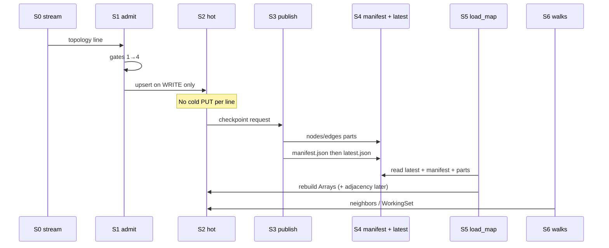
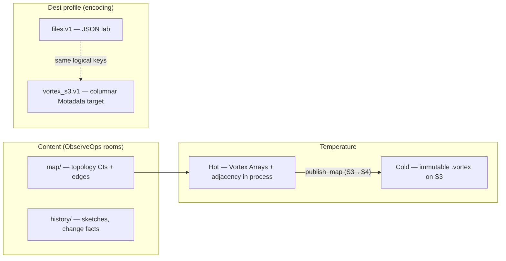

# Map Vortex + S3 PoC — single primer

- **Status:** Teaching entry point for the Motadata `vortex_s3.v1` map implementation (2026-09-29).
- **Audience:** Engineers on the Rust `map_vortex` crate and anyone comparing it to the Python `files.v1` lab.
- **Normative detail stays in contracts** — this page orients you; it does not replace [`MAP_WRITE_READ_RECORD.md`](../../contracts/MAP_WRITE_READ_RECORD.md) §6.

**Start the hands-on path in five minutes**

```bash
cd pillar-ab-implementation/pillar-b/map-vortex
cargo test
cargo run --bin map_vortex_demo -- --demo /tmp/map-vortex-demo
ls -la /tmp/map-vortex-demo/nodes /tmp/map-vortex-demo/edges
```

You should see paired `.arrow` and `.vortex` parts for `map_nodes` and `map_edges`. That is the **cold materialize** slice of `publish_map` — not hot upsert, not S3 upload yet.

---

## 1. What this PoC is trying to prove

| Claim | Meaning |
|-------|---------|
| **Same logical map, two encodings** | Lab uses `files.v1` (JSON / JSONL / `graph_snapshot.json`). Motadata target uses `vortex_s3.v1` (immutable `.vortex` on object storage). Row shapes stay `graph_node.v1` / `graph_edge.v1`. |
| **Two columnar tables only** | `map_nodes` and `map_edges`. No third Vortex table for `graph_snapshot.v1` — that envelope is a files-profile package only. |
| **Hot ≠ cold** | Stream admit + upsert mutates in-process Arrays and an adjacency index. `publish_map` writes a **new** snapshot generation; it never patches an old `.vortex` file. |
| **Rust owns the Motadata columnar path** | [`map-vortex/`](../map-vortex/) admits lines, holds hot state, and writes Arrow / Vortex parts. The Python GraphWriter remains the parallel **`files.v1` lab** (same admit rules, JSON dest) — not the Motadata cold path. |
| **Not in this PoC yet** | Live Motadata Vortex cluster, production S3 adapter, Rust adjacency walks (Phase C), `Dest` trait + S3 PUT (Phase D). Layout and APIs are specified; wiring is incremental. |

---

## 2. Chronology — numbered stages (one map lifecycle)

Read these steps in order. Later sections expand a step; they do not invent a second timeline.

| Step | Name | What happens | Where it lives today |
|------|------|--------------|----------------------|
| **S0** | Stream line | A topology claim arrives: two endpoint ids + one relation (optional types). Target wire: `writer_stream.v1` / lab `topo_update`. | Fixtures / ingest |
| **S1** | Admit gates 1→4 | Complete claim → identity resolved → both ends are CI vertices → relation + Motadata types + triplet allowlist. Fail → **NOOP** or **DROP** (never mutate hot). | Rust `admit` / `ci_qualify`; Python lab still mirrors the same rules |
| **S2** | Hot upsert | On **WRITE** only: upsert nodes/edges in-process; refresh adjacency. **No** cold PUT per line. | Rust `HotMap::apply_topo_line` |
| **S3** | Publish checkpoint | On demand: materialize **new** `map_nodes` / `map_edges` parts (`.arrow` + `.vortex`). | Rust `publish_map` / `HotMap::publish` |
| **S4** | Cold visibility | Write `manifest.json` listing those parts, then `latest.json` pointing at the generation. Incomplete generations stay invisible. | Rust manifest helpers; S3 Dest still Phase D |
| **S5** | Load map | Reader opens `latest` → manifest → Vortex parts → Arrow batches; rebuilds hot Arrays (+ adjacency when Phase C lands). Walks do **not** hop S3 per neighbor. | Rust `load_map` (batches today; adjacency next) |
| **S6** | Walk / WorkingSet | `neighbors` and bounded retrieval read **hot** state after load (or after live upserts). | Python lab walks today; Rust Phase C |



**S1 — Admit gates (before any hot mutate)**

| # | Gate | Fail |
|---|------|------|
| 1 | Complete claim (`src`, `dst`, `relation`) | **NOOP** |
| 2 | Identity resolved | **DROP** `identity_*` |
| 3 | Both ends are CI vertices | **DROP** `never_ci_vertex` |
| 4 | Fifteen relations + types + triplet allowlist | **DROP** catalog / triplet codes |

Detail: [`EDGE_TRIPLET_ALLOWLIST.md`](../../contracts/EDGE_TRIPLET_ALLOWLIST.md) §2.

**S4 — Publish order (cold visibility)** — parts → `manifest.json` → `latest.json`.

**Two footers (easy to confuse)**

- **Inside each `.vortex` file** — Vortex postscript + layout tree (column DTypes, zones, segment offsets). The SpiralDB `vortex` crate writes this; ObserveOps does not hand-edit it.
- **Across Dest objects** — ObserveOps `map_snapshot_manifest.v1` + `latest.json` (which parts belong to which tenant `version`).

Prose: [`MAP_WRITE_READ_RECORD.md`](../../contracts/MAP_WRITE_READ_RECORD.md) §6.4. Plain-language lifecycle diagrams: [`MAP_HOT_COLD_LIFECYCLE.md`](../../contracts/MAP_HOT_COLD_LIFECYCLE.md).

---

## 3. Mental model — three axes (do not merge them)

These axes cut **across** S0–S6; they are not extra stages.



- **Room** = what kind of data (`map/` vs `history/`).
- **Temperature** = whether you are mutating the live walk surface (hot, S2) or reading/writing a checkpoint (cold, S3–S5).
- **Profile** = how bytes are stored under Dest keys (`files.v1` in the Python lab; `vortex_s3.v1` in Rust for Motadata-shaped cold parts).

Visual companion: [`docs/fabric/vortex-s3-interaction.html`](../../../docs/fabric/vortex-s3-interaction.html) (rooms vs temperature, WorkingSet).

---

## 4. Artifacts you will see on disk

| Artifact | Role | Vortex table? | Chronology |
|----------|------|---------------|------------|
| `graph_node.v1` → **`map_nodes`** | CI vertices | **Yes** | Written at S3; read at S5 |
| `graph_edge.v1` → **`map_edges`** | Typed edges | **Yes** | Written at S3; read at S5 |
| `graph_snapshot.v1` | One JSON package: tenant + version + full nodes/edges (`files.v1` only) | **No** | Lab profile parallel to S3–S4 |
| `map_snapshot_manifest.v1` | Lists which `.vortex` parts belong to one cold `version` | **No** | S4 |
| `latest.json` | Pointer to current `version` | **No** | S4 |
| Inside each `.vortex` | VTXF file: data segments + layout metadata + postscript (owned by Vortex library) | Physical encoding of one table part | S3 |

Locked columns and Arrow dtypes: [`MAP_VORTEX_COLUMNAR_SCHEMA.md`](../../contracts/MAP_VORTEX_COLUMNAR_SCHEMA.md).

---

## 5. What is implemented today vs next

| Layer | Chronology | Today (repo) | Spec / next |
|-------|------------|--------------|-------------|
| **Admit + hot mutate** | S1–S2 | Rust `admit` + `ci_qualify` + `HotMap::apply_topo_line` (gates 1→4) | Wire JSON stream reader from lab fixtures |
| **Columnar schema** | S3 | Locked in contract + Rust `schema` module | CI validate against JSON Schema |
| **Cold publish** | S3–S4 | Rust `publish_map` / `HotMap::publish` → parts + manifest + latest | `Dest` trait + S3 PUT |
| **Cold load** | S5 | Rust `load_map` → Vortex parts → Arrow batches | Rebuild adjacency + walk API |
| **Walks** | S6 | Python in-memory neighbors in `files.v1` lab | Rust `walk` module (Phase C) |
| **Dest** | S3–S5 I/O | Path-based publish/load in tests + demo | `FileDest` / `S3Dest` (Phase D) |

Rust action checklist (normative): [`MAP_WRITE_READ_RECORD.md`](../../contracts/MAP_WRITE_READ_RECORD.md) §6.10.

---

## 6. Rust crate tour — `map_vortex`

Location: [`pillar-b/map-vortex/`](../map-vortex/).

| Module | Job | Chronology |
|--------|-----|------------|
| `ci_qualify` / `admit` | Gates 1→4 + triplet allowlist | S1 |
| `hot` | `TopoLine` → upsert → `publish` | S2–S3 |
| `schema` / `tables` / `types` / `edge_type` | Arrow builders + Motadata rows | S3 |
| `write` / `manifest` / `publish` / `load` | Cold checkpoint round-trip | S3–S5 |
| `bin/map_vortex_demo` | Minimal sample estate → parts under `--demo` | S3 (demo slice) |

**Dependencies (pinned for compatibility)**

- `arrow` 59.3
- `vortex` 0.86 with `tokio` — session uses `VortexSession::default().with_tokio()`; async write on a buffer then flush to disk

**What the demo writes**

```text
<demo>/
  nodes/part-00000.arrow
  nodes/part-00000.vortex
  edges/part-00000.arrow
  edges/part-00000.vortex
```

Production layout adds `manifest.json` and tenant-scoped prefixes — see [`MAP_VORTEX_COLUMNAR_SCHEMA.md`](../../contracts/MAP_VORTEX_COLUMNAR_SCHEMA.md) §4.

Crate README: [`map-vortex/README.md`](../map-vortex/README.md).

---

## 7. Two Dest profiles — keep the Python lab or drop it?

**Keep it — but as a parallel lab profile, not as “the” Motadata PoC.**

We did **not** replace Python with Rust end-to-end. We split by Dest profile:

| Profile | Owner today | Job |
|---------|-------------|-----|
| **`files.v1`** | Python GraphWriter under [`poc/`](../poc/) | Fast regression: JSON / JSONL / `graph_snapshot.json`, `make publish-map`, sample-estate walks |
| **`vortex_s3.v1`** | Rust [`map-vortex/`](../map-vortex/) | Motadata columnar cold path this primer is about (S1–S5 above) |

Same logical rows (`graph_node.v1` / `graph_edge.v1`) and the same admit rules (S1). Different bytes on disk.

| Concern | Python `files.v1` lab | Rust `vortex_s3.v1` path |
|---------|----------------------|-------------------------|
| Writer input | [`E2_INPUT_FIXTURES.md`](../../E2_INPUT_FIXTURES.md), `topo_update` / future `writer_stream.v1` | Same admit rules (S1) |
| Published map | `poc/out/<tenant>/map/graph_snapshot.json`, `nodes.jsonl`, `edges.jsonl` | Same rows → columnar parts (S3–S4) |
| Regression estate | `make publish-map`, [`SAMPLE_IO.md`](../poc/sample_estate/customer_checkout/SAMPLE_IO.md) | Round-trip load from `.vortex` (S5); walks after Phase C |
| Dest profile | Gate B default today | Design locked; S3 Dest Phase D |

Profile switch: [`GATE_B_DEST_PROFILE.md`](../../contracts/GATE_B_DEST_PROFILE.md).

Code tour (Python GraphWriter lab): [`Codebase-go-through.md`](./Codebase-go-through.md).

Drop §7 only if you retire the Python lab entirely. Until then, this section is the bridge so readers do not think Rust deleted `files.v1`.

---

## 8. Reading order after this primer

Prefer this short path:

1. [`MAP_ARROW_VORTEX_PIPELINE.md`](./MAP_ARROW_VORTEX_PIPELINE.md) · visual [`map-arrow-vortex-pipeline.html`](../../../docs/fabric/map-arrow-vortex-pipeline.html) — JSON → Arrow → Vortex → S3  
2. [`MAP_HOT_COLD_LIFECYCLE.md`](../../contracts/MAP_HOT_COLD_LIFECYCLE.md) — admit / hot / publish diagrams (S1–S4)  
3. [`MAP_VORTEX_COLUMNAR_SCHEMA.md`](../../contracts/MAP_VORTEX_COLUMNAR_SCHEMA.md) — columns  
4. [`MAP_WRITE_READ_RECORD.md`](../../contracts/MAP_WRITE_READ_RECORD.md) §6 — normative cold layout  
5. [`map-vortex/README.md`](../map-vortex/README.md) — crate  
6. [Stream → graph demo](../../../docs/fabric/pillar-b-stream-graph-demo.html) — GraphWriter timeline  

Optional: fabric HTML visuals, owner PDF, `GRAPH_QNA` G40–G44.

---

## 9. Vortex query discipline (one sentence to remember)

**Prune early → retrieve selectively → compute on compact Arrays → materialize late.**

Walks (S6) should project `(source_id, target_id, edge_type)` and defer promoted node tags (`env`, …) and edge `evidence_event_id` until something in the UI or filter needs them. Edges still have no tag bag — see [`MAP_HOT_COLD_LIFECYCLE.md`](../../contracts/MAP_HOT_COLD_LIFECYCLE.md) and the columnar re-lock.

---

*Hub symlink: [`docs/MAP_VORTEX_S3_POC_PRIMER.md`](../../../docs/MAP_VORTEX_S3_POC_PRIMER.md).*
