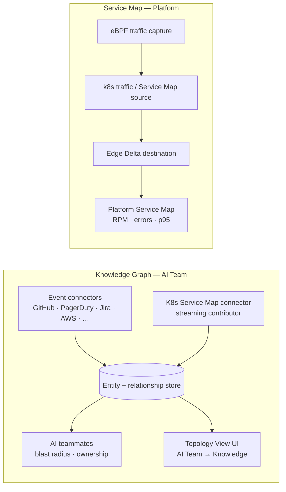
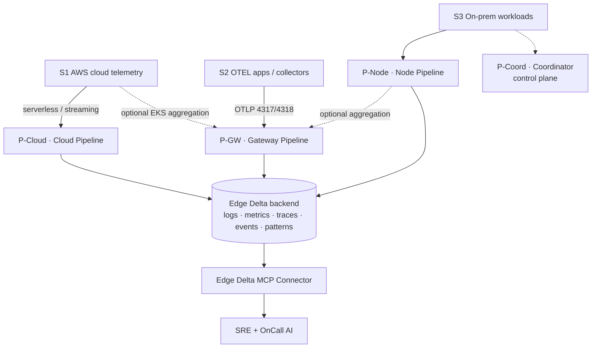
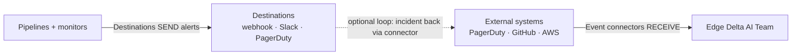
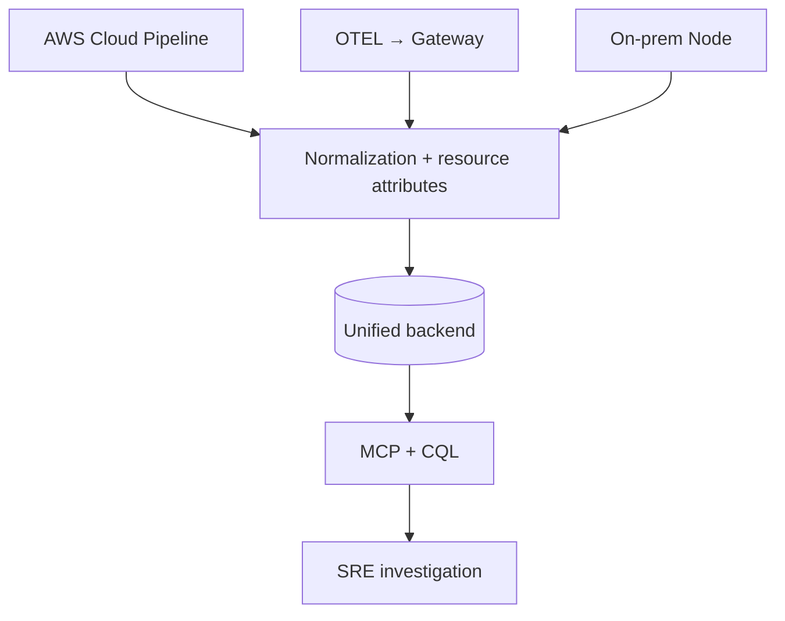
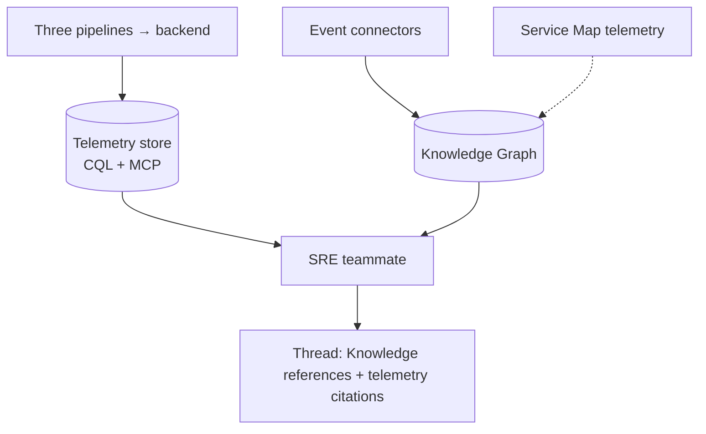

# Edge Delta concepts for Motadata / ObserveOps mapping

**What this file is:** A restructured research note that maps **Edge Delta** platform concepts to the language used in Motadata / ObserveOps (**E1–E11** stages, configuration-item thinking, RCA seed preparation). Source material was a long Q&A / chat dump; the technical content is preserved here in a readable order.

**What this file is not:** A decision to replace the Motadata build path with Edge Delta. Treat it as a **comparator map**. Canonical Motadata / Pillar B contracts stay under [`../../contracts/`](../../contracts/).

**Companion materials:**

| File | Role |
|------|------|
| [`ED to MD Mapping.md`](./ED%20to%20MD%20Mapping.md) | Earlier formatted mapping notes |
| [`../Mapping-ED-to-MD-README.md`](../../Mapping-ED-to-MD-README.md) | Index of ED→MD materials |
| [`docs/anomaly-detection.md`](../../../docs/anomaly-detection.md) | Pattern / metric anomaly deep dive |

**Editorial notes (this rewrite):**

- No substantive technical section was deleted.
- Conversational “pick a deliverable / POC checklist” menus were moved to [Appendix A](#appendix-a--research-chat-planning-menus-preserved) (not deleted).
- The identical **MCP `get_*_graph` tools** explanation appeared twice in the source; it is kept **once** in [§E5](#e5-mcp-graph-tools--time-series-charts-not-topology).

---

## Reading path

```text
Orient (Part A)
  → Multi-source SRE architecture (Part B)
  → Pipeline internals (Part C)
  → Telemetry model: events / signals / alerts (Part D)
  → Query, MCP, APIs, correlation (Part E)
  → Knowledge Graph deep dive (Part F)
  → CMDB / Motadata mapping notes (Part G)
  → Appendix A (planning menus) · Appendix B (links)
```

| Part | Question it answers |
|------|---------------------|
| [A · Orient](#part-a--orient) | What are ED’s two “graphs”? How does E1–E11 language map? |
| [B · Multi-source SRE](#part-b--multi-source-sre-architecture) | AWS + OTEL + on-prem → which pipelines? How does RCA run? |
| [C · Pipeline internals](#part-c--pipeline-internals) | Sources, processors, destinations, engine vs processors |
| [D · Telemetry model](#part-d--telemetry-data-model) | What is stored? Events vs signals vs alerts? |
| [E · Query & MCP](#part-e--query-mcp-and-apis) | CQL, MCP vs ingest, REST, correlation tags |
| [F · Knowledge Graph](#part-f--knowledge-graph-deep-dive) | Who consumes it? How does localization work? |
| [G · CMDB notes](#part-g--cmdb--motadata-mapping-notes) | No native CI binding — what are the options? |

---

## Part A — Orient

### A1. Two topology / “graph” capabilities

Edge Delta offers **two different** topology-related capabilities. Do not conflate them.



#### A1.1 Knowledge Graph (AI Team)

Automatic environment map that **AI teammates** use during investigations.

| Need | Detail |
|------|--------|
| Requirements | **Event connectors** (non-streaming, read-only tools): GitHub, GitLab, Slack, PagerDuty, Jira, Confluence, Notion, AWS, Grafana, Argo CD, Harness, … **plus** Kubernetes Service Map connector (the **only streaming connector** that contributes to the knowledge graph) |
| How it works | **Zero configuration** discovery starts ~3 minutes after connecting; **re-reconciles every 24 hours** |
| Entity types | Services, repositories, teams, channels, incidents, documents, cloud resources, people, … |
| Teammate uses | Trace dependencies · compute blast radius · assess criticality · find relationships · search entities |
| Human UI | Topology View (AI Team → Knowledge) — 3D “city of districts” |

#### A1.2 Service Map (Platform)

Visualizes **Kubernetes service-to-service communication**.

| Need | Detail |
|------|--------|
| Requirements | Agent **≥ 1.24.0**; pipeline with **Kubernetes Service Map source** (formerly `k8s_traffic_input`) linked to **Edge Delta destination** |
| Provides | Service interconnections; RPM; errors/min; P95 latency; error-rate coloring; link thickness; links to Traces Explorer / Logs |
| Technical | **eBPF** kernel capture; **resource-intensive**; metrics such as `k8s.traffic.communication.latency.p95`, `k8s.traffic.communication.count`; disable via Helm `tracerProps.enabled=false` |

#### A1.3 Side-by-side

| Feature | Knowledge Graph | Service Map |
|---------|-----------------|-------------|
| Purpose | AI teammate context for investigations | Service communication visualization |
| Scope | Multi-system (repos, teams, incidents, cloud, K8s services) | Kubernetes services only |
| Data source | Event connectors + K8s Service Map connector | eBPF network traffic |
| Configuration | Automatic from connectors | Specific pipeline nodes |
| Access | AI Team → Knowledge | Platform → Service Map |

**Docs:** Knowledge Graph · Service Map · Kubernetes Service Map Source · Connectors Overview (see [Appendix B](#appendix-b--documentation-references)).

---

### A2. Context lock for this research

Confirmed when this note was produced:

| Item | Status |
|------|--------|
| Internal pipeline stages **E1–E11** | In scope as Motadata / ObserveOps language |
| Internal design-doc terminology | In scope |
| Goal: understand Edge Delta architecture | Yes |
| Goal: map internal pipeline → Edge Delta | Yes |
| **CMDB correlation at ingest** | **Not required** for the mapping exercise |

---

### A3. Terminology mismatch: E1–E11 vs Edge Delta

Edge Delta’s real pipeline is **Sources → Processors → Destinations**, not an “E1 Collect / TelemetryEnvelope / ci_id” ingest contract.

| Your / Motadata term | Edge Delta equivalent | Notes |
|----------------------|----------------------|-------|
| E1 Collect (P1) | **Source nodes** | Configured per pipeline, not a single “E1” component |
| TelemetryEnvelope | No equivalent | OpenTelemetry-shaped data items (logs, metrics, traces) |
| ingest.v1 JSONL | No such format | OTLP, JSON, plain text, syslog, CEF, … |
| ci_id / ci_type | **Resource attributes** | OTEL semantic conventions (`service.name`, `k8s.pod.name`, …) |
| signal_class | No equivalent | Typed as log / metric / trace / event (and related) |
| CMDB / change / ticket at ingest | Not telemetry sources | Use **Connectors** (Jira, PagerDuty, …) for events |
| schema-version reject | Parser / processor errors | Format handled in processors, not a hard ingest schema gate |
| FR-K1 / AC | No ED equivalent | Internal requirement IDs |

**What the Motadata-style description often resembles:** ServiceNow Event Management / AIOps, Splunk ITSI, or a custom ITIL-centric pipeline — **not** Edge Delta’s native model.

```text
Edge Delta actual pipeline (corrected)

Sources  →  Processors  →  Destinations
  ↓            ↓              ↓
Collect      Transform      Route to:
telemetry    enrich         • Edge Delta Platform
(logs /      mask           • Third-party tools
 metrics /   filter         • Archives
 traces)     extract        • Alerts
```

---

### A4. Corrected collection → process → route flow

#### Phase 1 — Source collection (closest to “E1 Collect”)

**Component name in Edge Delta:** source nodes (not “E1 Collect”).

| Aspect | Detail |
|--------|--------|
| Purpose | Collect logs, metrics, traces, events from infrastructure |
| Trigger | Continuous streaming (not batch “ingestion”) |
| Inputs | File logs; Kubernetes API events / pod logs; OTLP 4317 gRPC / 4318 HTTP; syslog; HTTP POST; cloud streams (Kinesis, Pub/Sub, Kafka, Event Hub); security feeds (e.g. CrowdStrike FDR) |
| Wire formats | JSON, OTLP Protobuf, plain text, CEF, LEEF, syslog RFC — **not** ingest.v1 JSONL |
| Data shapes | Logs `{timestamp, body, attributes, resource, severity}` · Metrics `{name, value, timestamp, unit, kind, attributes}` · Traces `{trace_id, span_id, parent_span_id, attributes}` · Events `{event.type, event.domain, timestamp, attributes}` |

**Edge Delta does not have at source:** TelemetryEnvelope · ci_id/ci_type · signal_class enum · change_event/cmdb_sync/ticket reserved classes · schema-version validation at ingestion.

**Example — Kubernetes logs source**

```yaml
- type: kubernetes_logs   # illustrative; exact type names follow current ED docs
  include:
    - namespace: production
  exclude:
    - pod: "*-debug-*"
```

What happens:

1. Agent reads container / node logs.
2. Parses Kubernetes metadata (pod, namespace, container).
3. Adds **resource attributes** such as `k8s.pod.name`, `k8s.namespace.name`, `service.name`.
4. Emits an OpenTelemetry-shaped log record.

Still **no** ci_id, signal_class, TelemetryEnvelope, schema gate, or CMDB lookup at this stage.

#### Phase 2 — Processing (closest to “E2” enrichment)

Typical processor chain: Parse JSON → Add Field → Mask → Filter → Extract Metric → Pattern recognition (Drain) → Route.

Still **no native CMDB binding** — Edge Delta is not a CMDB system.

#### Phase 3 — Destination routing

Outputs may include: Edge Delta Platform · Splunk / Datadog / Elastic · SIEM · S3 / GCS archives · Slack / PagerDuty alerts. Encoding is destination-specific (HEC, OTLP, JSON, …).

---

## Part B — Multi-source SRE architecture

Enterprise starting point for this note:

1. **Completely cloud telemetry (AWS)** — Cloud Pipeline (agentless)  
2. **OTEL-based implementation** — Gateway Pipeline (recommended)  
3. **On-premise workloads** — Node Pipeline (agent-based)  

**End objective:** Edge Delta as **SRE companion for RCA**.

### B1. Architecture overview

Edge Delta combines **Telemetry Pipelines** (collect / process / route) with **AI Team** (investigation / RCA). Deploy **different pipeline types per source**; AI teammates query **all** indexed data for correlation.



**Legend:** solid = primary path · dashed = optional.

### B2. Component selection by data source

#### B2.1 AWS cloud telemetry

**Pipeline:** Cloud Pipeline (agentless) **or** Gateway (agent-based on EKS).

**Cloud Pipeline — serverless / streaming**

- AWS Lambda via Lambda Extension / **Lambda Forwarder**
- CloudWatch Logs via subscription filters + Forwarder
- Apply **CloudWatch Pack** / **Lambda Pack** for parsing
- HTTP/HTTPS/GRPCS endpoints; pull sources (HTTP Pull, S3, …)
- Compute units scale with traffic (~12 MB/s per unit in docs)
- Data to Edge Delta backend for AI analysis

**Gateway — agents in AWS for aggregation**

- Centralized aggregation; OTLP, application logs, cross-source correlation / dedup
- Official docs: Gateway / Coordinator are **Kubernetes** deployments; use **Node** on ECS/EC2 hosts

#### B2.2 OTEL-based implementation

**Pipeline:** **Gateway Pipeline (recommended)** — not Cloud as the primary design.

| Step | Action |
|------|--------|
| 1 | Deploy Gateway as centralized OTLP receiver |
| 2 | Configure **OTLP Connector** for AI Team streaming access |
| 3 | Add **otlp_input** — port **4317** (gRPC) or **4318** (HTTP) |
| 4 | Point OTEL Collectors / SDKs at Gateway |
| 5 | Gateway enables full-trace **tail sampling** and service-level aggregation |

**Why Gateway:** Direct Collectors → Gateway avoids unnecessary Node hops and preserves complete-trace context.

*(Docs also describe Cloud Pipeline OTLP endpoints for agentless cases; keep Gateway as the recommended enterprise path for this architecture.)*

#### B2.3 On-premise workloads

**Pipeline:** Node Pipeline per cluster / host.

| Environment | Pipelines | Collects |
|-------------|-----------|----------|
| Kubernetes | Node (DaemonSet) + **Coordinator** | Container logs, host metrics, K8s events, eBPF traces, service maps |
| Linux / VM | Linux Node agent | File logs, system metrics; direct destinations or via Gateway |

### B3. RCA and investigation layer

| Component | Role |
|-----------|------|
| **Edge Delta MCP Connector** | Required for teammates to search logs / patterns / metrics / traces / events / pipelines |
| **SRE teammate** | Autonomous investigation across sources |
| **Security Engineer** | Threat / compliance workflows |
| **Event connectors** | PagerDuty / Slack / Jira / GitHub triggers and collaboration |

**Typical RCA workflow**

1. Pipelines / monitors detect pattern anomalies or threshold breaches.  
2. SRE teammate searches logs (CQL), patterns, metrics, traces; builds a cited timeline.  
3. Humans review in channels.  
4. Actions (tickets, playbooks, pipeline changes) with **explicit approval**.

**Important:** When saying “search across three sources,” the teammate searches **three telemetry signal types** (logs, metrics, traces) that may have been ingested from AWS / OTEL / on-prem pipelines — not three isolated backends.

### B4. Coordinator vs Gateway (hierarchy)

| Pipeline | Role |
|----------|------|
| **Node** (DaemonSet) | Collect node-local data |
| **Coordinator** (same cluster/namespace) | Control plane: heartbeats, live features, leader election — **does not process telemetry** |
| **Gateway** (same or other cluster) | Aggregate / dedup / tail-sample / OTLP ingress |
| **Backend** | Index, explore, AI, monitors |

Coordinator is especially important for live capture on larger clusters (docs: required for live tail on clusters with **more than 20 nodes**).

### B5. Key architecture benefits

- Unified data plane queryable through one MCP connector  
- Edge processing reduces volume before egress  
- OTEL apps need no re-instrumentation  
- Mask / filter / sample before AI sees data  

---

## Part C — Pipeline internals

### C1. Destination types

| Type | Meaning | Examples |
|------|---------|----------|
| **Archive** | Buffered long-term storage | S3, GCS, Azure Blob; flush interval / max byte limit; gzip/zstd/snappy; JSON/Parquet |
| **Streaming** | Continuous to observability / SIEM | Elasticsearch, Splunk, Datadog, Kafka, HTTP/TCP |
| **Trigger** | Notifications when threshold nodes fire | Slack, Teams, PagerDuty, ServiceNow, webhooks — **signals**, not full log streams |

### C2. Processing engine vs processors

| Term | Analogy |
|------|---------|
| **Processing engine** | Agent runtime that executes the pipeline |
| **Processors** | Individual transforms (parse, extract metric, filter, enrich, …) |

Processors chain inside multiprocessor / sequence nodes and run in order.

### C3. Integrate Node + Coordinator + Gateway

See Edge Delta docs: *Integrate Edge Delta's Node, Coordinator, and Gateway Pipelines*. Node agents can send **directly** to the Edge Delta destination (`ed_output`) **or** via Gateway when aggregation is required. `ed_output` is a **destination node**, not a Gateway.

---

## Part D — Telemetry data model

### D1. How many telemetry types are stored?

Documentation commonly treats **five** core types collected / stored:

| Type | Notes |
|------|--------|
| **Logs** (often grouped with events in usage) | Primary search surface |
| **Metrics** | Explorers + MCP metric tools |
| **Traces** | Timeline / graphs |
| **Patterns** | Derived from logs (Drain signatures: count, proportion, sentiment, delta) |
| **Service Map** | K8s traffic topology metrics (distinct telemetry) |

Kubernetes connector materials explicitly mention collecting logs, metrics, traces, service map, and events. “Security signals” appear as enriched / analyzed metadata rather than a separate storage class in Trust Center language.

### D2. Events are not all the same

| Kind | Original or derived? | Source |
|------|----------------------|--------|
| **Kubernetes events** | Original | K8s API (`item.type=event`) |
| **Windows events** | Original | Windows Event Log API |
| **Event connector payloads** | Original external | PagerDuty, GitHub, AWS EventBridge, Slack, … |
| **Monitor events** | Derived | Platform monitors on metrics/logs |

### D3. Two separate flows: connectors vs destinations



| Flow | Purpose | Example |
|------|---------|---------|
| External → Edge Delta (**Event Connector**) | Trigger AI investigation of **external** events | PagerDuty incident → AI Team investigates logs/metrics |
| Edge Delta → External (**Destination**) | Alert others about **Edge Delta** findings | CPU spike / pattern anomaly → create PagerDuty incident |

You can combine them: Edge Delta alerts PagerDuty → PagerDuty connector fires → AI Team investigates.

### D4. Signals vs events vs alerts

| Term | Type | Generated by | Where |
|------|------|--------------|-------|
| **Event** | Data item | K8s / Windows / connectors / monitors | Infra + backend |
| **Signal** | Data item | **Threshold nodes** in pipelines | Edge (in pipeline) |
| **Alert** | State / concept | Monitor state (`OK` / `Warning` / `Alert` / `No Data`) or general “notification” language | Backend / human language |

Example **signal** shape:

```json
{
  "_type": "signal",
  "signal": {
    "title": "Threshold -threshold-checker triggered",
    "description": "error-logs-per-minute hit threshold",
    "signal_id": "111022",
    "name": "error-logs-per-minute",
    "value": 55,
    "threshold_condition": "value > 5"
  }
}
```

In Global Data Settings, a label **“Alerts”** may describe agent-detected threshold signals sent to the backend — the underlying data item is still a **signal**. Docs sometimes use “alert” and “signal” loosely for notifications.

### D5. Events available outside Kubernetes

| Environment | Infra events | Monitor events | Event connectors | Pipeline signals |
|-------------|--------------|----------------|------------------|------------------|
| Kubernetes | K8s events | Yes | Yes | Yes |
| Windows | Windows events | Yes | Yes | Yes |
| Linux (non-K8s) | — | Yes | Yes | Yes |
| macOS | — | Yes | Yes | Yes |

### D6. What the Edge Delta backend stores (inventory)

| Category | Contents |
|----------|----------|
| **Processed telemetry** | Logs, metrics, traces, events / security-related signals after pipeline processing |
| **Derived analytics** | Log patterns · anomalies · monitor/threshold outcomes · extracted / rolled-up stats |
| **Configuration / ops** | Pipeline configs · processor rules · control signals · heartbeats / agent health |
| **AI Team data** | Threads · findings · token / performance metrics · ratings |
| **Audit** | Config change trails · auth / access events |

**Customer control:** Mask / filter / encrypt in pipelines before egress.  
**AI training:** Trust Center language — customer telemetry is **not** used to train models; used for tenant-isolated inference / analysis.

---

## Part E — Query, MCP, and APIs

### E1. CQL = Common Query Language

**CQL** is Edge Delta’s **Common Query Language** (not “Context Query Language”). Unified search across explorers (logs, metrics, traces, K8s / monitor events, rehydrations).

```text
error
host.name:webserver AND k8s.namespace.name:production
@region:"us-west-2" AND @status_code > 399
error AND database
level:(error OR warn)
"connection failed" -timeout
statusCode:"*04"
ed.tag:"*prod*"
```

**CQL vs OTTL:** CQL is for **search in the UI / MCP**. Pipeline **filter processors** use **OTTL** (OpenTelemetry Transformation Language); convert CQL → OTTL when promoting a search into a pipeline filter.

### E2. MCP is not the telemetry ingest/output path

```text
Data plane:   Sources → Pipelines → Platform → Destinations
AI plane:     AI agents / teammates ↔ MCP Server ↔ REST API ↔ Platform data
```

| Path | Role |
|------|------|
| Sources / pipelines / destinations / ingestion HTTP | **Ingest and egress** telemetry |
| MCP (`…/mcp`) | **Query and manage** for AI clients |
| REST API (`api.edgedelta.com`) | Scripts / automation |

MCP tools such as `get_log_graph` / `get_metric_graph` are **MCP tools** that call REST under the hood — not the ingest API.

### E3. Why Edge Delta’s own AI teammates also use MCP

Intentional design:

1. **Same permission model** (Allow / Ask Permission, RBAC, audit) for internal and external agents  
2. **Separation of concerns** — AI Team orchestration is a separate plane from the telemetry backend  
3. **Protocol standardization** — same connectors (AWS, GitHub, …) for custom and built-in teammates  
4. **Security / audit** — one authenticated pathway  

From the platform’s perspective, ED teammates are **first-class MCP clients** that happen to be built by Edge Delta.

### E4. REST API categories (high level)

Examples under `https://api.edgedelta.com`:

| Area | Examples |
|------|----------|
| AI / explore | pattern stats, log search, events search, dashboards, metrics graph |
| Pipeline management | create / add_source / deploy / history |
| Access & users | RBAC, groups, invites |
| Integrations | endpoints, testing |
| Lookup tables | upload / manage |
| Rehydrations | historical replay |
| Agent configs | legacy |

**Knowledge Graph:** documentation reviewed for this note showed **no dedicated public REST endpoint** and **no MCP tool** for graph traversal. Access is **internal to AI teammates** + Topology View UI. (See Part F.)

### E5. MCP “graph” tools — time series charts, not topology

`get_log_graph`, `get_metric_graph`, `get_trace_graph`, `get_pattern_graph` mean **charts over time**, **not** the Knowledge Graph / Neo4j-style graphs.

| Tool | Returns |
|------|---------|
| `get_log_graph` | Bucketed log counts over time |
| `get_metric_graph` | Aggregated metric series (exact metric name) |
| `get_trace_graph` | Span counts or latency percentiles |
| `get_pattern_graph` | Pattern counts with volatility filters (`all` / `new` / `existing` / `gone`) |

| Tool family | Returns | Size | Use |
|-------------|---------|------|-----|
| Search (`get_log_search`, …) | Individual records | Large | Drill into evidence |
| Graph (`get_*_graph`) | Time buckets | Compact | Spot trends first |

AI agents typically **graph first**, then **search** the interesting window — keeps context windows small.

### E6. Unified backend storage — not four siloed products

Edge Delta uses a **unified backend** with **type-specific query surfaces** (Log Search, Metrics Explorer, traces, events). Infrastructure mentions include ClickHouse, S3 (compressed raw logs per org), and related cloud services. Usage pricing language often applies the same credit-per-GB idea across logs/metrics/traces.

This differs from “Elasticsearch + Prometheus + Jaeger” as three separate products you operate.

### E7. Normalization and correlation (smart tagging, not full rewrite)

**At the pipeline:** standardize toward **OpenTelemetry** (and **OCSF** for security data).

**Lightweight wrapper (not expensive full rewrite):** the **original message stays in `body`**; metadata is **added**:

```json
{
  "body": "<original log message unchanged>",
  "timestamp": "2024-01-15T10:30:00Z",
  "severity_text": "ERROR",
  "trace_id": "abc123...",
  "span_id": "xyz789...",
  "attributes": {
    "service.name": "payment-api",
    "environment": "production",
    "k8s.pod.name": "payment-api-7d9f8b-abc"
  },
  "resource": {
    "host.name": "node-1",
    "k8s.deployment.name": "payment-api",
    "container.id": "docker://abc123"
  }
}
```

**Automatic / enrichable correlation fields** (Datadog “tags” analogue): `host.name`, `service.name`, `ed.source.*`, Kubernetes attributes, cloud region/provider, custom fields via Add Field / OTTL, plus `trace_id` / `span_id` for logs↔traces.

**Best practices for three ingest paths**

1. Same `service.name` everywhere (AWS / OTEL / on-prem).  
2. Consistent `environment` / `region` / optional `data_source` tag.  
3. Trace context in OTEL apps.  
4. Enrich **at the edge** before storage.



---

## Part F — Knowledge Graph deep dive

### F1. Who consumes it?

| Consumer | Access | Use |
|----------|--------|-----|
| Edge Delta AI teammates | Built-in / internal | Investigation, impact, ownership |
| Humans | Topology View (read-only) | Explore environment |
| External AI agents | **None** via MCP/REST | — |
| Public REST / MCP tools | **None** documented | — |

**Value in investigations:** entity + neighbors · dependencies · blast radius · criticality · cross-entity search · “Knowledge references” citations in threads.

### F2. Compared with Datadog / Dynatrace

| Capability | Edge Delta | Datadog | Dynatrace |
|------------|------------|---------|-----------|
| Telemetry query engine | Backend + CQL | Husky | Grail |
| AI tool access | MCP tools | MCP / API | API |
| Topology / graph | Knowledge Graph (**internal**) | Service Catalog (API) | Smartscape (API) |
| Who queries topology? | ED teammates (+ UI) | API clients | API clients |

Husky/Grail ≈ **data lake / query engines**. ED Knowledge Graph ≈ **relationship / context layer on top of** telemetry — closer to a privileged AI context system than a public graph warehouse.

### F3. How teammates use the graph for localization (seed-like reasoning)

**Documented:** teammates query the graph during investigations and cite **Knowledge references**. Capabilities listed: find entity/neighbors, trace dependencies, blast radius, criticality, search.

**Not documented:** exact wire protocol (no MCP tool, no public REST). Likely **privileged internal API** and/or undocumented MCP **resources** (ED MCP already exposes some resources such as `services://list`, `facets://…`). Treat mechanism details as **inference until Edge Delta confirms**.

Illustrative localization flow (conceptual):

```text
1. Detect via telemetry MCP tools (logs/metrics/traces)
2. Resolve entity in Knowledge Graph (internal)
3. Neighborhood + blast radius + ownership + recent change context
4. Form investigation seed: suspect service · neighborhood · time window
5. Cite Knowledge references + telemetry evidence in the thread
```

**Implication for Motadata E7–E10 thinking:** graph-assisted **localize / seed** is a **native ED teammate advantage**, not something external MCP clients can fully copy today without building their own catalog.

### F4. Knowledge Graph entry vs backend telemetry entry

| Aspect | Backend storage | Knowledge Graph |
|--------|-----------------|-----------------|
| Data | Time-series telemetry | Entities + relationships |
| Updates | Continuous stream | Reconcile ~every 24h |
| Source | Streaming pipelines / connectors | Event connectors (+ Service Map as input for K8s) |
| Query | CQL via MCP | Internal teammate + Topology UI |
| Purpose | “Show errors for payment-api” | “What depends on payment-api?” |

**Conceptual KG entry** (illustrative):

```json
{
  "nodes": [
    {"id": "service:payment-api", "type": "Service", "criticality": 0.92},
    {"id": "repo:payment-service", "type": "Repository"},
    {"id": "team:platform", "type": "Team"}
  ],
  "relationships": [
    {"from": "service:payment-api", "to": "repo:payment-service", "type": "DEPLOYED_FROM"},
    {"from": "team:platform", "to": "service:payment-api", "type": "OWNS"},
    {"from": "service:payment-api", "to": "service:order-api", "type": "DEPENDS_ON"}
  ]
}
```

### F5. Why Service Map is stored telemetry but Knowledge Graph is not

| | Service Map | Knowledge Graph |
|--|-------------|-----------------|
| Nature | Continuous eBPF traffic telemetry + metrics | Discovery metadata / topology for AI |
| Pipeline | Flows through pipelines; usage/credits | Built from connector APIs; not a telemetry stream |
| Purpose | Who talks to whom **now** | Who owns what / depends on what / blast radius |
| Storage impact | Counts like other telemetry | Small vs continuous streams |

Service Map can be an **input** into Knowledge Graph for Kubernetes environments; they remain different products.

### F6. Combined RCA picture



---

## Part G — CMDB / Motadata mapping notes

Edge Delta **does not** natively bind telemetry to CMDB configuration items at ingest.

| Approach | What it does |
|----------|----------------|
| **Knowledge Graph** | Closest operational topology for AI — not a CMDB replacement |
| **Lookup processor** | Manually map `service.name` → `ci_id` from a lookup table |
| **External CMDB connector** | Teammate queries ServiceNow (or similar) **during analysis**, not at ingest |

Illustrative lookup (conceptual YAML):

```yaml
- type: lookup_processor
  lookup_table: cmdb_mapping
  source_field: attributes["service.name"]
  target_field: attributes["ci_id"]
  lookup_key: service_name
  lookup_value: cmdb_ci_id
```

For Motadata Pillar B, durable CI–CI topology and blast-radius **computed** edges remain a **separate** product concern from Edge Delta’s Knowledge Graph (see pillar-b `references/` Fusion / OneOps HTMLs and `contracts/`).

---

## Appendix A — Research-chat planning menus (preserved)

These were conversational “what next?” menus in the source dump. Kept for continuity; they are **not** Motadata ADRs.

### A-1. Deliverable options discussed

1. **Configuration templates** — YAML for E1→sources, E2→processors, E6→monitors, E7–E11→workflows  
2. **Gap analysis document** — stage coverage table + mitigations  
3. *(Option 3 was not present in the source dump.)*  
4. **ADR** — e.g. “Replace internal E1–E11 with Edge Delta” draft  
5. **Cost / TCO spreadsheet**  
6. **Risk register** — migration, wrong RCA, vendor outage, …

Illustrative gap sketch from the chat (directional, not a Motadata lock):

| Stage | Edge Delta | Coverage sketch | Action sketch |
|-------|------------|-----------------|---------------|
| E1 Collect | Source nodes | High | Config |
| E2 Identity | Processors | Medium–high | Lookups |
| E3 Topology | Knowledge Graph | Medium–high | Connectors / MCP |
| E4 Stores | Backend (+ archives) | High | Deploy |
| E5 Maintain | Platform | Medium | Webhooks / ops |
| E6 Detect | Monitors | High | Migrate rules |
| E7 Curate | AI teammates | Different model | Rethink vs native AI |
| E8–E11 | AI teammates | High if trusting AI Team | Channels / approvals |

### A-2. Follow-on “next step” menu

A. Ready-to-deploy configs · B. Day-1 POC commands · C. E7 approach (Composite Monitors vs custom service) · D. Replay past incidents · E. Stakeholder presentation  

### A-3. POC environment checklist (fields to fill)

- Kubernetes distro / version / size / namespaces  
- Telemetry volume (logs / metrics / traces)  
- Data sources checklist (pod logs, events, OTLP, files, syslog, streams, …)  
- Top E6 detection rules  
- One real E7 correlation scenario (signals, merge logic, case_seed fields)  
- Integrations (GitHub, Slack, PagerDuty, Jira, AWS, …)

---

## Appendix B — Documentation references

Search these titles on [docs.edgedelta.com](https://docs.edgedelta.com/) if a path renames:

| Topic |
|-------|
| Edge Delta Architecture |
| Knowledge Graph |
| Service Map / Kubernetes Service Map Source |
| Connectors Overview / Event Connectors / OTLP Connector |
| Cloud Pipelines / Installation Overview / Ingestion Pipelines |
| Integrate Node, Coordinator, and Gateway Pipelines |
| Edge Delta Destination / Processors Overview / Pipeline Triggers / Threshold Node |
| Common Query Language (CQL) / Logs Explorer |
| Edge Delta MCP Connector / MCP Server Tools |
| Data Locality for AI-Driven Investigations |
| Specialized Teammates / AI Team Overview / Getting Started with AI Team |
| Anomaly Detection / Pattern Anomaly Monitor / Metric monitors |
| Pipeline Settings / Usage Report / Trust Center / API Reference |
| Add Field Processor / Strengthening Security and Compliance |
| Federation with Gateway Pipelines / AI Team Use Cases |

---

*End of restructured note. Source: research chat consolidated into Parts A–G + appendices.*
