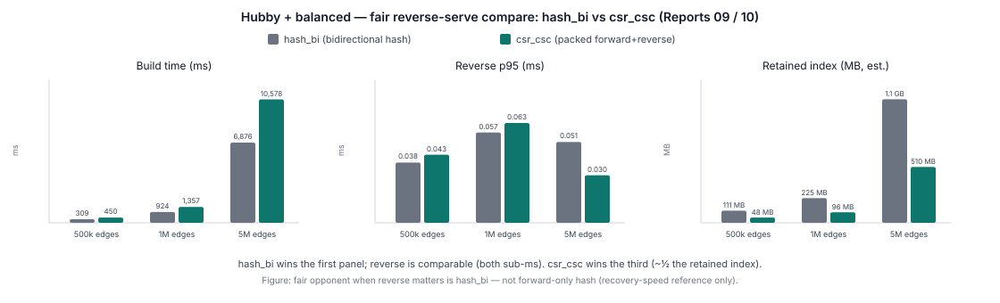

# Motadata map Vortex — engineering brief (cold readers)

**Audience:** engineers who did not sit through Design v3 chats and need a single shareable brief.  
**Date:** 2026-10-12 (updated pointers 2026-10-13)  
**Status:** Lab evidence through Design v3 Stage **4.2** (synthetic). Milestone A/B closed later — see **[Report 22](./22-program-one-stop.md)** for the current one-stop guide. **Not** a Motadata production architecture approval.  
**Owner path in repo:** `product/vortex-bench/`

If you need the **current** program close (Reports 01–21 + locked decisions), read **[Report 22](./22-program-one-stop.md)** instead. This page remains the Stage‑4.2-era brief. Deep dive: [Report 10](./10-design-v3-comprehensive.md). ADR after measurement: [Architecture Decision Record](./Map_Vortex_Graph_Architecture_Decision_Record.md).

---

## 1. Sixty-second takeaway

1. Motadata Scope does **not** open Vortex per neighbor hop. Product path is: load cold `.vortex` map parts → rebuild an in-memory **adjacency index** → walk that index.
2. On that path, **building the index dominates** decode and the first walk. Publishing edges in **clustered** order (source → edge type → target) and using a **sort-aware** builder remains the right packing default.
3. **Forward-only hash adjacency** rebuilds fastest but makes **reverse / blast-radius** queries slow (hundreds of milliseconds to seconds at multi-million edges).
4. If reverse walks matter, you need either **bidirectional hash (`hash_bi`)** or **packed forward+reverse arrays (CSR+CSC)**. Forward-only CSR is **not** enough.
5. In synthetic screens, `hash_bi` and CSR+CSC are similar on reverse latency; CSR+CSC usually keeps a **smaller retained index**; hash_bi usually **builds faster**.
6. Everything above is **synthetic**. Real Motadata estates, mutation rates, and SLOs are still required before locking GraphWriter.

---

## 2. Terms (defined once)

| Term | Meaning in this brief |
| ---- | --------------------- |
| **Vortex** | Columnar file format used for Motadata cold Dest parts. |
| **Cold → hot** | Decode Vortex map tables into process memory and build the walkable index. |
| **Spine load** | Decode only columns needed to rebuild walks (edge `source_id`, `target_id`, `edge_type`, and the matching node identity columns)—not every tag or evidence field. |
| **Clustered edges** | Edge rows written sorted by source, then edge type, then target (better rebuild locality). |
| **Natural edges** | Edge rows in generation order (control in labs; usually slower rebuild). |
| **Hash** | One forward map: source → list of `(target, edge_type)`. Reverse = scan everything. |
| **hash_bi** | Forward map **and** reverse map. |
| **CSR / CSC** | Packed adjacency arrays (forward / reverse). **CSR+CSC** means both directions packed. |
| **Hybrid** | CSR+CSC base plus a small mutable delta (inserts/deletes by occurrence count). |
| **Scope** | Motadata neighborhood walk over the **hot** index after rebuild (not per-hop Vortex I/O). |

Motadata **map schema columns stay locked**. This work changes packing and the hot index, not the logical tables.

---

## 3. What problem we are solving

Pillar B map already has a flat, locked schema (`map_nodes` / `map_edges`). The expensive product moment is **process start / failover / refresh**: load Dest Vortex parts and reconstruct adjacency so Scope can walk.

We are **not** redesigning nested map schemas. We are answering:

- Which **publish / load / build** choices make cold→hot fast enough?
- Which **hot index shapes** stay viable when queries include reverse walks?
- Where do layouts **cross over** under different graph shapes and query mixes?

---

## 4. What we measured (and what we did not)

### Measured (Design v3 Stages 0–4.2)

| Topic | Result location |
| ----- | --------------- |
| Clustered vs natural publish; naive vs sort-aware build | [Report 04](./04-design-v3-stage1-reproduce.md), [05](./05-design-v3-stage2-screen.md) |
| Fair compare of hash, hash_bi, CSR, CSR+CSC, hybrid (equal reverse mix) | [Report 07](./07-design-v3-stage3_5-fair.md) |
| Six synthetic graph families with structural validation | [Report 08](./08-design-v3-stage4_1-properties.md) |
| Same query traces replayed across layouts; workload profiles; ≤5M edges | [Report 09](./09-design-v3-stage4_2-screen.md) |
| End-to-end synthesis | [Report 10](./10-design-v3-comprehensive.md) |

Stage 4.2 coverage in plain words:

- **Full matrix** at 500k and 1M edges across six synthetic families and three experimental query mixes.
- **Thin 5M ladder** (uniform and hubby, balanced mix, five layouts) as a ceiling check—not a full 5M factorial.

Query mixes used in the lab (these are **scenarios**, not Motadata production estimates):

| Profile | Forward | Reverse | Dependency chain |
| ------- | ------: | ------: | ---------------: |
| Forward-dominant | 90% | 5% | 5% |
| Balanced | 45% | 45% | 10% |
| Reverse-heavy | 20% | 70% | 10% |

Seeds are chosen from out-degree percentiles among sources that have edges (`p10` / `p50` / `p90`). Reverse-heavy traces also include the highest-degree hub. The **same** trace file is replayed for every layout in a cell.

Coldness label: **`process_cold`** (fresh decode/build in-process). Operating-system page cache may still be warm. We did **not** measure drop-cache disk-cold or remote object-store cold.

### Not measured yet

- Real Motadata customer graphs or production query traces  
- Concurrent readers overlapping a rebuild  
- Mutation / lifecycle economics (Stage 4.2 ran hybrid with **zero churn**)  
- Disk-cold / remote-cold Dest paths  
- The proposed **segmented CSR+CSC** design in the Architecture Decision Record  

---

## 5. Engineering conclusions you can act on now

These are **lab-backed defaults for further Motadata GraphWriter design**, not a ship gate.

### 5.1 Publish and load (stable across Design v3)

| Choice | Guidance |
| ------ | -------- |
| Edge order at publish | Prefer **clustered** (`source_id` → `edge_type` → `target_id`). |
| Adjacency builder | Prefer **sort-aware** when edges are clustered. Do not claim sort-aware as a win on natural order. |
| Decode set for rebuild | Prefer **spine** columns for walk rebuild; defer tags / evidence until UI needs them. |
| Schema | **Do not** reopen map column redesign for layout performance. |

### 5.2 Why hash-style layouts rebuild faster, and how big the gap really is

**Same flaw as the old reverse-serve chart:** comparing `csr_csc` only to forward-only `hash` overstates the rebuild penalty of a usable bidirectional index, because forward-only `hash` skips the reverse index.

#### Two comparisons (keep them separate)

| Question | Fair opponent | What the gap means |
| -------- | ------------- | ------------------ |
| Fastest cold→ready when reverse share ≈ 0 | forward-only **`hash`** | Recovery-speed **reference** — least work per edge |
| Rebuild cost of a **bidirectional** serve index | **`hash_bi`** | Like-for-like gap for reverse-capable layouts |

#### Mechanism (no low-level profiling claimed)

1. **Forward-only `hash`:** one neighbor-list append per edge (outgoing only).  
2. **`hash_bi`:** that work twice — outgoing and incoming maps.  
3. **`csr_csc`:** packed forward and reverse arrays plus row/column offsets (more structured build, usually slower than `hash_bi`).

#### Build-time ladder (hubby × balanced, Stage 4.2 — Reports 09 / 10)

| Edges | `hash` build (ms) | `hash_bi` build (ms) | `csr_csc` build (ms) | `csr_csc` / `hash` | `csr_csc` / `hash_bi` |
| ----: | ----------------: | -------------------: | -------------------: | -----------------: | --------------------: |
| 500k | ~142 | ~309 | ~450 | ~3.2× | ~1.5× |
| 1M | ~407 | ~924 | ~1357 | ~3.3× | ~1.5× |
| 5M | ~2909 | ~6876 | ~10578 | ~3.6× | ~1.5× |

Ratios are from those report numbers (rounded). Under the Action 3 envelope (Report 14, 5M hubby `scope_policy_mixed` build p50): `csr_csc` ~11056 ms vs `hash_bi` ~5801 ms ≈ **1.9×**.

**Takeaway:** forward-only `hash` rebuilds fastest because it does the least work. Against `hash_bi`, the gap is real but much smaller (~1.5× in Stage 4.2 build, ~1.9× on the Report 14 5M cell). The lasting trade is **retained memory** (`csr_csc` ≈ half of `hash_bi`), not a 3×+ rebuild cliff versus a bidirectional layout.

#### Recovery (Report 15) — do not read ~3× as the bidirectional cost

Report 15’s headline ~3.1× (disk-cold T_ready: 450 vs 1203 ms at 1M; 3178 vs 9794 ms at 5M) is **forward-only `hash` vs `csr_csc`**. Build is only one phase of \(T_{\mathrm{ready}}\); the full-recovery gap versus `hash_bi` is smaller:

| Scale × coldness | `hash` T_ready p50 | `hash_bi` T_ready p50 | `csr_csc` T_ready p50 | `csr`/`hash` | `csr`/`hash_bi` |
| ---------------- | -----------------: | --------------------: | --------------------: | -----------: | --------------: |
| 1M disk_cold | 450 ms | **943 ms** | 1203 ms | ~2.7× | **~1.3×** |
| 5M disk_cold | 3178 ms | **6902 ms** | 9794 ms | ~3.1× | **~1.4×** |

Reference only: forward-only `hash` still wins absolute recovery speed. For a reverse-capable product path, quote the **`hash_bi`** column.

#### Mode selection (after the gaps above)

| Product mode | Lab envelope |
| ------------ | ------------ |
| Rebuild / failover first; Scope mostly **forward** | Forward-only **`hash`** (clustered + sort-aware) — recovery reference |
| Reverse / blast-radius walks are **common** | **`hash_bi` or `csr_csc`** — not forward-only hash or CSR-only |
| Retained index memory matters after build | Prefer **`csr_csc`** over `hash_bi` (~½ retained bytes) |
| In-place mutation without full packed rebuild | **Hybrid** candidate only; Stage 4.2 did **not** prove mutation economics |

### 5.3 Why `csr_csc` serves better when reverse traversal matters

**Fair opponent:** bidirectional hash (`hash_bi`), not forward-only `hash`.

Forward-only `hash` has **no reverse index**, so reverse walks scan the whole graph. Comparing `csr_csc` reverse latency to that cliff proves only that *some* reverse index is required — it does **not** explain why packed CSR+CSC beats bidirectional hash for serving. Keep `hash` as the **recovery-speed reference** (fastest rebuild); use `hash_bi` when arguing the serve choice under reverse load.

**Primary compare — hubby × balanced (Stage 4.2, Reports 09 / 10):**

| Edges | Layout | Build (ms) | Reverse p95 (ms) | Est. retained index |
| ----: | ------ | ---------: | ---------------: | ------------------: |
| 500k | hash_bi | ~309 | ~0.04 | ~111 MB |
| 500k | CSR+CSC | ~450 | ~0.04 | ~48 MB |
| 1M | hash_bi | ~924 | ~0.06 | ~225 MB |
| 1M | CSR+CSC | ~1357 | ~0.06 | ~96 MB |
| 5M | hash_bi | ~6876 | ~0.05 | ~1.1 GB |
| 5M | CSR+CSC | ~10578 | ~0.03 | ~510 MB |

Reading guide for this claim:

1. **Reverse:** `hash_bi` and `csr_csc` are both sub-millisecond — same class, not a latency cliff.
2. **Retained index:** `csr_csc` is ~½ of `hash_bi` at every rung — this is the main serve win.
3. **Build:** `hash_bi` rebuilds faster; that trade is acceptable when reverse share is material and memory matters.

**Sidebar — why forward-only `hash` is not the serve opponent**

| Edges | `hash` reverse p95 | `csr_csc` reverse p95 |
| ----: | -----------------: | --------------------: |
| 500k | ~244 ms | ~0.04 ms |
| 1M | ~706 ms | ~0.06 ms |
| 5M | ~3961 ms | ~0.03 ms |

That gap only shows that forward-only hash fails reverse Scope / blast-radius. It is the recovery-vs-serve trade-off, not the fair reverse-serve bake-off.

Full tables and other families: [Report 09](./09-design-v3-stage4_2-screen.md). Deep narrative: [Report 10](./10-design-v3-comprehensive.md) §3 Stage 4.2.

### 5.4 Correctness hygiene

Stage 4.2 screen cells reported walk checksum agreement versus forward hash with hybrid churn off. That checks **layout equivalence under the lab walk**, not full Motadata semantic completeness.

---

## 6. What leadership / ADR discussion proposed next (hypothesis only)

A separate Architecture Decision Record proposes moving toward:

- **Segmented** bidirectional adjacency (node-group chunks, not one monolithic CSR+CSC),  
- **Incremental copy-on-write** rebuild of affected groups,  
- **Atomic snapshot publish** so forward and reverse never disagree across groups,  
- Queries that **pin** one snapshot, with bounded reader lifetime before reclaim.

That proposal is a **design hypothesis**. It was **not** benchmarked in Stages 4.0–4.2. Conventional CSR+CSC numbers **do not transfer** automatically to a segmented implementation.

Open items in that ADR (correctly unresolved): visibility budget (seconds), durability/replay, partition thresholds, query timeout policy.

Read: [Architecture Decision Record (Markdown)](./Map_Vortex_Graph_Architecture_Decision_Record.md) · [Word copy](./Map_Vortex_Graph_Architecture_Decision_Record.docx).

---

## 7. What engineering should do next (decision-validation sprint)

Full program: [`../design-v3/decision-validation-sprint.md`](../design-v3/decision-validation-sprint.md).  
Milestone A **FROZEN** ([Report 17](./17-milestone-a-close.md)): serve baseline **`csr_csc`**; recovery reference **`hash`**. Milestone B / Action 6 **CLOSED** ([Report 21](./21-action6-milestone-b-close.md)): segmented CSR+CSC retained as a **conditional** candidate for localized mutations only; conventional `csr_csc` remains the serve path. Per-segment journals stay a separate hypothesis.

### Do

1. **Freeze** primary candidates to `hash` · `hash_bi` · `csr_csc` — no new layout variants in the primary matrix.  
2. Get Motadata to fill (or formally waive) success criteria: query mix, latency SLO, recovery budget, memory ceiling, freshness.  
3. Strengthen correctness beyond walk checksums, then run Milestone A (final compare, real cold→hot, concurrency/memory).  
4. Treat **clustered publish + sort-aware + spine load** as the default cold packing path.  
5. Keep synthetic profiles labeled **experimental** unless an approved Motadata envelope replaces them.

### Do not

1. Do **not** declare a production winner from Stage 4.2 alone.  
2. Do **not** expand the architecture zoo before Milestone A closes.  
3. Do **not** treat hybrid Stage 4.2 numbers as mutation proof (churn was off).  
4. Do **not** treat the segmented ADR as “Design v3 chose segmented CSR+CSC universally” — Report 21 retains it only for localized mutations.  
5. Do **not** reopen map schema nesting to chase cold→hot performance.

---

## 8. Suggested reading order for cold engineers

| Order | Doc | Why |
| ----: | --- | --- |
| 1 | **This brief** | Shared picture and boundaries |
| 2 | [Report 10](./10-design-v3-comprehensive.md) | What changed from Report 02 and full analysis |
| 3 | [Report 07](./07-design-v3-stage3_5-fair.md) | Fair layout + hash_bi (fixes Stage 3 confound); §5.3 reverse-serve bake-off uses hash_bi not hash |
| 4 | [Report 09](./09-design-v3-stage4_2-screen.md) | Workload screen and crossover list |
| 5 | [Architecture Decision Record](./Map_Vortex_Graph_Architecture_Decision_Record.md) | Next hypothesis to implement/bench |
| Optional | [Report 02](./02-map-load-adjacency.md) | Original cold→hot motivation |

Program contracts and exit gates: [`../design-v3/`](../design-v3/). Bench code and scripts: [`../map-vortex-bench/`](../map-vortex-bench/).

---

## 9. Bottom line for the engineering team

Motadata map performance work is about **cold→hot adjacency rebuild and the shape of the hot index**, not about redesigning locked Vortex map columns. Lab evidence through Milestone A supports **clustered publish**, **sort-aware build**, and a **mode-based** hot index: serve baseline **`csr_csc`**; recovery-speed reference **`hash`**. Milestone B measured segmented CSR+CSC under an approved synthetic mutation envelope: it is a **conditional** candidate for localized mutation publish windows, not a universal replacement, and not yet validated against measured Motadata churn.
