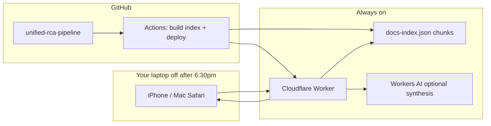

# Docs Ask — intelligent documentation search (24/7)

Ask questions about Unified-RCA documentation and get **answers with GitHub citations**. This service runs on **Cloudflare Workers**, so it stays available when your WSL laptop and local `:8765` dashboard are off. You can use it from **iPhone or Mac** in Safari (bookmark the Worker URL or add to Home Screen).

GitHub is the **source of truth**: every push to tracked doc paths rebuilds the search index and redeploys the Worker (see [`.github/workflows/docs-ask-deploy.yml`](../../.github/workflows/docs-ask-deploy.yml)).

## How it fits together



| Piece | Role |
|-------|------|
| **GitHub repo** | Stores `knowledge/`, `product/` contracts and docs |
| **Index builder** | `index/build_index.py` chunks markdown/HTML, emits citation URLs |
| **Worker** | Retrieval + `/api/ask` (Workers AI) + mobile UI |
| **Local `:8765`** | Unchanged — great on desk; not required for Docs Ask |

Citations point at **GitHub blob URLs** (branch set in `index/paths.yaml`), so links open on phone even without the docs hub.

## Live URL (already deployed)

**Open on iPhone / Mac:** [https://unified-rca-docs-ask.harshilshah25.workers.dev](https://unified-rca-docs-ask.harshilshah25.workers.dev)

Health: `https://unified-rca-docs-ask.harshilshah25.workers.dev/api/health`

## One-time setup (you or platform admin)

### 1. Cloudflare account (free tier is enough to start)

1. Create a [Cloudflare account](https://dash.cloudflare.com/sign-up).
2. Enable **Workers** and **Workers AI** on the account.
3. Create an API token with **Edit Cloudflare Workers** (and AI if prompted).  
   [Create token](https://dash.cloudflare.com/profile/api-tokens)

### 2. GitHub secrets

In `harshilshah2501/unified-rca-pipeline` → **Settings → Secrets and variables → Actions**:

| Secret | Value |
|--------|--------|
| `CLOUDFLARE_API_TOKEN` | Token from step 1 |
| `CLOUDFLARE_ACCOUNT_ID` | Cloudflare dashboard → Workers → right sidebar |

Push to `main` (or run **Actions → docs-ask deploy → Run workflow**). Note the deployed URL, e.g. `https://unified-rca-docs-ask.<your-subdomain>.workers.dev`.

### 3. Protect a private repo’s docs (recommended)

Your documentation may describe internal architecture. The Worker URL is **public** unless you add controls:

```bash
cd tools/docs-ask/worker
npx wrangler secret put DOCS_ASK_TOKEN
# enter a long random string; store in iPhone password manager
```

The web UI sends `X-Docs-Ask-Token`. Without the secret, `/api/ask` and `/api/search` stay open.

Optional: [Cloudflare Access](https://developers.cloudflare.com/cloudflare-one/policies/access/) in front of the Worker (Google/GitHub login) for team-wide access without sharing a token.

### 4. iPhone / Mac

- Open the Worker URL in Safari → **Share → Add to Home Screen** (iPhone).
- Save the access token once in the UI (stored in `localStorage` on that device only).

## Local development (laptop on)

```bash
# From repo root
pip install pyyaml
python3 tools/docs-ask/index/build_index.py

cd tools/docs-ask/worker
npm install
npx wrangler dev
# Open http://localhost:8787
```

## API

| Endpoint | Method | Body / query | Response |
|----------|--------|--------------|----------|
| `/api/health` | GET | — | `{ ok: true }` |
| `/api/search` | GET | `q=...`, optional `k=8`, `token=` | Ranked snippets + `cite_url` |
| `/api/ask` | POST | `{ "question": "..." }` | `answer`, `citations[]` |

## Index scope

Edit [`index/paths.yaml`](index/paths.yaml) to add or exclude paths. By default: `knowledge/**`, product contracts and pillar docs — not PoC `sample_estate`, not `eval/` dumps.

## Branch for citations

If you deploy from a long-lived branch, set `github.branch` in `paths.yaml` to match (e.g. `chore/pillar-b-graphwriter-api-rename`) so phone citations open the right files.

## What this is not

- Not a replacement for the full **docs hub** (`:8765`) interactive HTML — it answers from **text index** of markdown and teaching HTML.
- Not GitHub-only search — GitHub code search does not synthesize answers or rank by doc semantics the same way.

## Troubleshooting

| Symptom | Fix |
|---------|-----|
| Empty answers | Run workflow; confirm `docs-index.json` exists under `worker/public/` |
| 401 | Set token in UI or unset `DOCS_ASK_TOKEN` secret for testing |
| AI fallback text only | Workers AI not enabled on account; search-only still works |
| Wrong citation line | Rebuild index after doc edits; check `github.branch` |
